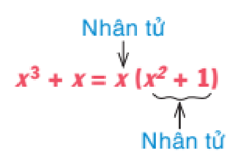
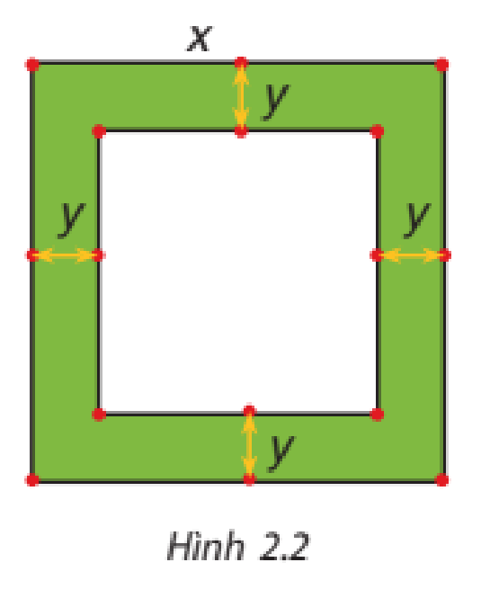

<!-- pdf:43 -->

# BÀI 9: PHÂN TÍCH ĐA THỨC THÀNH NHÂN TỬ

## 🔤 Khái niệm, thuật ngữ

- Phân tích đa thức thành nhân tử
- Đặt nhân tử chung
- Nhóm các hạng tử

## 🎯 Kiến thức, kĩ năng

- Nhận biết phân tích đa thức thành nhân tử.
- Mô tả ba cách phân tích đa thức thành nhân tử: Đặt nhân tử chung; Nhóm các hạng tử; Sử dụng hằng đẳng thức.

## 🔴 Mở đầu

> - **Tròn:** Tớ biết cách tìm được tất cả số $x$ để $2x^2 + x = 0$.
> - **Vuông:** Tròn làm thế nào nhỉ?
<!-- ocr-ok: đã đối chiếu ảnh trang PDF 43, hộp bóng thoại của Tròn và Vuông -->

## 1. PHÂN TÍCH ĐA THỨC THÀNH NHÂN TỬ BẰNG CÁCH ĐẶT NHÂN TỬ CHUNG

**Phân tích đa thức thành nhân tử**

**HĐ:** Hãy viết đa thức $x^2 - 2xy$ thành tích của các đa thức, khác đa thức là số.

> **Phân tích đa thức thành nhân tử** (hay **thừa số**) là biến đổi đa thức đó thành một tích của những đa thức.

**Ví dụ 1:** Phân tích các đa thức sau thành nhân tử:

a) $x^3 + x$;

b) $2(x + y) - 2y(x + y)$.

**Giải**

a) Ta có $x^3 + x = x \cdot x^2 + x = x(x^2 + 1)$.

b) $2(x + y) - 2y(x + y) = (2 - 2y)(x + y) = 2(1 - y)(x + y)$.

**Chú ý.** Cách làm như Ví dụ 1 gọi là **phân tích đa thức thành nhân tử bằng cách đặt nhân tử chung**.

**Luyện tập 1:** Phân tích các đa thức sau thành nhân tử:

a) $6y^3 + 2y$;

b) $4(x - y) - 3x(x - y)$.

<!-- pdf:44 -->

## 2. PHÂN TÍCH ĐA THỨC THÀNH NHÂN TỬ BẰNG CÁCH NHÓM CÁC HẠNG TỬ

Trong giờ học toán, cô giáo yêu cầu cả lớp phân tích đa thức sau thành nhân tử

$x^2 - xy - 2y + 2x.$

Hai bạn Nam và Hà đã làm như sau:

- **Nam:**
  $x^2 - xy - 2y + 2x$
  $= (x^2 - xy) + (2x - 2y)$
  $= x(x - y) + 2(x - y)$
  $= (x + 2)(x - y).$
- **Hà:**
  $x^2 - xy - 2y + 2x$
  $= (x^2 + 2x) - (xy + 2y)$
  $= x(x + 2) - y(x + 2)$
  $= (x - y)(x + 2).$

**Chú ý.** Cách làm như trên của hai bạn Nam và Hà được gọi là **phân tích đa thức thành nhân tử bằng cách nhóm hạng tử**. Đối với một đa thức có thể có nhiều cách nhóm những hạng tử thích hợp.

**Ví dụ 2:** Phân tích đa thức $xy + 3z + xz + 3y$ thành nhân tử.

**Giải**

$xy + 3z + xz + 3y = (xy + xz) + (3z + 3y) = x(y + z) + 3(z + y) = (x + 3)(y + z).$

Ta có thể phân tích bằng cách nhóm khác như sau:

$xy + 3z + xz + 3y = (xy + 3y) + (3z + xz) = (x + 3)y + (3 + x)z = (x + 3)(y + z).$

**Luyện tập 2:** Phân tích đa thức $2x^2 - 4xy + 2y - x$ thành nhân tử.

**Vận dụng 1:** Giải bài toán mở đầu bằng cách phân tích $2x^2 + x$ thành nhân tử.

## 3. PHÂN TÍCH ĐA THỨC THÀNH NHÂN TỬ BẰNG CÁCH SỬ DỤNG HẰNG ĐẲNG THỨC

**Ví dụ 3:** Phân tích các đa thức sau thành nhân tử:

a) $x^2 - 8x + 16$;

b) $x^2 - 3$;

c) $9x^2 + 12x + 4$;

d) $8x^3 - 27$.

**Giải**

a) $x^2 - 8x + 16 = x^2 - 2 \cdot x \cdot 4 + 4^2 = (x - 4)^2$.

b) $x^2 - 3 = x^2 - (\sqrt{3})^2 = (x - \sqrt{3})(x + \sqrt{3})$.

c) $9x^2 + 12x + 4 = (3x)^2 + 2 \cdot 3x \cdot 2 + 2^2 = (3x + 2)^2$.

d) $8x^3 - 27 = (2x)^3 - 3^3 = (2x - 3)(4x^2 + 6x + 9)$.

<!-- pdf:45 -->

**Chú ý.** Cách làm như ví dụ trên gọi là **phân tích đa thức thành nhân tử bằng cách sử dụng hằng đẳng thức**.

**Luyện tập 3:** Phân tích các đa thức sau thành nhân tử

a) $(x + 1)^2 - y^2$;

b) $x^3 + 3x^2 + 3x + 1$;

c) $8x^3 - 12x^2 + 6x - 1$.

**Tranh luận**

Phân tích $x^3 - x$ thành nhân tử.

> - **Vuông:** $x^3 - x = x(x^2 - 1)$
> - **Tròn:** $x^3 - x = x(x - 1)(x + 1)$

Em hãy nêu ý kiến của em về lời giải của Tròn và Vuông.

**Vận dụng 2:** Tính nhanh giá trị của biểu thức
<!-- ocr-ok: đã đối chiếu ảnh trang PDF 45, OCR đọc lỗi nhãn Vận dụng 2 và "Tính" thành "Tín" -->

$A = x^2 + 2y - 2x - xy$ tại $x = 2022$, $y = 2020$.

## BÀI TẬP

2.22. Phân tích các đa thức sau thành nhân tử:

a) $x^2 + xy$;

b) $6a^2b - 18ab$.

c) $x^3 - 4x$;

d) $x^4 - 8x$.

2.23. Phân tích các đa thức sau thành nhân tử:

a) $x^2 - 9 + xy + 3y$;

b) $x^2y + x^2 + xy - 1$.

2.24. Tìm $x$, biết:

a) $x^2 - 4x = 0$;

b) $2x^3 - 2x = 0$.

2.25. Một mảnh vườn hình vuông có độ dài cạnh bằng $x$ (mét). Người ta làm đường đi xung quanh mảnh vườn, có độ rộng như nhau và bằng $y$ (mét) (H.2.2).

a) Viết biểu thức tính diện tích $S$ của đường bao quanh mảnh vườn theo $x$ và $y$.

b) Phân tích $S$ thành nhân tử rồi tính $S$ khi $x = 102\text{ m}$, $y = 2\text{ m}$.

*Hình 2.2*

## 📷 Danh sách hình trong bài

| Mã hình | Trang PDF | Vị trí trong bài | Chú thích gốc |
| --- | :---: | --- | --- |
| H8-toan-b09-01 | 43 | Mục 1, Ví dụ 1 | (sách không đánh số, sơ đồ minh hoạ các nhân tử của $x^3 + x = x(x^2 + 1)$) |
| H8-toan-b09-02 | 44 | Mục 2 | (sách không đánh số, bài làm của hai bạn Nam và Hà) |
| H8-toan-b09-03 | 45 | Bài tập 2.25 | Hình 2.2 |
