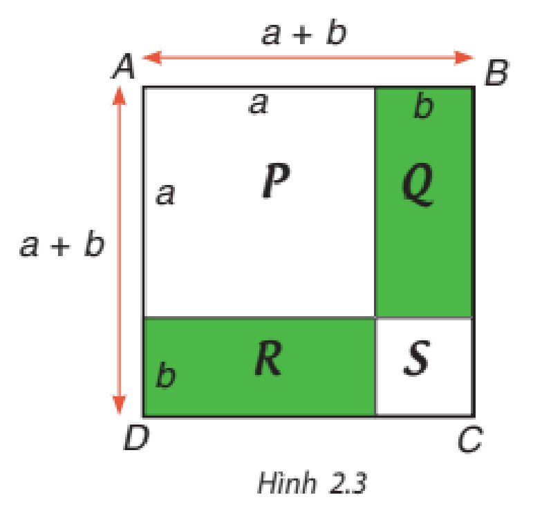

<!-- pdf:48 -->

# BÀI TẬP CUỐI CHƯƠNG II

## ✏️ A. TRẮC NGHIỆM

*Chọn phương án đúng trong mỗi câu sau:*

2.28. Đa thức $x^2 - 9x + 8$ được phân tích thành tích của hai đa thức

A. $x - 1$ và $x + 8$.

B. $x - 1$ và $x - 8$.

C. $x - 2$ và $x - 4$.

D. $x - 2$ và $x + 4$.

2.29. Khẳng định nào sau đây là đúng?

A. $(A - B)(A + B) = A^2 + 2AB + B^2$.

B. $(A + B)(A - B) = A^2 - 2AB + B^2$.

C. $(A + B)(A - B) = A^2 + B^2$.

D. $(A + B)(A - B) = A^2 - B^2$.

2.30. Biểu thức $25x^2 + 20xy + 4y^2$ viết dưới dạng bình phương của một tổng là:

A. $[5x + (-2y)]^2$.

B. $[2x + (-5y)]^2$.

C. $(2x + 5y)^2$.

D. $(5x + 2y)^2$.

2.31. Rút gọn biểu thức $A = (2x + 1)^3 - 6x(2x + 1)$ ta được

A. $x^3 + 8$.

B. $x^3 + 1$.

C. $8x^3 + 1$.

D. $8x^3 - 1$.

## ✏️ B. TỰ LUẬN

2.32. Tính nhanh giá trị của các biểu thức:

a) $x^2 - 4x + 4$ tại $x = 102$;

b) $x^3 + 3x^2 + 3x + 1$ tại $x = 999$.

2.33. Rút gọn các biểu thức:

a) $(2x - 5y)(2x + 5y) + (2x + 5y)^2$;

b) $(x + 2y)(x^2 - 2xy + 4y^2) + (2x - y)(4x^2 + 2xy + y^2)$.

2.34. Phân tích các đa thức sau thành nhân tử:

a) $6x^2 - 24y^2$;

b) $64x^3 - 27y^3$;

c) $x^4 - 2x^3 + x^2$;

d) $(x - y)^3 + 8y^3$.

2.35. Sử dụng Hình 2.3, bằng cách tính diện tích hình vuông $ABCD$ theo hai cách, hãy giải thích hằng đẳng thức $(a + b)^2 = a^2 + 2ab + b^2$.

*Hình 2.3*

## 📷 Danh sách hình trong bài

| Mã hình | Trang PDF | Vị trí trong bài | Chú thích gốc |
| --- | :---: | --- | --- |
| H8-toan-bt-c02-01 | 48 | Bài tập 2.35 | Hình 2.3 |
