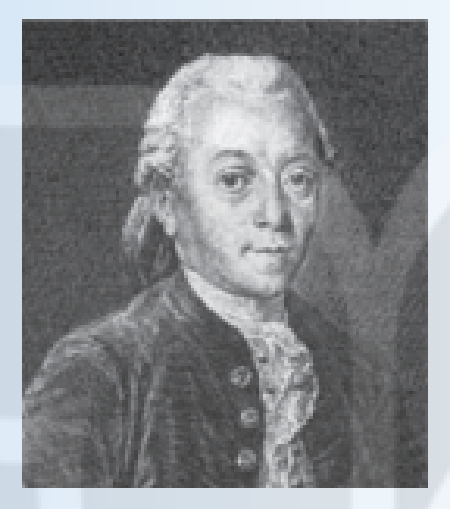

<!-- pdf:46 -->

# LUYỆN TẬP CHUNG (TRANG 45)

**Ví dụ 1:** Phân tích các đa thức sau thành nhân tử:

a) $x^2 - x + 2y - 4y^2$;

b) $3xy + 2z^2 - 6y - xz^2$.

**Giải**

a) $x^2 - x + 2y - 4y^2 = \left[x^2 - (2y)^2\right] - (x - 2y)$

$= (x - 2y)(x + 2y) - (x - 2y) = (x - 2y)(x + 2y - 1).$

b) $3xy + 2z^2 - 6y - xz^2 = (3xy - 6y) + (2z^2 - xz^2)$

$= 3y(x - 2) + z^2(2 - x) = 3y(x - 2) - z^2(x - 2) = (3y - z^2)(x - 2).$

**Ví dụ 2:** Phân tích các đa thức sau thành nhân tử:

a) $4x^2 - 4x + 1 - 4y^2$;

b) $8x^3 - 27y^3 - 27y^2 - 9y - 1$

**Giải**

a) $4x^2 - 4x + 1 - 4y^2 = (4x^2 - 4x + 1) - (2y)^2 = (2x - 1)^2 - (2y)^2$

$= (2x - 1 - 2y)(2x - 1 + 2y).$

b) $8x^3 - 27y^3 - 27y^2 - 9y - 1 = (2x)^3 - (27y^3 + 27y^2 + 9y + 1)$

$= (2x)^3 - (3y + 1)^3 = (2x - 3y - 1)\left[4x^2 + 2x(3y + 1) + (3y + 1)^2\right].$

**Ví dụ 3:** Phân tích các đa thức sau thành nhân tử:

a) $x^3 - x + 2y - 8y^3$;

b) $2x^3 - 8x^2 - 24x + 54$.

**Giải**

a) $x^3 - x + 2y - 8y^3 = (x^3 - 8y^3) - (x - 2y) = \left[x^3 - (2y)^3\right] - (x - 2y)$

$= (x - 2y)(x^2 + x \cdot 2y + 4y^2) - (x - 2y) = (x - 2y)(x^2 + 2xy + 4y^2 - 1).$

b) $2x^3 - 8x^2 - 24x + 54 = 2(x^3 - 4x^2 - 12x + 27) = 2\left[(x^3 + 27) - (4x^2 + 12x)\right]$

$= 2\left[(x^3 + 3^3) - 4x(x + 3)\right] = 2\left[(x + 3)(x^2 - 3x + 9) - 4x(x + 3)\right]$

$= 2(x + 3)(x^2 - 3x + 9 - 4x) = 2(x + 3)(x^2 - 7x + 9).$

<!-- pdf:47 -->

## BÀI TẬP

2.26. Phân tích các đa thức sau thành nhân tử:

a) $x^2 - 6x + 9 - y^2$

b) $4x^2 - y^2 + 4y - 4$.

c) $xy + z^2 + xz + yz$;

d) $x^2 - 4xy + 4y^2 + xz - 2yz$.

2.27. Phân tích các đa thức sau thành nhân tử:

a) $x^3 + y^3 + x + y$;

b) $x^3 - y^3 + x - y$.

c) $(x - y)^3 + (x + y)^3$.

d) $x^3 - 3x^2y + 3xy^2 - y^3 + y^2 - x^2$.

## 💡 Em có biết?

*Étienne Bézout (1730 – 1783) là nhà toán học người Pháp. Ông có nhiều công trình toán học nổi tiếng, đặc biệt là các công trình nghiên cứu về nghiệm của đa thức.*

**ĐỊNH LÍ BÉZOUT VÀ ỨNG DỤNG**

<!-- term: Định lí Bézout -->
Nếu đa thức $f(x)$ có nghiệm $x = a$ thì $f(x)$ có thể phân tích được thành tích $f(x) = (x - a)g(x)$ trong đó $g(x)$ là thương của phép chia đa thức $f(x)$ cho $x - a$.

Chẳng hạn, đa thức $2x^3 + x^2 - 3x - 14$ nhận $x = 2$ làm nghiệm và thương của phép chia $2x^3 + x^2 - 3x - 14$ cho $x - 2$ là $2x^2 + 5x + 7$ nên $2x^3 + x^2 - 3x - 14 = (x - 2)(2x^2 + 5x + 7)$.
<!-- ocr-ok: đã đối chiếu ảnh trang PDF 47, câu chứa nhiều đa thức trong LaTeX -->

Theo: *E. Bézout, “Théorie générale des équations algébriques”, Paris (1779)*
<!-- ocr-ok: đã đối chiếu ảnh trang PDF 47, tên tài liệu tiếng Pháp và năm 1779 bị OCR tiếng Việt đọc sai -->

## 📷 Danh sách hình trong bài

| Mã hình | Trang PDF | Vị trí trong bài | Chú thích gốc |
| --- | :---: | --- | --- |
| H8-toan-ltc-c02-02-01 | 47 | Em có biết? | (sách không đánh số, chân dung nhà toán học Étienne Bézout) |
