<!-- pdf:49 -->
<!-- Phần giới thiệu đầu Chương III (nửa trên trang PDF 49): HÌNH HỌC PHẲNG — CHƯƠNG III: TỨ GIÁC -->

Ở lớp 6, trong phần Hình học trực quan, ta đã làm quen với hình thang cân, hình bình hành, hình chữ nhật, hình thoi, hình vuông và các tính chất của chúng. Trong chương III, ta sẽ đưa ra định nghĩa và tìm hiểu các tính chất, dấu hiệu nhận biết các hình này.

# BÀI 10: TỨ GIÁC

## 🔤 Khái niệm, thuật ngữ

- Tứ giác, tứ giác lồi
- Đỉnh, cạnh, góc, đường chéo của tứ giác lồi

## 🎯 Kiến thức, kĩ năng

- Mô tả khái niệm tứ giác, tứ giác lồi.
- Giải thích định lí về tổng các góc trong một tứ giác lồi.

## 🔴 Mở đầu

Cắt bốn tứ giác như nhau bằng giấy rồi đánh số bốn góc của mỗi tứ giác như tứ giác $ABCD$ trong Hình 3.1a. Ghép bốn tứ giác giấy đó để được hình như Hình 3.1b.

- Em có thể ghép bốn tứ giác khít nhau như vậy không?
- Em có nhận xét gì về bốn góc tại điểm chung của bốn tứ giác? Hãy cho biết tổng số đo của bốn góc đó.
<!-- ocr-ok: đã đối chiếu trực tiếp ảnh trang PDF 49, OCR dính chữ câu hỏi tình huống mở đầu -->

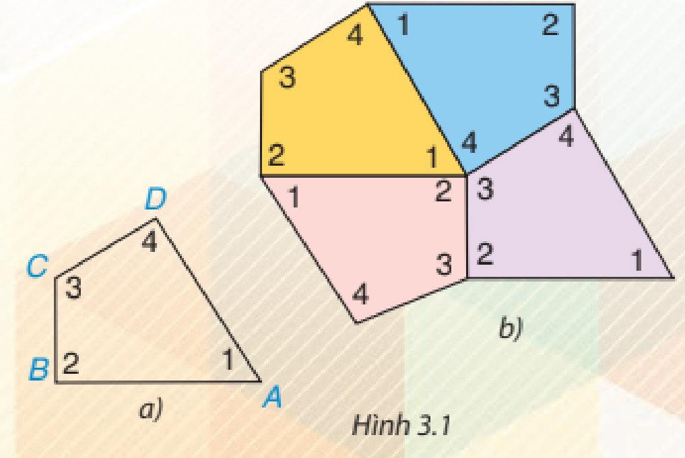
*Hình 3.1*

<!-- pdf:50 -->

## 1. TỨ GIÁC LỒI

**Tứ giác lồi và các yếu tố của nó**

Ta đã biết tam giác là hình gồm ba điểm không thẳng hàng và ba đoạn thẳng nối ba điểm đó.

- **Tứ giác** $ABCD$ là hình gồm bốn đoạn thẳng $AB, BC, CD, DA$ trong đó không có hai đoạn thẳng nào nằm trên cùng một đường thẳng.

Trên Hình 3.2, các hình a, b, c là tứ giác; hình d không phải là tứ giác.

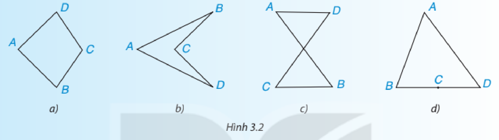
*Hình 3.2*

<!-- term: Đỉnh, cạnh, góc của tứ giác -->
Trong tứ giác $ABCD$, các điểm $A, B, C, D$ là các *đỉnh*; các đoạn thẳng $AB, BC, CD, DA$ là các *cạnh*.

- **Tứ giác lồi** là tứ giác mà hai đỉnh thuộc một cạnh bất kì luôn nằm về một phía của đường thẳng đi qua hai đỉnh còn lại.

Trong các tứ giác ở Hình 3.2a, b và c, chỉ có tứ giác ở Hình 3.2a là tứ giác lồi.

<!-- term: Đỉnh, cạnh, góc của tứ giác -->
- Trong tứ giác lồi $ABCD$, các góc $ABC, BCD, CDA$ và $DAB$ gọi là các góc của tứ giác. Kí hiệu đơn giản lần lượt là $\widehat{B}, \widehat{C}, \widehat{D}, \widehat{A}$.

**Chú ý**

- Từ nay, khi nói đến tứ giác mà không chú thích gì thêm, ta hiểu đó là tứ giác lồi.
- Tứ giác $ABCD$ trong Hình 3.2a còn được gọi tên là tứ giác $BCDA, CDAB, DABC, ADCB, DCBA, CBAD, BADC$.

> ❓ Cho bốn điểm $E, F, G, H$ (Hình 3.3). Kể tên một tứ giác có các đỉnh là bốn điểm đã cho.

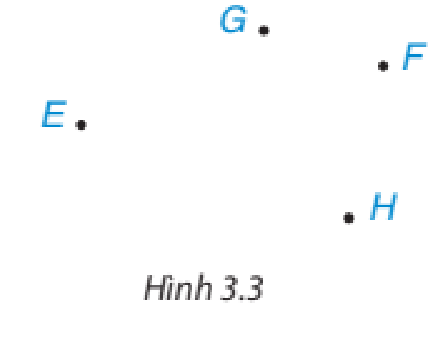
*Hình 3.3*

**Luyện tập 1:** Quan sát tứ giác $ABCD$ trong Hình 3.4.
<!-- ocr-ok: đã đối chiếu trực tiếp ảnh trang PDF 50, OCR đọc sai nhãn hộp Luyện tập 1 -->

- Hai đỉnh không cùng thuộc một cạnh gọi là **hai đỉnh đối nhau**. Đoạn thẳng nối hai đỉnh đối nhau là một **đường chéo**, chẳng hạn $AC$ là một đường chéo. Kể tên đường chéo còn lại.

<!-- pdf:51 -->

- Cặp cạnh $AB, CD$ là **cặp cạnh đối**. Chỉ ra cặp cạnh đối còn lại.
- Cặp góc $A, C$ là **cặp góc đối**. Hãy kể tên cặp góc đối còn lại.

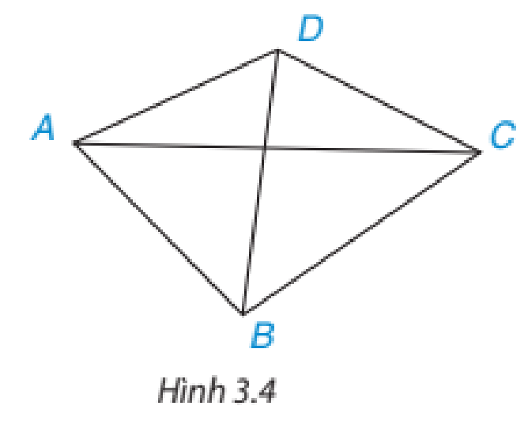
*Hình 3.4*

> **Vuông:** Trong tứ giác hai đường chéo cắt nhau tại một điểm nằm giữa mỗi đường.

## 2. TỔNG CÁC GÓC CỦA MỘT TỨ GIÁC

*Tổng các góc của một tứ giác*

**HĐ:** Cho tứ giác $ABCD$. Kẻ đường chéo $BD$ (H.3.5). Vận dụng định lí về tổng ba góc trong một tam giác đối với các tam giác $ABD$ và $CBD$, tính tổng $\widehat{A} + \widehat{B} + \widehat{C} + \widehat{D}$ của tứ giác $ABCD$.

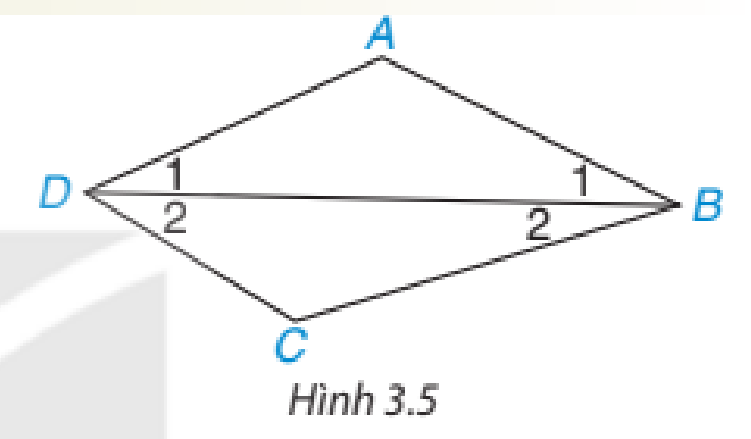
*Hình 3.5*

> **Tròn:** Nhớ rằng tổng ba góc trong một tam giác bằng $180^\circ$.

<!-- term: Tổng các góc của một tứ giác -->
> **Định lí:** Tổng các góc của một tứ giác bằng $360^\circ$.

**Ví dụ:** Cho tứ giác $ABCD$ như Hình 3.6. Hãy tính góc $D$.

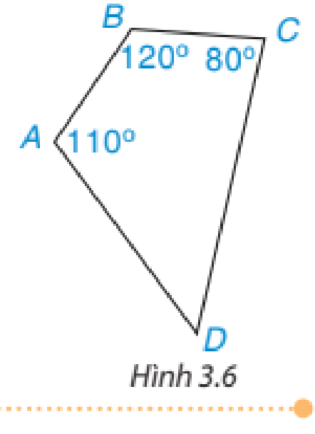
*Hình 3.6*

**Giải**

Theo định lí về tổng các góc của một tứ giác, ta có

$\widehat{A} + \widehat{B} + \widehat{C} + \widehat{D} = 360^\circ.$

Do đó $\widehat{D} = 360^\circ - (\widehat{A} + \widehat{B} + \widehat{C}) = 360^\circ - (110^\circ + 120^\circ + 80^\circ) = 50^\circ$.

Vậy $\widehat{D} = 50^\circ$.

**Luyện tập 2:** Cho tứ giác $EFGH$ như Hình 3.7.
<!-- ocr-ok: đã đối chiếu trực tiếp ảnh trang PDF 51, OCR đọc sai nhãn Luyện tập 2 và Hình 3.7 -->

Hãy tính góc $F$.

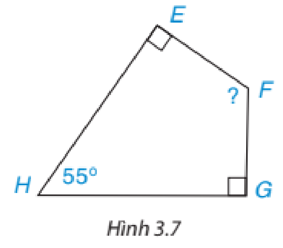
*Hình 3.7*

**Vận dụng:** Giải *bài toán mở đầu*.
<!-- ocr-ok: đã đối chiếu trực tiếp ảnh trang PDF 51, OCR đọc sai nhãn Vận dụng và dấu tiếng Việt -->

**Thử thách nhỏ**

Trong một tứ giác, hỏi số góc tù nhiều nhất là bao nhiêu và số góc nhọn nhiều nhất là bao nhiêu? Vì sao?

<!-- pdf:52 -->

## BÀI TẬP

3.1. Tính góc chưa biết của các tứ giác trong Hình 3.8.

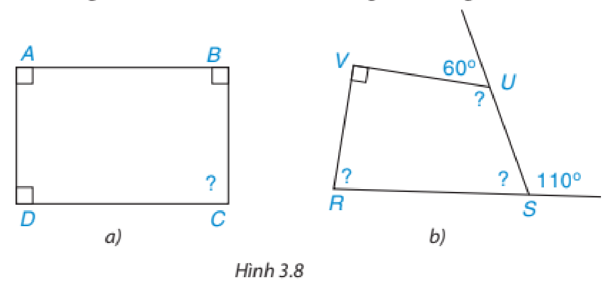
*Hình 3.8*

3.2. Tính góc chưa biết của tứ giác trong Hình 3.9.

Biết rằng $\widehat{H} = \widehat{E} + 10^\circ$.

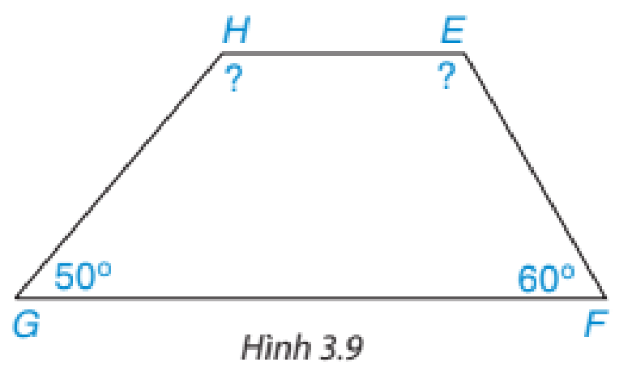
*Hình 3.9*

3.3. Tứ giác $ABCD$ trong Hình 3.10 có $AB = AD, CB = CD$, được gọi là hình “cái diều”.

a) Chứng minh rằng $AC$ là đường trung trực của đoạn thẳng $BD$.

b) Tính các góc $B, D$ biết rằng $\widehat{A} = 100^\circ, \widehat{C} = 60^\circ$.

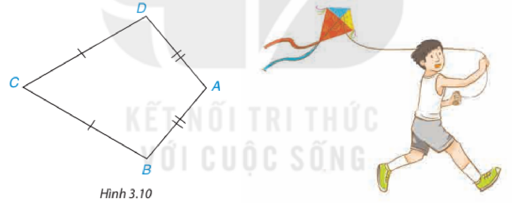
*Hình 3.10*

## 💡 Em có biết?

Ở lớp 6, đã giới thiệu cách lát nền phẳng bằng các viên gạch hình vuông. Cũng dễ thấy ta có thể lát bằng gạch hình chữ nhật, hình bình hành, hình thoi, hình thang. Hình bên mô tả một cách lát nền phẳng bằng những viên gạch hình tứ giác như nhau.

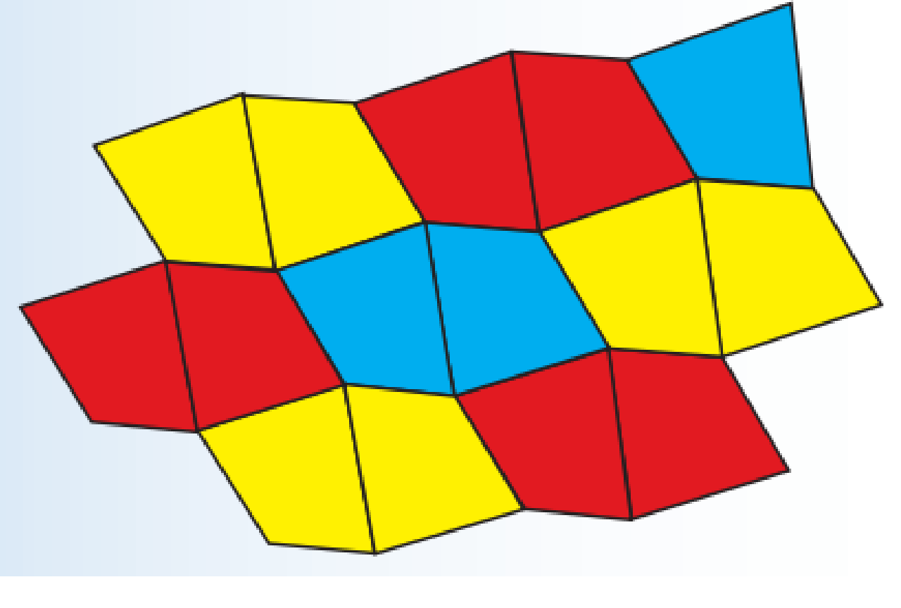

## 📷 Danh sách hình trong bài

| Mã hình | Trang PDF | Vị trí trong bài | Chú thích gốc |
| --- | :---: | --- | --- |
| H8-toan-b10-01 | 49 | Mở đầu (nằm trên mảng nền trang trí màu vàng góc dưới bên phải trang mở đầu Chương III) | Hình 3.1 |
| H8-toan-b10-02 | 50 | Mục 1 | Hình 3.2 |
| H8-toan-b10-03 | 50 | Mục 1, Câu hỏi | Hình 3.3 |
| H8-toan-b10-04 | 51 | Mục 1, Luyện tập 1 | Hình 3.4 |
| H8-toan-b10-05 | 51 | Mục 2, HĐ | Hình 3.5 |
| H8-toan-b10-06 | 51 | Mục 2, Ví dụ | Hình 3.6 |
| H8-toan-b10-07 | 51 | Mục 2, Luyện tập 2 | Hình 3.7 |
| H8-toan-b10-08 | 52 | Bài tập 3.1 | Hình 3.8 |
| H8-toan-b10-09 | 52 | Bài tập 3.2 | Hình 3.9 |
| H8-toan-b10-10 | 52 | Bài tập 3.3 | Hình 3.10 |
| H8-toan-b10-11 | 52 | Em có biết? | (sách không đánh số, lát nền phẳng bằng những viên gạch hình tứ giác như nhau) |
