<!-- pdf:53 -->

# BÀI 11: HÌNH THANG CÂN

## 🔤 Khái niệm, thuật ngữ

- Hình thang, hình thang cân
- Đường cao của hình thang
- Đường chéo của hình thang

## 🎯 Kiến thức, kĩ năng

- Mô tả khái niệm hình thang, hình thang cân và các yếu tố của chúng.
- Giải thích các tính chất về góc kề một đáy, cạnh bên và đường chéo của hình thang cân.
- Nhận biết dấu hiệu để một hình thang là hình thang cân.

## 🔴 Mở đầu

Cắt một mảnh giấy hình thang cân bằng một nhát cắt thẳng cắt cả hai cạnh đáy thì được hai hình thang. Lật một trong hai hình thang đó rồi ghép với hình thang còn lại dọc theo các cạnh bên của hình thang ban đầu (Hình 3.11). Hãy giải thích tại sao hình tạo thành cũng là một hình thang cân.

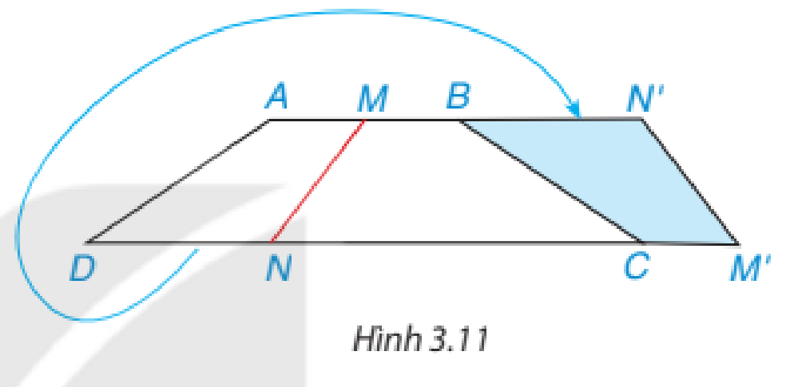
*Hình 3.11*

## 1. HÌNH THANG. HÌNH THANG CÂN

**Khái niệm hình thang và hình thang cân**

Trong bài này, ta sẽ xét tứ giác có hai cạnh đối song song.

> **Hình thang** là tứ giác có hai cạnh đối song song.

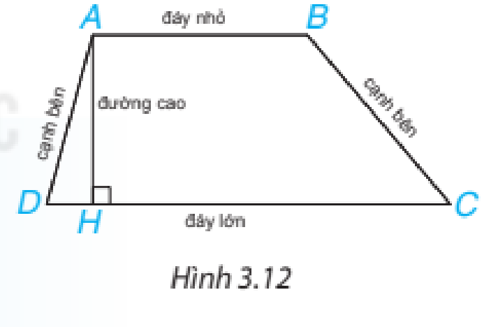
*Hình 3.12*

Trên Hình 3.12 là hình thang $ABCD$ ($AB \parallel CD$). Hai cạnh song song gọi là **hai đáy**, hai cạnh còn lại gọi là **hai cạnh bên** của hình thang. Đường vuông góc $AH$ kẻ từ $A$ đến $CD$ gọi là một **đường cao** của hình thang $ABCD$.

> **Hình thang cân** là hình thang có hai góc kề một đáy bằng nhau.

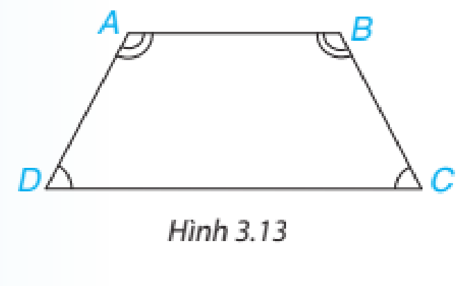
*Hình 3.13*

Trên Hình 3.13 là hình thang cân $ABCD$ ($AB \parallel CD$).

Hai góc $A, B$ kề đáy nhỏ $AB$, $\widehat{A} = \widehat{B}$.

Hai góc $C, D$ kề đáy lớn $CD$, $\widehat{C} = \widehat{D}$.

> **Pi:** Trong hình thang, hai góc kề một đáy bằng nhau thì hai góc kề đáy kia cũng bằng nhau.

<!-- pdf:54 -->

**Ví dụ 1**

Chứng minh rằng hai góc kề một cạnh bên của hình thang bù nhau.

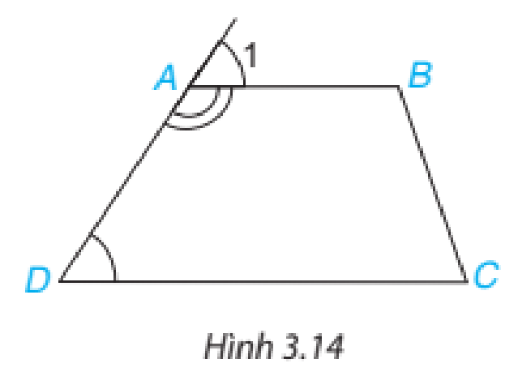
*Hình 3.14*

**Giải:** (H.3.14).

Vì $ABCD$ là hình thang ($AB \parallel CD$) nên $\widehat{D} = \widehat{A_1}$ (hai góc đồng vị).
<!-- ocr-ok: đã đối chiếu trực tiếp ảnh trang PDF 54, công thức kí hiệu góc khớp nguyên văn sách in -->

Do $\widehat{DAB} + \widehat{A_1} = 180^\circ$ (hai góc kề bù) suy ra $\widehat{D} + \widehat{DAB} = 180^\circ$.

**Luyện tập 1**

Tính các góc của hình thang cân $ABCD$ ($AB \parallel CD$), biết $\widehat{C} = 40^\circ$ (H.3.15).

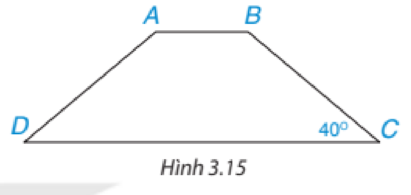
*Hình 3.15*

## 2. TÍNH CHẤT CỦA HÌNH THANG CÂN

**Tính chất về cạnh bên của hình thang cân**

**HĐ1:** Cho hình thang cân $ABCD$, $AB \parallel CD$ và $AB < CD$ (H.3.16).
<!-- ocr-ok: đã đối chiếu trực tiếp ảnh trang PDF 54, OCR đọc sai nhãn HĐ1 và (H.3.16) -->

a) Từ $A$ và $B$ kẻ $AH \perp DC, BI \perp DC, H \in CD, I \in CD$. Chứng minh rằng $AH = BI$ bằng cách chứng minh $\triangle AHI = \triangle IBA$.
<!-- ocr-ok: đã đối chiếu trực tiếp ảnh trang PDF 54, công thức hình học khớp nguyên văn sách in -->

b) Chứng minh $\triangle AHD = \triangle BIC$, từ đó suy ra $AD = BC$.

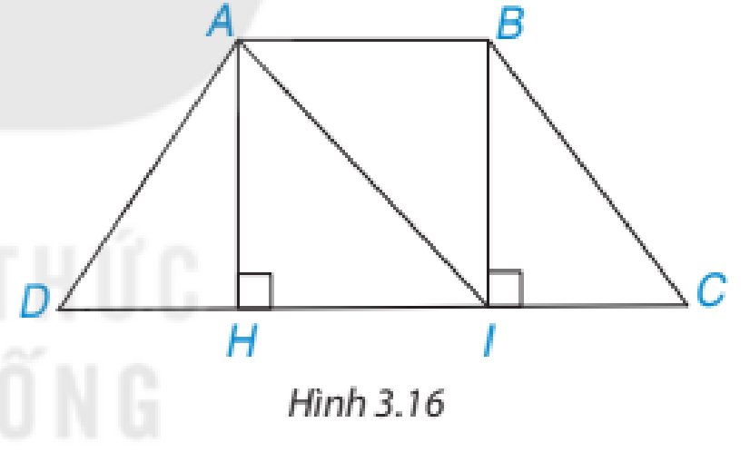
*Hình 3.16*

<!-- term: Tính chất của hình thang cân -->
> **Định lí 1:** Trong hình thang cân, hai cạnh bên bằng nhau.

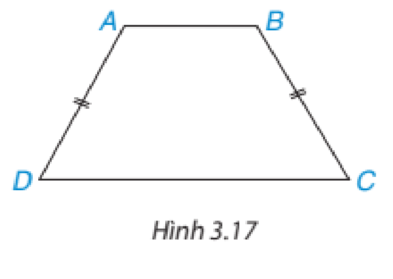
*Hình 3.17*

Cụ thể, hình thang cân $ABCD$ (H.3.17) có hai cạnh bên là $AD$ và $BC$ thì $AD = BC$.

**Luyện tập 2**

Cho tứ giác $ABCD$ như Hình 3.18.

Biết rằng $\widehat{A} = \widehat{B} = \widehat{D_1}$.

Chứng minh rằng $AD = BC$.

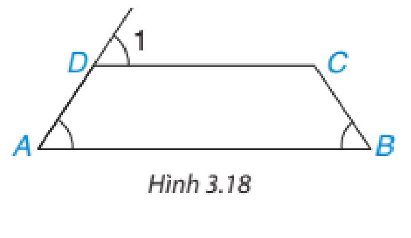
*Hình 3.18*

<!-- pdf:55 -->

**Tính chất về đường chéo của hình thang cân**

**HĐ2:** Cho hình thang cân $ABCD$, kẻ hai đường chéo $AC, BD$ (H.3.19). Hãy chứng minh $\triangle ACD = \triangle BDC$. Từ đó suy ra $AC = BD$.

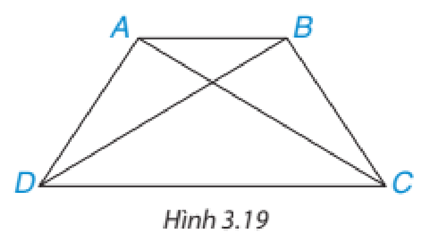
*Hình 3.19*

<!-- term: Tính chất của hình thang cân -->
> **Định lí 2:** Trong hình thang cân, hai đường chéo bằng nhau.

**Luyện tập 3**

Cho tam giác $ABC$ cân tại $A$. Kẻ một đường thẳng $d$ song song với $BC$, $d$ cắt cạnh $AB$ tại $D$ và cắt cạnh $AC$ tại $E$ (H.3.20).

a) Tứ giác $DECB$ là hình gì?

b) Chứng minh $BE = CD$.

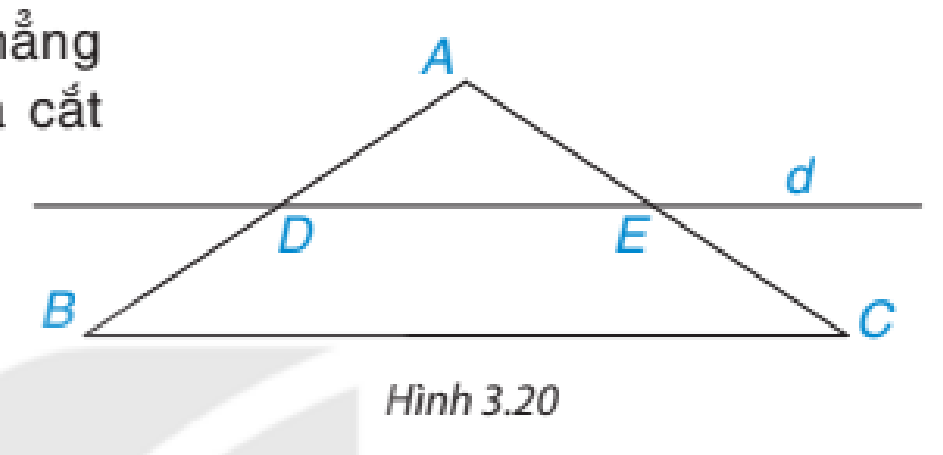
*Hình 3.20*

## 3. DẤU HIỆU NHẬN BIẾT

*Dấu hiệu nhận biết hình thang cân*

Định lí 2 cho ta biết nếu một hình thang là hình thang cân thì hai đường chéo của nó bằng nhau. Ngược lại, một hình thang có hai đường chéo bằng nhau có là hình thang cân không?

Người ta chứng minh được:

<!-- term: Dấu hiệu nhận biết hình thang cân -->
> **Định lí 3:** Nếu một hình thang có hai đường chéo bằng nhau thì hình thang đó là hình thang cân.

> **Vuông:** Định lí 3 là **định lí đảo** của Định lí 2. Giả thiết của định lí này là kết luận của định lí kia.

**Ví dụ 2**

Cho hình thang $ABCD$ ($AB \parallel CD$) có $\widehat{ACD} = \widehat{BDC}$. Chứng minh rằng $ABCD$ là hình thang cân.

**Giải:** (H.3.21)

| GT | Hình thang $ABCD, AB \parallel CD$, $\widehat{ACD} = \widehat{BDC}$. |
| --- | --- |
| KL | $ABCD$ là hình thang cân. |
<!-- ocr-ok: đã đối chiếu trực tiếp ảnh trang PDF 55, bảng GT/KL khớp nguyên văn sách in -->

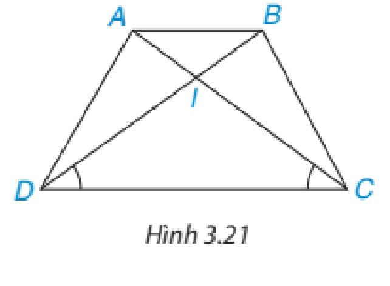
*Hình 3.21*

Hình thang $ABCD$ có hai đường chéo $AC$ và $BD$ cắt nhau tại $I$.

<!-- pdf:56 -->

Vì $AB \parallel CD$ nên $\widehat{BAC} = \widehat{ACD}, \widehat{ABD} = \widehat{BDC}$ (các cặp góc so le trong).

Mặt khác, $\widehat{ACD} = \widehat{BDC}$. Suy ra $\widehat{BAC} = \widehat{ACD} = \widehat{BDC} = \widehat{ABD}$.

Từ đó, tam giác $ICD$ và tam giác $IAB$ cùng cân tại $I$.

Vậy $IC = ID, IA = IB$, suy ra $AC = IA + IC = IB + ID = BD$.

Theo Định lí 3, hình thang $ABCD$ là hình thang cân.

**Thực hành:** (H.3.22)
<!-- ocr-ok: đã đối chiếu trực tiếp ảnh trang PDF 56, OCR đọc sai nhãn hộp Thực hành -->

a) Vẽ hình thang có hai đường chéo bằng nhau theo các bước sau:

- Vẽ hai đường thẳng song song $a, b$. Trên $a$ lấy hai điểm $A, B$.
- Vẽ hai cung tròn tâm $A$ và $B$ có cùng bán kính sao cho cung tròn tâm $A$ cắt $b$ tại $C$; cung tròn tâm $B$ cắt $b$ tại $D$ và hai đoạn thẳng $AC, BD$ cắt nhau. Hình thang $ABCD$ có hai đường chéo $AC$ và $BD$ bằng nhau.

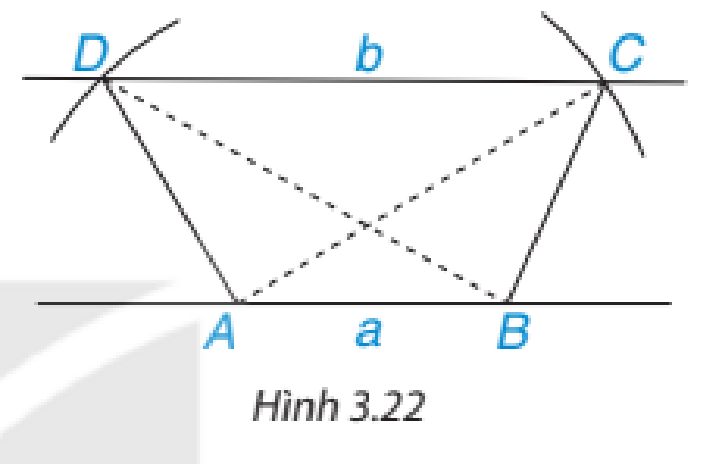
*Hình 3.22*

b) Hình thang $ABCD$ có là hình thang cân không? Vì sao?

**Vận dụng**

Hãy giải *bài toán mở đầu*.

## BÀI TẬP

3.4. Hình thang trong Hình 3.23 có là hình thang cân không? Vì sao?

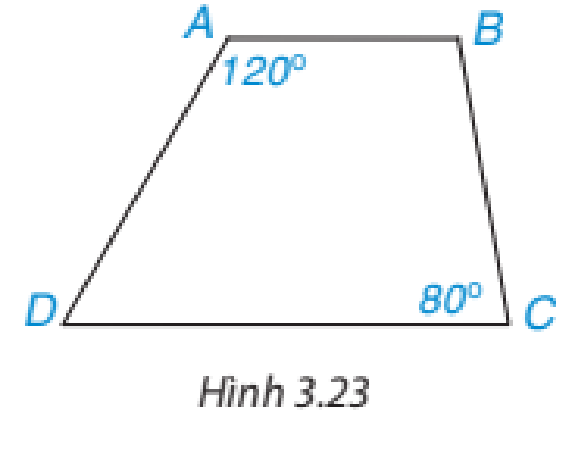
*Hình 3.23*

3.5. Cho hình thang $ABCD$ ($AB \parallel CD$). Kẻ đường thẳng vuông góc với $AC$ tại $C$ và đường thẳng vuông góc với $BD$ tại $D$, hai đường thẳng này cắt nhau tại $E$. Chứng minh rằng nếu $EC = ED$ thì hình thang $ABCD$ là hình thang cân.

3.6. Vẽ hình thang cân $ABCD$ ($AB \parallel CD$) biết đáy lớn $CD$ dài $4\text{ cm}$, cạnh bên dài $2\text{ cm}$ và đường chéo dài $3\text{ cm}$.

3.7. Hai tia phân giác của hai góc $A, B$ của hình thang cân $ABCD$ ($AB \parallel CD$) cắt nhau tại điểm $E$ trên cạnh đáy $CD$. Chứng minh rằng $EC = ED$.

3.8. Hình thang cân $ABCD$ ($AB \parallel CD$) có các đường thẳng $AD, BC$ cắt nhau tại $I$, các đường thẳng $AC, BD$ cắt nhau tại $J$. Chứng minh rằng đường thẳng $IJ$ là đường trung trực của đoạn thẳng $AB$.

## 📷 Danh sách hình trong bài

| Mã hình | Trang PDF | Vị trí trong bài | Chú thích gốc |
| --- | :---: | --- | --- |
| H8-toan-b11-01 | 53 | Mở đầu | Hình 3.11 |
| H8-toan-b11-02 | 53 | Mục 1 | Hình 3.12 |
| H8-toan-b11-03 | 53 | Mục 1 | Hình 3.13 |
| H8-toan-b11-04 | 54 | Mục 1, Ví dụ 1 | Hình 3.14 |
| H8-toan-b11-05 | 54 | Mục 1, Luyện tập 1 | Hình 3.15 |
| H8-toan-b11-06 | 54 | Mục 2, HĐ1 | Hình 3.16 |
| H8-toan-b11-07 | 54 | Mục 2, Định lí 1 | Hình 3.17 |
| H8-toan-b11-08 | 54 | Mục 2, Luyện tập 2 | Hình 3.18 |
| H8-toan-b11-09 | 55 | Mục 2, HĐ2 | Hình 3.19 |
| H8-toan-b11-10 | 55 | Mục 2, Luyện tập 3 (góc trên bên trái dính chữ 'thẳng', 'cắt' do đường thẳng $d$ và đỉnh $B$ vươn sang trái dưới dòng chữ) | Hình 3.20 |
| H8-toan-b11-11 | 55 | Mục 3, Ví dụ 2 | Hình 3.21 |
| H8-toan-b11-12 | 56 | Mục 3, Thực hành | Hình 3.22 |
| H8-toan-b11-13 | 56 | Bài tập 3.4 | Hình 3.23 |
