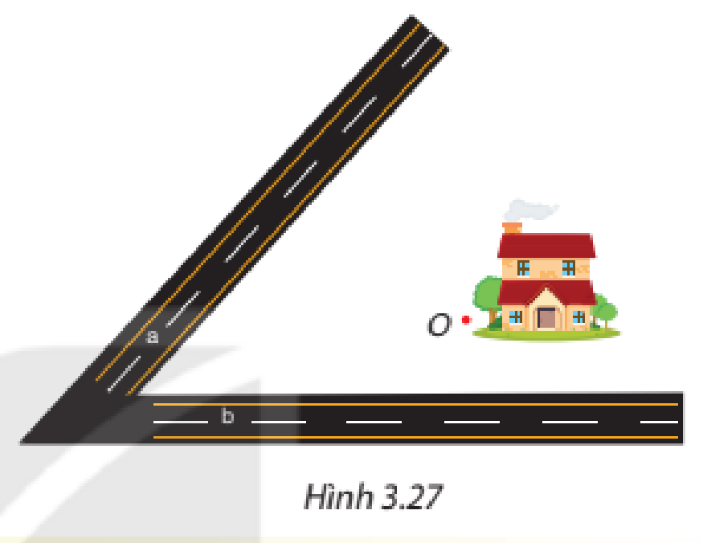
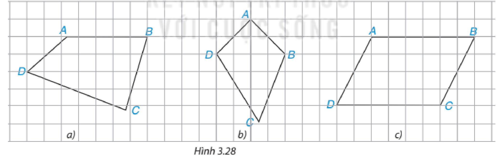
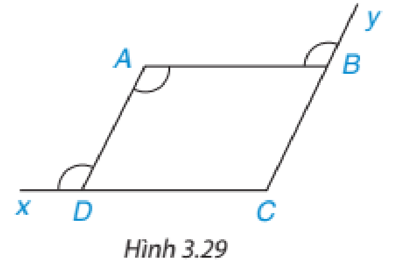
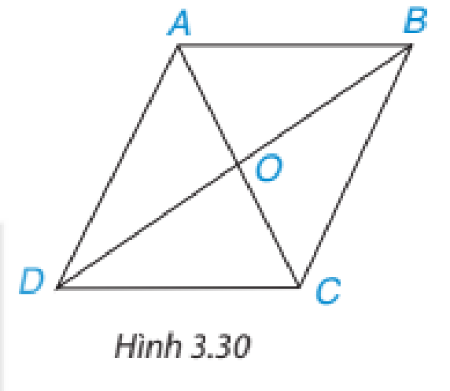
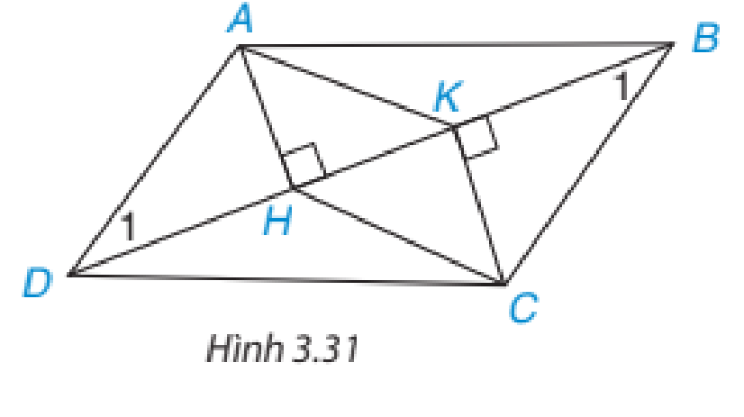
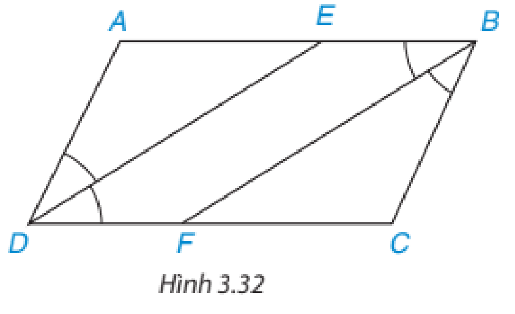
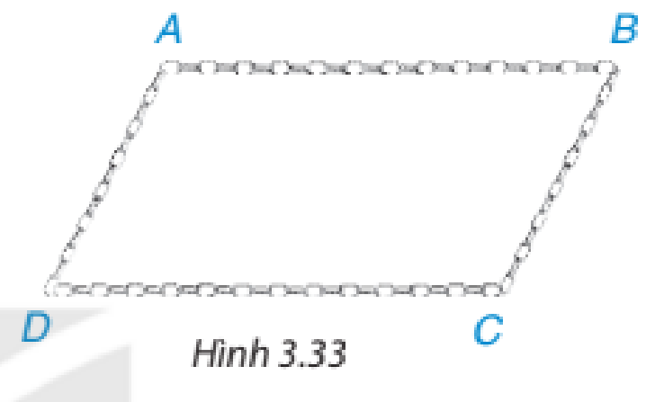
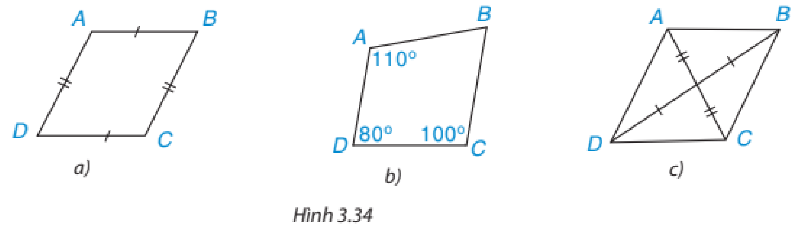
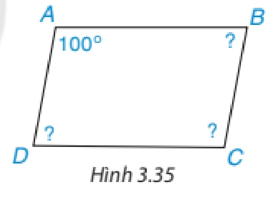
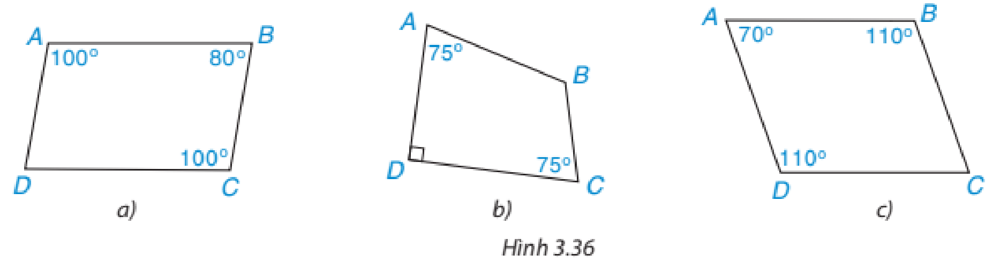

<!-- pdf:58 -->

# BÀI 12: HÌNH BÌNH HÀNH

## 🔤 Khái niệm, thuật ngữ

- Hình bình hành

## 🎯 Kiến thức, kĩ năng

- Mô tả khái niệm hình bình hành.
- Giải thích các tính chất của hình bình hành.
- Nhận biết dấu hiệu để một tứ giác là hình bình hành.

## 🔴 Mở đầu

Hai con đường lớn $a$ và $b$ cắt nhau tạo thành một góc. Bên trong góc đó có một điểm dân cư $O$. Phải mở một con đường thẳng đi qua $O$ như thế nào để theo con đường đó, hai đoạn đường từ điểm $O$ đến hai con đường $a$ và $b$ bằng nhau (các con đường đều là đường thẳng) (H.3.27)?

*Hình 3.27*

## 1. HÌNH BÌNH HÀNH VÀ TÍNH CHẤT

**Khái niệm hình bình hành**

**HĐ1:** Trong Hình 3.28, có một hình bình hành. Đó là hình nào? Em có thể giải thích tại sao không?

*Hình 3.28*

> **Hình bình hành** là tứ giác có các cạnh đối song song.

**Ví dụ 1**

Trong Hình 3.29, cho tứ giác $ABCD$ và ba góc bằng nhau. Tứ giác $ABCD$ có là hình bình hành không? Tại sao?

*Hình 3.29*

<!-- pdf:59 -->

**Giải**

Ta có $\widehat{xDA} = \widehat{DAB}$ và chúng ở vị trí so le trong nên $AB \parallel CD$.

Tương tự, $AD \parallel CB$.

Vậy theo định nghĩa, tứ giác $ABCD$ là hình bình hành.

**Thực hành 1:** Vẽ hình bình hành, biết hai cạnh liên tiếp bằng $3\text{ cm}, 4\text{ cm}$ và góc xen giữa hai cạnh đó bằng $60^\circ$. Hãy mô tả cách vẽ và giải thích tại sao hình vẽ được là hình bình hành.

*Tính chất của hình bình hành*

**HĐ2:** Hãy nêu các tính chất của hình bình hành mà em đã biết.

**HĐ3:** Cho hình bình hành $ABCD$ (H.3.30).

a) Chứng minh $\triangle ABC = \triangle CDA$.

Từ đó suy ra $AB = CD, AD = BC$ và $\widehat{ABC} = \widehat{CDA}$.

b) Chứng minh $\triangle ABD = \triangle CDB$. Từ đó suy ra $\widehat{DAB} = \widehat{BCD}$.

c) Gọi giao điểm của hai đường chéo $AC, BD$ là $O$.

Chứng minh $\triangle AOB = \triangle COD$. Từ đó suy ra $OA = OC, OB = OD$.

*Hình 3.30*

<!-- term: Tính chất của hình bình hành -->
> **Định lí 1:**
>
> Trong hình bình hành:
>
> a) Các cạnh đối bằng nhau;
>
> b) Các góc đối bằng nhau;
>
> c) Hai đường chéo cắt nhau tại trung điểm của mỗi đường.

| GT | $ABCD$ là hình bình hành; $O$ là giao điểm của $AC$ và $BD$. |
| --- | --- |
| KL | a) $AB = CD, AD = BC$; b) $\widehat{A} = \widehat{C}, \widehat{B} = \widehat{D}$; c) $OA = OC, OB = OD$. |
<!-- ocr-ok: đã đối chiếu trực tiếp ảnh trang PDF 59, bảng GT/KL khớp nguyên văn sách in -->

<!-- term: Tính chất của hình bình hành -->
**Nhận xét:** Dễ thấy trong một hình bình hành, hai góc kề một cạnh bất kì là hai góc bù nhau.

**Luyện tập 1:** Cho tam giác $ABC$. Từ một điểm $M$ tuỳ ý trên cạnh $BC$, kẻ đường thẳng song song với $AB$, cắt cạnh $AC$ tại $N$ và kẻ đường thẳng song song với $AC$, cắt cạnh $AB$ tại $P$. Gọi $I$ là trung điểm của đoạn $NP$. Chứng minh rằng $I$ cũng là trung điểm của đoạn thẳng $AM$.

<!-- pdf:60 -->

**Tranh luận**

- **Tròn:** Hình thang cân thì có hai cạnh bên bằng nhau. Ngược lại, hình thang có hai cạnh bên bằng nhau thì nó là hình thang cân.
- **Vuông:** Tròn sai rồi! Có trường hợp hình thang có hai cạnh bên bằng nhau nhưng nó lại là hình bình hành mà không phải là hình thang cân.

Theo em, bạn nào đúng? Vì sao?

## 2. DẤU HIỆU NHẬN BIẾT

**Dấu hiệu nhận biết hình bình hành theo cạnh**

Ta đã biết *hình bình hành* thì có các cạnh đối bằng nhau. Ngược lại, một tứ giác có các cạnh đối bằng nhau thì tứ giác đó có là hình bình hành không?

Ta có thể chứng minh được:

<!-- term: Dấu hiệu nhận biết hình bình hành -->
> **Định lí 2:**
>
> a) Tứ giác có các cạnh đối bằng nhau là một hình bình hành.
>
> b) Tứ giác có một cặp cạnh đối song song và bằng nhau là một hình bình hành.

> ❓ Hãy viết giả thiết, kết luận của Định lí 2.

**Ví dụ 2:** Cho hình bình hành $ABCD$. Từ $A, C$ kẻ $AH, CK$ cùng vuông góc với $BD$ (H.3.31).
<!-- ocr-ok: đã đối chiếu trực tiếp ảnh trang PDF 60, OCR đọc sai nhãn Ví dụ 2 -->

Chứng minh tứ giác $AHCK$ là hình bình hành.

*Hình 3.31*

**Giải**

| GT | $ABCD$ là hình bình hành; $AH \perp BD, CK \perp BD$. |
| --- | --- |
| KL | $AHCK$ là hình bình hành. |

Theo giả thiết $ABCD$ là hình bình hành nên $AD \parallel BC$ và $AD = BC$, suy ra $\widehat{D_1} = \widehat{B_1}$ (hai góc so le trong).

Hai tam giác vuông $AHD$ và $CKB$ có: $AD = BC, \widehat{D_1} = \widehat{B_1}$ (chứng minh trên).
<!-- ocr-ok: đã đối chiếu trực tiếp ảnh trang PDF 60, OCR đọc nhầm chứng minh thành chúng minh -->

Vậy hai tam giác vuông $AHD$ và $CKB$ bằng nhau (cạnh huyền – góc nhọn).

Do đó $AH = CK$. Mặt khác, $AH$ và $CK$ cùng vuông góc với $BD$ nên $AH \parallel CK$.
<!-- ocr-ok: đã đối chiếu trực tiếp ảnh trang PDF 60, công thức khớp nguyên văn sách in -->

<!-- pdf:61 -->

Tứ giác $AHCK$ có cặp cạnh đối $AH, CK$ song song và bằng nhau nên theo Định lí 2, $AHCK$ là hình bình hành.

**Luyện tập 2:** Cho hình bình hành $ABCD$ ($AB > BC$). Tia phân giác của góc $D$ cắt $AB$ tại $E$ và tia phân giác của góc $B$ cắt $CD$ tại $F$ (H.3.32).
<!-- ocr-ok: đã đối chiếu trực tiếp ảnh trang PDF 61, OCR đọc sai nhãn Luyện tập 2 và chữ tia -->

a) Chứng minh hai tam giác $ADE$ và $CBF$ là những tam giác cân, bằng nhau.

b) Tứ giác $DEBF$ là hình gì? Tại sao?

*Hình 3.32*

**Thực hành 2:** Chia một sợi dây xích thành bốn đoạn: hai đoạn dài bằng nhau, hai đoạn ngắn bằng nhau và đoạn dài, đoạn ngắn xen kẽ nhau. Hỏi khi móc hai đầu mút của sợi dây xích đó lại để được một tứ giác $ABCD$ (có các đỉnh tại các điểm chia) như Hình 3.33 thì tứ giác $ABCD$ là hình gì? Tại sao?

*Hình 3.33*

**Dấu hiệu nhận biết hình bình hành theo góc và đường chéo**

Ta biết hình bình hành thì có các góc đối bằng nhau và hai đường chéo cắt nhau tại trung điểm của mỗi đường. Ngược lại, một tứ giác có các góc đối bằng nhau hoặc có hai đường chéo cắt nhau tại trung điểm của mỗi đường thì tứ giác đó có là hình bình hành không?

Ta có thể chứng minh được:

<!-- term: Dấu hiệu nhận biết hình bình hành -->
> **Định lí 3:**
>
> a) Tứ giác có các góc đối bằng nhau là một hình bình hành.
>
> b) Tứ giác có hai đường chéo cắt nhau tại trung điểm của mỗi đường là một hình bình hành.

> ❓ Hãy viết giả thiết, kết luận của Định lí 3.

**Ví dụ 3:** Trong ba tứ giác dưới đây, tứ giác nào là hình bình hành, tứ giác nào không là hình bình hành? Vì sao?

*Hình 3.34*

<!-- pdf:62 -->

**Giải**

Tứ giác trong Hình 3.34a là hình bình hành (theo Định lí 2a).

Tứ giác trong Hình 3.34c là hình bình hành (theo Định lí 3b).

Tứ giác trong Hình 3.34b không là hình bình hành vì có hai góc đối $A, C$ không bằng nhau.

**Luyện tập 3:** Cho hai điểm $A, B$ phân biệt và điểm $O$ không nằm trên đường thẳng $AB$. Gọi $A', B'$ là các điểm sao cho $O$ là trung điểm của $AA', BB'$. Chứng minh rằng $A'B' = AB$ và đường thẳng $A'B'$ song song với đường thẳng $AB$.

**Vận dụng:** Trở lại *bài toán mở đầu*. Em hãy vẽ hình và nêu cách vẽ con đường cần mở đi qua $O$ sao cho theo con đường đó, hai đoạn đường từ $O$ tới $a$ và tới $b$ bằng nhau.

> **Pi:** Con đường cần mở là đường chéo của hình bình hành có hai cạnh liên tiếp nằm trên hai con đường $a$ và $b$.

## BÀI TẬP

3.13. Trong các khẳng định sau, khẳng định nào đúng, khẳng định nào sai? Vì sao?

a) Hình thang có hai cạnh bên song song là hình bình hành.

b) Hình thang có hai cạnh bên bằng nhau là hình bình hành.

c) Tứ giác có hai cạnh đối nào cũng song song là hình bình hành.

3.14. Tính các góc còn lại của hình bình hành $ABCD$ trong Hình 3.35.

*Hình 3.35*

3.15. Cho hình bình hành $ABCD$. Gọi $E, F$ lần lượt là trung điểm của các cạnh $AB, CD$. Chứng minh $BF = DE$.

3.16. Trong mỗi trường hợp sau đây, tứ giác nào là hình bình hành, tứ giác nào không là hình bình hành? Vì sao?

*Hình 3.36*

3.17. Cho hình bình hành $ABCD$. Gọi $E, F$ lần lượt là trung điểm của các cạnh $AB, CD$. Chứng minh rằng:

a) Hai tứ giác $AEFD, AECF$ là những hình bình hành;

b) $EF = AD, AF = EC$.

3.18. Gọi $O$ là giao điểm của hai đường chéo của hình bình hành $ABCD$. Một đường thẳng đi qua $O$ lần lượt cắt các cạnh $AB, CD$ của hình bình hành tại hai điểm $M, N$. Chứng minh $\triangle OAM = \triangle OCN$. Từ đó suy ra tứ giác $MBND$ là hình bình hành.

## 📷 Danh sách hình trong bài

| Mã hình | Trang PDF | Vị trí trong bài | Chú thích gốc |
| --- | :---: | --- | --- |
| H8-toan-b12-01 | 58 | Mở đầu | Hình 3.27 |
| H8-toan-b12-02 | 58 | Mục 1, HĐ1 | Hình 3.28 |
| H8-toan-b12-03 | 58 | Mục 1, Ví dụ 1 | Hình 3.29 |
| H8-toan-b12-04 | 59 | Mục 1, HĐ3 | Hình 3.30 |
| H8-toan-b12-05 | 60 | Mục 2, Ví dụ 2 | Hình 3.31 |
| H8-toan-b12-06 | 61 | Mục 2, Luyện tập 2 | Hình 3.32 |
| H8-toan-b12-07 | 61 | Mục 2, Thực hành 2 | Hình 3.33 |
| H8-toan-b12-08 | 61 | Mục 2, Ví dụ 3 | Hình 3.34 |
| H8-toan-b12-09 | 62 | Bài tập 3.14 | Hình 3.35 |
| H8-toan-b12-10 | 62 | Bài tập 3.16 | Hình 3.36 |
