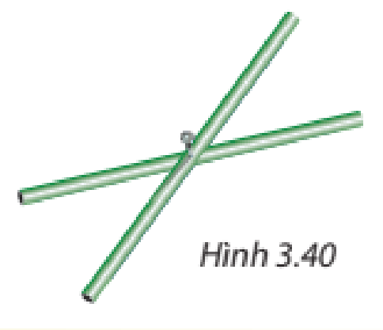
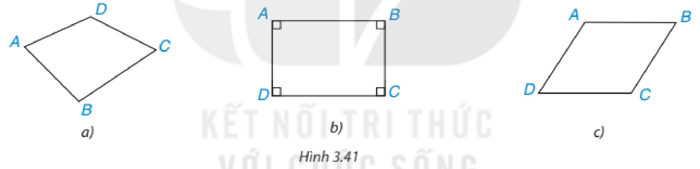
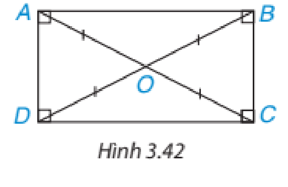
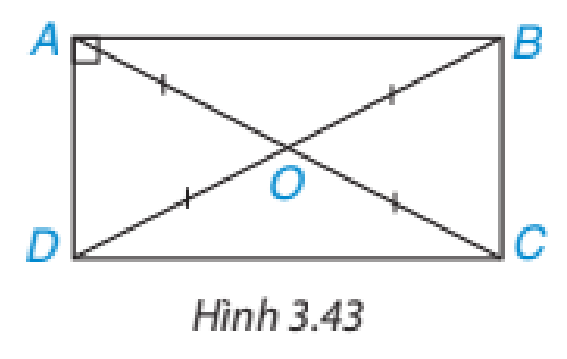
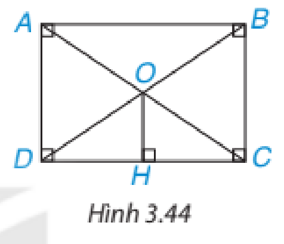
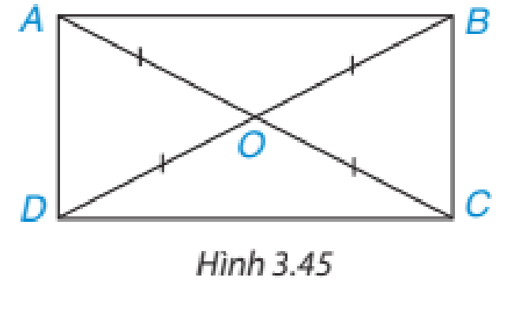

<!-- pdf:65 -->

# BÀI 13: HÌNH CHỮ NHẬT

## 🔤 Khái niệm, thuật ngữ

- Hình chữ nhật

## 🎯 Kiến thức, kĩ năng

- Mô tả khái niệm hình chữ nhật.
- Giải thích tính chất hai đường chéo của hình chữ nhật.
- Nhận biết dấu hiệu để một hình bình hành là hình chữ nhật.

## 🔴 Mở đầu

Hai thanh tre thẳng bằng nhau, được gắn với nhau tại trung điểm của mỗi thanh. Khi các đầu mút của hai thanh tre đó tạo thành bốn đỉnh của một tứ giác (H.3.40) thì tứ giác đó là hình gì? Tại sao?

*Hình 3.40*

## 1. HÌNH CHỮ NHẬT

**Khái niệm hình chữ nhật và tính chất**

**HĐ1:** Trong các hình dưới đây, hình nào là hình chữ nhật? Tại sao?

*Hình 3.41*

> **Hình chữ nhật** là tứ giác có bốn góc vuông.

**Chú ý:** Nếu một tứ giác có ba góc vuông thì góc còn lại cũng là góc vuông và tứ giác đó là *hình chữ nhật*.

<!-- term: Tính chất của hình chữ nhật -->
> **Tròn:** Hình chữ nhật có tất cả các tính chất của hình bình hành và của hình thang cân.

**HĐ2:** Hình chữ nhật có là hình bình hành không, có là hình thang cân không? Tại sao?

Ta có tính chất sau đây về đường chéo của hình chữ nhật:

<!-- term: Tính chất của hình chữ nhật -->
> **Định lí 1:** Trong hình chữ nhật, hai đường chéo bằng nhau và cắt nhau tại trung điểm của mỗi đường (H.3.42).

*Hình 3.42*

<!-- term: Đường trung tuyến ứng với cạnh huyền trong tam giác vuông -->
**Nhận xét:** Trong tam giác vuông, đường trung tuyến ứng với cạnh huyền bằng một nửa cạnh huyền.

<!-- pdf:66 -->

**Ví dụ 1:** Cho hình chữ nhật $ABCD$, hai đường chéo $AC$ và $BD$ cắt nhau tại $O$. Chứng minh $\triangle OAB = \triangle ODC$.
<!-- ocr-ok: đã đối chiếu trực tiếp ảnh trang PDF 66, OCR đọc sai nhãn Ví dụ 1 -->

*Hình 3.43*

**Giải:** (H.3.43)

Vì $ABCD$ là hình chữ nhật nên

$OA = OC = \frac{1}{2}AC = \frac{1}{2}BD = OB = OD.$

Hai tam giác $OAB$ và $ODC$ có: $OA = OD, OB = OC, AB = CD$.
<!-- ocr-ok: đã đối chiếu trực tiếp ảnh trang PDF 66, công thức khớp nguyên văn sách in -->

Vậy $\triangle OAB = \triangle ODC$ (c.c.c).

**Luyện tập 1:** Cho hình chữ nhật $ABCD$. Hai đường chéo $AC, BD$ cắt nhau tại $O$. Kẻ $OH \perp DC$ (H.3.44). Chứng minh rằng $H$ là trung điểm của $DC$.

*Hình 3.44*

## 2. DẤU HIỆU NHẬN BIẾT

*Dấu hiệu nhận biết hình chữ nhật*

**HĐ3:** Cho hình bình hành $ABCD$ có góc $A$ vuông. Tính các góc $B, C, D$. Tứ giác $ABCD$ có là hình chữ nhật không? Vì sao?

Ta cũng chứng minh được hình bình hành $ABCD$ có hai đường chéo $AC$ và $BD$ bằng nhau là hình chữ nhật.

<!-- term: Dấu hiệu nhận biết hình chữ nhật -->
> **Định lí 2:**
>
> a) Hình bình hành có một góc vuông là hình chữ nhật.
>
> b) Hình bình hành có hai đường chéo bằng nhau là hình chữ nhật.

**Ví dụ 2:** Chứng minh rằng tứ giác có hai đường chéo bằng nhau và cắt nhau tại trung điểm của mỗi đường thì tứ giác đó là hình chữ nhật.

**Giải:** (H.3.45)

| GT | $ABCD$ là tứ giác; $O$ là giao điểm của $AC$ và $BD$, $AC = BD, OA = OC, OB = OD$. |
| --- | --- |
| KL | $ABCD$ là hình chữ nhật. |
<!-- ocr-ok: đã đối chiếu trực tiếp ảnh trang PDF 66, bảng GT/KL khớp nguyên văn sách in -->

*Hình 3.45*

Theo giả thiết, $O$ là trung điểm của cả $AC$ và $BD$ nên ta có $ABCD$ là hình bình hành. Hơn nữa, $AC = BD$ nên theo Định lí 2, hình bình hành $ABCD$ là hình chữ nhật.

<!-- pdf:67 -->

**Luyện tập 2:** Cho tứ giác $ABCD$ có $\widehat{A} = 90^\circ$, hai đường chéo cắt nhau tại trung điểm $O$ của mỗi đường. Hỏi tứ giác $ABCD$ là hình gì? Tại sao?

<!-- term: Đường trung tuyến ứng với cạnh huyền trong tam giác vuông -->
**Nhận xét:** Nếu tam giác có một đường trung tuyến bằng nửa cạnh tương ứng thì tam giác đó là tam giác vuông.

**Vận dụng:** Hãy trả lời các câu hỏi trong *tình huống mở đầu*.

## BÀI TẬP

3.25. Bằng ê ke, nêu cách kiểm tra một tứ giác có là hình chữ nhật hay không. Hãy giải thích kết quả.

3.26. Bằng compa, nêu cách kiểm tra một tứ giác có là hình chữ nhật hay không. Giải thích kết quả.

3.27. Cho tam giác $ABC$, đường cao $AH$. Gọi $M$ là trung điểm của $AC$, $N$ là điểm sao cho $M$ là trung điểm của $HN$. Chứng minh tứ giác $AHCN$ là hình chữ nhật.

3.28. Xét một điểm $M$ trên cạnh huyền của tam giác $ABC$ vuông cân tại $A$. Gọi $N$ và $P$ lần lượt là hình chiếu vuông góc của $M$ trên các cạnh $AB$ và $AC$.

a) Hỏi tứ giác $MPAN$ là hình gì?

b) Hỏi $M$ ở vị trí nào thì đoạn thẳng $NP$ có độ dài ngắn nhất? Vì sao?

## 📷 Danh sách hình trong bài

| Mã hình | Trang PDF | Vị trí trong bài | Chú thích gốc |
| --- | :---: | --- | --- |
| H8-toan-b13-01 | 65 | Mở đầu | Hình 3.40 |
| H8-toan-b13-02 | 65 | Mục 1, HĐ1 | Hình 3.41 |
| H8-toan-b13-03 | 65 | Mục 1, Định lí 1 | Hình 3.42 |
| H8-toan-b13-04 | 66 | Mục 1, Ví dụ 1 | Hình 3.43 |
| H8-toan-b13-05 | 66 | Mục 1, Luyện tập 1 | Hình 3.44 |
| H8-toan-b13-06 | 66 | Mục 2, Ví dụ 2 | Hình 3.45 |
