<!-- pdf:68 -->

# BÀI 14: HÌNH THOI VÀ HÌNH VUÔNG

## 🔤 Khái niệm, thuật ngữ

- Hình thoi
- Hình vuông

## 🎯 Kiến thức, kĩ năng

- Mô tả khái niệm hình thoi và hình vuông.
- Giải thích các tính chất của hình thoi và hình vuông.
- Nhận biết dấu hiệu để một hình là hình thoi, hình vuông.

## 🔴 Mở đầu

Lấy một tờ giấy, gấp làm tư tạo ra một góc vuông $O$, đánh dấu hai điểm $A, B$ trên hai cạnh góc vuông rồi cắt chéo theo đoạn thẳng $AB$ (H.3.46a). Sau khi mở tờ giấy ra, ta được một tứ giác. Tứ giác đó là hình gì? Vì sao? Nếu ta có $OA = OB$ thì tứ giác nhận được là hình gì (H.3.46b)?

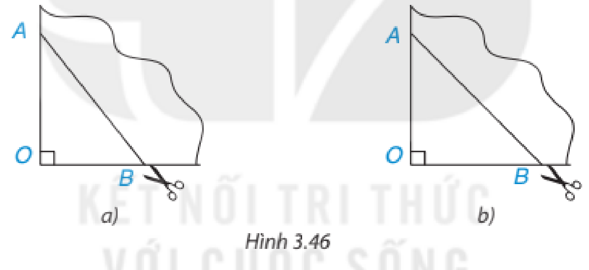
*Hình 3.46*

## 1. HÌNH THOI

**Khái niệm hình thoi và tính chất của nó**

Trong Hình 3.47, tứ giác $ABCD$ có các cạnh $AB, BC, CD, DA$ bằng nhau, nó là một hình thoi.

> **Hình thoi** là tứ giác có bốn cạnh bằng nhau.

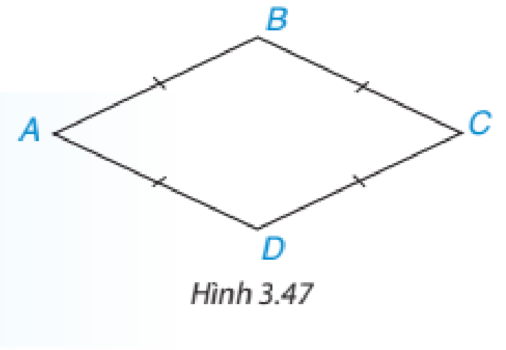
*Hình 3.47*

> ❓ Hình thoi có phải là hình bình hành không? Nếu có, từ tính chất đã biết của hình bình hành, hãy suy ra những tính chất tương ứng của hình thoi.

<!-- pdf:69 -->

Trong bài này, ta sẽ tìm hiểu thêm tính chất về đường chéo của hình thoi.

**Tính chất về hai đường chéo của hình thoi**

**HĐ1:** Cho hình thoi $ABCD$ có hai đường chéo $AC, BD$ cắt nhau tại $O$ (H.3.48).

a) $\triangle ABD$ có cân tại $A$ không?
<!-- ocr-ok: đã đối chiếu trực tiếp ảnh trang PDF 69, OCR đọc sai kí hiệu tam giác và chữ cân -->

b) $AC$ có vuông góc với $BD$ không và $AC$ có là đường phân giác của góc $A$ không? Vì sao?

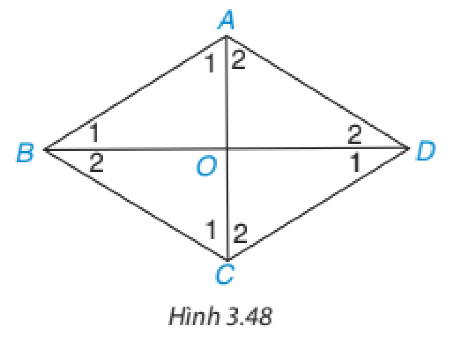
*Hình 3.48*

<!-- term: Tính chất của hình thoi -->
> **Định lí 1:**
>
> Trong hình thoi:
>
> a) Hai đường chéo vuông góc với nhau;
>
> b) Hai đường chéo là các đường phân giác của các góc trong hình thoi.

**Ví dụ 1:** Hai đường tròn tâm $A$ và $C$ có cùng bán kính, cắt nhau tại $B, D$ (H.3.49).
<!-- ocr-ok: đã đối chiếu trực tiếp ảnh trang PDF 69, OCR đọc sai nhãn Ví dụ 1 -->

a) Hỏi tứ giác $ABCD$ là hình gì? Tại sao?

b) Chứng minh $AC \perp BD$.

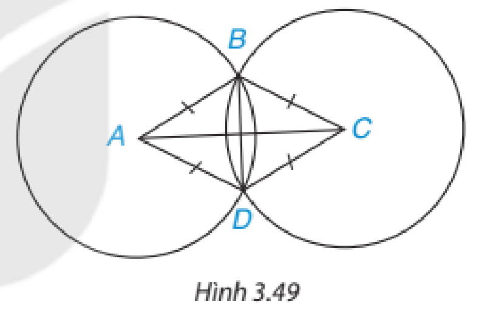
*Hình 3.49*

**Giải**

a) Vì hai đường tròn tâm $A$ và $C$ có cùng bán kính, cắt nhau tại $B, D$ nên $AB = AD = CD = CB$.

Vậy theo định nghĩa, tứ giác $ABCD$ là hình thoi.

b) Từ câu a và theo Định lí 1 ta có $AC \perp BD$.

*Dấu hiệu nhận biết hình thoi*

Ngoài nhận biết hình thoi bằng định nghĩa (tứ giác có bốn cạnh bằng nhau), ta còn có thể nhận biết hình thoi bằng những dấu hiệu khác.

<!-- term: Dấu hiệu nhận biết hình thoi -->
> **Định lí 2:**
>
> a) Hình bình hành có hai cạnh kề bằng nhau là hình thoi.
>
> b) Hình bình hành có hai đường chéo vuông góc với nhau là hình thoi.
>
> c) Hình bình hành có một đường chéo là đường phân giác của một góc là hình thoi.

> ❓ Hãy viết giả thiết, kết luận của câu c trong Định lí 2.

<!-- pdf:70 -->

**Ví dụ 2:** Trong Hình 3.50, tứ giác nào là hình thoi? Vì sao?

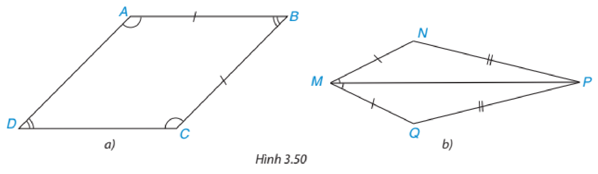
*Hình 3.50*

**Giải**

a) Tứ giác $ABCD$ là hình bình hành vì có các góc đối bằng nhau: $\widehat{A} = \widehat{C}, \widehat{B} = \widehat{D}$.

Mặt khác, ta lại có hai cạnh kề $AB$ và $BC$ bằng nhau.

Do đó, tứ giác $ABCD$ là hình thoi.

b) Tứ giác $MNPQ$ không phải là hình thoi vì hai cạnh kề $MN$ và $NP$ không bằng nhau.

**Luyện tập 1**

Trong Hình 3.51, hình nào là hình thoi? Vì sao?

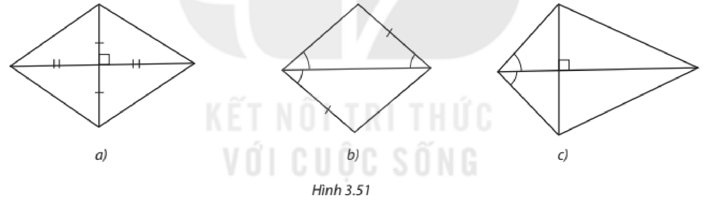
*Hình 3.51*

## 2. HÌNH VUÔNG

Thực hiện HĐ mở đầu theo Hình 3.46b, ta được một hình vuông.

**Khái niệm hình vuông và tính chất của nó**

Tứ giác $ABCD$ trong Hình 3.52 có bốn góc vuông và bốn cạnh bằng nhau, ta gọi tứ giác đó là một hình vuông.

> **Hình vuông** là tứ giác có bốn góc vuông và bốn cạnh bằng nhau.

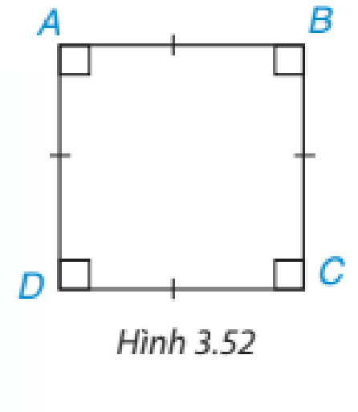
*Hình 3.52*

<!-- pdf:71 -->

**Tính chất về đường chéo của hình vuông**

**HĐ2:** Hãy giải thích tại sao hai đường chéo của hình vuông bằng nhau và vuông góc với nhau.

<!-- term: Tính chất của hình vuông -->
> **Vuông:** Hình vuông cũng là hình chữ nhật, hình thoi nên nó có tất cả các tính chất của hình chữ nhật và hình thoi.

<!-- term: Tính chất của hình vuông -->
> **Định lí 3:** Trong một hình vuông, hai đường chéo bằng nhau, vuông góc với nhau, cắt nhau tại trung điểm mỗi đường và là các đường phân giác của các góc của hình vuông.

*Dấu hiệu nhận biết hình vuông*

Ngoài nhận biết hình vuông bằng định nghĩa (tứ giác có bốn góc vuông và bốn cạnh bằng nhau), ta còn có thể nhận biết hình vuông bằng những dấu hiệu khác.

<!-- term: Dấu hiệu nhận biết hình vuông -->
> **Định lí 4:**
>
> a) Hình chữ nhật có hai cạnh kề bằng nhau là hình vuông.
>
> b) Hình chữ nhật có hai đường chéo vuông góc là hình vuông.
>
> c) Hình chữ nhật có một đường chéo là đường phân giác của một góc là hình vuông.

<!-- term: Dấu hiệu nhận biết hình vuông -->
> **Pi:** Chú ý rằng:
>
> - Hình thoi có một góc vuông là hình vuông.
> - Hình thoi có hai đường chéo bằng nhau là hình vuông.

> ❓ Hãy viết giả thiết, kết luận của câu a trong Định lí 4.

**Ví dụ 3:** Tìm hình vuông trong Hình 3.53.

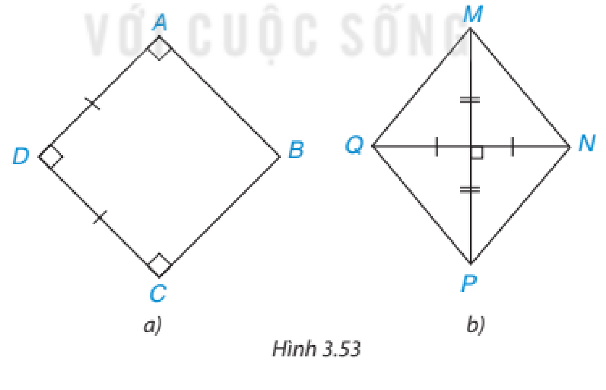
*Hình 3.53*

**Giải**

a) Tứ giác $ABCD$ là hình chữ nhật vì có ba góc vuông mà $AD = DC$ nên $ABCD$ là hình vuông.

b) Tứ giác $MNPQ$ có hai đường chéo $MP$ và $NQ$ không bằng nhau nên nó không phải là hình chữ nhật. Do đó, tứ giác $MNPQ$ không phải là hình vuông.

<!-- pdf:72 -->

**Luyện tập 2**

Với mỗi hình dưới đây, ta dùng dấu hiệu nhận biết nào để khẳng định đó là hình vuông?

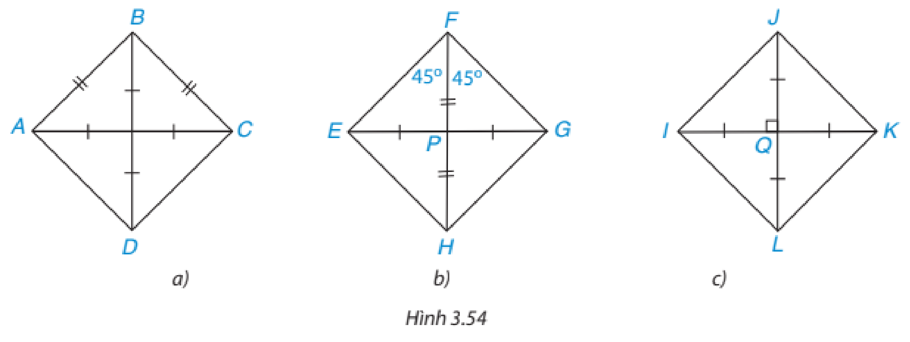
*Hình 3.54*

**Vận dụng**

Trở lại *tình huống mở đầu*. Hãy giải thích tại sao:

- Trường hợp a, ta được hình thoi.
- Trường hợp b, ta được hình vuông.

## BÀI TẬP

3.29. Tìm các hình thoi và hình vuông trong Hình 3.55.

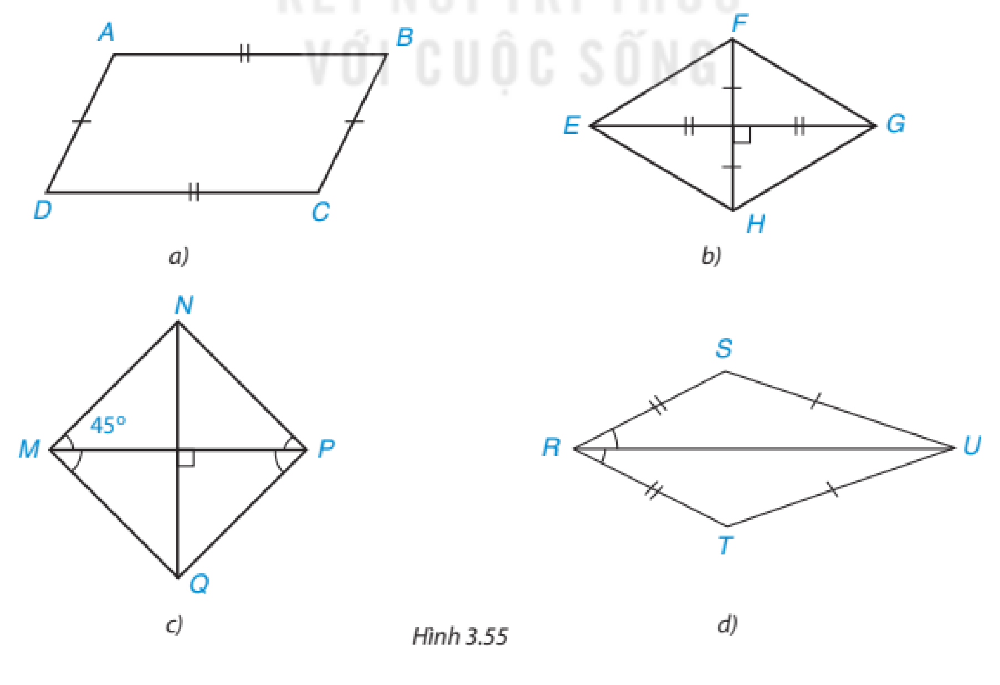
*Hình 3.55*

<!-- pdf:73 -->

3.30. Cho tam giác $ABC$, $D$ là một điểm nằm giữa $B$ và $C$. Qua $D$ kẻ các đường thẳng song song với $AB, AC$, chúng cắt các cạnh $AC, AB$ lần lượt tại $E, F$.

a) Tứ giác $AEDF$ là hình gì? Vì sao?

b) Nếu tam giác $ABC$ cân tại $A$ thì điểm $D$ ở vị trí nào trên cạnh $BC$ để tứ giác $AEDF$ là hình thoi?

c) Nếu tam giác $ABC$ vuông tại $A$ thì tứ giác $AEDF$ là hình gì?

d) Nếu tam giác $ABC$ vuông cân tại $A$ thì điểm $D$ ở vị trí nào trên cạnh $BC$ để $AEDF$ là hình vuông?

3.31. Chứng minh rằng các trung điểm của bốn cạnh trong một hình chữ nhật là các đỉnh của một hình thoi.

3.32. Chứng minh rằng các trung điểm của bốn cạnh trong một hình thoi là các đỉnh của một hình chữ nhật.

3.33. Cho hình chữ nhật $ABCD$ có chu vi bằng $36\text{ cm}$. Gọi $M$ là trung điểm của cạnh $BC$. Biết rằng $MA \perp MD$. Tính độ dài các cạnh của hình chữ nhật $ABCD$ (H.3.56).

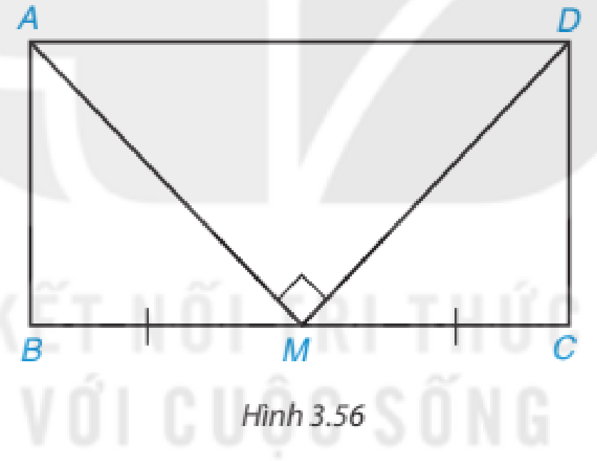
*Hình 3.56*

## 📷 Danh sách hình trong bài

| Mã hình | Trang PDF | Vị trí trong bài | Chú thích gốc |
| --- | :---: | --- | --- |
| H8-toan-b14-01 | 68 | Mở đầu | Hình 3.46 |
| H8-toan-b14-02 | 68 | Mục 1 | Hình 3.47 |
| H8-toan-b14-03 | 69 | Mục 1, HĐ1 | Hình 3.48 |
| H8-toan-b14-04 | 69 | Mục 1, Ví dụ 1 | Hình 3.49 |
| H8-toan-b14-05 | 70 | Mục 1, Ví dụ 2 | Hình 3.50 |
| H8-toan-b14-06 | 70 | Mục 1, Luyện tập 1 | Hình 3.51 |
| H8-toan-b14-07 | 70 | Mục 2 | Hình 3.52 |
| H8-toan-b14-08 | 71 | Mục 2, Ví dụ 3 | Hình 3.53 |
| H8-toan-b14-09 | 72 | Mục 2, Luyện tập 2 | Hình 3.54 |
| H8-toan-b14-10 | 72 | Bài tập 3.29 | Hình 3.55 |
| H8-toan-b14-11 | 73 | Bài tập 3.33 | Hình 3.56 |
