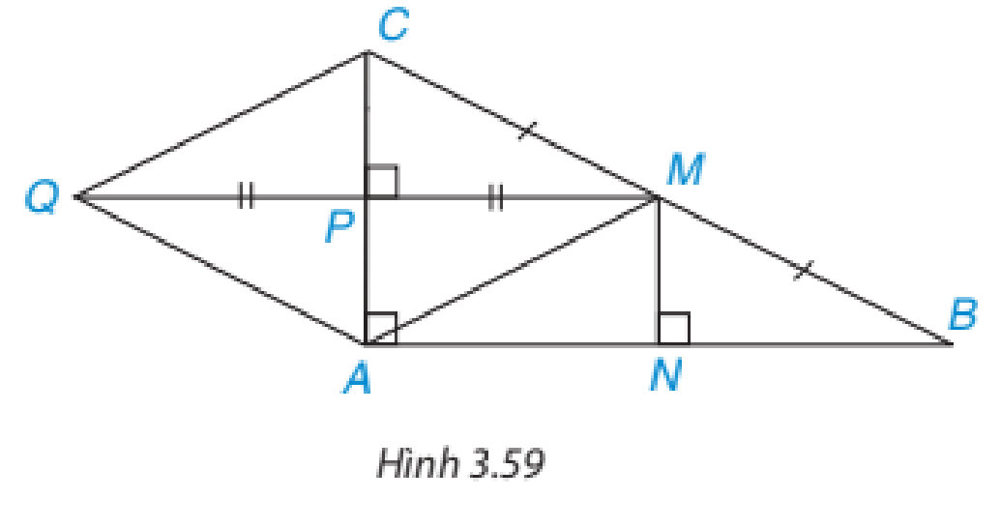
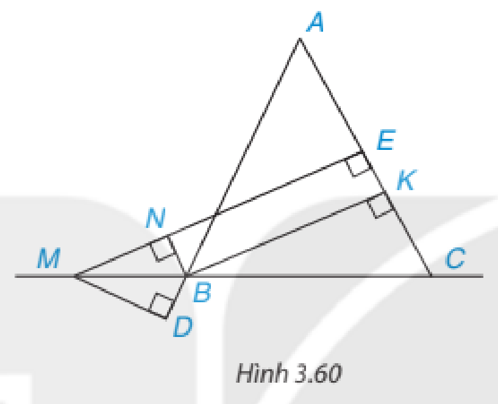

<!-- pdf:75 -->

# BÀI TẬP CUỐI CHƯƠNG III

**A. TRẮC NGHIỆM**

3.39. Trong các khẳng định sau, khẳng định nào đúng?

A. Không có tứ giác nào mà không có góc tù.

B. Nếu tứ giác có ba góc nhọn thì góc còn lại là góc tù.

C. Nếu tứ giác có hai góc tù thì hai góc còn lại phải nhọn.

D. Không có tứ giác nào có ba góc tù.

3.40. Trong các khẳng định sau, khẳng định nào đúng? Khẳng định nào **sai**?

a) Tứ giác có hai đường chéo bằng nhau là hình bình hành.

b) Tứ giác có hai cặp cạnh bằng nhau là hình bình hành.

c) Tứ giác có ba góc vuông là hình chữ nhật.

d) Tứ giác có ba cạnh bằng nhau là hình thoi.

3.41. Trong các khẳng định sau, khẳng định nào đúng? Khẳng định nào **sai**?

a) Tứ giác có hai đường chéo bằng nhau và hai cạnh đối nào cũng bằng nhau là hình chữ nhật.

b) Tứ giác có hai cạnh đối nào cũng bằng nhau là hình bình hành.

c) Tứ giác có hai cạnh song song và hai đường chéo bằng nhau là hình thang cân.

d) Tứ giác có hai cạnh song song và hai cạnh còn lại bằng nhau là hình bình hành.

**B. TỰ LUẬN**

3.42. Chứng minh rằng nếu tứ giác có hai đường chéo bằng nhau và một cặp cạnh đối bằng nhau thì tứ giác đó là một hình thang cân.

3.43. Cho hình bình hành $ABCD$. Lấy điểm $P$ trên tia $AB$ sao cho $AP = 2AB$.

a) Tứ giác $BPCD$ có phải là hình bình hành không? Tại sao?

b) Khi tam giác $ABD$ vuông cân tại $A$, hãy tính số đo các góc của tứ giác $BPCD$.

3.44. Cho tam giác $ABC$ vuông tại $A$. Gọi $M$ là trung điểm của $BC$ còn $P, N$ lần lượt là chân đường vuông góc hạ từ $M$ xuống $CA, AB$ (H.3.59).

*Hình 3.59*

<!-- pdf:76 -->

a) Chứng minh hai tam giác vuông $CMP$ và $MBN$ bằng nhau.

b) Chứng minh tứ giác $APMN$ là một hình chữ nhật. Từ đó suy ra $N$ là trung điểm của $AB$, $P$ là trung điểm của $AC$.

c) Lấy điểm $Q$ sao cho $P$ là trung điểm của $MQ$, chứng minh rằng tứ giác $AMCQ$ là một hình thoi.

d) Nếu $AB = AC$, tức là tam giác $ABC$ vuông cân tại $A$ thì tứ giác $AMCQ$ có là hình vuông không? Vì sao?

3.45. Cho tam giác $ABC$ cân tại $A$; $M$ là một điểm thuộc đường thẳng $BC$, $B$ ở giữa $M$ và $C$. Gọi $E$ và $K$ lần lượt là chân đường vuông góc hạ từ $M$ và từ $B$ xuống $AC$, còn $N$ là chân đường vuông góc hạ từ $B$ xuống $ME$ (H.3.60).

*Hình 3.60*

Chứng minh rằng:

a) Tứ giác $BKEN$ là hình chữ nhật.

b) $BK$ và $NE$ cùng bằng hiệu khoảng cách từ $M$ đến $AC$ và $AB$ (dù $M$ thay đổi trên đường thẳng $BC$ miễn là $B$ nằm giữa $M$ và $C$).
<!-- ocr-ok: đã đối chiếu trực tiếp ảnh trang PDF 76, OCR đọc sai BC thành ØC và B thành 8 -->

## 📷 Danh sách hình trong bài

| Mã hình | Trang PDF | Vị trí trong bài | Chú thích gốc |
| --- | :---: | --- | --- |
| H8-toan-bt-c03-01 | 75 | Bài tập 3.44 | Hình 3.59 |
| H8-toan-bt-c03-02 | 76 | Bài tập 3.45 | Hình 3.60 |
