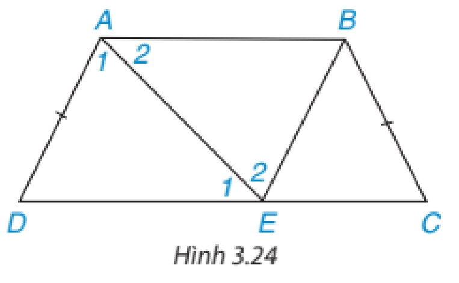
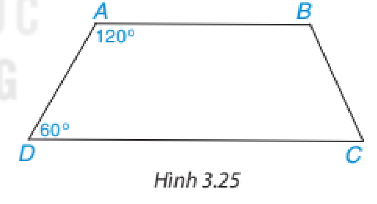
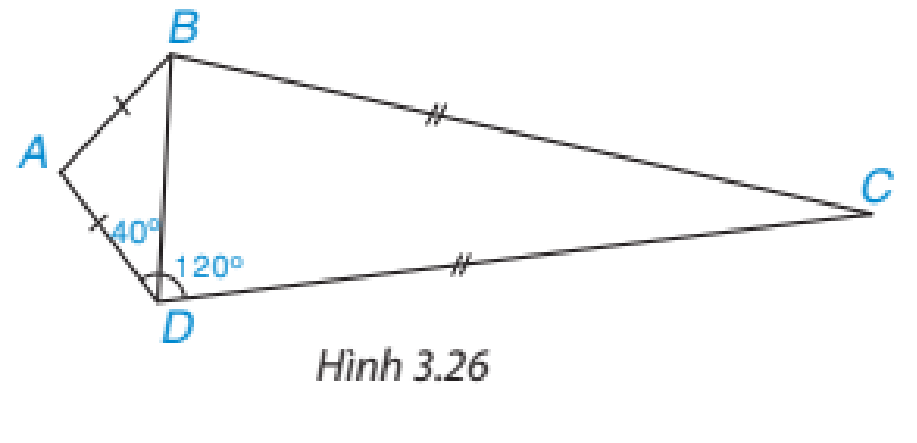

<!-- pdf:57 -->

# LUYỆN TẬP CHUNG (TRANG 56)

**Ví dụ:** Chứng minh rằng hình thang có hai cạnh đáy không bằng nhau, hai cạnh bên bằng nhau nhưng không song song là hình thang cân.

**Giải**

| GT | Hình thang $ABCD$; $AB \parallel CD$; $AB < CD$; $AD = BC$; $AD$ không song song $BC$. |
| --- | --- |
| KL | $ABCD$ là hình thang cân. |
<!-- ocr-ok: đã đối chiếu trực tiếp ảnh trang PDF 57, bảng GT/KL khớp nguyên văn sách in -->

*Hình 3.24*

Qua điểm $B$ kẻ đường thẳng song song với đường thẳng $AD$, cắt đường thẳng $CD$ tại điểm $E$. Điểm $E$ phải khác $C$ vì nếu $E$ trùng với $C$ thì $AD$ và $BC$ song song, trái với giả thiết (H.3.24).

Hai tam giác $EDA$ và $ABE$ có: $\widehat{A_1} = \widehat{E_2}$ (do $AD \parallel BE$), $AE$ là cạnh chung, $\widehat{E_1} = \widehat{A_2}$ (do $AB \parallel DC$).
<!-- ocr-ok: đã đối chiếu trực tiếp ảnh trang PDF 57, công thức kí hiệu góc khớp nguyên văn sách in -->

Vậy $\triangle EDA = \triangle ABE$; suy ra $AD = BE$ (hai cạnh tương ứng). Hơn nữa, theo giả thiết $AD = BC$ nên $BE = BC$. Từ đó có $\triangle BEC$ cân tại $B$, suy ra $\widehat{BEC} = \widehat{C}$. Mặt khác, $\widehat{BEC} = \widehat{D}$ (do $AD \parallel BE$) nên $\widehat{C} = \widehat{D}$.
<!-- ocr-ok: đã đối chiếu trực tiếp ảnh trang PDF 57, lời giải chứng minh khớp nguyên văn sách in -->

Vậy $ABCD$ là hình thang cân.

## BÀI TẬP

3.9. Tứ giác $ABCD$ trong Hình 3.25 có phải là hình thang không? Vì sao?

*Hình 3.25*

3.10. Cho hình thang cân $ABCD$ ($AB \parallel CD$) có $AB = AD$.

Biết $\widehat{ABD} = 30^\circ$, tính số đo các góc của hình thang đó.

3.11. Tính số đo các góc của tứ giác $ABCD$ trong Hình 3.26.

*Hình 3.26*

3.12. Cho $M$ là một điểm nằm trong tam giác đều $ABC$. Qua $M$ kẻ các đường thẳng song song với $BC, CA, AB$ lần lượt cắt $AB, BC, CA$ tại các điểm $P, Q, R$.

a) Chứng minh tứ giác $APMR$ là hình thang cân.

b) Chứng minh rằng chu vi tam giác $PQR$ bằng tổng độ dài $MA + MB + MC$.

c) Hỏi với vị trí nào của $M$ thì tam giác $PQR$ là tam giác đều?

## 📷 Danh sách hình trong bài

| Mã hình | Trang PDF | Vị trí trong bài | Chú thích gốc |
| --- | :---: | --- | --- |
| H8-toan-ltc-c03-01-01 | 57 | Ví dụ | Hình 3.24 |
| H8-toan-ltc-c03-01-02 | 57 | Bài tập 3.9 | Hình 3.25 |
| H8-toan-ltc-c03-01-03 | 57 | Bài tập 3.11 | Hình 3.26 |
