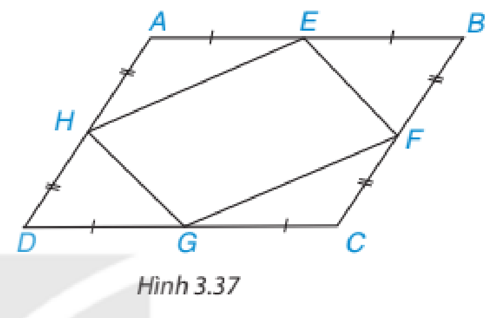
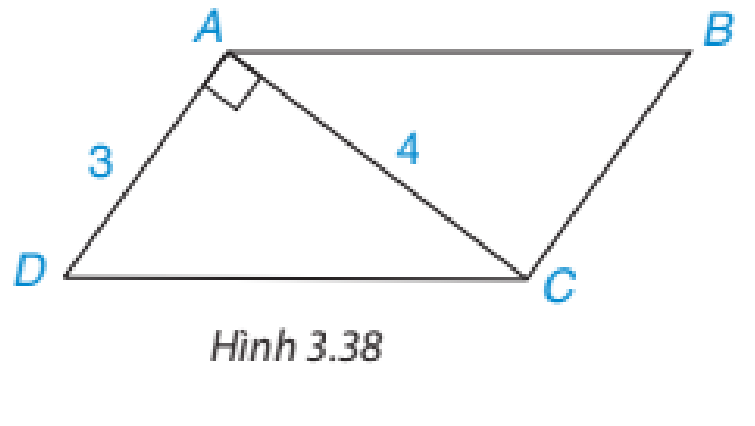
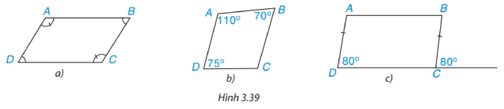

<!-- pdf:63 -->

# LUYỆN TẬP CHUNG (TRANG 62)

**Ví dụ 1**

Gọi $E, F, G, H$ lần lượt là trung điểm các cạnh $AB, BC, CD, DA$ của hình bình hành $ABCD$. Hỏi $EFGH$ là hình gì? Vì sao?

*Hình 3.37*

**Giải:** (H.3.37)

Theo giả thiết, $E, F, G, H$ lần lượt là trung điểm các cạnh $AB, BC, CD, DA$ của hình bình hành $ABCD$ nên $AE = \frac{1}{2}AB = \frac{1}{2}CD = CG$;

$AH = \frac{1}{2}AD = \frac{1}{2}BC = CF$.

Hai tam giác $AHE$ và $CFG$ có: $\widehat{HAE} = \widehat{FCG}$ (hai góc đối của hình bình hành $ABCD$), $AH = CF, AE = CG$ (chứng minh trên).

Vậy $\triangle AHE = \triangle CFG$ (c.g.c), suy ra $HE = FG$. Tương tự, $GH = EF$.

Tứ giác $EFGH$ có $GH = EF, HE = FG$ nên tứ giác đó là hình bình hành.

**Ví dụ 2:** Tính diện tích hình bình hành $ABCD$ có đường chéo $AC$ vuông góc với cạnh $AD$, biết $AC = 4\text{ cm}, AD = 3\text{ cm}$.
<!-- ocr-ok: đã đối chiếu trực tiếp ảnh trang PDF 63, OCR đọc sai nhãn Ví dụ 2 -->

*Hình 3.38*

**Giải:** (H.3.38)

Theo giả thiết, $ABCD$ là hình bình hành nên $BC \parallel AD$, $BC = AD$ ($= 3\text{ cm}$). Mặt khác, $AD \perp AC$ (giả thiết) suy ra $BC \perp AC$.
<!-- ocr-ok: đã đối chiếu trực tiếp ảnh trang PDF 63, công thức khớp nguyên văn sách in -->

Ta có $\triangle ABC$ vuông tại $C$ và $\triangle ADC$ vuông tại $A$ nên:
<!-- ocr-ok: đã đối chiếu trực tiếp ảnh trang PDF 63, kí hiệu tam giác khớp nguyên văn sách in -->

$S_{ADC} = \frac{1}{2} AD \cdot AC = \frac{1}{2} \cdot 3 \cdot 4 = 6\ (\text{cm}^2)$;

$S_{ACB} = \frac{1}{2} AC \cdot BC = \frac{1}{2} \cdot 4 \cdot 3 = 6\ (\text{cm}^2)$.

Vậy diện tích hình bình hành $ABCD$ là $12\text{ cm}^2$.

<!-- pdf:64 -->

## BÀI TẬP

3.19. Trong các tứ giác ở Hình 3.39, tứ giác nào là hình bình hành? Vì sao?

*Hình 3.39*

3.20. Cho hình bình hành $ABCD$. Lấy điểm $M$ thuộc cạnh $AB$ và điểm $N$ thuộc cạnh $CD$ sao cho $AM = CN$. Chứng minh rằng:

a) $AN = CM$;

b) $\widehat{AMC} = \widehat{ANC}$.

3.21. Vẽ tứ giác $ABCD$ theo hướng dẫn sau:

*Bước 1.* Vẽ đoạn thẳng $AB$ và đường thẳng $a$ song song với $AB$.

*Bước 2.* Lấy điểm $C \in a$.

*Bước 3.* Trên $a$ chọn $D$ sao cho $CD = AB$ và $A, D$ nằm cùng phía đối với $BC$.
<!-- ocr-ok: đã đối chiếu trực tiếp ảnh trang PDF 64, OCR đọc sai BC thành BƠ -->

Hãy giải thích tại sao tứ giác $ABCD$ là hình bình hành.

3.22. Cho hình bình hành $ABCD$ có $AB = 3\text{ cm}, AD = 5\text{ cm}$.

a) Hỏi tia phân giác của góc $A$ cắt cạnh $CD$ hay cạnh $BC$?

b) Tính khoảng cách từ giao điểm đó đến điểm $C$.

3.23. Cho hình bình hành $ABCD$. Lấy điểm $E$ sao cho $B$ là trung điểm của $AE$, lấy điểm $F$ sao cho $C$ là trung điểm của $DF$. Chứng minh rằng:

a) Hai tứ giác $AEFD, ABFC$ là những hình bình hành;

b) Các trung điểm của ba đoạn thẳng $AF, DE, BC$ trùng nhau.

3.24. Cho ba điểm không thẳng hàng.

a) Tìm một điểm sao cho nó cùng với ba điểm đã cho là bốn đỉnh của một hình bình hành. Hãy vẽ hình và mô tả cách tìm.

b) Hỏi tìm được bao nhiêu điểm như vậy?

## 📷 Danh sách hình trong bài

| Mã hình | Trang PDF | Vị trí trong bài | Chú thích gốc |
| --- | :---: | --- | --- |
| H8-toan-ltc-c03-02-01 | 63 | Ví dụ 1 | Hình 3.37 |
| H8-toan-ltc-c03-02-02 | 63 | Ví dụ 2 | Hình 3.38 |
| H8-toan-ltc-c03-02-03 | 64 | Bài tập 3.19 | Hình 3.39 |
