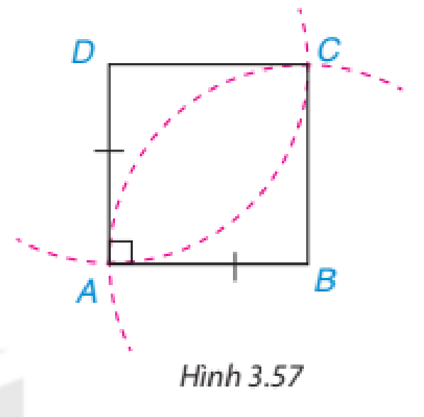
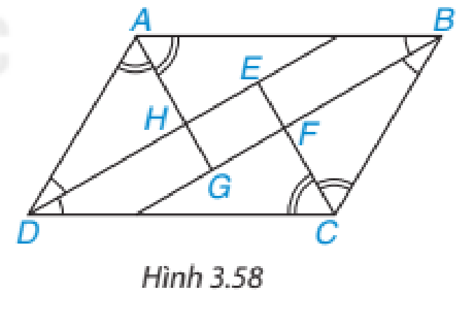

<!-- pdf:74 -->

# LUYỆN TẬP CHUNG (TRANG 73)

**Ví dụ**

Cho ba điểm $A, B, D$ sao cho $AB = AD$ và $AB$ vuông góc với $AD$. Vẽ hai đường tròn cùng đi qua $A$, lần lượt có tâm là $B$ và $D$. Hai đường tròn đó còn cắt nhau tại điểm $C$.

Chứng minh $ABCD$ là một hình vuông.

*Hình 3.57*

**Giải:** (H.3.57)

Điểm $C$ nằm trên đường tròn tâm $B$ đi qua $A$ nên $BC = BA$.
<!-- ocr-ok: đã đối chiếu trực tiếp ảnh trang PDF 74, OCR đọc sai B thành 8B -->

Điểm $C$ nằm trên đường tròn tâm $D$ đi qua $A$ nên $DC = DA$.
<!-- ocr-ok: đã đối chiếu trực tiếp ảnh trang PDF 74, công thức khớp nguyên văn sách in -->

Theo giả thiết $AB = AD$ nên tứ giác $ABCD$ có bốn cạnh bằng nhau $DC = AD = AB = BC$, vậy $ABCD$ là một hình thoi. Hình thoi $ABCD$ có góc $A$ vuông nên là một hình vuông.

## BÀI TẬP

3.34. Cho tam giác $ABC$; $M$ và $N$ lần lượt là trung điểm của hai cạnh $AB$ và $AC$. Lấy điểm $P$ sao cho $N$ là trung điểm của đoạn thẳng $MP$.

a) Hỏi tứ giác $AMCP$ là hình gì? Vì sao?

b) Với điều kiện nào của tam giác $ABC$ thì tứ giác $AMCP$ là hình chữ nhật; hình thoi; hình vuông?

3.35. Cho hình bình hành $ABCD$. Các tia phân giác của các góc $A, B, C, D$ cắt nhau như trên Hình 3.58. Chứng minh rằng $EFGH$ là hình chữ nhật.

*Hình 3.58*

3.36. Một khung tre hình chữ nhật có lắp đinh vít tại bốn đỉnh. Khi khung tre này bị xô lệch (do các đinh vít bị lỏng), các góc không còn vuông nữa thì khung đó là hình gì? Tại sao? Hỏi khi nẹp thêm một đường chéo vào khung đó thì nó còn bị xô lệch không?

3.37. Gọi $Ou$ và $Ov$ lần lượt là hai tia phân giác của hai góc kề bù $xOy$ và $x'Oy$; $A$ là một điểm khác $O$ trên tia $Ox$. Gọi $B$ và $C$ là chân đường vuông góc hạ từ $A$ lần lượt xuống đường thẳng chứa $Ou$ và $Ov$. Hỏi tứ giác $OBAC$ là hình gì? Vì sao?

3.38. Cho hình vuông $ABCD$. Lấy một điểm $E$ trên cạnh $CD$. Tia phân giác của góc $DAE$ cắt cạnh $DC$ tại $M$. Đường thẳng qua $M$ vuông góc với $AE$ cắt $BC$ tại $N$.
<!-- ocr-ok: đã đối chiếu trực tiếp ảnh trang PDF 74, OCR đọc sai M thành IM -->

Chứng minh $DM + BN = MN$.

## 📷 Danh sách hình trong bài

| Mã hình | Trang PDF | Vị trí trong bài | Chú thích gốc |
| --- | :---: | --- | --- |
| H8-toan-ltc-c03-03-01 | 74 | Ví dụ | Hình 3.57 |
| H8-toan-ltc-c03-03-02 | 74 | Bài tập 3.35 | Hình 3.58 |
