<!-- pdf:77 -->
<!-- Phần giới thiệu đầu Chương IV (nửa trên trang PDF 77): HÌNH HỌC PHẲNG — CHƯƠNG IV: ĐỊNH LÍ THALÈS -->

Thalès (625 - 547 trước Công nguyên) là một trong những nhà hình học đầu tiên của Hi Lạp. Trong chương này chúng ta sẽ cùng tìm hiểu định lí mang tên ông và một số kiến thức về đường trung bình, tính chất đường phân giác trong tam giác.

# BÀI 15: ĐỊNH LÍ THALÈS TRONG TAM GIÁC

## 🔤 Khái niệm, thuật ngữ

- Tỉ số hai đoạn thẳng
- Đoạn thẳng tỉ lệ

## 🎯 Kiến thức, kĩ năng

- Định lí Thalès trong tam giác (thuận và đảo).
- Tính độ dài đoạn thẳng bằng cách sử dụng định lí Thalès.
- Giải quyết một số vấn đề thực tiễn gắn với việc vận dụng định lí Thalès.

## 🔴 Mở đầu

Cây cầu $AB$ bắc qua một con sông có chiều rộng $300\text{ m}$. Để đo khoảng cách giữa hai điểm $C$ và $D$ trên hai bờ con sông, người ta chọn một điểm $E$ trên đường thẳng $AB$ sao cho ba điểm $E, C, D$ thẳng hàng. Trên mặt đất, người ta đo được $AE = 400\text{ m}, EC = 500\text{ m}$.

Theo em, người ta tính khoảng cách giữa $C$ và $D$ như thế nào?

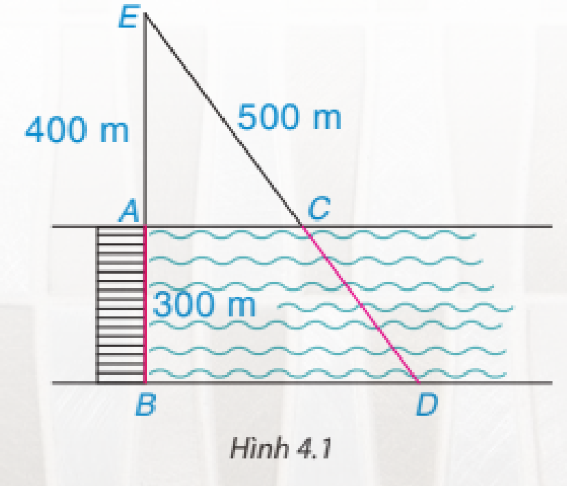
*Hình 4.1*

<!-- pdf:78 -->

## 1. ĐOẠN THẲNG TỈ LỆ

*Tỉ số của hai đoạn thẳng*

Cho Hình 4.2, em hãy thực hiện các hoạt động sau:

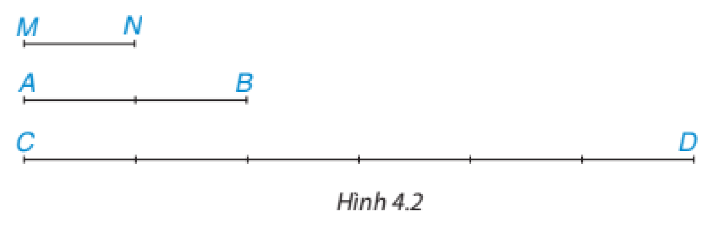
*Hình 4.2*

**HĐ1:** Hãy tìm độ dài của hai đoạn thẳng $AB$ và $CD$ nếu chọn đoạn $MN$ làm đơn vị độ dài. Với các độ dài đó hãy tính tỉ số $\frac{AB}{CD}$.

**HĐ2:** Dùng thước thẳng, đo độ dài hai đoạn $AB$ và $CD$ (đơn vị: cm) rồi dùng kết quả vừa đo để tính tỉ số $\frac{AB}{CD}$.

**HĐ3:** So sánh hai tỉ số tìm được trong hai hoạt động trên.

Ta có nhận xét rằng: Khi ta thay đổi đơn vị đo, tỉ số độ dài của hai đoạn thẳng $AB$ và $CD$ không thay đổi. Ta gọi tỉ số đó là *tỉ số của hai đoạn thẳng* $AB$ và $CD$.

> **Tỉ số của hai đoạn thẳng** là tỉ số độ dài của chúng theo cùng một đơn vị đo.

**Luyện tập 1:** Tìm tỉ số của các cặp đoạn thẳng có độ dài như sau:

a) $MN = 3\text{ cm}$ và $PQ = 9\text{ cm}$.

b) $EF = 25\text{ cm}$ và $HK = 10\text{ dm}$.

*Đoạn thẳng tỉ lệ*

Cho bốn đoạn thẳng $AB, CD, A'B', C'D'$ (H.4.3). Ta thấy $\frac{AB}{CD} = \frac{2}{3}; \frac{A'B'}{C'D'} = \frac{4}{6} = \frac{2}{3}$. Ta có tỉ lệ thức $\frac{AB}{CD} = \frac{A'B'}{C'D'}$. Khi đó, ta nói $AB$ và $CD$ tỉ lệ với $A'B'$ và $C'D'$.

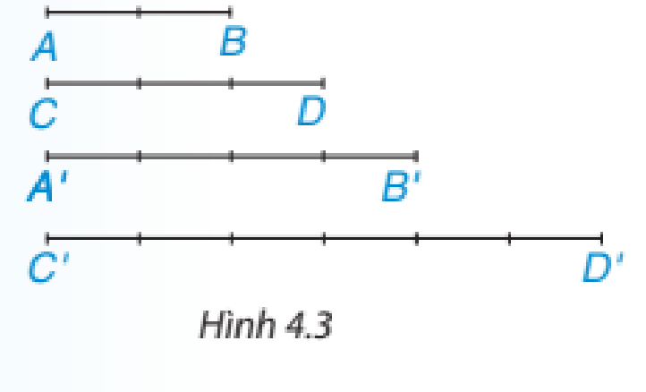
*Hình 4.3*

Ta có định nghĩa sau:

> Hai đoạn thẳng $AB$ và $CD$ gọi là **tỉ lệ** với hai đoạn thẳng $A'B'$ và $C'D'$ nếu có tỉ lệ thức:
>
> $\frac{AB}{CD} = \frac{A'B'}{C'D'}\text{ hay }\frac{AB}{A'B'} = \frac{CD}{C'D'}.$
<!-- ocr-ok: đã đối chiếu trực tiếp ảnh trang PDF 78, khung định nghĩa đoạn thẳng tỉ lệ khớp nguyên văn sách in -->

<!-- pdf:79 -->

**Luyện tập 2**

Cho tam giác $ABC$ và một điểm $B'$ nằm trên cạnh $AB$. Qua điểm $B'$, ta vẽ một đường thẳng song song với $BC$, cắt $AC$ tại $C'$ (H.4.4). Dựa vào hình vẽ, hãy tính và so sánh các tỉ số sau và viết các tỉ lệ thức:

a) $\frac{AB'}{AB}$ và $\frac{AC'}{AC}$;

b) $\frac{AB'}{B'B}$ và $\frac{AC'}{C'C}$;

c) $\frac{B'B}{AB}$ và $\frac{C'C}{AC}$.

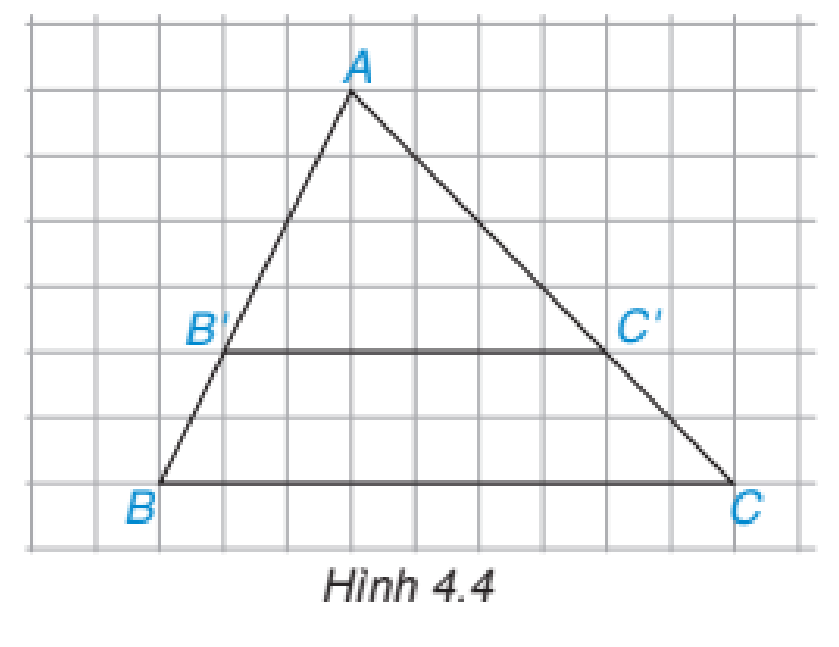
*Hình 4.4*

## 2. ĐỊNH LÍ THALÈS TRONG TAM GIÁC

**Định lí Thalès trong tam giác**

Trong Luyện tập 2, khi $B'C'$ song song với $BC$, ta có các tỉ lệ thức:

$\frac{AB'}{AB} = \frac{AC'}{AC};\quad \frac{AB'}{B'B} = \frac{AC'}{C'C};\quad \frac{B'B}{AB} = \frac{C'C}{AC}.$

Một cách tổng quát, ta có định lí sau:

> **Định lí Thalès**
>
> Nếu một đường thẳng song song với một cạnh của tam giác và cắt hai cạnh còn lại thì nó định ra trên hai cạnh đó những đoạn thẳng tương ứng tỉ lệ.

| GT | $\triangle ABC, B'C' \parallel BC$ ($B' \in AB; C' \in AC$) |
| --- | --- |
| KL | $\frac{AB'}{AB} = \frac{AC'}{AC}; \frac{AB'}{B'B} = \frac{AC'}{C'C}; \frac{B'B}{AB} = \frac{C'C}{AC}.$ |

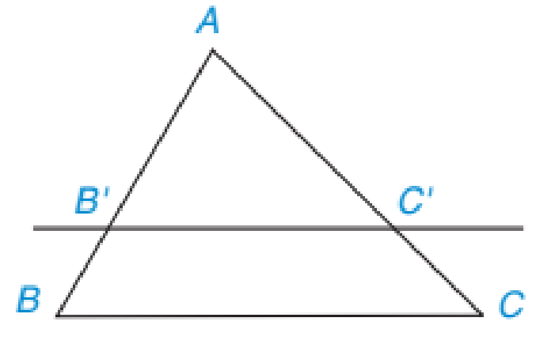

**Ví dụ 1:** Tính độ dài $x$ trong Hình 4.5$^{(*)}$, biết $MN \parallel EF$.
<!-- ocr-ok: đã đối chiếu trực tiếp ảnh trang PDF 79, OCR đọc sai nhãn Ví dụ 1 -->

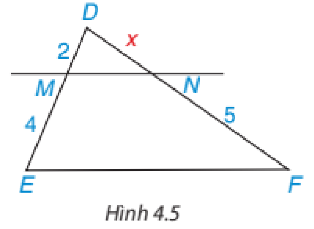
*Hình 4.5*

**Giải**

Xét tam giác $DEF$ có $MN \parallel EF$ nên theo định lí Thalès, ta có:

$\frac{DM}{ME} = \frac{DN}{NF}$ hay $\frac{2}{4} = \frac{x}{5}$, suy ra $x = \frac{2 \cdot 5}{4} = 2,5$.

> (\*) Các số chỉ kích thước trên mỗi hình có cùng đơn vị đo.

<!-- pdf:80 -->

**Luyện tập 3:** Tìm các độ dài $x, y$ trong Hình 4.6.

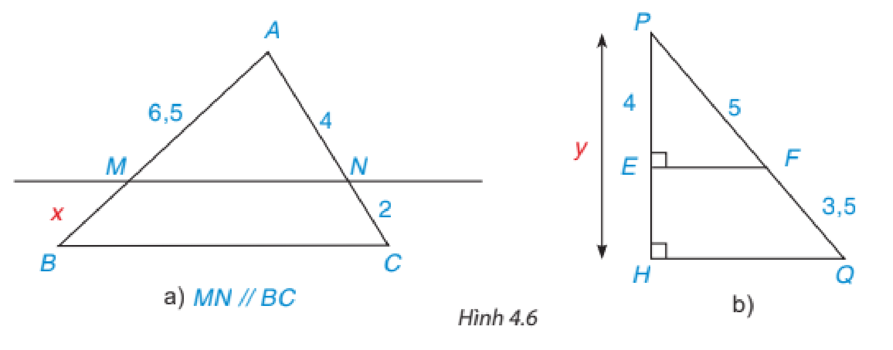
*Hình 4.6*

*Định lí Thalès đảo*

**HĐ4:** Cho $\triangle ABC$ có $AB = 6\text{ cm}, AC = 9\text{ cm}$. Trên cạnh $AB$ lấy điểm $B'$, trên cạnh $AC$ lấy điểm $C'$ sao cho $AB' = 4\text{ cm}, AC' = 6\text{ cm}$ (H.4.7).
<!-- ocr-ok: đã đối chiếu trực tiếp ảnh trang PDF 80, OCR đọc sai nhãn HĐ4 và kí hiệu điểm phẩy -->

- So sánh các tỉ số $\frac{AB'}{AB}$ và $\frac{AC'}{AC}$.
- Vẽ đường thẳng $a$ đi qua $B'$ và song song với $BC$, đường thẳng $a$ cắt $AC$ tại điểm $C''$. Tính độ dài đoạn thẳng $AC''$.
- Nhận xét gì về hai điểm $C', C''$ và hai đường thẳng $B'C', BC$?

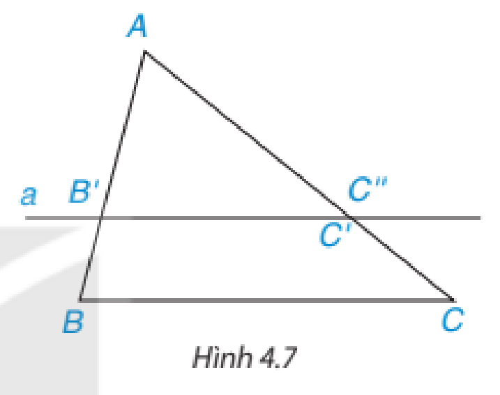
*Hình 4.7*

Ta thừa nhận định lí sau:

> **Định lí Thalès đảo**
>
> Nếu một đường thẳng cắt hai cạnh của một tam giác và định ra trên hai cạnh này những đoạn thẳng tương ứng tỉ lệ thì đường thẳng đó song song với cạnh còn lại của tam giác.

| GT | $\triangle ABC, B' \in AB; C' \in AC; \frac{AB'}{AB} = \frac{AC'}{AC}.$ |
| --- | --- |
| KL | $B'C' \parallel BC.$ |

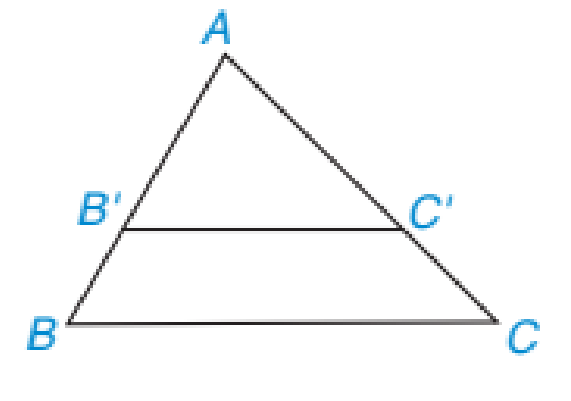

**Ví dụ 2**

Quan sát Hình 4.8. Chứng minh rằng $MN \parallel EF$.

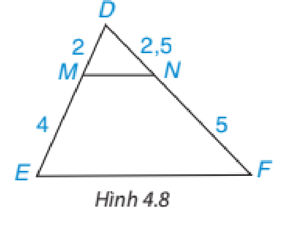
*Hình 4.8*

**Giải**

Trong $\triangle DEF$, ta có: $\frac{DM}{ME} = \frac{2}{4} = \frac{1}{2}; \frac{DN}{NF} = \frac{2,5}{5} = \frac{1}{2}$.

Vì $\frac{DM}{ME} = \frac{DN}{NF} = \frac{1}{2}$ nên $MN \parallel EF$ (định lí Thalès đảo).
<!-- ocr-ok: đã đối chiếu trực tiếp ảnh trang PDF 80, công thức khớp nguyên văn sách in -->

<!-- pdf:81 -->

**Vận dụng**

Em hãy trả lời câu hỏi trong *tình huống mở đầu*.

## BÀI TẬP

4.1. Tìm độ dài $x, y$ trong Hình 4.9 (làm tròn kết quả đến chữ số thập phân thứ nhất).

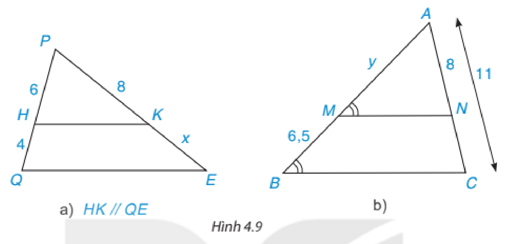
*Hình 4.9*

4.2. Tìm các cặp đường thẳng song song trong Hình 4.10 và giải thích vì sao chúng song song với nhau.

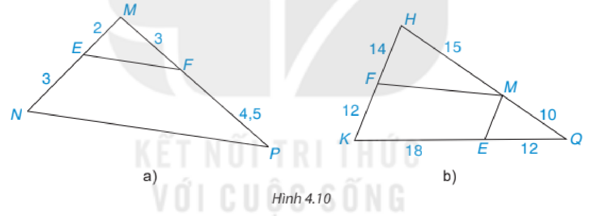
*Hình 4.10*

4.3. Cho $\triangle ABC$, từ điểm $D$ trên cạnh $BC$, kẻ đường thẳng song song với $AB$ cắt $AC$ tại $F$ và kẻ đường thẳng song song với $AC$ cắt $AB$ tại $E$.

Chứng minh rằng: $\frac{AE}{AB} + \frac{AF}{AC} = 1$.

4.4. Cho $\triangle ABC$ có trọng tâm $G$. Vẽ đường thẳng $d$ qua $G$ và song song với $AB$, $d$ cắt $BC$ tại điểm $M$. Chứng minh rằng $BM = \frac{1}{3}BC$.
<!-- ocr-ok: đã đối chiếu trực tiếp ảnh trang PDF 81, OCR đọc sai kí hiệu tam giác và M thành /M -->

4.5. Để đo khoảng cách giữa hai vị trí $B$ và $E$ ở hai bên bờ sông, bác An chọn ba vị trí $A, F, C$ cùng nằm ở một bên bờ sông sao cho ba điểm $C, E, B$ thẳng hàng, ba điểm $C, F, A$ thẳng hàng và $AB \parallel EF$ (H. 4.11). Sau đó bác An đo được $AF = 40\text{ m}, FC = 20\text{ m}, EC = 30\text{ m}$. Hỏi khoảng cách giữa hai vị trí $B$ và $E$ bằng bao nhiêu?

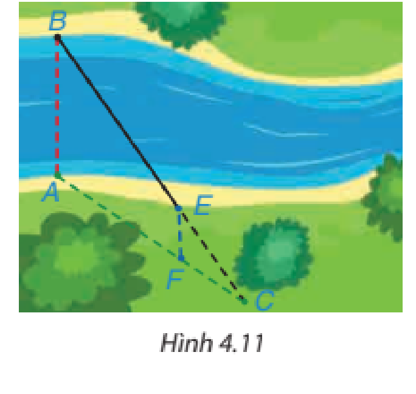
*Hình 4.11*

## 📷 Danh sách hình trong bài

| Mã hình | Trang PDF | Vị trí trong bài | Chú thích gốc |
| --- | :---: | --- | --- |
| H8-toan-b15-01 | 77 | Mở đầu | Hình 4.1 |
| H8-toan-b15-02 | 78 | Mục 1 | Hình 4.2 |
| H8-toan-b15-03 | 78 | Mục 1 | Hình 4.3 |
| H8-toan-b15-04 | 79 | Mục 1, Luyện tập 2 | Hình 4.4 |
| H8-toan-b15-05 | 79 | Mục 2, Định lí Thalès | (sách không đánh số, tam giác $ABC$ có $B'C' \parallel BC$) |
| H8-toan-b15-06 | 79 | Mục 2, Ví dụ 1 | Hình 4.5 |
| H8-toan-b15-07 | 80 | Mục 2, Luyện tập 3 | Hình 4.6 |
| H8-toan-b15-08 | 80 | Mục 2, HĐ4 | Hình 4.7 |
| H8-toan-b15-09 | 80 | Mục 2, Định lí Thalès đảo | (sách không đánh số, tam giác $ABC$ có $B' \in AB, C' \in AC$) |
| H8-toan-b15-10 | 80 | Mục 2, Ví dụ 2 | Hình 4.8 |
| H8-toan-b15-11 | 81 | Bài tập 4.1 | Hình 4.9 |
| H8-toan-b15-12 | 81 | Bài tập 4.2 | Hình 4.10 |
| H8-toan-b15-13 | 81 | Bài tập 4.5 | Hình 4.11 |
