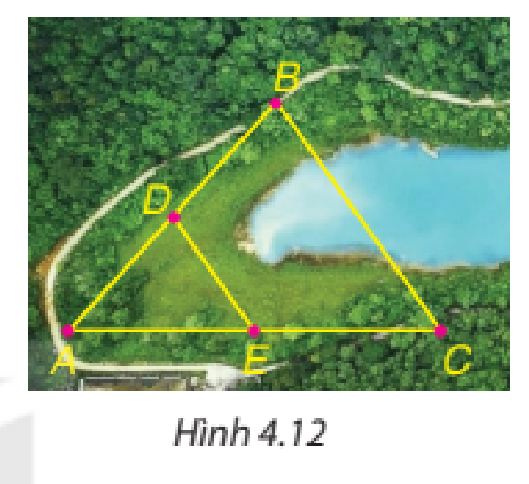
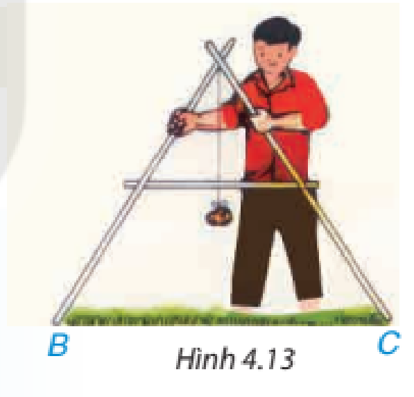
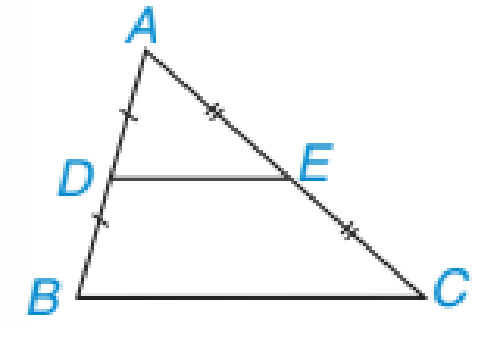
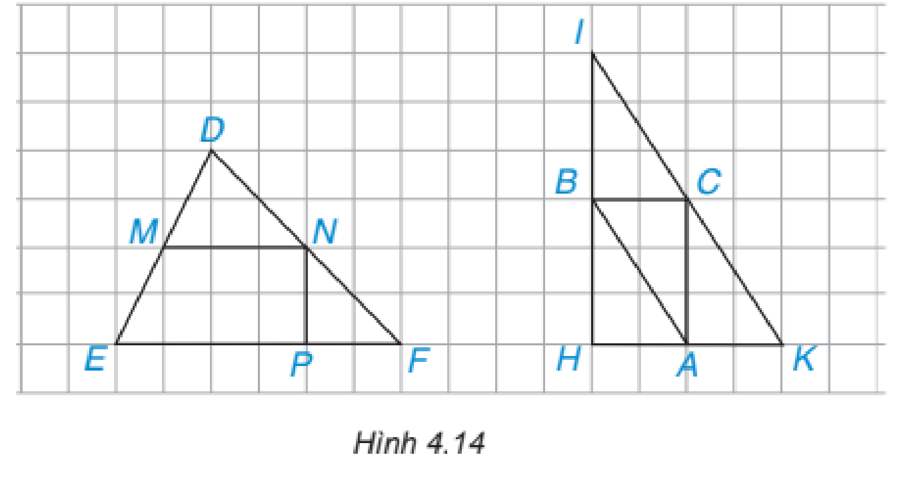
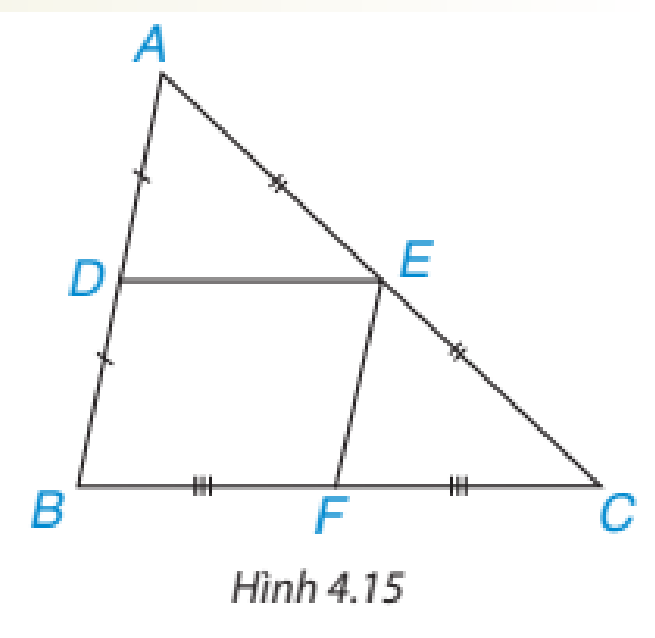
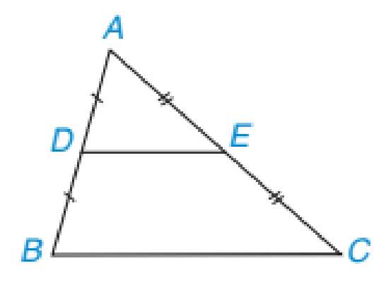
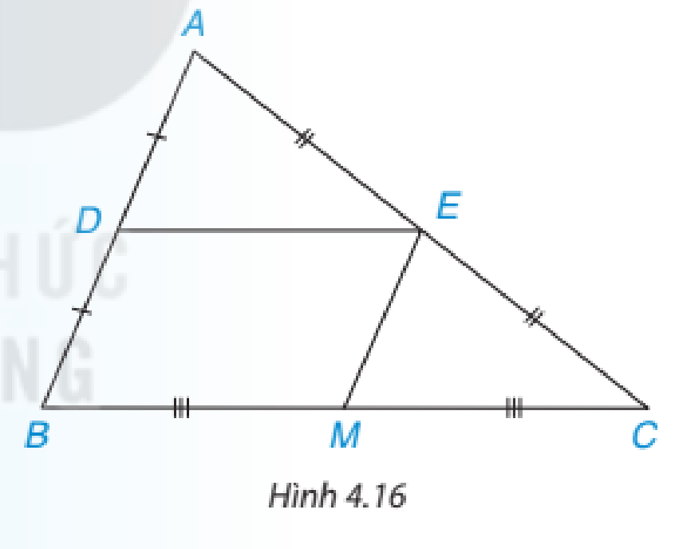
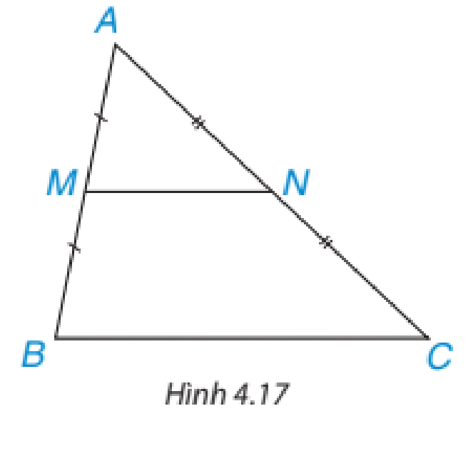
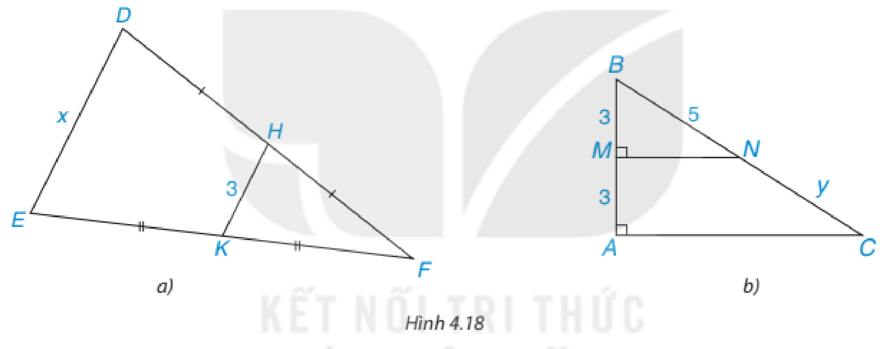

<!-- pdf:82 -->

# BÀI 16: ĐƯỜNG TRUNG BÌNH CỦA TAM GIÁC

## 🔤 Khái niệm, thuật ngữ

- Đường trung bình của tam giác

## 🎯 Kiến thức, kĩ năng

- Mô tả định nghĩa đường trung bình của tam giác.
- Giải thích tính chất đường trung bình của tam giác.

## 🔴 Mở đầu

Cho $B$ và $C$ là hai điểm cách nhau bởi một hồ nước như Hình 4.12 với $D, E$ lần lượt là trung điểm của $AB$ và $AC$. Biết $DE = 500\text{ m}$, liệu không cần đo trực tiếp, ta có thể tính được khoảng cách giữa hai điểm $B$ và $C$ không?

*Hình 4.12*

## 1. ĐỊNH NGHĨA ĐƯỜNG TRUNG BÌNH CỦA TAM GIÁC

**Nhận biết đường trung bình của tam giác**

Hình 4.13 mô tả thước chữ A dùng để đo đạc trên mặt đất. Thanh ngang đặt ở trung điểm của hai thanh bên. Thanh ngang của thước chữ A trong Hình 4.13 là hình ảnh đường trung bình của tam giác.

*Hình 4.13*

Tổng quát ta có định nghĩa sau:

> **Đường trung bình của tam giác** là đoạn thẳng nối trung điểm hai cạnh của tam giác.

> ❓ Em hãy chỉ ra các đường trung bình của $\triangle DEF$ và $\triangle IHK$ trong Hình 4.14.

*Hình 4.14*

<!-- pdf:83 -->

## 2. TÍNH CHẤT ĐƯỜNG TRUNG BÌNH CỦA TAM GIÁC

*Tính chất đường trung bình của tam giác*

Cho $DE$ là đường trung bình của tam giác $ABC$ (H.4.15).

**HĐ1:** Sử dụng định lí Thalès đảo, chứng minh rằng $DE \parallel BC$.

**HĐ2:** Gọi $F$ là trung điểm của $BC$. Chứng minh tứ giác $DEFB$ là hình bình hành. Từ đó suy ra $DE = \frac{1}{2}BC$.

*Hình 4.15*

<!-- term: Tính chất đường trung bình của tam giác -->
> **Định lí 1:** Đường trung bình của tam giác song song với cạnh thứ ba và bằng nửa cạnh đó.

| GT | $\triangle ABC, AD = DB, AE = EC, D \in AB, E \in AC$. |
| --- | --- |
| KL | $DE \parallel BC; DE = \frac{1}{2}BC$. |

**Chứng minh định lí**

Gọi $M$ là trung điểm của $BC$ (H.4.16).

Tam giác $ABC$ có $\frac{AD}{AB} = \frac{AE}{AC} = \frac{1}{2}$, suy ra $DE \parallel BC$ (định lí Thalès đảo).

Tương tự, ta chứng minh được $EM \parallel AB$.

Tứ giác $DEMB$ có: $DE \parallel BM$ và $EM \parallel DB$ nên tứ giác $DEMB$ là hình bình hành (dấu hiệu nhận biết hình bình hành), suy ra $DE = BM = \frac{1}{2}BC$.

Vậy $DE \parallel BC$ và $DE = \frac{1}{2}BC$.

*Hình 4.16*

<!-- term: Tính chất đường trung bình của tam giác -->
**Chú ý:** Trong một tam giác, nếu một đường thẳng đi qua trung điểm một cạnh và song song với cạnh thứ hai thì nó đi qua trung điểm của cạnh thứ ba.

**Ví dụ**

Cho tam giác $ABC$ với $M$ là trung điểm của $AB$, $N$ là trung điểm của $AC$ và $BC = 10\text{ cm}$. Tính $MN$.
<!-- ocr-ok: đã đối chiếu trực tiếp ảnh trang PDF 83, đề bài Ví dụ khớp nguyên văn sách in -->

*Hình 4.17*

<!-- pdf:84 -->

**Giải:** (H.4.17)

Tam giác $ABC$ có $M$ là trung điểm của $AB$; $N$ là trung điểm của $AC$. Do đó, $MN$ là đường trung bình của $\triangle ABC$. Suy ra $MN = \frac{1}{2}BC = \frac{1}{2} \cdot 10 = 5\ (\text{cm})$ (tính chất đường trung bình của tam giác). Vậy $MN = 5\text{ cm}$.

**Luyện tập:** Cho tam giác $ABC$ cân tại $A$, $D$ và $E$ lần lượt là trung điểm của $AB, AC$. Tứ giác $DECB$ là hình gì? Tại sao?

**Vận dụng:** Em hãy trả lời câu hỏi trong *tình huống mở đầu*.

## BÀI TẬP

4.6. Tính các độ dài $x, y$ trong Hình 4.18.

*Hình 4.18*

4.7. Cho tam giác $ABC$. Gọi $M, N, P$ lần lượt là trung điểm của các cạnh $AB, AC, BC$.

a) Chứng minh tứ giác $BMNC$ là hình thang.

b) Tứ giác $MNPB$ là hình gì? Tại sao?

4.8. Cho tam giác $ABC$ có trung tuyến $AM$. Lấy hai điểm $D$ và $E$ trên cạnh $AB$ sao cho $AD = DE = EB$ và $D$ nằm giữa hai điểm $A, E$.
<!-- ocr-ok: đã đối chiếu trực tiếp ảnh trang PDF 84, OCR dính chữ Dnằm -->

a) Chứng minh $DC \parallel EM$.

b) $DC$ cắt $AM$ tại $I$. Chứng minh $I$ là trung điểm của $AM$.
<!-- ocr-ok: đã đối chiếu trực tiếp ảnh trang PDF 84, OCR đọc sai I thành ! -->

4.9. Cho hình chữ nhật $ABCD$ có $AC$ cắt $BD$ tại $O$. Gọi $H, K$ lần lượt là trung điểm của $AB, AD$. Chứng minh rằng tứ giác $AHOK$ là hình chữ nhật.

## 📷 Danh sách hình trong bài

| Mã hình | Trang PDF | Vị trí trong bài | Chú thích gốc |
| --- | :---: | --- | --- |
| H8-toan-b16-01 | 82 | Mở đầu | Hình 4.12 |
| H8-toan-b16-02 | 82 | Mục 1 | Hình 4.13 |
| H8-toan-b16-03 | 82 | Mục 1, Định nghĩa | (sách không đánh số, đường trung bình $DE$ của tam giác $ABC$) |
| H8-toan-b16-04 | 82 | Mục 1, Câu hỏi | Hình 4.14 |
| H8-toan-b16-05 | 83 | Mục 2, HĐ1–HĐ2 | Hình 4.15 |
| H8-toan-b16-06 | 83 | Mục 2, Định lí 1 | (sách không đánh số, tam giác $ABC$ có đường trung bình $DE$) |
| H8-toan-b16-07 | 83 | Mục 2, Chứng minh định lí | Hình 4.16 |
| H8-toan-b16-08 | 83 | Mục 2, Ví dụ | Hình 4.17 |
| H8-toan-b16-09 | 84 | Bài tập 4.6 | Hình 4.18 |
