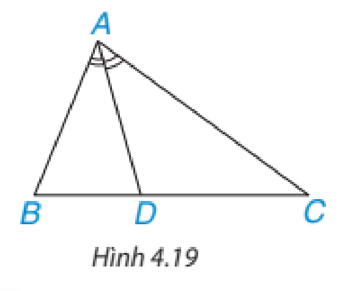
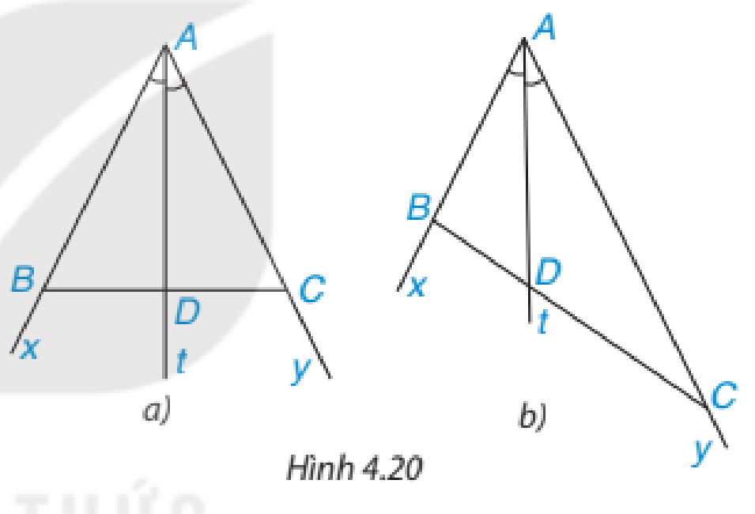
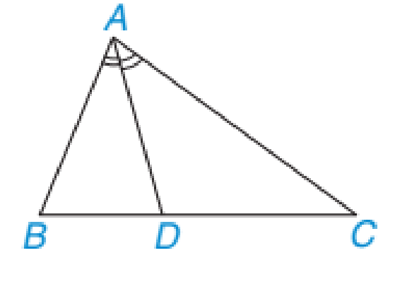
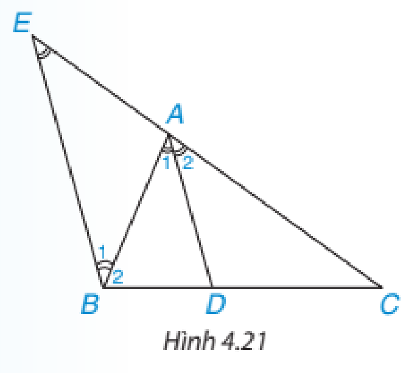
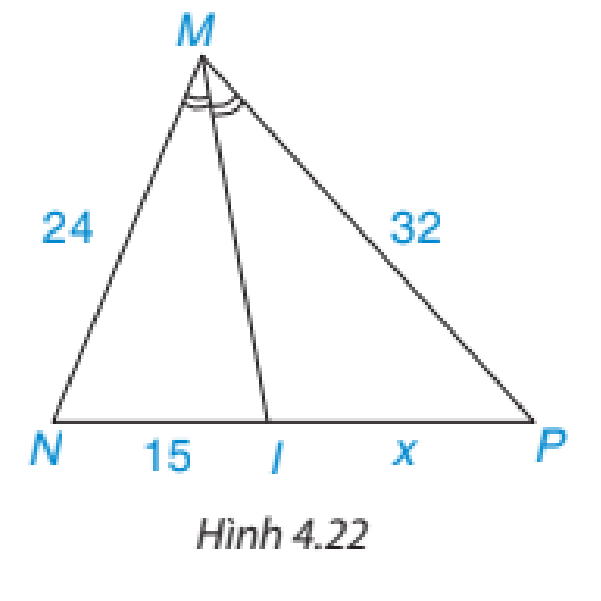
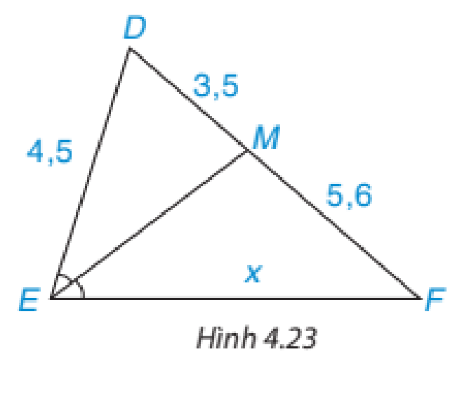
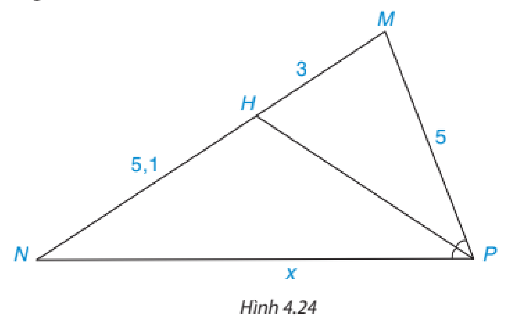
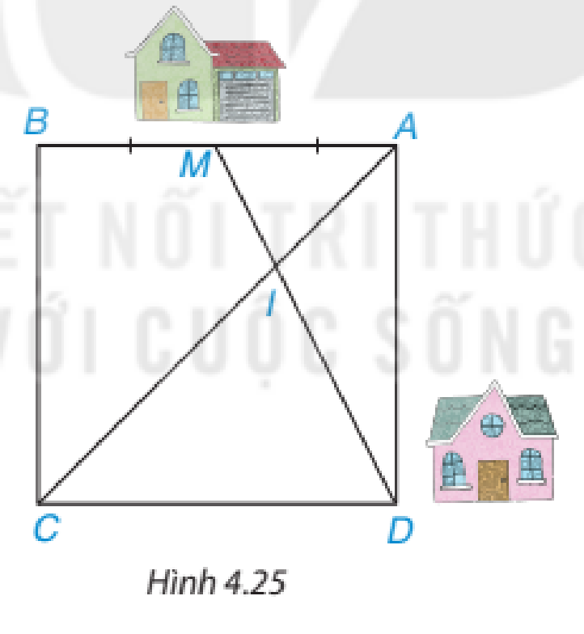
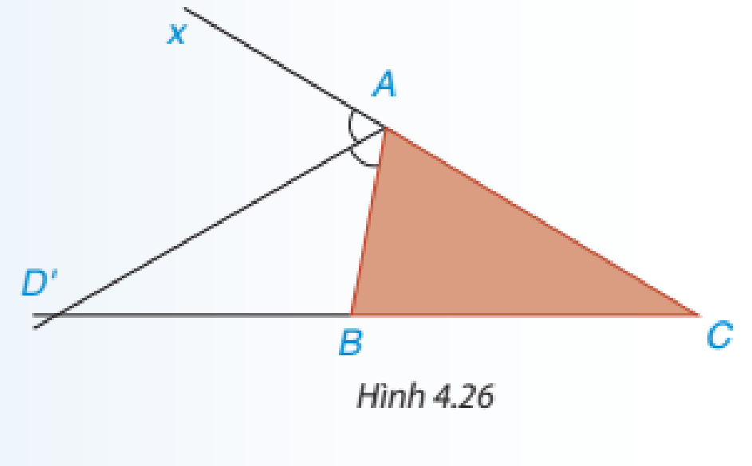

<!-- pdf:85 -->

# BÀI 17: TÍNH CHẤT ĐƯỜNG PHÂN GIÁC CỦA TAM GIÁC

## 🎯 Kiến thức, kĩ năng

- Giải thích tính chất đường phân giác trong của tam giác.
- Sử dụng tính chất đường phân giác trong của tam giác để tính độ dài đoạn thẳng và tỉ số của hai đoạn thẳng.

## 🔴 Mở đầu

Trong H.4.19, $AD$ là đường phân giác của tam giác $ABC$. Hai tỉ số $\frac{DB}{DC}$ và $\frac{AB}{AC}$ có bằng nhau không?

*Hình 4.19*

*Tính chất đường phân giác của tam giác*

Cho tia phân giác $At$ của góc $xAy$ (H.4.20). Nếu lấy điểm $B$ trên tia $Ax$, điểm $C$ trên tia $Ay$, ta được tam giác $ABC$. Giả sử tia phân giác $At$ cắt $BC$ tại điểm $D$.

*Hình 4.20*

**HĐ1:** Khi lấy $B$ và $C$ sao cho $AB = AC$ (H.4.20a), hãy so sánh hai tỉ số $\frac{DB}{DC}$ và $\frac{AB}{AC}$.

**HĐ2:** Khi lấy $B$ và $C$ sao cho $AB = 2\text{ cm}$ và $AC = 4\text{ cm}$ (H.4.20b), hãy dùng thước có vạch chia đến milimét để đo độ dài các đoạn thẳng $DB, DC$ rồi so sánh hai tỉ số $\frac{DB}{DC}$ và $\frac{AB}{AC}$.

> **Định lí:** (**Tính chất đường phân giác của tam giác**)
>
> Trong một tam giác, đường phân giác của một góc chia cạnh đối diện thành hai đoạn thẳng tỉ lệ với hai cạnh kề với hai đoạn ấy.

| GT | $\triangle ABC$, $AD$ là đường phân giác của góc $\widehat{BAC}$ ($D \in BC$). |
| --- | --- |
| KL | $\frac{DB}{DC} = \frac{AB}{AC}$. |

<!-- pdf:86 -->

**Chứng minh định lí**

Vẽ đường thẳng qua $B$, song song với $AD$, cắt đường thẳng $AC$ tại $E$ (H.4.21).

Theo giả thiết, $AD$ là phân giác của góc $A$ nên $\widehat{A_1} = \widehat{A_2}$.

Ta có $EB \parallel AD$ nên $\widehat{A_1} = \widehat{B_1}$ (hai góc so le trong);

$\widehat{A_2} = \widehat{E}$ (hai góc đồng vị).

Do đó, $\widehat{B_1} = \widehat{E}$ ($= \widehat{A_1} = \widehat{A_2}$) nên tam giác $AEB$ cân tại $A$.

Suy ra $AE = AB$. (1)

Mặt khác, áp dụng định lí Thalès vào tam giác $CEB$, ta có:

$\frac{DB}{DC} = \frac{AE}{AC}$. (2)

Từ (1) và (2) ta suy ra $\frac{DB}{DC} = \frac{AB}{AC}$ (đpcm).

*Hình 4.21*

<!-- term: Dấu hiệu nhận biết đường phân giác của tam giác -->
**Chú ý:** Trong tam giác $ABC$, nếu $D$ là điểm thuộc đoạn $BC$ và thoả mãn $\frac{DB}{DC} = \frac{AB}{AC}$ thì $AD$ là đường phân giác của góc $A$.

**Ví dụ**

Tính độ dài $x$ trong Hình 4.22.

*Hình 4.22*

**Giải**

Trong tam giác $MNP$ có $MI$ là đường phân giác của góc $M$. Do đó ta có:

$\frac{IP}{IN} = \frac{MP}{MN}\text{ hay }\frac{x}{15} = \frac{32}{24}.$

Từ đó suy ra $x = \frac{15 \cdot 32}{24} = 20$.

**Luyện tập**

Tính độ dài $x$ trên Hình 4.23.

*Hình 4.23*

<!-- pdf:87 -->

## BÀI TẬP

4.10. Tính độ dài $x$ trong Hình 4.24.

*Hình 4.24*

4.11. Cho tam giác $ABC$. Đường phân giác trong của góc $A$ cắt $BC$ tại $D$. Tính độ dài đoạn thẳng $DC$ biết $AB = 4,5\text{ m}$; $AC = 7,0\text{ m}$ và $CB = 3,5\text{ m}$ (làm tròn kết quả đến hàng phần chục).

4.12. Nhà bạn Mai ở vị trí $M$, nhà bạn Dung ở vị trí $D$ (Hình 4.25), biết rằng tứ giác $ABCD$ là hình vuông và $M$ là trung điểm của $AB$. Hai bạn đi bộ với cùng một vận tốc trên con đường $MD$ để đến điểm $I$. Bạn Mai xuất phát lúc 7h. Hỏi bạn Dung phải xuất phát lúc mấy giờ để gặp bạn Mai lúc 7h30 tại điểm $I$?

*Hình 4.25*

## 💡 Em có biết?

Đường phân giác của góc ngoài của một tam giác (còn gọi là **đường phân giác ngoài**) cũng có tính chất tương tự như đường phân giác trong. Cụ thể là:

Trong hình 4.26, $AD'$ là phân giác của góc $BAx$ (đường phân giác ngoài của $\triangle ABC$ tại $A$), ta có tỉ lệ thức $\frac{D'B}{D'C} = \frac{AB}{AC}$.
<!-- ocr-ok: đã đối chiếu trực tiếp ảnh trang PDF 87, OCR đọc sai tỉ lệ thức thành tệ thức -->

*Hình 4.26*

## 📷 Danh sách hình trong bài

| Mã hình | Trang PDF | Vị trí trong bài | Chú thích gốc |
| --- | :---: | --- | --- |
| H8-toan-b17-01 | 85 | Mở đầu | Hình 4.19 |
| H8-toan-b17-02 | 85 | HĐ1–HĐ2 | Hình 4.20 |
| H8-toan-b17-03 | 85 | Định lí | (sách không đánh số, tam giác $ABC$ có đường phân giác $AD$) |
| H8-toan-b17-04 | 86 | Chứng minh định lí | Hình 4.21 |
| H8-toan-b17-05 | 86 | Ví dụ | Hình 4.22 |
| H8-toan-b17-06 | 86 | Luyện tập | Hình 4.23 |
| H8-toan-b17-07 | 87 | Bài tập 4.10 | Hình 4.24 |
| H8-toan-b17-08 | 87 | Bài tập 4.12 | Hình 4.25 |
| H8-toan-b17-09 | 87 | Em có biết? | Hình 4.26 |
