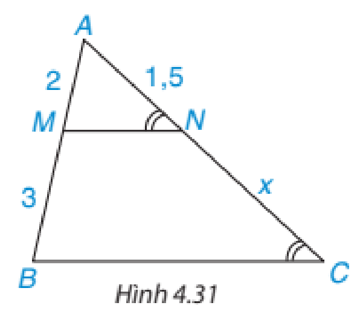
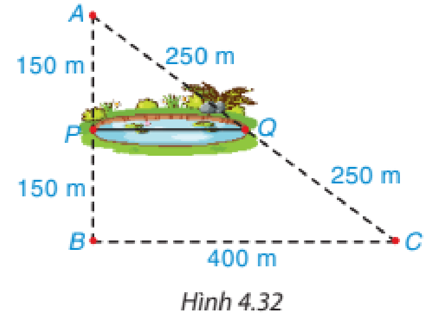

<!-- pdf:90 -->

# BÀI TẬP CUỐI CHƯƠNG IV

**A. TRẮC NGHIỆM**

4.18. Độ dài $x$ trong Hình 4.31 bằng

A. $2,75$.

B. $2$.

C. $2,25$.

D. $3,75$.

*Hình 4.31*

4.19. Cho tam giác $ABC$. Gọi $H, K$ lần lượt là trung điểm của $AC, BC$. Biết $HK = 3,5\text{ cm}$. Độ dài $AB$ bằng

A. $3,5\text{ cm}$.

B. $7\text{ cm}$.

C. $10\text{ cm}$.

D. $15\text{ cm}$.

4.20. Cho tam giác $ABC$ có chu vi là $32\text{ cm}$. Gọi $M, N, P$ lần lượt là trung điểm của các cạnh $AB, AC, BC$. Chu vi của tam giác $MNP$ là

A. $8\text{ cm}$.

B. $64\text{ cm}$.

C. $30\text{ cm}$.

D. $16\text{ cm}$.

4.21. Cho tam giác $ABC$ có $AB = 9\text{ cm}$, $D$ là điểm thuộc cạnh $AB$ sao cho $AD = 6\text{ cm}$. Kẻ $DE$ song song với $BC$ ($E$ thuộc $AC$), kẻ $EF$ song song với $CD$ ($F$ thuộc $AB$). Độ dài $AF$ bằng
<!-- ocr-ok: đã đối chiếu trực tiếp ảnh trang PDF 90, OCR dính chữ Dlà -->

A. $4\text{ cm}$.

B. $5\text{ cm}$.

C. $6\text{ cm}$.

D. $7\text{ cm}$.

4.22. Cho tam giác $ABC$ cân tại $A$ có $AB = 15\text{ cm}, BC = 10\text{ cm}$, đường phân giác trong của góc $B$ cắt $AC$ tại $D$. Khi đó, đoạn thẳng $AD$ có độ dài là

A. $3\text{ cm}$.

B. $6\text{ cm}$.

C. $9\text{ cm}$.

D. $12\text{ cm}$.

**B. TỰ LUẬN**

4.23. Cho góc $xOy$. Trên tia $Ox$, lấy hai điểm $A$ và $B$ sao cho $OA = 2\text{ cm}, OB = 5\text{ cm}$. Trên tia $Oy$, lấy điểm $C$ sao cho $OC = 3\text{ cm}$. Từ điểm $B$ kẻ đường thẳng song song với $AC$ cắt $Oy$ tại $D$. Tính độ dài đoạn thẳng $CD$.
<!-- ocr-ok: đã đối chiếu trực tiếp ảnh trang PDF 90, OCR đọc sai B thành 8 -->

4.24. Cho tam giác $ABC$ vuông tại $A$. Gọi $D, E, F$ lần lượt là trung điểm của $AB, BC, AC$.

a) Chứng minh rằng $AE = DF$.

b) Gọi $I$ là trung điểm của $DE$. Chứng minh rằng ba điểm $B, I, F$ thẳng hàng.

4.25. Cho tam giác $ABC$, các đường trung tuyến $BD$ và $CE$ cắt nhau tại $G$. Gọi $I, K$ lần lượt là trung điểm của $GB, GC$. Chứng minh tứ giác $EDKI$ là hình bình hành.

4.26. Cho tam giác $ABC$, điểm $I$ thuộc cạnh $AB$, điểm $K$ thuộc cạnh $AC$. Kẻ $IM$ song song với $BK$ ($M$ thuộc $AC$), kẻ $KN$ song song với $CI$ ($N$ thuộc $AB$). Chứng minh $MN$ song song với $BC$.
<!-- ocr-ok: đã đối chiếu trực tiếp ảnh trang PDF 90, OCR đọc sai I thành / và BC thành BƠ -->

4.27. Bác Mến muốn tính khoảng cách giữa hai vị trí $P, Q$ ở hai bên bờ ao cá. Để làm điều đó, bác Mến chọn ba vị trí $A, B, C$, thực hiện đo đạc và vẽ mô phỏng như Hình 4.32. Em hãy giúp bác Mến tính khoảng cách giữa hai điểm $P$ và $Q$.

*Hình 4.32*

## 📷 Danh sách hình trong bài

| Mã hình | Trang PDF | Vị trí trong bài | Chú thích gốc |
| --- | :---: | --- | --- |
| H8-toan-bt-c04-01 | 90 | Bài tập 4.18 | Hình 4.31 |
| H8-toan-bt-c04-02 | 90 | Bài tập 4.27 | Hình 4.32 |
