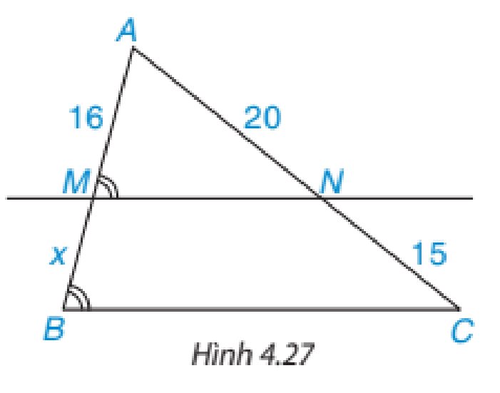
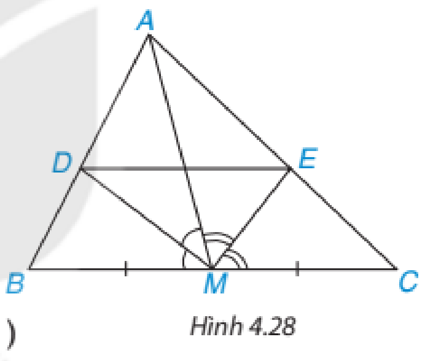
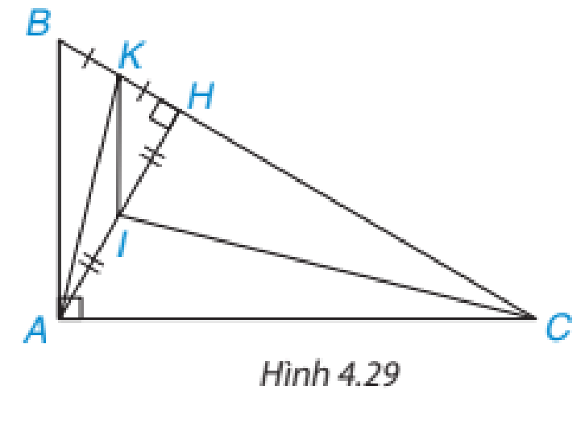
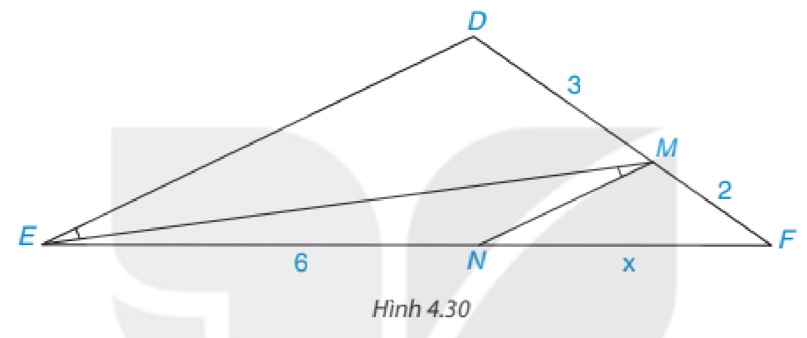

<!-- pdf:88 -->

# LUYỆN TẬP CHUNG (TRANG 87)

**Ví dụ 1**

Tìm độ dài $x$ trong Hình 4.27.

*Hình 4.27*

**Giải:** (H.4.27)

Ta có $\widehat{AMN} = \widehat{ABC}$ (giả thiết), mà hai góc này ở vị trí đồng vị nên $MN \parallel BC$ (dấu hiệu nhận biết hai đường thẳng song song).

Suy ra $\frac{AM}{MB} = \frac{AN}{NC}$ (định lí Thalès trong tam giác),

hay $\frac{16}{x} = \frac{20}{15}$, suy ra $x = \frac{16 \cdot 15}{20} = 12$.

**Ví dụ 2**

Cho tam giác $ABC$ với đường trung tuyến $AM$. Tia phân giác của góc $AMB$ cắt cạnh $AB$ tại $D$, tia phân giác của góc $AMC$ cắt cạnh $AC$ tại $E$. Chứng minh $DE \parallel BC$.

*Hình 4.28*

**Giải:** (H.4.28)

Trong $\triangle AMB$, $MD$ là phân giác của $\widehat{AMB}$ nên
<!-- ocr-ok: đã đối chiếu trực tiếp ảnh trang PDF 88, công thức khớp nguyên văn sách in -->

$\frac{DA}{DB} = \frac{MA}{MB}$ (tính chất đường phân giác trong tam giác). (1)

Trong $\triangle AMC$, $ME$ là phân giác của $\widehat{AMC}$ nên
<!-- ocr-ok: đã đối chiếu trực tiếp ảnh trang PDF 88, công thức khớp nguyên văn sách in -->

$\frac{EA}{EC} = \frac{MA}{MC}$ (tính chất đường phân giác trong tam giác). (2)

Mặt khác, $MB = MC$ (do $M$ là trung điểm của $BC$). (3)
<!-- ocr-ok: đã đối chiếu trực tiếp ảnh trang PDF 88, công thức khớp nguyên văn sách in -->

Từ (1), (2) và (3) suy ra $\frac{DA}{DB} = \frac{EA}{EC}$.

Do đó $DE \parallel BC$ (định lí Thalès đảo).

**Ví dụ 3**

Cho $\triangle ABC$ vuông tại $A$, đường cao $AH$ ($H \in BC$).
<!-- ocr-ok: đã đối chiếu trực tiếp ảnh trang PDF 88, kí hiệu thuộc và tam giác khớp nguyên văn sách in -->

Gọi $I$ và $K$ lần lượt là trung điểm của $AH$ và $HB$.

Chứng minh rằng:

a) $IK \perp AC$;

b) $AK \perp CI$.

*Hình 4.29*

**Giải:** (H.4.29)

a) Tam giác $AHB$ có $I$ là trung điểm của $AH$, $K$ là trung điểm của $BH$ nên $KI$ là đường trung bình của $\triangle AHB$.

<!-- pdf:89 -->

Từ đó, suy ra $KI \parallel AB$ (tính chất đường trung bình của tam giác).

Vì $AB \perp AC$ (do $\triangle ABC$ vuông tại $A$) nên $KI \perp AC$.
<!-- ocr-ok: đã đối chiếu trực tiếp ảnh trang PDF 89, công thức vuông góc khớp nguyên văn sách in -->

b) Tam giác $AKC$ có: $AH \perp KC$ (giả thiết);
<!-- ocr-ok: đã đối chiếu trực tiếp ảnh trang PDF 89, công thức vuông góc khớp nguyên văn sách in -->

$KI \perp AC$ (chứng minh trên).

Vì $AH$ cắt $KI$ tại $I$ nên $I$ là trực tâm của $\triangle AKC$. Suy ra $CI \perp AK$.
<!-- ocr-ok: đã đối chiếu trực tiếp ảnh trang PDF 89, OCR đọc sai trực tâm thành trực tãm -->

## BÀI TẬP

4.13. Tìm độ dài $x$ trong Hình 4.30
<!-- ocr-ok: đã đối chiếu trực tiếp ảnh trang PDF 89, OCR đọc sai Tìm thành Tim -->

*Hình 4.30*

4.14. Cho tứ giác $ABCD$, gọi $E, F, K$ lần lượt là trung điểm của $AD, BC, AC$.

a) Chứng minh $EK \parallel CD, FK \parallel AB$.

b) So sánh $EF$ và $\frac{1}{2}(AB + CD)$.

4.15. Cho tam giác $ABC$, phân giác $AD$ ($D \in BC$). Đường thẳng qua $D$ song song với $AB$ cắt $AC$ tại $E$. Chứng minh rằng $\frac{AC}{AB} = \frac{EC}{EA}$.
<!-- ocr-ok: đã đối chiếu trực tiếp ảnh trang PDF 89, OCR đọc sai Chứng thành Ehứng -->

4.16. Tam giác $ABC$ có $AB = 15\text{ cm}, AC = 20\text{ cm}, BC = 25\text{ cm}$. Đường phân giác của góc $BAC$ cắt cạnh $BC$ tại $D$.

a) Tính độ dài đoạn thẳng $DB$ và $DC$.

b) Tính tỉ số diện tích của hai tam giác $ABD$ và $ACD$.

4.17. Cho hình bình hành $ABCD$, một đường thẳng đi qua $D$ cắt $AC, AB, CB$ theo thứ tự tại $M, N, K$. Chứng minh rằng: $DM^2 = MN \cdot MK$.

## 📷 Danh sách hình trong bài

| Mã hình | Trang PDF | Vị trí trong bài | Chú thích gốc |
| --- | :---: | --- | --- |
| H8-toan-ltc-c04-01 | 88 | Ví dụ 1 | Hình 4.27 |
| H8-toan-ltc-c04-02 | 88 | Ví dụ 2 | Hình 4.28 |
| H8-toan-ltc-c04-03 | 88 | Ví dụ 3 | Hình 4.29 |
| H8-toan-ltc-c04-04 | 89 | Bài tập 4.13 | Hình 4.30 |
