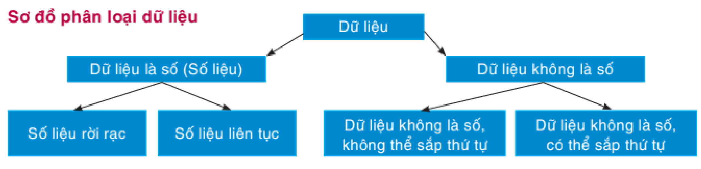

<!-- pdf:91 -->
<!-- Trang mở đầu Chương V (PDF 91): Chương V. DỮ LIỆU VÀ BIỂU ĐỒ (THỐNG KÊ) — "Mục đích của trực quan hoá dữ liệu là có cái nhìn sâu sắc về dữ liệu, không phải để có một bức tranh" (Ben Shneiderman, Nhà khoa học người Mỹ.) -->

# BÀI 18: THU THẬP VÀ PHÂN LOẠI DỮ LIỆU

## 🔤 Khái niệm, thuật ngữ

- Số liệu rời rạc
- Số liệu liên tục

## 🎯 Kiến thức, kĩ năng

- Thực hiện và lí giải việc thu thập dữ liệu.
- Phân loại số liệu rời rạc, số liệu liên tục.

## 1. THU THẬP DỮ LIỆU

**Thu thập dữ liệu**

**HĐ1:** Nêu các phương pháp thu thập dữ liệu đã được học. Mỗi phương pháp cho một ví dụ.

> Thu thập dữ liệu có thể là trực tiếp hoặc gián tiếp.
> - **Thu thập dữ liệu trực tiếp** là việc thu thập dữ liệu thông qua quan sát, làm thí nghiệm, lập bảng hỏi, phỏng vấn,...
> - **Thu thập dữ liệu gián tiếp** là việc thu thập dữ liệu từ những nguồn có sẵn như sách, báo, mạng Internet,...
>
> Để có thể đưa ra các kết luận hợp lí, dữ liệu thu thập được phải đảm bảo **tính đại diện** cho toàn bộ đối tượng đang được quan tâm.

<!-- pdf:92 -->

**Ví dụ 1:** Để thu thập mỗi dữ liệu sau, ta nên làm thế nào? Đó là thu thập dữ liệu trực tiếp hay gián tiếp?

a) Dữ liệu về xếp hạng FIFA của bóng đá nam Việt Nam trong thời gian gần đây.

b) Số liệu về sự phát triển chiều cao của một giống cây mới theo thời gian.

**Giải**

a) Để thu thập dữ liệu về xếp hạng FIFA của bóng đá nam Việt Nam trong thời gian gần đây, cách tốt nhất là ta vào website của Liên đoàn Bóng đá Thế giới (FIFA) tại địa chỉ *fifa.com/fifa-world-ranking/vie* để thu thập. Đây là phương pháp thu nhập dữ liệu gián tiếp.
<!-- Sách in "thu nhập dữ liệu gián tiếp" ở câu cuối ý a; giữ nguyên văn theo quy tắc Tầng 1. -->

b) Để có số liệu về sự phát triển chiều cao của một giống cây mới theo thời gian, ta trồng cây và định kì đo chiều cao, ghi lại kết quả. Đây là phương pháp thu thập dữ liệu trực tiếp.

**Luyện tập 1:** Em hãy cho biết phương pháp thu thập dữ liệu trong mỗi trường hợp sau là trực tiếp hay gián tiếp.

a) Nam vào website của Tổng cục Thống kê và ghi lại số quận/huyện của các tỉnh/thành phố thuộc đồng bằng Bắc Bộ.

b) Thầy giáo dạy Giáo dục thể chất đã đo và ghi lại thời gian chạy cự li $1\,000$ mét của các bạn học sinh khối 8.

## 2. PHÂN LOẠI DỮ LIỆU

**HĐ2:** Cho hai dãy dữ liệu sau về $5$ học sinh.

(A) Chiều cao (đơn vị: $\text{cm}$): $128,1; \quad 132,9; \quad 125,7; \quad 131,3; \quad 133,6$.

(B) Số môn thể thao học sinh biết chơi: $2; \quad 1; \quad 5; \quad 2; \quad 3$.

a) Hai dãy dữ liệu này có phải là số liệu không?

b) Đo chiều cao (kí hiệu là $h$) một học sinh khác và hỏi về số môn thể thao (kí hiệu là $n$) mà em đó biết chơi.

+ $h$ có thể nhận giá trị bất kì lớn hơn $120\text{ cm}$ và nhỏ hơn $150\text{ cm}$ được không?

+ $n$ có thể nhận giá trị lớn hơn $3$ và nhỏ hơn $4$ được không?

> Số liệu có thể nhận giá trị tuỳ ý trong một khoảng nào đó được gọi là **số liệu liên tục**. Số liệu không phải là số liệu liên tục được gọi là **số liệu rời rạc**.

**Chú ý**

1) Dạng hay gặp của số liệu liên tục là số liệu thu được từ các phép đo như chiều cao, cân nặng, nhiệt độ,...

2) Dạng hay gặp của số liệu rời rạc là số liệu đếm số phần tử của một tập nào đó, chẳng hạn số học sinh trong lớp học, số sản phẩm một công nhân làm được trong ngày,...

*Sơ đồ phân loại dữ liệu:*
- **Dữ liệu** gồm:
  - **Dữ liệu là số** (**Số liệu**): gồm *Số liệu rời rạc* và *Số liệu liên tục*.
  - **Dữ liệu không là số**: gồm *Dữ liệu không là số, không thể sắp thứ tự* và *Dữ liệu không là số, có thể sắp thứ tự*.
<!-- ocr-ok: đã đối chiếu ảnh trang PDF 92, sơ đồ phân nhánh dữ liệu -->

<!-- pdf:93 -->

**Ví dụ 2:** Với mỗi câu hỏi sau, Quỳnh đã hỏi ba bạn và ghi lại câu trả lời.

a) Nhà bạn có bao nhiêu chiếc ti vi? Kết quả: $3; \quad 52; \quad 2$.

b) Bạn mất bao nhiêu thời gian (đơn vị: giờ) để hoàn thành bài tập về nhà?

Kết quả: $1,5; \quad 2,3; \quad 1,9$.

Mỗi dãy dữ liệu trên thuộc loại nào? Chỉ ra giá trị không hợp lí nếu có.

**Giải**

a) Dữ liệu thu được là số liệu rời rạc. Giá trị $52$ không hợp lí.

b) Dữ liệu thu được là số liệu liên tục.

**Luyện tập 2:** Với mỗi câu hỏi sau, An đã hỏi $5$ bạn và ghi lại câu trả lời.

a) Bạn nặng bao nhiêu kilôgam? Kết quả: $48; \quad 51; \quad 46; \quad 145; \quad 48$.

b) Tên bạn có bao nhiêu chữ cái? Kết quả: $4; \quad 5; \quad 6; \quad 3; \quad 5$.

Mỗi dãy dữ liệu trên thuộc loại nào? Chỉ ra giá trị không hợp lí nếu có.

**Vận dụng**

Em muốn ước lượng thời gian tự học ở nhà (đơn vị: giờ) của các bạn trong lớp. Hãy đưa ra cách thu thập dữ liệu và xác định xem dữ liệu thu được thuộc loại nào.

## BÀI TẬP

5.1. Dữ liệu thu được trong mỗi câu hỏi sau thuộc loại nào?

a) Bạn cao bao nhiêu?

b) Mạng điện thoại bạn đang dùng là gì?

c) Gia đình bạn có bao nhiêu người dưới $18$ tuổi?

5.2. Ghép cặp cho phù hợp và ghi kết quả vào vở.

| Phân loại dữ liệu | Ví dụ |
| --- | --- |
| a. Số liệu rời rạc. | A. Kết quả đánh giá của $5$ bạn về đề kiểm tra học kì I môn Toán: Khó, Rất khó, Trung bình, Dễ, Khó. |
| b. Số liệu liên tục. | B. Nhiệt độ ($^\circ\text{C}$) tại Nha Trang trong $5$ ngày đầu tháng $6$ là: $23,2; \quad 25,7; \quad 31,4; \quad 27,3; \quad 28,6$. |
| c. Dữ liệu không là số, không thể sắp thứ tự. | C. Số hoạt động hè mà các bạn trong tổ tham gia: $2; \quad 1; \quad 3; \quad 0; \quad 4$. |
| d. Dữ liệu không là số, có thể sắp thứ tự. | D. Tên các môn thể thao mà các bạn yêu thích nhất: Bóng đá, Cầu lông, Cờ vua, Võ thuật, Bóng bàn. |
<!-- ocr-ok: đã đối chiếu ảnh trang PDF 93, bảng ghép cặp 2 cột của Bài 5.2 -->

5.3. Nên sử dụng phương pháp thu thập nào để thu được mỗi dữ liệu sau?

a) Tên của $10$ quốc gia có diện tích lớn nhất.

b) Ý kiến của các bạn về địa điểm đi tham quan tuần tới.

c) Chiều cao của các cây cau giống sau $6$ tháng trồng.

## 📷 Danh sách hình trong bài

| Mã hình | Trang PDF | Vị trí trong bài | Chú thích gốc |
| --- | :---: | --- | --- |
| H8-toan-b18-01 | 92 | Mục 2, sau Chú ý | Sơ đồ phân loại dữ liệu |
