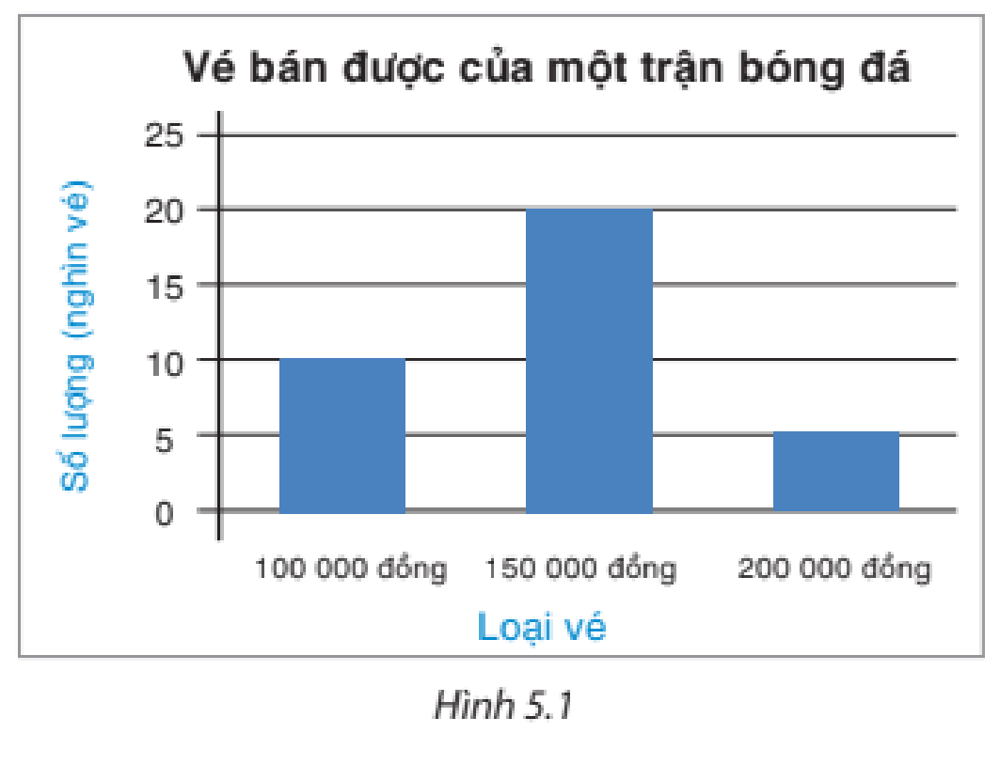
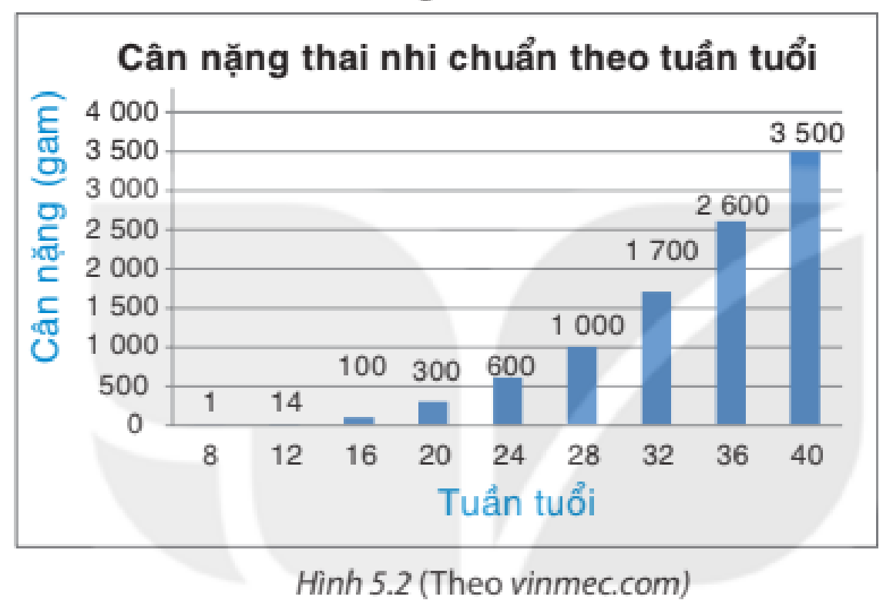
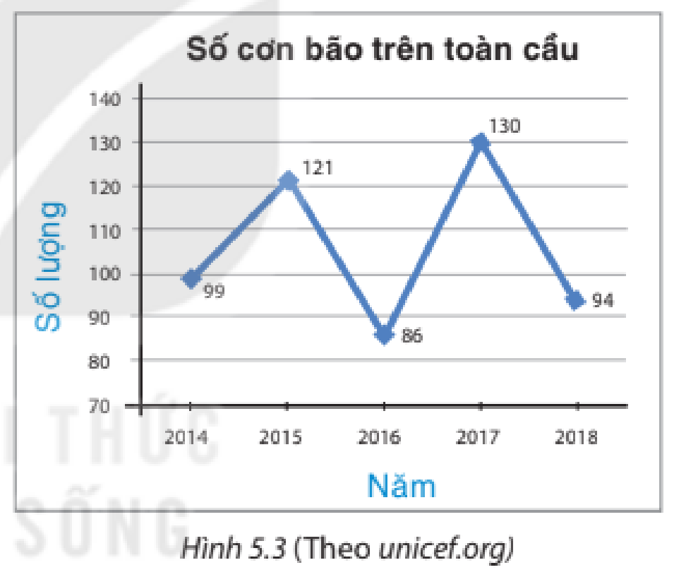
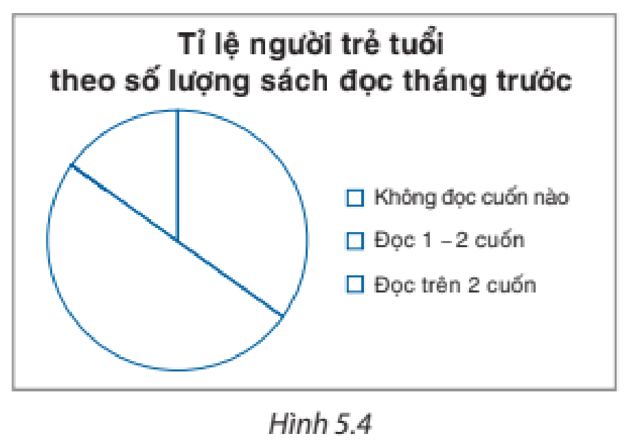
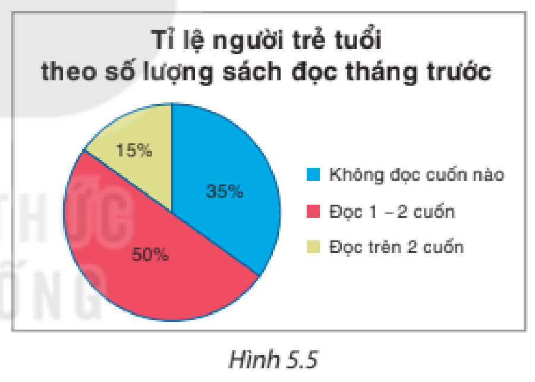
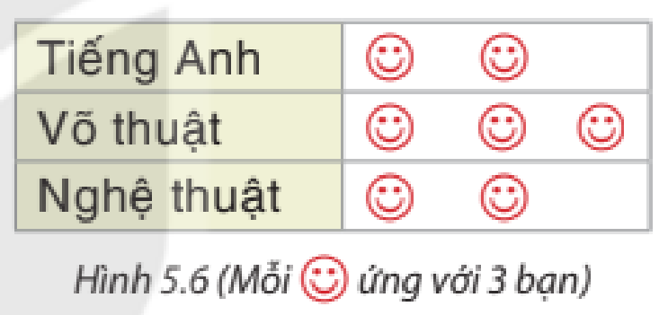
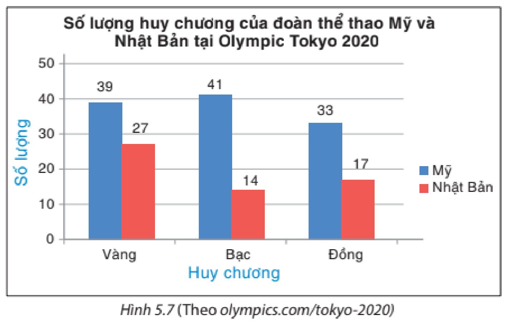
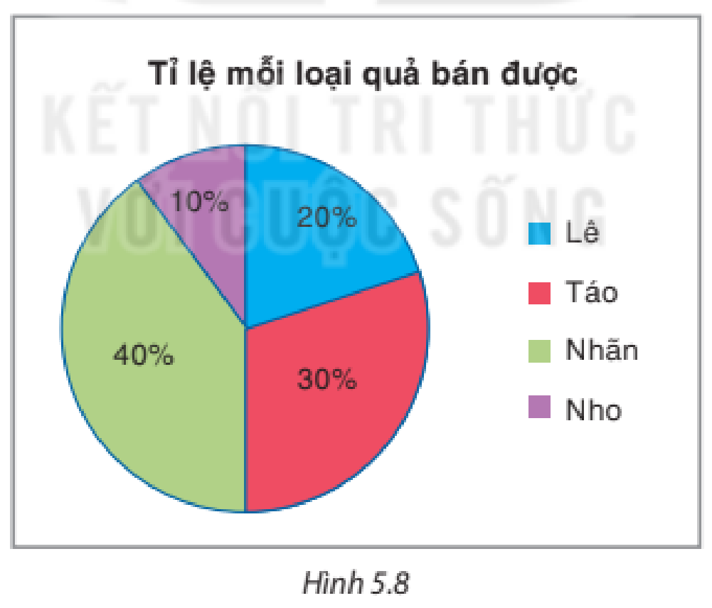

<!-- pdf:94 -->

# BÀI 19: BIỂU DIỄN DỮ LIỆU BẰNG BẢNG, BIỂU ĐỒ

## 🎯 Kiến thức, kĩ năng

- Chuyển dữ liệu từ dạng biểu diễn này sang dạng biểu diễn khác.
- Lựa chọn biểu đồ phù hợp với dữ liệu cho trước.

## 🔴 Mở đầu

Bảng dưới cho biết số lượng các loài động vật tại Thảo Cầm Viên, Thành phố Hồ Chí Minh vào ngày 14-7-1869, thời điểm Thảo Cầm Viên chính thức mở cửa đón khách vào xem.

| Loài động vật | Thú | Chim | Bò sát |
| --- | :---: | :---: | :---: |
| Số lượng (con) | $120$ | $344$ | $45$ |

*Bảng 5.1 (Theo cand.com.vn)*

- **Vuông:** Tớ sẽ dùng biểu đồ cột để biểu diễn bảng thống kê trên.
- **Tròn:** Biểu diễn bằng biểu đồ tranh được không nhỉ?
<!-- ocr-ok: đã đối chiếu ảnh trang PDF 94, hai bóng thoại của Vuông và Tròn đặt ngang nhau -->

Theo em, những loại biểu đồ nào phù hợp để biểu diễn dữ liệu trong Bảng 5.1? Chúng ta cùng tìm hiểu trong bài học này.

## 1. LỰA CHỌN BIỂU ĐỒ TRANH HAY BIỂU ĐỒ CỘT

**Lựa chọn biểu đồ**

Cho biểu đồ Hình 5.1.

*Hình 5.1*

**HĐ1:** Lập bảng thống kê cho dữ liệu được biểu diễn trong biểu đồ. Nếu biểu diễn dữ liệu này bằng biểu đồ tranh thì nên chọn mỗi biểu tượng biểu diễn cho bao nhiêu vé?

**HĐ2:** Trong một trận bóng đá khác, số vé $100\,000$ đồng, $150\,000$ đồng, $200\,000$ đồng
<!-- ocr-ok: đã đối chiếu ảnh trang PDF 94, nhãn HĐ2 và mệnh giá các loại vé -->

<!-- pdf:95 -->

bán được lần lượt là $10\,300$, $22\,300$, $4\,100$ vé. Nếu dùng biểu đồ tranh để biểu diễn thì mỗi biểu tượng biểu diễn bao nhiêu vé? Phải vẽ bao nhiêu biểu tượng?

<!-- term: Biểu đồ tranh -->
<!-- term: Biểu đồ cột -->
**Nhận xét.** Có thể dùng biểu đồ tranh, biểu đồ cột để biểu diễn số lượng các loại đối tượng khác nhau. Tuy nhiên, khi dùng biểu đồ tranh mà phải vẽ rất nhiều biểu tượng thì ta nên dùng biểu đồ cột.

**Luyện tập 1:**

Nên chọn biểu đồ tranh hay biểu đồ cột để biểu diễn dữ liệu Bảng 5.1? Vẽ biểu đồ đó.

## 2. LỰA CHỌN BIỂU ĐỒ CỘT HAY BIỂU ĐỒ ĐOẠN THẲNG

**Lựa chọn biểu đồ**

Biểu đồ Hình 5.2 cho biết cân nặng thai nhi chuẩn tại một số thời điểm trong thai kì.

*Hình 5.2 (Theo vinmec.com)*

**HĐ3:** Ta có thể dùng biểu đồ đoạn thẳng để biểu diễn dữ liệu này hay không?

**HĐ4:** Bảng sau cho biết cân nặng thai nhi chuẩn theo tuần tuổi:

| Tuổi thai nhi | Cân nặng (gam) | Tuổi thai nhi | Cân nặng (gam) | Tuổi thai nhi | Cân nặng (gam) |
| :---: | :---: | :---: | :---: | :---: | :---: |
| $8$ | $1$ | $20$ | $300$ | $32$ | $1\,700$ |
| $9$ | $2$ | $21$ | $360$ | $33$ | $1\,900$ |
| $10$ | $4$ | $22$ | $430$ | $34$ | $2\,100$ |
| $11$ | $7$ | $23$ | $500$ | $35$ | $2\,400$ |
| $12$ | $14$ | $24$ | $600$ | $36$ | $2\,600$ |
| $13$ | $23$ | $25$ | $660$ | $37$ | $2\,900$ |
| $14$ | $43$ | $26$ | $760$ | $38$ | $3\,000$ |
| $15$ | $70$ | $27$ | $875$ | $39$ | $3\,300$ |
| $16$ | $100$ | $28$ | $1\,000$ | $40$ | $3\,500$ |
| $17$ | $140$ | $29$ | $1\,100$ | $41$ | $3\,600$ |
| $18$ | $190$ | $30$ | $1\,300$ | $42$ | $3\,700$ |
| $19$ | $240$ | $31$ | $1\,500$ | *(Theo vinmec.com)* | |
<!-- ocr-ok: đã đối chiếu ảnh trang PDF 95, bảng cân nặng thai nhi chuẩn theo tuần tuổi 6 cột -->

a) Ta có nên dùng biểu đồ cột để biểu diễn bảng số liệu này không? Tại sao?

b) Biểu đồ nào phù hợp để biểu diễn bảng số liệu này?

<!-- pdf:96 -->

<!-- term: Biểu đồ đoạn thẳng -->
<!-- term: Biểu đồ cột -->
**Nhận xét.** Nếu muốn biểu diễn sự thay đổi của một đại lượng theo thời gian ta dùng biểu đồ đoạn thẳng. Khi số lượng thời điểm quan sát ít ta cũng có thể biểu diễn bằng biểu đồ cột.

**Ví dụ 1:**

Chọn biểu đồ phù hợp nhất để biểu diễn dữ liệu về tuổi thọ trung bình ở một số quốc gia Đông Nam Á năm 2019. Giải thích tại sao em chọn biểu đồ đó.

| Quốc gia | Indonesia | Myanmar | Thailand | Timor – Leste | Việt Nam |
| --- | :---: | :---: | :---: | :---: | :---: |
| Tuổi thọ trung bình (năm) | $71,3$ | $69,1$ | $77,7$ | $69,6$ | $75,4$ |

*(Theo Báo cáo của Tổ chức Y tế Thế giới)*

**Giải**

Tuổi thọ trung bình của các quốc gia không phải là các số nguyên nên biểu đồ tranh không phù hợp. Ta không thể dùng biểu đồ đoạn thẳng để biểu diễn vì trong dữ liệu này tuổi thọ trung bình không thay đổi theo thời gian mà thay đổi theo quốc gia. Ta nên dùng biểu đồ cột để biểu diễn dữ liệu này.

**Luyện tập 2:**

Cho biểu đồ Hình 5.3.

*Hình 5.3 (Theo unicef.org)*
<!-- ocr-ok: đã đối chiếu ảnh trang PDF 96, chú thích Hình 5.3 -->

a) Lập bảng thống kê cho dữ liệu trong biểu đồ.

b) Vẽ biểu đồ cột biểu diễn dữ liệu này. Nếu ta có dữ liệu về số cơn bão hằng năm trên toàn cầu từ năm 1970 đến nay thì có nên dùng biểu đồ cột để biểu diễn không?

## 3. LỰA CHỌN BIỂU ĐỒ CỘT KÉP HAY BIỂU ĐỒ HÌNH QUẠT TRÒN

**Lựa chọn biểu đồ**

Cho bảng thống kê về cỡ áo của học sinh lớp 8A như trong Bảng 5.2.

| Giới tính | Cỡ áo: Lớn (L) | Cỡ áo: Trung bình (M) | Cỡ áo: Nhỏ (S) |
| --- | :---: | :---: | :---: |
| Nam | $10$ | $8$ | $4$ |
| Nữ | $5$ | $12$ | $6$ |
| Tổng số | $15$ | $20$ | $10$ |
<!-- ocr-ok: đã đối chiếu ảnh trang PDF 96, Bảng 5.2 gộp ô tiêu đề Cỡ áo -->

*Bảng 5.2*

**HĐ5:** Nên dùng biểu đồ nào để biểu diễn dữ liệu đã cho và giải thích tại sao trong các trường hợp sau:

a) So sánh tỉ lệ học sinh của lớp 8A theo cỡ áo?

b) So sánh số lượng cỡ áo mỗi loại của nam và nữ?

<!-- term: Biểu đồ cột kép -->
<!-- term: Biểu đồ hình quạt tròn -->
**Nhận xét.** Khi muốn so sánh hai tập dữ liệu với nhau ta dùng biểu đồ cột kép. Khi muốn biểu diễn tỉ lệ các phần trong tổng thể ta dùng biểu đồ hình quạt tròn.

<!-- pdf:97 -->

**Ví dụ 2:**

Một nhóm nghiên cứu đã phỏng vấn $1\,000$ người trẻ tuổi về số cuốn sách đã đọc trong tháng trước thu được kết quả sau:

| Số cuốn sách | $0$ | $1$ - $2$ | Trên $2$ |
| --- | :---: | :---: | :---: |
| Số người | $350$ | $500$ | $150$ |
<!-- ocr-ok: đã đối chiếu ảnh trang PDF 97, bảng số cuốn sách đặt cạnh Hình 5.4 -->

*Hình 5.4*

a) Nếu ta muốn biểu diễn tỉ lệ người trẻ tuổi trong tổng số $1\,000$ người được hỏi theo số cuốn sách họ đã đọc trong tháng trước thì nên dùng biểu đồ nào?

b) Tính tỉ lệ phần trăm người trẻ tuổi theo số cuốn sách đã đọc trong tháng trước, vẽ lại và hoàn thiện biểu đồ trên Hình 5.4 vào vở.

**Giải**

a) Vì ta muốn biểu diễn tỉ lệ người trẻ tuổi theo số lượng sách đã đọc tháng trước so với tổng số người trẻ tuổi được hỏi nên ta dùng biểu đồ hình quạt tròn.

b) Tổng số người trẻ tuổi được khảo sát là $1\,000$ (người).

Tỉ lệ người trẻ tuổi tháng trước không đọc cuốn sách nào là: $\dfrac{350}{1\,000} = 35\%$. Tỉ lệ người trẻ tuổi tháng trước đọc từ $1$ đến $2$ cuốn sách là $\dfrac{500}{1\,000} = 50\%$. Tỉ lệ người trẻ tuổi tháng trước đọc trên $2$ cuốn sách là $\dfrac{150}{1\,000} = 15\%$.

Biểu đồ đã hoàn thiện được cho như Hình 5.5.

*Hình 5.5*

**Luyện tập 3:**

Bảng thống kê sau cho biết mật độ dân số ($\text{người/km}^2$) tại ba vùng kinh tế xã hội trong hai năm 2009 và 2019.

| Năm \ Vùng kinh tế xã hội | Đồng bằng sông Hồng | Bắc Trung bộ và Duyên hải miền Trung | Đồng bằng sông Cửu Long |
| :---: | :---: | :---: | :---: |
| 2009 | $930$ | $196$ | $424$ |
| 2019 | $1\,060$ | $211$ | $423$ |
<!-- ocr-ok: đã đối chiếu ảnh trang PDF 97, bảng 2 chiều mật độ dân số Luyện tập 3 -->

*(Theo Báo cáo tổng điều tra dân số năm 2019)*

Muốn biết sau $10$ năm mật độ dân số thay đổi thế nào ở mỗi vùng, ta nên sử dụng biểu đồ nào?

<!-- pdf:98 -->

**Thử thách nhỏ**

Trở lại bài toán mở đầu, với dữ liệu trong Bảng 5.1.

- **Tròn:** Tớ sẽ dùng biểu đồ cột để biểu diễn dữ liệu trong Bảng 5.1.
- **Vuông:** Tớ sẽ dùng biểu đồ hình quạt tròn để biểu diễn.
- **Pi:** Việc lựa chọn biểu đồ nào để biểu diễn không chỉ phụ thuộc vào dữ liệu mà còn phụ thuộc vào mục đích của người dùng!
<!-- ocr-ok: đã đối chiếu ảnh trang PDF 98, ba bóng thoại của Tròn, Vuông và Pi đặt ngang nhau -->

Em ủng hộ Vuông hay Tròn?

## BÀI TẬP

5.4. Biểu đồ Hình 5.6 biểu diễn số lượng các bạn lớp 8A tham gia các câu lạc bộ.

*Hình 5.6 (Mỗi biểu tượng mặt cười ứng với 3 bạn)*
<!-- ocr-ok: đã đối chiếu ảnh trang PDF 98, chú thích Hình 5.6 chứa biểu tượng mặt cười -->

a) Cho biết đây là biểu đồ gì? Mỗi biểu tượng ứng với bao nhiêu học sinh?

b) Lập bảng thống kê và vẽ biểu đồ cột biểu diễn dữ liệu này.

5.5. Bảng thống kê bên cho biết số lượng khách đánh giá chất lượng dịch vụ của một khách sạn.

| Đánh giá | Rất tốt | Tốt | Trung bình | Kém |
| --- | :---: | :---: | :---: | :---: |
| Số lượng | $5$ | $20$ | $10$ | $5$ |
<!-- ocr-ok: đã đối chiếu ảnh trang PDF 98, bảng thống kê đặt ngang cạnh Bài 5.5 -->

a) Vẽ biểu đồ tranh, biểu đồ cột biểu diễn bảng thống kê trên.

b) Nếu muốn biểu diễn tỉ lệ khách hàng đánh giá theo các mức đánh giá trên, ta cần dùng biểu đồ nào để biểu diễn?

5.6. Cho biểu đồ Hình 5.7.

*Hình 5.7 (Theo olympics.com/tokyo-2020)*

Hãy lập bảng thống kê biểu diễn số lượng huy chương các loại của đoàn thể thao Mỹ và vẽ biểu đồ cột biểu diễn bảng thống kê này.

<!-- pdf:99 -->

5.7. Bảng sau cho biết khối lượng giấy vụn các lớp khối 8 đã thu gom được.

| Lớp | 8A | 8B | 8C | 8D |
| --- | :---: | :---: | :---: | :---: |
| Khối lượng ($\text{kg}$) | $12,7$ | $16,8$ | $15,5$ | $14,3$ |

Lựa chọn biểu đồ phù hợp biểu diễn bảng thống kê này. Vẽ biểu đồ đó.

5.8. Bảng thống kê sau biểu diễn số huy chương vàng trong hai kì SEA Games năm 2017 và 2019 của đoàn thể thao Việt Nam, Thái Lan.

| Quốc gia | SEA Games 2019 | SEA Games 2017 |
| --- | :---: | :---: |
| Việt Nam | $98$ | $58$ |
| Thái Lan | $92$ | $72$ |
<!-- ocr-ok: đã đối chiếu ảnh trang PDF 99, bảng thống kê SEA Games Bài 5.8 -->

*Theo Website chính thức các Đại hội thể thao Đông Nam Á lần thứ 29, 30.*

a) Vẽ biểu đồ để so sánh số huy chương của mỗi quốc gia đạt được qua hai kì SEA Games.

b) Vẽ biểu đồ so sánh số huy chương của Việt Nam và Thái Lan trong mỗi kì SEA Games.

5.9. Biểu đồ Hình 5.8 cho biết tỉ lệ mỗi loại quả bán được của một cửa hàng. Giả sử cửa hàng bán được $200\text{ kg}$ quả các loại. Lập bảng thống kê cho biết số lượng mỗi loại quả cửa hàng bán được. Vẽ biểu đồ cột biểu diễn bảng thống kê này.

*Hình 5.8*

## 📷 Danh sách hình trong bài

| Mã hình | Trang PDF | Vị trí trong bài | Chú thích gốc |
| --- | :---: | --- | --- |
| H8-toan-b19-01 | 94 | Mục 1, HĐ1 | Hình 5.1 |
| H8-toan-b19-02 | 95 | Mục 2, trước HĐ3 | Hình 5.2 (Theo vinmec.com) |
| H8-toan-b19-03 | 96 | Mục 2, Luyện tập 2 | Hình 5.3 (Theo unicef.org) |
| H8-toan-b19-04 | 97 | Mục 3, Ví dụ 2 | Hình 5.4 |
| H8-toan-b19-05 | 97 | Mục 3, Ví dụ 2, Giải | Hình 5.5 |
| H8-toan-b19-06 | 98 | Bài tập 5.4 | Hình 5.6 (Mỗi biểu tượng mặt cười ứng với 3 bạn) |
| H8-toan-b19-07 | 98 | Bài tập 5.6 | Hình 5.7 (Theo olympics.com/tokyo-2020) |
| H8-toan-b19-08 | 99 | Bài tập 5.9 | Hình 5.8 |
