<!-- pdf:100 -->

# BÀI 20: PHÂN TÍCH SỐ LIỆU THỐNG KÊ DỰA VÀO BIỂU ĐỒ

## 🎯 Kiến thức, kĩ năng

- Phát hiện và giải quyết được vấn đề, quy luật đơn giản dựa trên phân tích số liệu.
- Nhận ra tính hợp lí của dữ liệu được biểu diễn.
- Nhận biết mối liên hệ giữa thống kê với những kiến thức trong các môn học khác trong Chương trình lớp 8.

## 1. CÁC LƯU Ý KHI ĐỌC VÀ DIỄN GIẢI BIỂU ĐỒ

**Ví dụ 1:** Cho hai biểu đồ sau:
<!-- ocr-ok: đã đối chiếu ảnh trang PDF 100, nhãn Ví dụ 1 chữ trắng trên nền xanh -->

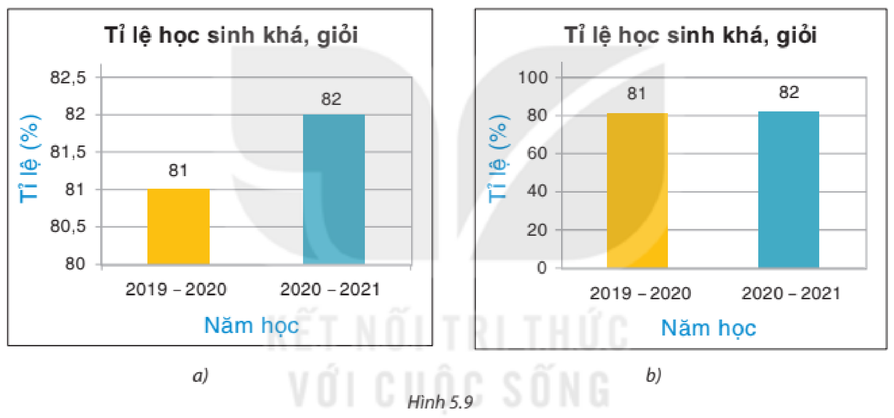
*Hình 5.9*

a) Hai biểu đồ trên có biểu diễn cùng một tập dữ liệu không? Lập bảng thống kê cho dữ liệu đó.

b) Trong mỗi biểu đồ, so sánh tỉ lệ chiều cao hai cột và tỉ lệ số liệu mà hai cột này biểu diễn. Giải thích tại sao có sự khác nhau đó.

**Giải**

a) Hai biểu đồ biểu diễn cùng một dữ liệu. Bảng thống kê cho dữ liệu này là:

| Năm học | 2019 – 2020 | 2020 – 2021 |
| --- | :---: | :---: |
| Tỉ lệ học sinh khá, giỏi ($\%$) | $81$ | $82$ |
<!-- ocr-ok: đã đối chiếu ảnh trang PDF 100, bảng thống kê đặt ngang cạnh câu a -->

b) Trong Biểu đồ b) tỉ lệ chiều cao hai cột xanh và vàng bằng với tỉ lệ số liệu mà chúng biểu diễn (bằng $\dfrac{82}{81}$). Trong Biểu đồ a) cột màu xanh cao gấp đôi cột màu vàng nhưng số liệu mà nó biểu diễn ($82\%$) không gấp đôi số liệu cột màu vàng biểu diễn ($81\%$). Có sự khác nhau này trong Biểu đồ a) là do gốc của trục đứng không phải là $0$.

<!-- pdf:101 -->

<!-- term: Lưu ý khi đọc biểu đồ cột có gốc trục đứng khác 0 -->
**Nhận xét.** Trong biểu đồ cột, khi gốc của trục đứng khác $0$ thì tỉ lệ chiều cao của các cột không bằng tỉ lệ số liệu mà chúng biểu diễn.

**Luyện tập 1:** Dựa trên dữ liệu khảo sát về món ăn Việt Nam được ưa thích, một công ty du lịch đã vẽ hai biểu đồ sau:

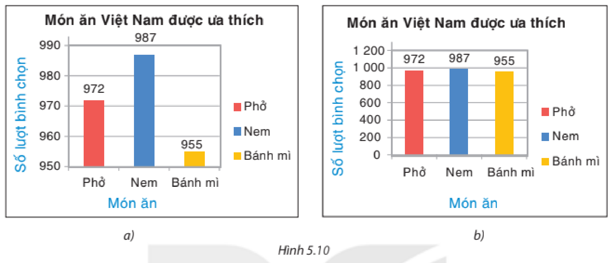
*Hình 5.10*

a) Hai biểu đồ này biểu diễn cùng một dữ liệu không? Lập bảng thống kê về dữ liệu đó.

b) Trong Biểu đồ a), tỉ lệ chiều cao giữa cột màu xanh và cột màu vàng có bằng tỉ lệ hai số mà chúng biểu diễn không? Giải thích tại sao.

**Ví dụ 2:** Cho hai biểu đồ sau:
<!-- ocr-ok: đã đối chiếu ảnh trang PDF 101, nhãn Ví dụ 2 chữ trắng trên nền xanh -->

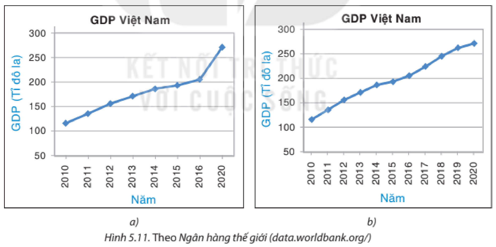
*Hình 5.11. Theo Ngân hàng thế giới (data.worldbank.org/)*
<!-- ocr-ok: đã đối chiếu ảnh trang PDF 101, chú thích Hình 5.11 -->

So sánh độ dốc của đoạn thẳng cuối cùng trong hai biểu đồ này. Giải thích tại sao Biểu đồ a) dễ làm cho ta hiểu lầm rằng GDP của Việt Nam năm 2020 tăng đột biến so với trước đó.

**Giải**

Đoạn cuối cùng trong Biểu đồ a) có độ dốc lớn hơn độ dốc của đoạn cuối cùng trong Biểu đồ b). Nhìn vào Biểu đồ a), ta có thể cho là GDP Việt Nam trong năm 2020 tăng rất mạnh so với trước đó, nguyên nhân là do trong biểu đồ này trục ngang được chia tỉ lệ không đều nhau giữa các đoạn (trước năm 2020 là năm 2016).

<!-- pdf:102 -->

<!-- term: Độ dốc của biểu đồ đoạn thẳng -->
**Nhận xét.** Trong biểu đồ đoạn thẳng, khi các điểm quan sát trên trục ngang không đều nhau, ta không thể dựa vào độ dốc để kết luận về tốc độ tăng, giảm của đại lượng được biểu diễn.

**Luyện tập 2:** Cho hai biểu đồ sau biểu diễn số lượng người thất nghiệp tại một thành phố trong giai đoạn từ 12/2007 đến 6/2010.

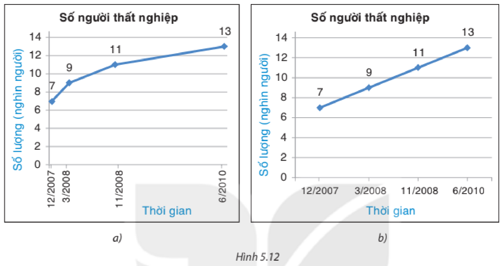
*Hình 5.12*

Hãy giải thích tại sao xu thế của hai biểu đồ lại khác nhau. Để thấy được xu thế của số lượng người thất nghiệp, ta nên dùng biểu đồ nào?

## 2. ĐỌC VÀ PHÂN TÍCH SỐ LIỆU TỪ BIỂU ĐỒ

**Ví dụ 3:** Các biểu đồ sau cho biết cấu trúc dân số của Việt Nam các năm 2010 và 2020.

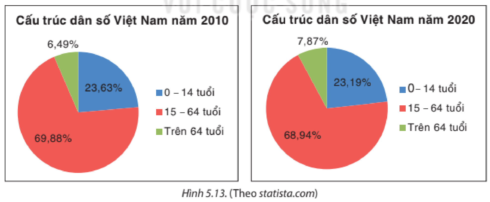
*Hình 5.13. (Theo statista.com)*
<!-- ocr-ok: đã đối chiếu ảnh trang PDF 102, chú thích Hình 5.13 -->

a) Nhận xét về sự thay đổi tỉ lệ người thuộc nhóm tuổi lao động chính ($15$ - $64$ tuổi) sau $10$ năm.

b) Năm 2020 dân số Việt Nam là $97,41$ triệu người (theo *statista.com*). Tính số lượng người thuộc mỗi nhóm tuổi trên.

<!-- pdf:103 -->

**Giải**

a) Sau $10$ năm, tỉ lệ người thuộc nhóm tuổi lao động chính ($15$ - $64$ tuổi) giảm từ $69,88\%$ năm 2010 xuống còn $68,94\%$ năm 2020.

b) Năm 2020, tỉ lệ người thuộc nhóm tuổi $0$ - $14$ tuổi là $23,19\%$, do đó số người thuộc nhóm tuổi này là $97\,410\,000 \cdot 23,19\% = 22\,589\,379$ (người).

Tỉ lệ người thuộc nhóm tuổi $15$ - $64$ là $68,94\%$, do đó số người thuộc nhóm tuổi này là $97\,410\,000 \cdot 68,94\% = 67\,154\,454$ (người).

Tỉ lệ người thuộc nhóm trên $64$ tuổi là $7,87\%$, do đó số người thuộc nhóm tuổi này là $97\,410\,000 \cdot 7,87\% = 7\,666\,167$ (người).

<!-- term: Phân tích số liệu thống kê dựa vào biểu đồ -->
**Chú ý.** Khi phân tích số liệu, ta có thể kết hợp thông tin từ hai hay nhiều biểu đồ.

**Luyện tập 3:** Các biểu đồ sau cho biết cơ cấu năng lượng được khai thác, sản xuất trong nước các năm 2018 và 2019.

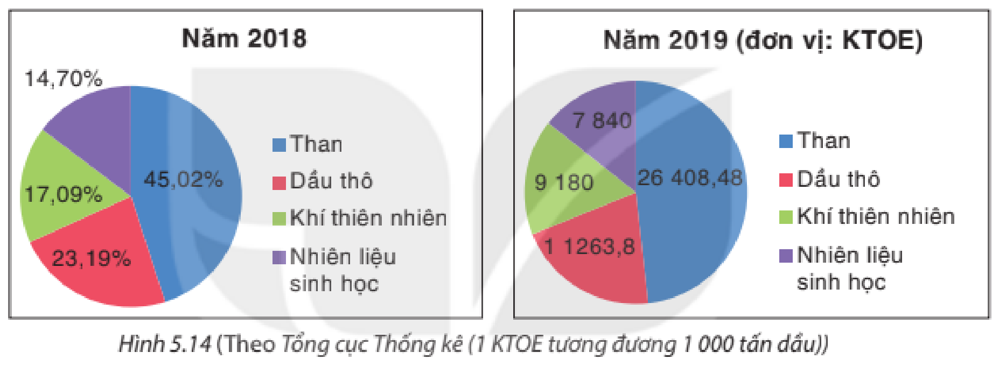
*Hình 5.14 (Theo Tổng cục Thống kê (1 KTOE tương đương 1 000 tấn dầu))*

a) Lập bảng thống kê cho biết cơ cấu năng lượng được khai thác, sản xuất trong nước (theo tỉ lệ $\%$) năm 2019.

b) Nhận xét về sự thay đổi cơ cấu năng lượng được khai thác, sản xuất trong nước năm 2019 so với năm 2018.

**Ví dụ 4:** Cho biểu đồ sau biểu diễn số giờ ban ngày trong các tháng tại hai địa điểm.

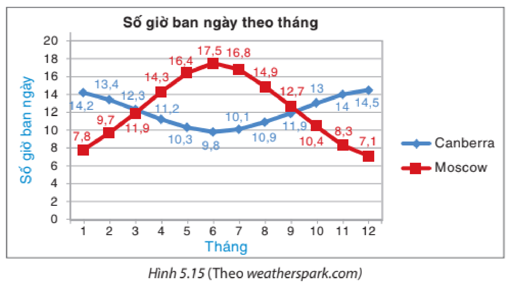
*Hình 5.15 (Theo weatherspark.com)*
<!-- ocr-ok: đã đối chiếu ảnh trang PDF 103, chú thích Hình 5.15 -->

a) Lập bảng thống kê cho số liệu được biểu diễn trên biểu đồ.

<!-- pdf:104 -->

b) Dựa vào biểu đồ, cho biết vào hai tháng nào trong năm số giờ ban ngày ở hai nơi gần như nhau. Vì sao?

c) Nhận xét và giải thích sự khác nhau về xu thế thay đổi số giờ ban ngày trong năm.

**Giải**

a) Bảng thống kê về số giờ ban ngày theo tháng tại Canberra và Moscow.

| Tháng | 1 | 2 | 3 | 4 | 5 | 6 | 7 | 8 | 9 | 10 | 11 | 12 |
| --- | :---: | :---: | :---: | :---: | :---: | :---: | :---: | :---: | :---: | :---: | :---: | :---: |
| Canberra (giờ) | $14,2$ | $13,4$ | $12,3$ | $11,2$ | $10,3$ | $9,8$ | $10,1$ | $10,9$ | $11,9$ | $13$ | $14$ | $14,5$ |
| Moscow (giờ) | $7,8$ | $9,7$ | $11,9$ | $14,3$ | $16,4$ | $17,5$ | $16,8$ | $14,9$ | $12,7$ | $10,4$ | $8,3$ | $7,1$ |
<!-- ocr-ok: đã đối chiếu ảnh trang PDF 104, bảng thống kê 13 cột của Ví dụ 4 -->

b) Hai đường cắt nhau vào khoảng tháng 3 và tháng 9 nên vào hai tháng này số giờ ban ngày tại hai địa điểm gần như nhau.

c) Từ tháng 1 số giờ ban ngày tại Canberra giảm, đạt mức thấp nhất vào tháng 6, sau đó lại tăng. Từ tháng 1 số giờ ban ngày tại Moscow tăng, đạt mức cao nhất vào tháng 6, sau đó lại giảm. Sự biến đổi về số giờ ban ngày theo tháng tại hai địa điểm này ngược nhau do hai thành phố Canberra và Moscow nằm ở hai bán cầu.

<!-- term: Phân tích số liệu thống kê dựa vào biểu đồ -->
**Chú ý.** Để so sánh sự thay đổi theo thời gian của hai hay nhiều đại lượng, người ta thường biểu diễn chúng trên cùng biểu đồ.

**Luyện tập 4:** Cho biểu đồ sau:
<!-- ocr-ok: đã đối chiếu ảnh trang PDF 104, nhãn Luyện tập 4 chữ trắng trên nền xanh -->

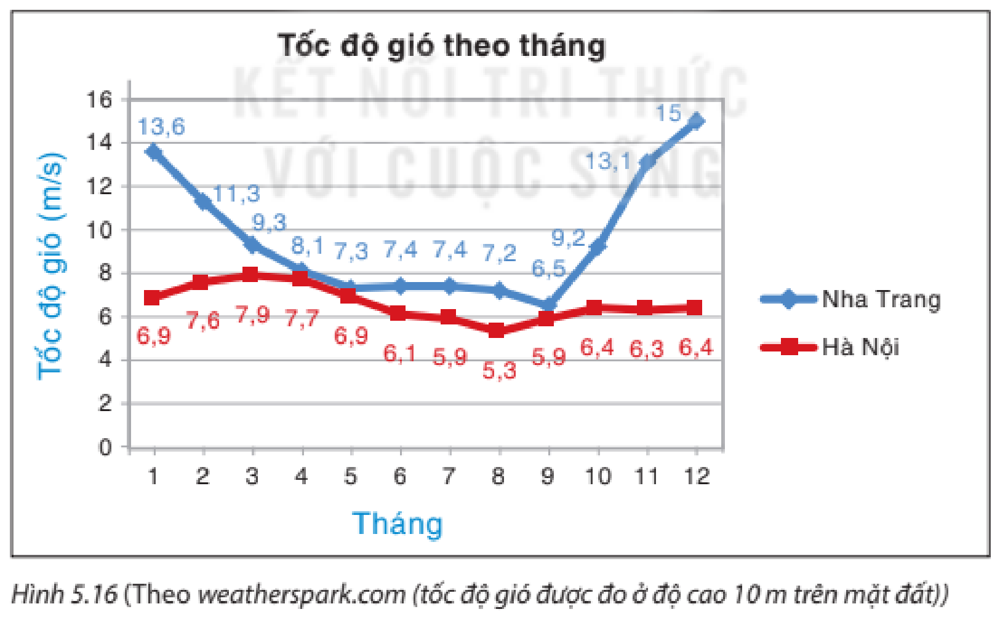
*Hình 5.16 (Theo weatherspark.com (tốc độ gió được đo ở độ cao 10 m trên mặt đất))*
<!-- ocr-ok: đã đối chiếu ảnh trang PDF 104, chú thích Hình 5.16 -->

a) So sánh tốc độ gió trong các tháng tại hai thành phố này. Giải thích sự khác nhau đó.

b) Ở Nha Trang, $6$ tháng gió thổi mạnh nhất là những tháng nào?

<!-- pdf:105 -->

## BÀI TẬP

5.10. Biểu đồ cột (H.5.17) biểu diễn số tiền mỗi người trong nhóm học sinh có được nhờ bán phế liệu.

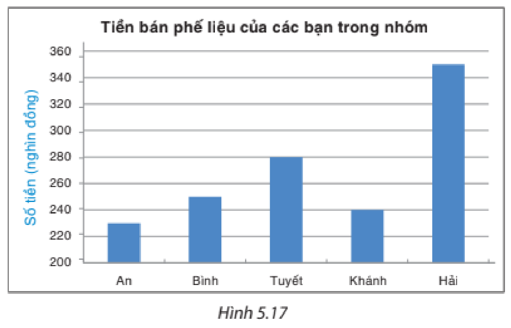
*Hình 5.17*

a) Số tiền của Tuyết có gấp đôi số tiền của Khánh không? Giải thích tại sao.

b) Lập bảng thống kê cho số tiền mỗi bạn có được nhờ bán phế liệu.

5.11. Cho hai biểu đồ (H.5.18)

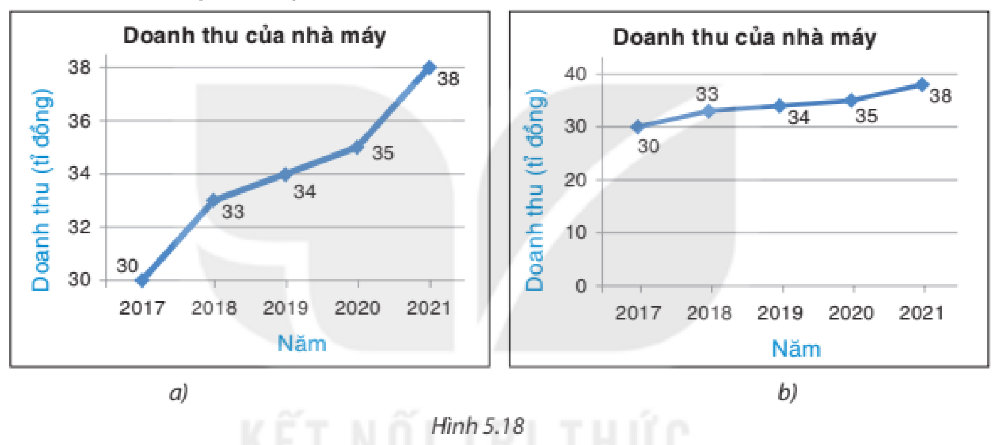
*Hình 5.18*

a) Doanh thu của nhà máy trong Biểu đồ a) có tăng nhanh hơn doanh thu của nhà máy trong Biểu đồ b) hay không?

b) Hai biểu đồ này có cùng biểu diễn một dãy số liệu không?

c) Giải thích tại sao hai đường gấp khúc trên hai biểu đồ có độ dốc khác nhau.

5.12. Cho biểu đồ (H.5.19)

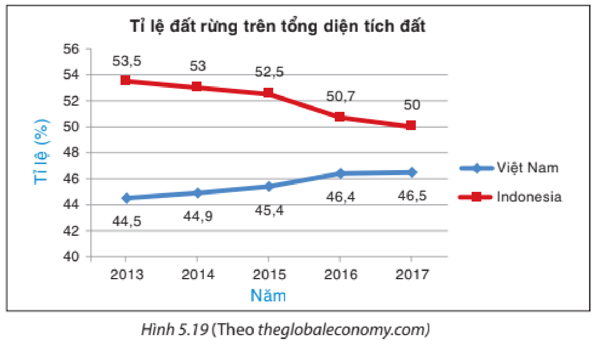
*Hình 5.19 (Theo theglobaleconomy.com)*
<!-- ocr-ok: đã đối chiếu ảnh trang PDF 105, chú thích Hình 5.19 -->

<!-- pdf:106 -->

a) So sánh tỉ lệ diện tích đất rừng trên tổng diện tích đất của hai nước.

b) Cho biết xu thế tăng, giảm của tỉ lệ diện tích đất rừng trên tổng diện tích đất của mỗi nước.

c) Lập bảng thống kê về tỉ lệ diện tích đất rừng của Việt Nam trên tổng diện tích đất qua các năm.

d) Tổng diện tích đất của Việt Nam, Indonesia tương ứng là $331\,690\text{ km}^2$; $1\,826\,440\text{ km}^2$. Tính diện tích đất rừng của Việt Nam, Indonesia năm 2017.

5.13. Biểu đồ (H.5.20) cho biết cơ cấu GDP của Việt Nam năm 2021.

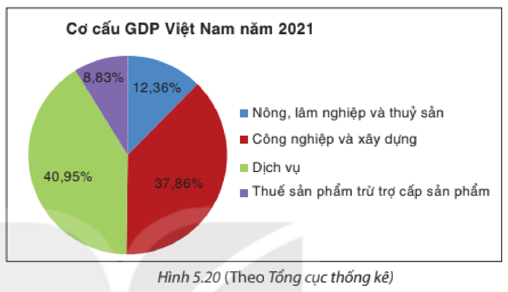
*Hình 5.20 (Theo Tổng cục thống kê)*

a) Lĩnh vực nào đóng góp nhiều nhất vào GDP, với bao nhiêu phần trăm?

b) GDP Việt Nam năm 2021 là $0,4$ nghìn tỉ đô la Mỹ. Lĩnh vực dịch vụ đóng góp bao nhiêu tỉ đô la Mỹ?

5.14. Cho biểu đồ (H.5.21)

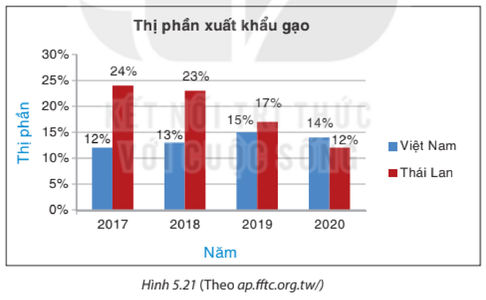
*Hình 5.21 (Theo ap.fftc.org.tw/)*

a) Nhận xét về xu thế của thị phần xuất khẩu gạo của Thái Lan trong các năm từ 2017 đến 2020.

b) Lập bảng thống kê thị phần xuất khẩu gạo của Việt Nam trong giai đoạn này.

## 📷 Danh sách hình trong bài

| Mã hình | Trang PDF | Vị trí trong bài | Chú thích gốc |
| --- | :---: | --- | --- |
| H8-toan-b20-01 | 100 | Mục 1, Ví dụ 1 | Hình 5.9 |
| H8-toan-b20-02 | 101 | Mục 1, Luyện tập 1 | Hình 5.10 |
| H8-toan-b20-03 | 101 | Mục 1, Ví dụ 2 | Hình 5.11. Theo Ngân hàng thế giới (data.worldbank.org/) |
| H8-toan-b20-04 | 102 | Mục 1, Luyện tập 2 | Hình 5.12 |
| H8-toan-b20-05 | 102 | Mục 2, Ví dụ 3 | Hình 5.13. (Theo statista.com) |
| H8-toan-b20-06 | 103 | Mục 2, Luyện tập 3 | Hình 5.14 (Theo Tổng cục Thống kê (1 KTOE tương đương 1 000 tấn dầu)) |
| H8-toan-b20-07 | 103 | Mục 2, Ví dụ 4 | Hình 5.15 (Theo weatherspark.com) |
| H8-toan-b20-08 | 104 | Mục 2, Luyện tập 4 | Hình 5.16 (Theo weatherspark.com (tốc độ gió được đo ở độ cao 10 m trên mặt đất)) |
| H8-toan-b20-09 | 105 | Bài tập 5.10 | Hình 5.17 |
| H8-toan-b20-10 | 105 | Bài tập 5.11 | Hình 5.18 |
| H8-toan-b20-11 | 105 | Bài tập 5.12 | Hình 5.19 (Theo theglobaleconomy.com) |
| H8-toan-b20-12 | 106 | Bài tập 5.13 | Hình 5.20 (Theo Tổng cục thống kê) |
| H8-toan-b20-13 | 106 | Bài tập 5.14 | Hình 5.21 (Theo ap.fftc.org.tw/) |
