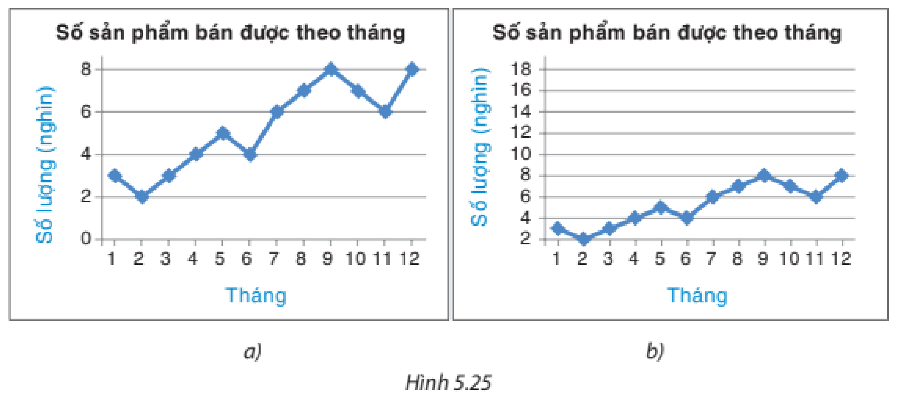

<!-- pdf:110 -->

# BÀI TẬP CUỐI CHƯƠNG V

**A. TRẮC NGHIỆM**

*Chọn phương án đúng trong mỗi câu hỏi sau:*

5.19. Dữ liệu nào sau đây là số liệu liên tục?

A. Dữ liệu về tên các vận động viên Việt Nam tham dự SEA Games 31.

B. Dữ liệu về kết quả đánh giá hiệu quả của chương trình dạy học trên truyền hình.

C. Dữ liệu về cân nặng của $200$ con cá chép sau $6$ tháng nuôi.

D. Dữ liệu về số người bị mắc Covid–19 trong gia đình của các bạn trong lớp.

5.20. An đứng từ xa và ghi lại xem bạn nào đi sang đường sử dụng cầu vượt khi tan trường. Phương pháp An thu thập dữ liệu là:

A. Từ nguồn có sẵn. $\qquad$ B. Quan sát. $\qquad$ C. Lập bảng hỏi. $\qquad$ D. Phỏng vấn.

5.21. Trong biểu đồ cột với gốc trục đứng không bắt đầu từ $0$, khẳng định nào sau đây **không** đúng?

A. Cột cao hơn biểu diễn số liệu lớn hơn.

B. Hai cột cao bằng nhau biểu diễn số liệu bằng nhau.

C. Cột thấp hơn biểu diễn số liệu bé hơn.

D. Tỉ lệ chiều cao của hai cột bằng tỉ lệ hai số liệu được biểu diễn.

5.22. Để biểu diễn tỉ lệ của các phần trong tổng thể ta dùng biểu đồ nào sau đây?

A. Biểu đồ tranh. $\qquad$ B. Biểu đồ cột.

C. Biểu đồ đoạn thẳng. $\qquad$ D. Biểu đồ hình quạt tròn.

5.23. Để biểu diễn sự thay đổi của một đại lượng theo thời gian ta dùng biểu đồ nào sau đây?

A. Biểu đồ cột kép. $\quad$ B. Biểu đồ tranh. $\quad$ C. Biểu đồ đoạn thẳng. $\quad$ D. Biểu đồ hình quạt tròn.

**B. TỰ LUẬN**

5.24. Cho hai biểu đồ

*Hình 5.25*

<!-- pdf:111 -->

a) Lập bảng thống kê cho dữ liệu được biểu diễn trong mỗi biểu đồ.

b) Dữ liệu biểu diễn trên hai biểu đồ có như nhau không? Giải thích tại sao hình dạng hai đường gấp khúc trên hai biểu đồ lại khác nhau.

5.25. Khối 8 tổ chức giải bóng đá với $5$ đội tham dự là các đội bóng của các lớp A, B, C, D, E. Trước khi giải đấu diễn ra, Bình muốn thực hiện khảo sát dự đoán của các bạn về đội bóng vô địch giải đấu.

a) Theo em Bình có thể thực hiện khảo sát theo những cách nào?

b) Dữ liệu Bình thu được thuộc loại nào?

5.26. Bạn Bình tiến hành khảo sát dự đoán như trong Bài 5.25. Giả sử Bình thu được kết quả như sau: A, B, A, A, A, A, A, B, D, B, A, A, B, D, D, A, A, B, D. Lập bảng thống kê về số lượng dự đoán vô địch cho mỗi đội.

a) Có thể dùng biểu đồ nào để biểu diễn dữ liệu trong bảng thống kê thu được.

b) Nếu muốn biểu diễn tỉ lệ các bạn được hỏi dự đoán mỗi đội vô địch thì nên dùng biểu đồ nào?

5.27. Bảng thống kê sau cho biết số lượng học sinh của các lớp khối 8 tham gia các câu lạc bộ Thể thao và Nghệ thuật của trường.

| Câu lạc bộ \ Lớp | 8A | 8B | 8C | 8D |
| --- | :---: | :---: | :---: | :---: |
| Thể thao | $8$ | $12$ | $10$ | $5$ |
| Nghệ thuật | $16$ | $4$ | $8$ | $8$ |
<!-- ocr-ok: đã đối chiếu ảnh trang PDF 111, bảng 2 chiều Bài 5.27 -->

a) Lựa chọn và vẽ biểu đồ để so sánh số lượng học sinh tham gia hai câu lạc bộ này ở từng lớp.

b) Lựa chọn và vẽ biểu đồ biểu diễn tỉ lệ học sinh các lớp tham gia hai câu lạc bộ trong số các học sinh khối 8 tham gia hai câu lạc bộ này.

## 📷 Danh sách hình trong bài

| Mã hình | Trang PDF | Vị trí trong bài | Chú thích gốc |
| --- | :---: | --- | --- |
| H8-toan-bt-c05-01 | 110 | Bài tập 5.24 | Hình 5.25 |
