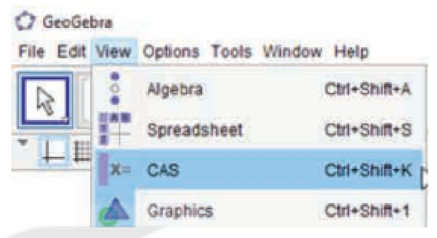
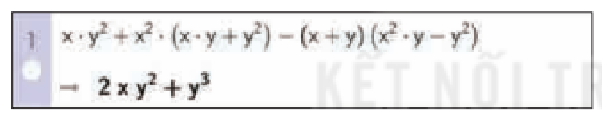
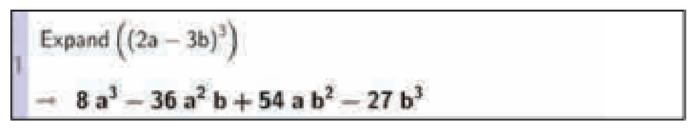
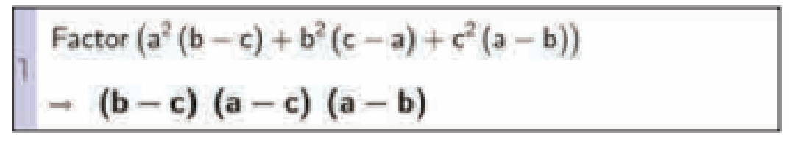
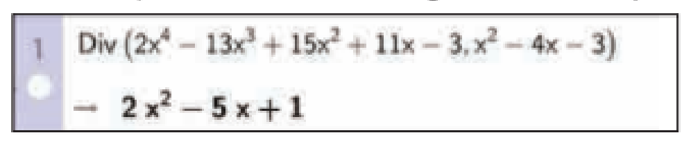
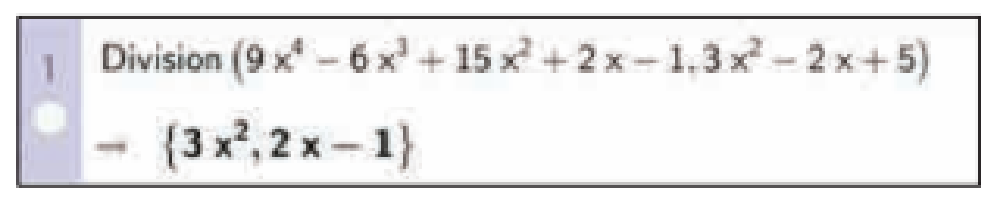

<!-- pdf:114 -->

# THỰC HIỆN TÍNH TOÁN TRÊN ĐA THỨC VỚI PHẦN MỀM GEOGEBRA

## 🎯 Mục tiêu

- Sử dụng phần mềm GeoGebra để tính toán các phép tính trên đa thức.

## 🔴 Mở đầu

Khởi động phần mềm GeoGebra, chọn View $\rightarrow$ Complex Adaptive System (CAS) để thực hiện tính toán các phép tính trên đa thức.
<!-- ocr-ok: đã đối chiếu ảnh trang PDF 114, dòng hướng dẫn xen kẽ biểu tượng GeoGebra -->

**1.** *Cộng, trừ, nhân đa thức:* Nhập biểu thức trên dòng lệnh của cửa sổ CAS, kết quả sẽ được hiển thị ngay bên dưới.

- *Lưu ý:* Trên cửa sổ CAS, chọn chế độ tính toán chính xác bằng cách chọn nút `=`.
<!-- ocr-ok: đã đối chiếu ảnh trang PDF 114, hộp lưu ý bên phải mục 1 -->

- Dòng lệnh CAS: `x * y^2 + x^2 * (x * y + y^2) - (x + y) (x^2 * y - y^2)` $\rightarrow$ $2xy^2 + y^3$.
<!-- ocr-ok: đã đối chiếu ảnh trang PDF 114, nội dung cửa sổ lệnh CAS mục 1 -->

**2.** *Khai triển các biểu thức có chứa tích hoặc luỹ thừa:* Sử dụng lệnh `Expand(<biểu thức cần khai triển>)`.

- *Lưu ý:* Dấu nhân được dùng với kí hiệu `*`. Dấu luỹ thừa được dùng với kí hiệu `^`. Cần ghi đủ phép nhân giữa hai biến của đa thức khi viết lệnh, chẳng hạn $xy^2$ viết là `x*y^2`.
<!-- ocr-ok: đã đối chiếu ảnh trang PDF 114, hộp lưu ý bên phải mục 2–3 -->

- Dòng lệnh CAS: `Expand((2a - 3b)^3)` $\rightarrow$ $8a^3 - 36a^2b + 54ab^2 - 27b^3$.
<!-- ocr-ok: đã đối chiếu ảnh trang PDF 114, nội dung cửa sổ lệnh CAS mục 2 -->

**3.** *Phân tích đa thức thành nhân tử:* Sử dụng lệnh `Factor(<đa thức>)`.

- Dòng lệnh CAS: `Factor(a^2 (b - c) + b^2 (c - a) + c^2 (a - b))` $\rightarrow$ $(b - c)(a - c)(a - b)$.
<!-- ocr-ok: đã đối chiếu ảnh trang PDF 114, nội dung cửa sổ lệnh CAS mục 3 -->

Trường hợp phân tích đa thức thành nhân tử có chứa số vô tỉ thì dùng lệnh `IFactor(<đa thức>)`.

- Dòng lệnh CAS: `IFactor(x^3 + 2x^2 - 5x - 10)` $\rightarrow$ $\left(x - \sqrt{5}\right)(x + 2)\left(x + \sqrt{5}\right)$.
<!-- ocr-ok: đã đối chiếu ảnh trang PDF 114, nội dung cửa sổ lệnh CAS IFactor -->

<!-- pdf:115 -->

**4.** *Chia đa thức:* Dùng lệnh `Div(<đa thức bị chia>,<đa thức chia>)` để tìm thương; lệnh `Mod(<đa thức bị chia>,<đa thức chia>)` để tìm dư; lệnh `Division(<đa thức bị chia>,<đa thức chia>)` để tìm cả thương và dư của phép chia hai đa thức.

- Dòng lệnh CAS:
  - `Div(2x^4 - 13x^3 + 15x^2 + 11x - 3, x^2 - 4x - 3)` $\rightarrow$ $2x^2 - 5x + 1$
  - `Mod(6x^2 - 3x + 5, 2x - 1)` $\rightarrow$ $5$
  - `Division(9x^4 - 6x^3 + 15x^2 + 2x - 1, 3x^2 - 2x + 5)` $\rightarrow$ $\{3x^2, 2x - 1\}$
- *Lưu ý:* Trong kết quả hiển thị trên, $3x^2$ là thương, $2x - 1$ là dư của phép chia.
<!-- ocr-ok: đã đối chiếu ảnh trang PDF 115, nội dung cửa sổ lệnh CAS mục 4 và hộp lưu ý -->

**Chú ý.** Nếu muốn sử dụng giao diện tiếng Việt, sau khi khởi động GeoGebra, chọn Options $\rightarrow$ Language $\rightarrow$ Vietnamese/Tiếng Việt. Khi đó, thay vì cú pháp lệnh tiếng Anh như trình bày ở trên, ta dùng cú pháp lệnh tiếng Việt tương ứng như trong bảng sau (lưu ý rằng cú pháp lệnh tiếng Việt có thể khác nhau tùy theo phiên bản GeoGebra).

| Lệnh | Cú pháp lệnh tiếng Anh | Cú pháp lệnh tiếng Việt |
| --- | --- | --- |
| Khai triển biểu thức | `Expand(<biểu thức>)` | `KhaiTriển(<biểu thức>)` |
| Phân tích đa thức thành nhân tử | `Factor(<đa thức>)` | `PhânTíchRaThừaSố(<đa thức>)` |
| Phân tích đa thức thành nhân tử có chứa số vô tỉ | `IFactor(<đa thức>)` | `ThừaSốvớiSốVôTỷ(<đa thức>)` |
| Tìm dư | `Mod(<đa thức bị chia>,<đa thức chia>)` | `SoDu(<đa thức bị chia>,<đa thức chia>)` |
| Tìm cả thương và dư | `Division(<đa thức bị chia>,<đa thức chia>)` | `PhépChia(<đa thức bị chia>,<đa thức chia>)` |
<!-- ocr-ok: đã đối chiếu ảnh trang PDF 115, bảng cú pháp lệnh tiếng Anh và tiếng Việt trong GeoGebra -->

**Thực hành**

*Sử dụng phần mềm GeoGebra, hãy thực hiện các yêu cầu sau đây.*

1. Tính:

$(3x^2y + 5xy - 2)(4x + 3y) - 6x^2\left(2xy + \dfrac{3}{2}y^2 + \dfrac{10}{3}y\right).$

2. Khai triển các biểu thức sau:

a) $(5x - y)^2$; $\qquad$ b) $\left(\dfrac{1}{3}x + 2y\right)^3$.

3. Phân tích các đa thức sau thành nhân tử:

a) $x^4 - 4x^3 - 7x^2 + 8x + 10$; $\qquad$ b) $(x + y + z)^3 - x^3 - y^3 - z^3$.

4. Tìm thương và dư (nếu có) trong các phép chia sau:

a) $(3x^4y - 9x^3y^2 - 21x^2y^2) : (3x^2y)$; $\qquad$ b) $(2x^3 + 5x^2 - 2x + 12) : (2x^2 - x + 1)$.

## 📷 Danh sách hình trong bài

| Mã hình | Trang PDF | Vị trí trong bài | Chú thích gốc |
| --- | :---: | --- | --- |
| H8-toan-hd-thtn-02-01 | 114 | Mở đầu | (sách không đánh số, cửa sổ menu View chọn CAS trong GeoGebra) |
| H8-toan-hd-thtn-02-02 | 114 | Mục 1 | (sách không đánh số, cửa sổ lệnh CAS cộng, trừ, nhân đa thức) |
| H8-toan-hd-thtn-02-03 | 114 | Mục 2 | (sách không đánh số, cửa sổ lệnh Expand trên CAS) |
| H8-toan-hd-thtn-02-04 | 114 | Mục 3 | (sách không đánh số, cửa sổ lệnh Factor trên CAS) |
| H8-toan-hd-thtn-02-05 | 114 | Mục 3 | (sách không đánh số, cửa sổ lệnh IFactor trên CAS) |
| H8-toan-hd-thtn-02-06 | 115 | Mục 4 | (sách không đánh số, cửa sổ lệnh Div trên CAS) |
| H8-toan-hd-thtn-02-07 | 115 | Mục 4 | (sách không đánh số, cửa sổ lệnh Mod trên CAS) |
| H8-toan-hd-thtn-02-08 | 115 | Mục 4 | (sách không đánh số, cửa sổ lệnh Division trên CAS) |
