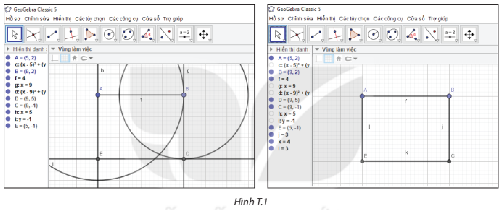
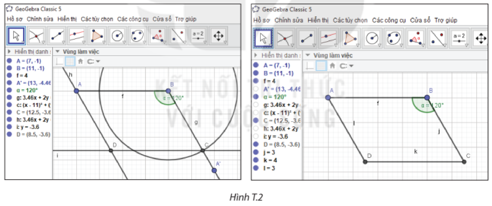
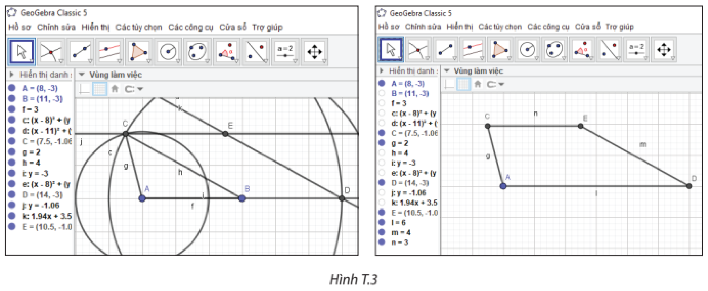

<!-- pdf:116 -->

# VẼ HÌNH ĐƠN GIẢN VỚI PHẦN MỀM GEOGEBRA

## 🎯 Mục tiêu

- Sử dụng phần mềm GeoGebra để vẽ hình chữ nhật, hình bình hành, hình thang.

## 🔴 Mở đầu

Các em đã được học về hình thang, hình bình hành, hình chữ nhật và có thể vẽ các hình đó bằng thước kẻ và compa dựa vào các tính chất của chúng. Trong bài này, chúng ta sẽ thực hành dùng phần mềm GeoGebra để vẽ các hình như vậy.

**HĐ1. VẼ HÌNH CHỮ NHẬT**

Các em đã biết vẽ đường vuông góc và đường thẳng song song. Bây giờ chúng ta sẽ sử dụng hộp công cụ đường thẳng và đường tròn trong GeoGebra để vẽ hình chữ nhật $ABCE$ có $AB = 4\text{ cm}$, $BC = 3\text{ cm}$.

*Bước 1.* Vẽ đoạn thẳng $AB$ và có độ dài $4\text{ cm}$.

Chọn công cụ Đường tròn $\rightarrow$ Chọn Đường tròn khi biết tâm và bán kính $\rightarrow$ Chọn điểm $A$, nhập bán kính bằng $4$.
<!-- ocr-ok: đã đối chiếu ảnh trang PDF 116, dòng hướng dẫn xen kẽ biểu tượng công cụ GeoGebra -->

Chọn công cụ Điểm $\rightarrow$ Chọn Điểm mới $\rightarrow$ Chọn điểm $B$ nằm trên đường tròn.
<!-- ocr-ok: đã đối chiếu ảnh trang PDF 116, dòng hướng dẫn xen kẽ biểu tượng công cụ GeoGebra -->

Chọn công cụ Đường thẳng $\rightarrow$ Chọn Đoạn thẳng $\rightarrow$ Chọn điểm $A$ $\rightarrow$ Chọn điểm $B$.
<!-- ocr-ok: đã đối chiếu ảnh trang PDF 116, dòng hướng dẫn xen kẽ biểu tượng công cụ GeoGebra -->

*Bước 2.* Vẽ điểm $C$ nằm trên đường thẳng vuông góc với $AB$ và $BC = 3\text{ cm}$.

Chọn công cụ Đường đặc biệt $\rightarrow$ Chọn Đường vuông góc $\rightarrow$ Nháy chuột vào điểm $B$ $\rightarrow$ Nháy chuột vào đoạn thẳng $AB$.
<!-- ocr-ok: đã đối chiếu ảnh trang PDF 116, dòng hướng dẫn xen kẽ biểu tượng công cụ GeoGebra -->

Chọn công cụ Đường tròn $\rightarrow$ Chọn Đường tròn khi biết tâm và bán kính $\rightarrow$ Nháy chuột vào điểm $B$, nhập bán kính bằng $3$.
<!-- ocr-ok: đã đối chiếu ảnh trang PDF 116, dòng hướng dẫn xen kẽ biểu tượng công cụ GeoGebra -->

Chọn công cụ Điểm $\rightarrow$ Chọn Giao điểm của 2 đối tượng $\rightarrow$ Lần lượt nháy chuột vào đường thẳng và đường tròn vừa vẽ.
<!-- ocr-ok: đã đối chiếu ảnh trang PDF 116, dòng hướng dẫn xen kẽ biểu tượng công cụ GeoGebra -->

*Bước 3.* Vẽ điểm $E$ là giao của đường thẳng vuông góc với $AB$ tại $A$ và đường thẳng vuông góc với $BC$ tại $C$.

<!-- pdf:117 -->

Chọn công cụ Đường đặc biệt $\rightarrow$ Chọn Đường vuông góc $\rightarrow$ Nháy chuột vào điểm $A$ $\rightarrow$ Nháy chuột vào đoạn thẳng $AB$.
<!-- ocr-ok: đã đối chiếu ảnh trang PDF 117, dòng hướng dẫn xen kẽ biểu tượng công cụ GeoGebra -->

Chọn công cụ Đường đặc biệt $\rightarrow$ Chọn Đường vuông góc $\rightarrow$ Nháy chuột vào điểm $C$ $\rightarrow$ Nháy chuột vào đường thẳng $BC$.
<!-- ocr-ok: đã đối chiếu ảnh trang PDF 117, dòng hướng dẫn xen kẽ biểu tượng công cụ GeoGebra -->

Chọn công cụ Điểm $\rightarrow$ Chọn Giao điểm của 2 đối tượng $\rightarrow$ Lần lượt nháy chuột vào hai đường thẳng vừa vẽ.
<!-- ocr-ok: đã đối chiếu ảnh trang PDF 117, dòng hướng dẫn xen kẽ biểu tượng công cụ GeoGebra -->

Ẩn các đường tròn và đường thẳng, chọn công cụ Đoạn thẳng để nối $B$ với $C$, $C$ với $E$, $E$ với $A$ và thu được hình chữ nhật $ABCE$.
<!-- ocr-ok: đã đối chiếu ảnh trang PDF 117, dòng hướng dẫn xen kẽ biểu tượng công cụ GeoGebra -->

*Hình T.1*

**Luyện tập 1:**

a) Dùng công cụ Góc để kiểm tra các góc của tứ giác $ABCE$ có vuông không.
<!-- ocr-ok: đã đối chiếu ảnh trang PDF 117, sách in biểu tượng công cụ Góc -->

b) Lưu hình vẽ ở HĐ1 thành tệp ảnh hnc.png.
<!-- Sách in "hnc.png"; giữ nguyên văn theo quy tắc Tầng 1. -->

c) Tương tự, hãy vẽ hình vuông $ABCE$ có cạnh $4\text{ cm}$.

**HĐ2. VẼ HÌNH BÌNH HÀNH**

Vẽ hình bình hành $ABCE$ có $AB = 4\text{ cm}$, $BC = 3\text{ cm}$, $\widehat{ABC} = 120^\circ$.
<!-- Sách in "ABCE" ở đề bài HĐ2 và "ABCD" ở cuối Bước 3; giữ nguyên văn theo quy tắc Tầng 1. -->

*Bước 1.* Vẽ đoạn thẳng $AB$ và có độ dài $4\text{ cm}$ tương tự như Bước 1 của HĐ1.

*Bước 2.* Vẽ điểm $C$ sao cho $BC = 3\text{ cm}$ và $\widehat{ABC} = 120^\circ$.

Chọn công cụ Góc $\rightarrow$ Chọn Góc với độ lớn cho trước $\rightarrow$ Nháy chuột lần lượt vào các điểm $A, B$ và nhập số đo góc là $120$.
<!-- ocr-ok: đã đối chiếu ảnh trang PDF 117, dòng hướng dẫn xen kẽ biểu tượng công cụ Góc của GeoGebra -->

Chọn công cụ Đường thẳng $\rightarrow$ Chọn Tia đi qua 2 điểm $\rightarrow$ Nháy chuột lần lượt vào các điểm $B, A'$.
<!-- ocr-ok: đã đối chiếu ảnh trang PDF 117, dòng hướng dẫn xen kẽ biểu tượng công cụ GeoGebra -->

<!-- pdf:118 -->

Chọn công cụ Đường tròn $\rightarrow$ Chọn Đường tròn khi biết tâm và bán kính $\rightarrow$ Nháy chuột vào điểm $B$, nhập bán kính bằng $3$.
<!-- ocr-ok: đã đối chiếu ảnh trang PDF 118, dòng hướng dẫn xen kẽ biểu tượng công cụ GeoGebra -->

Chọn công cụ Điểm $\rightarrow$ Chọn Giao điểm của 2 đối tượng $\rightarrow$ Lần lượt nháy chuột vào tia $BA'$ và đường tròn vừa vẽ.
<!-- ocr-ok: đã đối chiếu ảnh trang PDF 118, dòng hướng dẫn xen kẽ biểu tượng công cụ GeoGebra -->

*Bước 3.* Vẽ điểm $D$ là giao của đường thẳng qua $A$ song song với $BC$ và đường thẳng qua $C$ song song với $AB$.

Chọn công cụ Đường đặc biệt $\rightarrow$ Chọn Đường song song $\rightarrow$ Nháy chuột vào điểm $C$ $\rightarrow$ Nháy chuột vào đoạn thẳng $AB$.
<!-- ocr-ok: đã đối chiếu ảnh trang PDF 118, dòng hướng dẫn xen kẽ biểu tượng công cụ GeoGebra -->

Chọn công cụ Đường đặc biệt $\rightarrow$ Chọn Đường song song $\rightarrow$ Nháy chuột vào điểm $A$ $\rightarrow$ Nháy chuột vào tia $BA'$.
<!-- ocr-ok: đã đối chiếu ảnh trang PDF 118, dòng hướng dẫn xen kẽ biểu tượng công cụ GeoGebra -->

Chọn công cụ Điểm $\rightarrow$ Chọn Giao điểm của 2 đối tượng $\rightarrow$ Lần lượt nháy chuột vào hai đường thẳng vừa vẽ.
<!-- ocr-ok: đã đối chiếu ảnh trang PDF 118, dòng hướng dẫn xen kẽ biểu tượng công cụ GeoGebra -->

Ẩn đường tròn, tia $BA'$, các đường thẳng và điểm $A'$, chọn công cụ Đoạn thẳng để nối $B$ với $C$, $C$ với $D$, $D$ với $A$ và thu được hình bình hành $ABCD$.
<!-- ocr-ok: đã đối chiếu ảnh trang PDF 118, dòng hướng dẫn xen kẽ biểu tượng công cụ GeoGebra -->

*Hình T.2*

**Luyện tập 2:**

a) Dùng Trung điểm hoặc tâm trong công cụ Điểm để kiểm tra trung điểm $AC$ và $BD$ có trùng nhau không.
<!-- ocr-ok: đã đối chiếu ảnh trang PDF 118, dòng hướng dẫn xen kẽ biểu tượng công cụ GeoGebra -->

b) Lưu hình vẽ ở HĐ2 thành tệp ảnh hbh.png.

c) Tương tự, hãy vẽ một hình thoi $ABCD$ có cạnh $4\text{ cm}$.

<!-- pdf:119 -->

**HĐ3. VẼ HÌNH THANG**

Vẽ hình thang $ADEC$ có đáy lớn $AD = 6\text{ cm}$, đáy nhỏ $EC = 3\text{ cm}$, các cạnh bên $AC = 2\text{ cm}$, $DE = 4\text{ cm}$ theo các bước sau:

*Bước 1.* Vẽ đoạn thẳng $AB$ và có độ dài bằng $AD - EC = 3\text{ cm}$ tương tự như Bước 1 của HĐ1.

*Bước 2.* Vẽ tam giác $ABC$ có $BC = 4\text{ cm}$ (độ dài của $DE$), $AC = 2\text{ cm}$.

Chọn công cụ Đường tròn $\rightarrow$ Chọn Đường tròn khi biết tâm và bán kính $\rightarrow$ Nháy chuột vào điểm $A$, nhập bán kính bằng $2$.
<!-- ocr-ok: đã đối chiếu ảnh trang PDF 119, dòng hướng dẫn xen kẽ biểu tượng công cụ GeoGebra -->

Chọn công cụ Đường tròn $\rightarrow$ Chọn Đường tròn khi biết tâm và bán kính $\rightarrow$ Nháy chuột vào điểm $B$, nhập bán kính bằng $4$.
<!-- ocr-ok: đã đối chiếu ảnh trang PDF 119, dòng hướng dẫn xen kẽ biểu tượng công cụ GeoGebra -->

Chọn công cụ Điểm $\rightarrow$ Chọn Giao điểm của 2 đối tượng $\rightarrow$ Lần lượt nháy chuột vào hai đường tròn vừa vẽ.
<!-- ocr-ok: đã đối chiếu ảnh trang PDF 119, dòng hướng dẫn xen kẽ biểu tượng công cụ GeoGebra -->

Chọn công cụ Đường thẳng $\rightarrow$ Chọn Đoạn thẳng $\rightarrow$ Chọn điểm $A$ $\rightarrow$ Chọn điểm $C$.
<!-- ocr-ok: đã đối chiếu ảnh trang PDF 119, dòng hướng dẫn xen kẽ biểu tượng công cụ GeoGebra -->

Chọn công cụ Đường thẳng $\rightarrow$ Chọn Đoạn thẳng $\rightarrow$ Chọn điểm $B$ $\rightarrow$ Chọn điểm $C$.
<!-- ocr-ok: đã đối chiếu ảnh trang PDF 119, dòng hướng dẫn xen kẽ biểu tượng công cụ GeoGebra -->

*Bước 3.* Vẽ điểm $D$ nằm trên tia $AB$ sao cho $AD = 6\text{ cm}$.

Chọn công cụ Đường tròn $\rightarrow$ Chọn Đường tròn khi biết tâm và bán kính $\rightarrow$ Nháy chuột vào điểm $A$, nhập bán kính bằng $6$.
<!-- ocr-ok: đã đối chiếu ảnh trang PDF 119, dòng hướng dẫn xen kẽ biểu tượng công cụ GeoGebra -->

Chọn công cụ Đường thẳng $\rightarrow$ Chọn Tia đi qua 2 điểm $\rightarrow$ Nháy chuột lần lượt vào các điểm $A, B$.
<!-- ocr-ok: đã đối chiếu ảnh trang PDF 119, dòng hướng dẫn xen kẽ biểu tượng công cụ GeoGebra -->

Chọn công cụ Điểm $\rightarrow$ Chọn Giao điểm của 2 đối tượng $\rightarrow$ Lần lượt nháy chuột vào tia $AB$ và đường tròn vừa vẽ.
<!-- ocr-ok: đã đối chiếu ảnh trang PDF 119, dòng hướng dẫn xen kẽ biểu tượng công cụ GeoGebra -->

*Bước 4.* Vẽ điểm $E$ sao cho $DE \parallel BC$ và $CE \parallel AB$.

Chọn công cụ Đường đặc biệt $\rightarrow$ Chọn Đường song song $\rightarrow$ Nháy chuột vào điểm $D$ $\rightarrow$ Nháy chuột vào đoạn thẳng $BC$.
<!-- ocr-ok: đã đối chiếu ảnh trang PDF 119, dòng hướng dẫn xen kẽ biểu tượng công cụ GeoGebra -->

Chọn công cụ Đường đặc biệt $\rightarrow$ Chọn Đường song song $\rightarrow$ Nháy chuột vào điểm $C$ $\rightarrow$ Nháy chuột vào tia $AB$.
<!-- ocr-ok: đã đối chiếu ảnh trang PDF 119, dòng hướng dẫn xen kẽ biểu tượng công cụ GeoGebra -->

Chọn công cụ Điểm $\rightarrow$ Chọn Giao điểm của 2 đối tượng $\rightarrow$ Lần lượt nháy chuột vào hai đường thẳng vừa vẽ.
<!-- ocr-ok: đã đối chiếu ảnh trang PDF 119, dòng hướng dẫn xen kẽ biểu tượng công cụ GeoGebra -->

Ẩn các đường tròn, các đường thẳng, đoạn thẳng $AB, BC$ và điểm $B$. Chọn công cụ Đoạn thẳng để nối $A$ với $D$, $D$ với $E$, $E$ với $C$ và thu được hình thang $ADEC$.
<!-- ocr-ok: đã đối chiếu ảnh trang PDF 119, dòng hướng dẫn xen kẽ biểu tượng công cụ GeoGebra -->

<!-- pdf:120 -->

*Hình T.3*

**Luyện tập 3:**

a) Dùng Khoảng cách trong công cụ Góc để kiểm tra $DE$ có bằng $4\text{ cm}$ không.
<!-- ocr-ok: đã đối chiếu ảnh trang PDF 120, dòng hướng dẫn xen kẽ biểu tượng công cụ GeoGebra -->

b) Lưu hình vẽ ở HĐ3 thành tệp ảnh hth.png.

c) Tương tự, hãy vẽ hình thang cân $ADEC$ có $AD \parallel EC$, $AD = 6\text{ cm}$, $CE = 4\text{ cm}$, $AC = DE = 3\text{ cm}$.

**Thực hành**

1. a) Em hãy trình bày các bước dùng phần mềm GeoGebra để vẽ hình chữ nhật $ABCD$ có $AB = 6\text{ cm}$, $AC = 9\text{ cm}$.

b) Vẽ hình chữ nhật trên trong phần mềm GeoGebra và lưu thành một tệp có đuôi png.

2. a) Em hãy trình bày các bước dùng phần mềm Geogebra để vẽ hình bình hành $ABCD$ có $AB = 4\text{ cm}$, $AC = 5\text{ cm}$, $BC = 6\text{ cm}$.
<!-- Sách in "Geogebra" ở câu 2a và 2b; giữ nguyên văn theo quy tắc Tầng 1. -->

b) Vẽ hình bình hành trên trong phần mềm Geogebra và lưu thành một tệp có đuôi png.

## 📷 Danh sách hình trong bài

| Mã hình | Trang PDF | Vị trí trong bài | Chú thích gốc |
| --- | :---: | --- | --- |
| H8-toan-hd-thtn-03-01 | 117 | HĐ1, Bước 3 | Hình T.1 |
| H8-toan-hd-thtn-03-02 | 118 | HĐ2, Bước 3 | Hình T.2 |
| H8-toan-hd-thtn-03-03 | 120 | HĐ3, Bước 4 | Hình T.3 |
