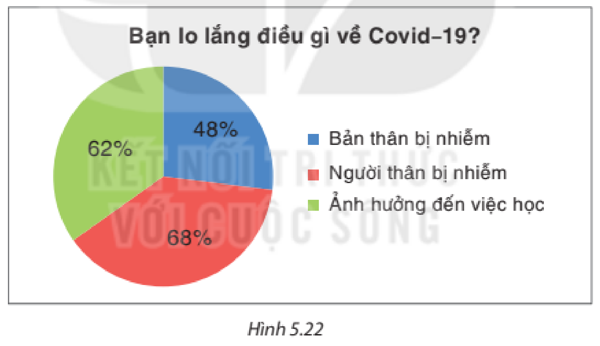
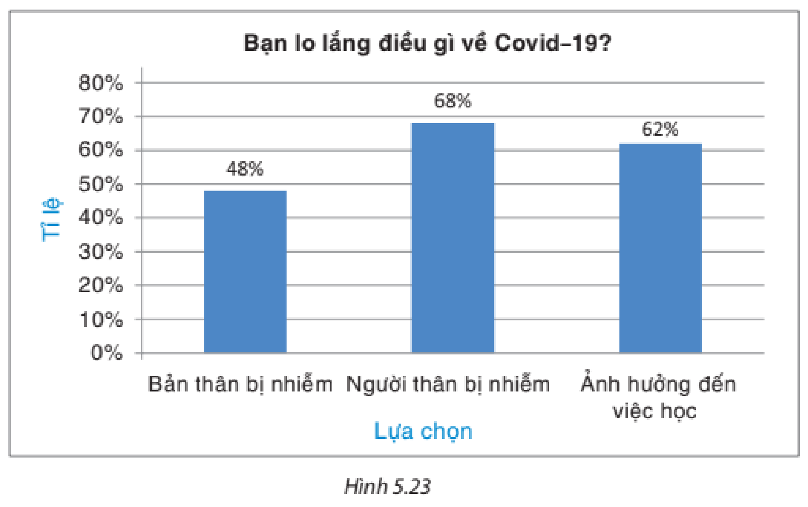
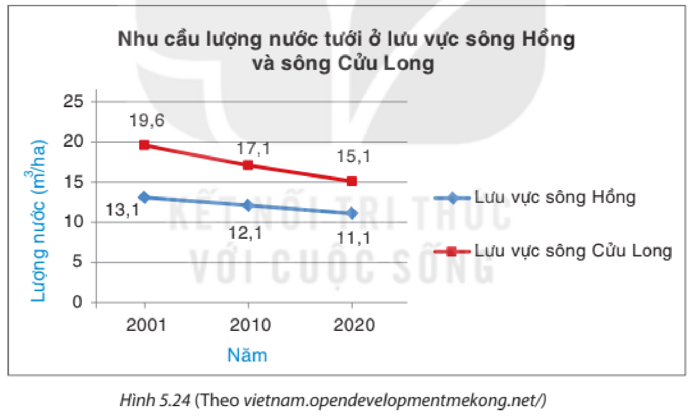

<!-- pdf:107 -->

# LUYỆN TẬP CHUNG (TRANG 106)

**Ví dụ 1:** An phát phiếu điều tra sau cho $200$ bạn trong trường để thực hiện khảo sát.

> **Bạn lo lắng điều gì về Covid–19?**
>
> *(Khoanh tròn vào lựa chọn. Có thể có nhiều lựa chọn)*
>
> A. Bản thân bị nhiễm
>
> B. Người thân bị nhiễm
>
> C. Ảnh hưởng đến việc học
>
> D. Vấn đề khác

An thống kê kết quả và thấy có $96$ lựa chọn A, $136$ lựa chọn B, $124$ lựa chọn C.

a) Giải thích tại sao tổng số lựa chọn lớn hơn số bạn được hỏi.

b) An đã biểu diễn tỉ lệ học sinh đã lựa chọn A, B, C bằng biểu đồ hình quạt tròn sau:

*Hình 5.22*

Biểu đồ An sử dụng có phù hợp không?

c) An phải dùng biểu đồ nào để biểu diễn? Vẽ biểu đồ đó.

**Giải**

a) Tổng số lựa chọn là $96 + 136 + 124 = 356$ lớn hơn số bạn được hỏi vì mỗi bạn có thể có nhiều lựa chọn.

b) An sử dụng biểu đồ hình quạt tròn (H.5.22) là không phù hợp vì biểu đồ hình quạt tròn biểu diễn tỉ lệ các phần trong tổng thể, tổng tỉ lệ của các phần luôn là $100\%$.

c) Nếu muốn biểu diễn tỉ lệ học sinh đã lựa chọn A, B, C thì An nên dùng biểu đồ hình cột (H.5.23) sau:

<!-- pdf:108 -->

*Hình 5.23*

**Ví dụ 2:** Biểu đồ sau cho biết nhu cầu về lượng nước tưới (đơn vị: $\text{m}^3/\text{ha}$) tại lưu vực sông Hồng và sông Cửu Long trong các năm có lượng mưa trung bình.

*Hình 5.24 (Theo vietnam.opendevelopmentmekong.net/)*

Không cần nhìn vào số liệu cụ thể, hãy cho biết:

a) Xu thế theo thời gian của các dãy số liệu được biểu diễn.

b) Nhu cầu về lượng nước tưới ở lưu vực sông nào lớn hơn.

**Giải**

a) Hai dãy số liệu về nhu cầu lượng nước tưới ở lưu vực sông Hồng và sông Cửu Long đều có xu hướng giảm, từ trái qua phải đường biểu diễn hai dãy số liệu này đi xuống.

b) Nhu cầu về nước tưới ở lưu vực sông Cửu Long lớn hơn ở lưu vực sông Hồng do đường màu đỏ nằm trên đường màu xanh.

<!-- pdf:109 -->

## BÀI TẬP

5.15. Mỗi dữ liệu sau đây thuộc loại nào? Nên dùng biểu đồ nào để biểu diễn dữ liệu đó.

a) Tuổi thọ trung bình của người Việt Nam trong $30$ năm từ năm 1989 đến năm 2019.

b) Số bàn thắng mà mỗi đội bóng châu Á ghi được tại World Cup 2022.

5.16. Bảng thống kê sau cho biết tỉ lệ đóng góp vào GDP toàn cầu của Việt Nam trong một số năm.

| Năm | 2011 | 2012 | 2013 | 2014 | 2015 | 2016 | 2017 | 2018 |
| --- | :---: | :---: | :---: | :---: | :---: | :---: | :---: | :---: |
| Tỉ lệ ($\%$) | $0,16$ | $0,18$ | $0,19$ | $0,20$ | $0,23$ | $0,24$ | $0,24$ | $0,25$ |
<!-- ocr-ok: đã đối chiếu ảnh trang PDF 109, bảng số liệu Bài 5.16 -->

*(Theo theglobaleconomy.com)*

a) Chọn biểu đồ phù hợp để biểu diễn bảng thống kê này.

b) Cho biết xu thế về tỉ lệ đóng góp của Việt Nam vào GDP toàn cầu.

5.17. Số học sinh của ba trường Trung học cơ sở trên địa bàn đăng kí tham dự giải chạy việt dã do quận tổ chức được cho trong bảng sau:

| Trường | Đoàn Kết | Bình Minh | Hoà Bình |
| --- | :---: | :---: | :---: |
| Số lượng học sinh đăng kí | $13$ | $47$ | $183$ |

Theo em nên sử dụng biểu đồ tranh hay biểu đồ cột để biểu diễn dữ liệu này? Tại sao?

5.18. Doanh thu (đơn vị: tỉ đồng) của hai chi nhánh một công ty trong năm 2021 và 2022 được cho trong bảng sau:

| Chi nhánh \ Năm | 2021 | 2022 |
| --- | :---: | :---: |
| Hà Nội | $6$ | $8$ |
| Thành phố Hồ Chí Minh | $10$ | $12$ |
<!-- ocr-ok: đã đối chiếu ảnh trang PDF 109, bảng 2 chiều Bài 5.18 -->

Lựa chọn và vẽ biểu đồ để so sánh doanh thu của hai chi nhánh này trong hai năm 2021 và 2022.

## 📷 Danh sách hình trong bài

| Mã hình | Trang PDF | Vị trí trong bài | Chú thích gốc |
| --- | :---: | --- | --- |
| H8-toan-ltc-c05-01 | 107 | Ví dụ 1b | Hình 5.22 |
| H8-toan-ltc-c05-02 | 108 | Ví dụ 1c, Giải | Hình 5.23 |
| H8-toan-ltc-c05-03 | 108 | Ví dụ 2 | Hình 5.24 (Theo vietnam.opendevelopmentmekong.net/) |
