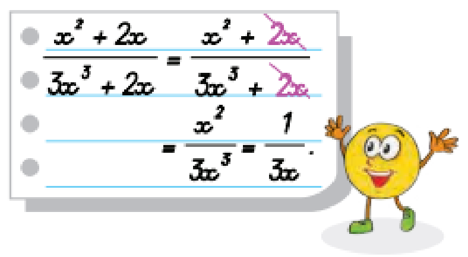

<!-- pdf:9 -->

# BÀI 22: TÍNH CHẤT CƠ BẢN CỦA PHÂN THỨC ĐẠI SỐ

## 🔤 Khái niệm, thuật ngữ

- Tính chất cơ bản của phân thức đại số
- Mẫu thức chung
- Nhân tử phụ
- Quy đồng mẫu thức

## 🎯 Kiến thức, kĩ năng

- Mô tả tính chất cơ bản của phân thức đại số.
- Rút gọn phân thức đại số.
- Biết quy đồng mẫu thức nhiều phân thức trong trường hợp thuận lợi.

## 🔴 Mở đầu

- **Pi:** Liệu có phân thức nào đơn giản hơn nhưng bằng phân thức $\dfrac{x - y}{x^3 - y^3}$ không nhỉ?

## 1. TÍNH CHẤT CƠ BẢN CỦA PHÂN THỨC

**Nhận biết tính chất cơ bản của phân thức đại số**

**HĐ1:** Nếu nhân cả tử và mẫu của phân thức $\dfrac{x + y}{x - y}$ với $2x$ ta được phân thức mới nào?

Giải thích vì sao phân thức mới nhận được bằng phân thức đã cho.

**HĐ2:** Tử và mẫu của phân thức $\dfrac{(x - 1)(x + 1)}{(x - 1)(x^2 + x + 1)}$ có nhân tử chung là $x - 1$. Viết phân thức nhận được sau khi chia cả tử và mẫu của phân thức này cho nhân tử chung đó.

So sánh phân thức mới nhận được với phân thức đã cho.

<!-- term: Tính chất cơ bản của phân thức đại số -->
Từ HĐ1 và HĐ2, ta thấy phân thức đại số có tính chất cơ bản sau:

<!-- term: Tính chất cơ bản của phân thức đại số -->
> - Nếu nhân cả tử và mẫu của một phân thức với cùng một đa thức khác đa thức $0$ thì được một phân thức bằng phân thức đã cho:
>
> $\dfrac{A}{B} = \dfrac{A \cdot M}{B \cdot M}$ ($M$ là một đa thức khác đa thức $0$).
>
> - Nếu tử và mẫu của một phân thức có nhân tử chung thì khi chia cả tử và mẫu cho nhân tử chung đó ta được một phân thức bằng phân thức đã cho:
>
> $\dfrac{A : N}{B : N} = \dfrac{A}{B}$ ($N$ là một nhân tử chung).

<!-- pdf:10 -->

**Ví dụ 1:**

Dùng tính chất cơ bản của phân thức, giải thích vì sao $\dfrac{2x + 2}{x^2 - 1} = \dfrac{2}{x - 1}$.

**Giải**

Áp dụng tính chất cơ bản của phân thức, ta có: $\dfrac{2x + 2}{x^2 - 1} = \dfrac{2(x + 1)}{(x - 1)(x + 1)} = \dfrac{2}{x - 1}$.

**Luyện tập 1:** Khẳng định sau đúng hay sai? Vì sao?

$\dfrac{30xy^2(x - y)}{45xy(x - y)^2} = \dfrac{2y}{3(x - y)}.$

**Luyện tập 2:** Giải thích vì sao $\dfrac{-x}{1 - x} = \dfrac{x}{x - 1}$.

- **Pi:** Đổi dấu một đa thức là đổi dấu tất cả các hạng tử của đa thức đó.
<!-- ocr-ok: đã đối chiếu ảnh trang PDF 10, bóng thoại của Pi đặt ngang cạnh Luyện tập 2 và Chú ý -->

**Chú ý.** Tổng quát, ta có **quy tắc đổi dấu**: Nếu đổi dấu cả tử và mẫu của một phân thức thì được một phân thức bằng phân thức đã cho.

$\dfrac{A}{B} = \dfrac{-A}{-B}.$

## 2. VẬN DỤNG

**a) Rút gọn phân thức**

**Cách rút gọn một phân thức**

**Rút gọn một phân thức** là biến đổi phân thức đó thành một phân thức mới bằng nó nhưng đơn giản hơn.

Hãy thực hiện các yêu cầu sau đây để rút gọn phân thức $\dfrac{2x^2 + 2x}{x^2 - 1}$.

**HĐ3:** Phân tích tử và mẫu của phân thức $\dfrac{2x^2 + 2x}{x^2 - 1}$ thành nhân tử và tìm các nhân tử chung của chúng.

**HĐ4:** Chia cả tử và mẫu của phân thức $\dfrac{2x^2 + 2x}{x^2 - 1}$ cho các nhân tử chung, ta nhận được một phân thức mới bằng phân thức đã cho nhưng đơn giản hơn.

<!-- term: Các bước rút gọn phân thức đại số -->
> Muốn rút gọn một phân thức đại số ta làm như sau:
> - Phân tích tử và mẫu thành nhân tử (nếu cần) để tìm nhân tử chung;
> - Chia cả tử và mẫu cho nhân tử chung đó.

**Ví dụ 2:**

Rút gọn phân thức $P = \dfrac{x^2 - xy}{3(xy^2 - y^3)}$.

**Giải**

Ta có: $P = \dfrac{x^2 - xy}{3(xy^2 - y^3)} = \dfrac{x(x - y)}{3y^2(x - y)} = \dfrac{x}{3y^2}$.

<!-- pdf:11 -->

**Luyện tập 3:** Em hãy trả lời câu hỏi trong *tình huống mở đầu*.

**Tranh luận**

Tròn thực hiện rút gọn một phân thức như hình bên.

Hỏi bạn Tròn làm đúng hay sai? Vì sao?

- *Bài làm của Tròn:* $\dfrac{x^2 + 2x}{3x^3 + 2x} = \dfrac{x^2 + \not{2x}}{3x^3 + \not{2x}} = \dfrac{x^2}{3x^3} = \dfrac{1}{3x}$.
<!-- ocr-ok: đã đối chiếu ảnh trang PDF 11, nội dung phép biến đổi viết tay trên giấy trong hình Tranh luận -->

**Thử thách nhỏ**

Tìm $a$ sao cho hai phân thức sau bằng nhau:

$\dfrac{-ax^2 - ax}{x^2 - 1}$ và $\dfrac{3x}{x - 1}$.

**b) Quy đồng mẫu thức nhiều phân thức**

**Cách quy đồng mẫu thức nhiều phân thức**

**Quy đồng mẫu thức nhiều phân thức** là biến đổi các phân thức đã cho thành những phân thức mới có cùng mẫu thức và lần lượt bằng các phân thức đã cho.

Hãy thực hiện các yêu cầu sau để quy đồng mẫu thức hai phân thức:

$\dfrac{1}{2x^2 + 2x}$ và $\dfrac{1}{3x^2 - 6x}$.

**HĐ5:** Phân tích các mẫu thức của hai phân thức đã cho thành nhân tử.

**HĐ6:** Chọn **mẫu thức chung** (**MTC**) của hai mẫu thức trên bằng cách lấy tích của các nhân tử được chọn như sau:
- Nhân tử bằng số của MTC là tích các nhân tử bằng số ở các mẫu thức của các phân thức đã cho (nếu các nhân tử bằng số ở các mẫu thức là những số nguyên dương thì nhân tử bằng số ở MTC là BCNN của chúng);
- Với mỗi luỹ thừa của cùng một biểu thức có mặt trong các mẫu thức, ta chọn luỹ thừa với số mũ cao nhất.

**HĐ7:** Tìm **nhân tử phụ** của mỗi mẫu thức bằng cách lấy MTC chia cho mẫu thức đó.

**HĐ8:** Nhân cả tử và mẫu của mỗi phân thức đã cho với nhân tử phụ tương ứng, ta được các phân thức có mẫu thức là MTC đã chọn.

<!-- term: Các bước quy đồng mẫu thức nhiều phân thức -->
> Muốn quy đồng mẫu thức nhiều phân thức ta làm như sau:
> - Phân tích các mẫu thức thành nhân tử rồi tìm mẫu thức chung;
> - Tìm nhân tử phụ của mỗi mẫu thức bằng cách chia MTC cho mẫu thức đó;
> - Nhân cả tử và mẫu của mỗi phân thức với nhân tử phụ tương ứng.

<!-- pdf:12 -->

**Ví dụ 3:**

Quy đồng mẫu thức hai phân thức $\dfrac{3}{5x^3 + 5x^2}$ và $\dfrac{-7}{2x^3 + 4x^2 + 2x}$.

**Giải**

Ta có: $5x^3 + 5x^2 = 5x^2 \cdot (x + 1)$;

$2x^3 + 4x^2 + 2x = 2x \cdot (x^2 + 2x + 1) = 2x \cdot (x + 1)^2.$

Mẫu thức chung là $10x^2(x + 1)^2$.

Nhân tử phụ của $5x^3 + 5x^2$ là

$\text{MTC} : (5x^3 + 5x^2) = 10x^2(x + 1)^2 : \left[5x^2(x + 1)\right] = 2(x + 1).$

Nhân tử phụ của $2x^3 + 4x^2 + 2x$ là

$\text{MTC} : (2x^3 + 4x^2 + 2x) = 10x^2(x + 1)^2 : \left[2x(x + 1)^2\right] = 5x.$

Nhân cả tử và mẫu của mỗi phân thức với nhân tử phụ tương ứng, ta có:

$\dfrac{3}{5x^3 + 5x^2} = \dfrac{3 \cdot 2(x + 1)}{10x^2(x + 1)^2} = \dfrac{6(x + 1)}{10x^2(x + 1)^2}$ và $\dfrac{-7}{2x^3 + 4x^2 + 2x} = \dfrac{-7 \cdot 5x}{10x^2(x + 1)^2} = \dfrac{-35x}{10x^2(x + 1)^2}$.

**Luyện tập 4:**

Quy đồng mẫu thức hai phân thức $\dfrac{1}{3x^2 - 3}$ và $\dfrac{1}{x^3 - 1}$.

**Tranh luận**

- **Tròn:** Hai phân thức $\dfrac{5}{x - 1}$ và $\dfrac{x}{1 - x}$ có MTC là $x - 1$.
- **Vuông:** Không đúng, MTC là $(x - 1)(1 - x)$ chứ!
<!-- ocr-ok: đã đối chiếu ảnh trang PDF 12, hai bóng thoại của Tròn và Vuông đặt ngang nhau -->

Theo em, bạn nào chọn MTC hợp lí hơn? Vì sao?

## BÀI TẬP

6.7. Dùng tính chất cơ bản của phân thức, giải thích vì sao các kết luận sau đúng.

a) $\dfrac{(x - 2)^3}{x^2 - 2x} = \dfrac{(x - 2)^2}{x}$; $\qquad$ b) $\dfrac{1 - x}{-5x + 1} = \dfrac{x - 1}{5x - 1}$.

<!-- pdf:13 -->

6.8. Tìm đa thức thích hợp thay cho dấu “$?$”.

$\dfrac{y - x}{4 - x} = \dfrac{?}{x - 4}.$

6.9. Rút gọn các phân thức sau:

a) $\dfrac{5x + 10}{25x^2 + 50}$; $\qquad$ b) $\dfrac{45x(3 - x)}{15x(x - 3)^3}$; $\qquad$ c) $\dfrac{(x^2 - 1)^2}{(x + 1)(x^3 + 1)}$.

6.10. Cho phân thức $P = \dfrac{x + 1}{x^2 - 1}$.

a) Rút gọn phân thức đã cho, kí hiệu $Q$ là phân thức nhận được.

b) Tính giá trị của $P$ và $Q$ tại $x = 11$. So sánh hai kết quả đó.

6.11. Tìm $a$ sao cho hai phân thức sau bằng nhau:

$\dfrac{5x}{x + 1}$ và $\dfrac{ax(x - 1)}{(1 - x)(x + 1)}$.

6.12. Quy đồng mẫu thức các phân thức sau:

a) $\dfrac{1}{x^3 - 8}$ và $\dfrac{3}{4 - 2x}$; $\qquad$ b) $\dfrac{x}{x^2 - 1}$ và $\dfrac{1}{x^2 + 2x + 1}$.

6.13. Quy đồng mẫu thức các phân thức sau:

a) $\dfrac{1}{x + 2}; \dfrac{x + 1}{x^2 - 4x + 4}$ và $\dfrac{5}{2 - x}$. $\qquad$ b) $\dfrac{1}{3x + 3y}; \dfrac{2x}{x^2 - y^2}$ và $\dfrac{x^2 - xy + y^2}{x^2 - 2xy + y^2}$.

6.14. Cho hai phân thức $\dfrac{9x^2 + 3x + 1}{27x^3 - 1}$ và $\dfrac{x^2 - 4x}{16 - x^2}$.

a) Rút gọn hai phân thức đã cho.

b) Quy đồng mẫu thức hai phân thức nhận được ở câu a.

## 📷 Danh sách hình trong bài

| Mã hình | Trang PDF | Vị trí trong bài | Chú thích gốc |
| --- | :---: | --- | --- |
| H8-toan-b22-01 | 11 | Mục 2a, Tranh luận | (sách không đánh số, bài làm rút gọn phân thức của bạn Tròn) |
