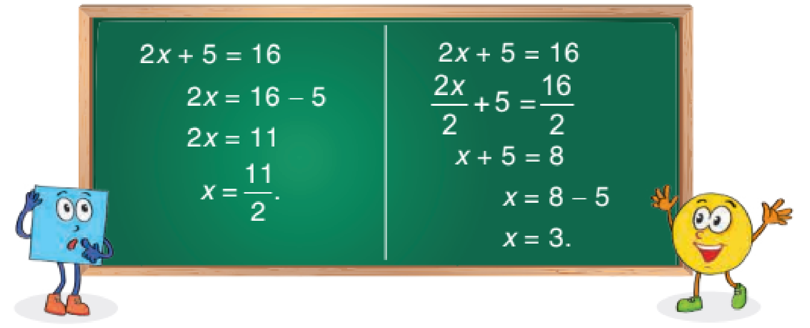

<!-- pdf:28 -->
<!-- Phần giới thiệu đầu Chương VII (nửa trên trang PDF 28): ĐẠI SỐ — CHƯƠNG VII: PHƯƠNG TRÌNH BẬC NHẤT VÀ HÀM SỐ BẬC NHẤT -->

Chương này trình bày cách giải phương trình bậc nhất một ẩn và ứng dụng của chúng, khái niệm hàm số và đồ thị của hàm số, cách vẽ đồ thị của hàm số bậc nhất và khái niệm hệ số góc của đường thẳng.

# BÀI 25: PHƯƠNG TRÌNH BẬC NHẤT MỘT ẨN

## 🔤 Khái niệm, thuật ngữ

- Phương trình bậc nhất một ẩn
- Ẩn
- Nghiệm

## 🎯 Kiến thức, kĩ năng

- Hiểu khái niệm phương trình bậc nhất một ẩn và cách giải.
- Giải quyết một số vấn đề thực tiễn gắn với phương trình bậc nhất.

## 🔴 Mở đầu

Bác An gửi tiết kiệm $150$ triệu đồng với kì hạn $12$ tháng. Đến cuối kì (tức là sau $1$ năm), bác An thu được số tiền cả vốn lẫn lãi là $159$ triệu đồng. Tính lãi suất gửi tiết kiệm của bác An.

## 1. PHƯƠNG TRÌNH MỘT ẨN

**Nhận biết phương trình một ẩn**

Xét *bài toán mở đầu*.

**HĐ1:** Gọi $x$ (viết dưới dạng số thập phân) là lãi suất gửi tiết kiệm của bác An. Viết biểu thức tính số tiền lãi mà bác An nhận được sau $1$ năm theo $x$.

> Ngân hàng thường công bố lãi suất ở dạng phần trăm. Lãi suất $r = 5\%$ nghĩa là $r = 5\% = \dfrac{5}{100} = 0,05$.

**HĐ2:** Số tiền bác An thu được sau $1$ năm bao gồm cả số tiền vốn và số tiền lãi. Dựa vào kết quả của HĐ1, viết hệ thức chứa $x$ biểu thị số tiền bác An thu được là $159$ triệu đồng.

<!-- pdf:29 -->

Hệ thức chứa $x$ nhận được ở HĐ2 gọi là một *phương trình với ẩn số $x$* (hay *ẩn $x$*).

Tổng quát, ta có:

> Một **phương trình với ẩn $x$** có dạng $A(x) = B(x)$, trong đó vế trái $A(x)$ và vế phải $B(x)$ là hai biểu thức của cùng một biến $x$.

**Nhận biết khái niệm nghiệm của phương trình**

**HĐ3:** Xét phương trình $2x + 9 = 3 - x$. $(1)$

a) Chứng minh rằng $x = -2$ thoả mãn phương trình $(1)$ (tức là hai vế của phương trình nhận cùng một giá trị khi $x = -2$).

Khi đó, ta nói $x = -2$ là một *nghiệm* của phương trình $(1)$.

b) Bằng cách thay trực tiếp vào hai vế của phương trình, hãy kiểm tra xem $x = 1$ có phải là một nghiệm của phương trình $(1)$ không.

> Số $x_0$ gọi là **nghiệm** của phương trình $A(x) = B(x)$ nếu giá trị của $A(x)$ và $B(x)$ tại $x_0$ bằng nhau.
>
> **Giải một phương trình** là tìm tất cả các nghiệm của nó.

**Chú ý:** Tập hợp tất cả các nghiệm của một phương trình được gọi là **tập nghiệm** của phương trình đó và thường được kí hiệu là $S$.

**Ví dụ 1:** Cho phương trình $2x - 5 = 4 - x$.
<!-- ocr-ok: đã đối chiếu ảnh trang PDF 29, OCR bỏ sót nhãn Ví dụ 1 màu xanh và dính chữ "trình2x" -->

Kiểm tra xem $x = 3$ và $x = -1$ có là nghiệm của phương trình đã cho không?

**Giải**

Với $x = 3$, thay vào hai vế của phương trình ta có: $2 \cdot 3 - 5 = 4 - 3$ (đều bằng $1$).

Do đó, $x = 3$ là một nghiệm của phương trình đã cho.

Với $x = -1$, thay vào hai vế của phương trình ta có: $2 \cdot (-1) - 5 \ne 4 - (-1)$.

Do đó, $x = -1$ không là nghiệm của phương trình đã cho.

**Luyện tập 1:** Hãy cho ví dụ về một phương trình với ẩn $x$ và kiểm tra xem $x = 2$ có là một nghiệm của phương trình đó không.

<!-- pdf:30 -->

## 2. PHƯƠNG TRÌNH BẬC NHẤT MỘT ẨN VÀ CÁCH GIẢI

**Khái niệm phương trình bậc nhất một ẩn**

Phương trình một ẩn đơn giản nhất là phương trình có dạng sau:

> Phương trình dạng $ax + b = 0$, với $a, b$ là hai số đã cho và $a \ne 0$, được gọi là **phương trình bậc nhất một ẩn** $x$.

> **Pi:** $a$ gọi là **hệ số của $x$**, $b$ gọi là **hạng tử tự do**, $x$ gọi là **ẩn**.

> ❓ Những phương trình nào sau đây là phương trình bậc nhất một ẩn?
>
> a) $2x + 1 = 0$; \qquad b) $-x + 1 = 0$; \qquad c) $0 \cdot x + 2 = 0$; \qquad d) $(-2) \cdot x = 0$.

*Cách giải phương trình bậc nhất một ẩn*

**HĐ4:** Xét phương trình bậc nhất một ẩn $2x - 6 = 0$. $(2)$

Hãy thực hiện các yêu cầu sau để giải phương trình $(2)$ (tức là tìm nghiệm của nó):

a) Sử dụng quy tắc chuyển vế, hãy chuyển hạng tử tự do $-6$ sang vế phải.

b) Sử dụng quy tắc nhân, nhân cả hai vế của phương trình với $\dfrac{1}{2}$ (tức là chia cả hai vế của phương trình cho hệ số của $x$ là $2$) để tìm nghiệm $x$.

> **Vuông:**
> - **Quy tắc chuyển vế**: $A + C = B$ hay $A = B - C$.
> - **Quy tắc nhân**: $A = B$ hay $A \cdot C = B \cdot C$ nếu $C \ne 0$.
<!-- ocr-ok: đã đối chiếu ảnh trang PDF 30, hộp bóng thoại của Vuông đặt bên lề phải cạnh HĐ4 -->

Trong thực hành, ta trình bày cách tìm nghiệm của phương trình $(2)$ trong HĐ4 như sau:

$$2x - 6 = 0$$

$$2x = 6$$

$$x = 3.$$

<!-- term: Cách giải phương trình bậc nhất một ẩn -->
> - Phương trình bậc nhất $ax + b = 0$ ($a \ne 0$) được giải như sau:
>   $$ax + b = 0$$
>   $$ax = -b$$
>   $$x = -\dfrac{b}{a}.$$
> - Phương trình bậc nhất $ax + b = 0$ ($a \ne 0$) luôn có một nghiệm duy nhất $x = -\dfrac{b}{a}$.

<!-- pdf:31 -->

**Ví dụ 2:** Giải các phương trình sau:

a) $3x + 11 = 0$; \qquad b) $2 - \dfrac{1}{3}x = 0$.

**Giải**

a) $3x + 11 = 0$

$$3x = -11$$

$$x = -\dfrac{11}{3}.$$

Vậy nghiệm của phương trình là $x = -\dfrac{11}{3}$.

> **Pi:** Ta còn nói tập nghiệm của phương trình $3x + 11 = 0$ là $S = \left\{-\dfrac{11}{3}\right\}$.

b) $2 - \dfrac{1}{3}x = 0$

$-\dfrac{1}{3}x = -2$

$x = (-2) : \left(-\dfrac{1}{3}\right)$

$x = 6.$

Vậy nghiệm của phương trình là $x = 6$.

**Luyện tập 2:** Giải các phương trình sau:

a) $2x - 5 = 0$;

b) $4 - \dfrac{2}{5}x = 0$.

**Vận dụng 1:** Hãy giải bài toán trong *tình huống mở đầu*.

**Tranh luận**

Hai bạn Vuông và Tròn giải phương trình $2x + 5 = 16$ như sau:

- **Vuông:** $2x + 5 = 16$; $2x = 16 - 5$; $2x = 11$; $x = \dfrac{11}{2}$.
- **Tròn:** $2x + 5 = 16$; $\dfrac{2x}{2} + 5 = \dfrac{16}{2}$; $x + 5 = 8$; $x = 8 - 5$; $x = 3$.
<!-- ocr-ok: đã đối chiếu ảnh trang PDF 31, chữ viết phấn trắng trên bảng xanh của Vuông và Tròn bị OCR đọc sai -->

Theo em, bạn nào giải đúng, bạn nào giải sai? Giải thích.

<!-- pdf:32 -->

## 3. PHƯƠNG TRÌNH ĐƯA ĐƯỢC VỀ DẠNG $ax + b = 0$

*Phương trình đưa về dạng $ax + b = 0$*

<!-- term: Phương trình đưa được về dạng $ax + b = 0$ -->
Bằng cách chuyển vế và nhân cả hai vế của phương trình với một số khác $0$, ta có thể đưa một số phương trình ẩn $x$ về phương trình dạng $ax + b = 0$ và do đó có thể giải được chúng.

**Ví dụ 3:** Giải phương trình $5x - (2 - 3x) = 4(x + 3)$.
<!-- ocr-ok: đã đối chiếu ảnh trang PDF 32, OCR bỏ sót nhãn Ví dụ 3 màu xanh -->

> **Pi:** Phương trình ẩn $x$ có dạng $A(x) = B(x)$. Giải một phương trình là tìm tất cả các nghiệm của nó.

**Giải**

$5x - 2 + 3x = 4x + 12 \quad \leftarrow \text{Thực hiện phép tính để bỏ dấu ngoặc}$

$5x + 3x - 4x = 12 + 2 \quad \leftarrow \text{Chuyển các hạng tử chứa } x \text{ sang vế trái, các hạng tử không chứa } x \text{ sang vế phải}$

$4x = 14 \quad \leftarrow \text{Thu gọn và giải phương trình nhận được}$

$x = \dfrac{14}{4}$

$x = \dfrac{7}{2}.$

Vậy nghiệm của phương trình là $x = \dfrac{7}{2}$.

**Ví dụ 4:** Giải phương trình $\dfrac{3x - 2}{2} + x = 2 + \dfrac{1 - 2x}{3}$.
<!-- ocr-ok: đã đối chiếu ảnh trang PDF 32, OCR bỏ sót nhãn Ví dụ 4 màu xanh -->

**Giải**

$\dfrac{3(3x - 2) + 6x}{6} = \dfrac{12 + 2(1 - 2x)}{6} \quad \leftarrow \text{Quy đồng mẫu hai vế}$

$3(3x - 2) + 6x = 12 + 2(1 - 2x) \quad \leftarrow \text{Nhân hai vế với } 6 \text{ để khử mẫu}$

$9x - 6 + 6x = 12 + 2 - 4x \quad \leftarrow \text{Thực hiện phép tính để bỏ dấu ngoặc}$

$9x + 6x + 4x = 12 + 2 + 6 \quad \leftarrow \text{Chuyển các hạng tử chứa } x \text{ sang vế trái, các hạng tử không chứa } x \text{ sang vế phải}$

$19x = 20 \quad \leftarrow \text{Thu gọn và giải phương trình nhận được}$

$x = \dfrac{20}{19}.$

Vậy nghiệm của phương trình là $x = \dfrac{20}{19}$.

**Luyện tập 3:** Giải các phương trình sau:

a) $5x - (2 - 4x) = 6 + 3(x - 1)$;

b) $\dfrac{x - 1}{4} + 2x = 3 - \dfrac{2x - 3}{3}$.

<!-- pdf:33 -->

**Vận dụng 2:** Hai bạn Lan và Hương cùng vào hiệu sách. Lan mua $5$ quyển vở cùng loại và $1$ quyển sách giá $50$ nghìn đồng. Hương mua $3$ quyển vở cùng loại với loại vở của Lan và $1$ quyển sách giá $74$ nghìn đồng. Số tiền phải trả của Lan và Hương là bằng nhau.

a) Gọi $x$ (nghìn đồng) là giá tiền của mỗi quyển vở. Viết phương trình biểu thị tổng số tiền mua sách và vở của hai bạn Lan và Hương là bằng nhau.

b) Giải phương trình nhận được ở câu a để tìm giá tiền của mỗi quyển vở.

## BÀI TẬP

7.1. Hãy chỉ ra các phương trình bậc nhất một ẩn trong các phương trình sau:

a) $x + 1 = 0$;

b) $0x - 2 = 0$;

c) $2 - x = 0$;

d) $3x = 0$.

7.2. Giải các phương trình sau:

a) $5x - 4 = 0$;

b) $3 + 2x = 0$;

c) $7 - 5x = 0$;

d) $\dfrac{3}{2} + \dfrac{5}{3}x = 0$.

7.3. Giải các phương trình sau:

a) $7x - (2x + 3) = 5(x - 2)$;

b) $x + \dfrac{2x - 1}{5} = 3 + \dfrac{3 - x}{4}$.

7.4. Ở một số quốc gia, người ta dùng cả hai đơn vị đo nhiệt độ là độ Fahrenheit ($^\circ\text{F}$) và độ Celcius ($^\circ\text{C}$), liên hệ với nhau bởi công thức $C = \dfrac{5}{9}(F - 32)$. Hãy tính độ Fahrenheit tương ứng với $10\ ^\circ\text{C}$.

7.5. Hiện nay tuổi của bố bạn Nam gấp $3$ lần tuổi của Nam. Sau $10$ năm nữa thì tổng số tuổi của Nam và bố là $76$ tuổi. Gọi $x$ là số tuổi hiện nay của Nam.

a) Biểu thị tuổi hiện nay của bố bạn Nam theo tuổi hiện tại của Nam.

b) Viết phương trình biểu thị sự kiện sau $10$ năm nữa thì tổng số tuổi của Nam và bố là $76$ tuổi.

c) Giải phương trình nhận được ở câu b để tính tuổi của Nam và bố hiện nay.

7.6. Bạn Mai mua cả sách và vở hết $500$ nghìn đồng. Biết rằng số tiền mua sách nhiều gấp rưỡi số tiền mua vở, hãy tính số tiền bạn Mai dùng để mua mỗi loại.

## 📷 Danh sách hình trong bài

| Mã hình | Trang PDF | Vị trí trong bài | Chú thích gốc |
| --- | :---: | --- | --- |
| H8-toan-b25-01 | 31 | Mục 2, Tranh luận | (sách không đánh số, minh hoạ lời giải phương trình $2x + 5 = 16$ của Vuông và Tròn) |
