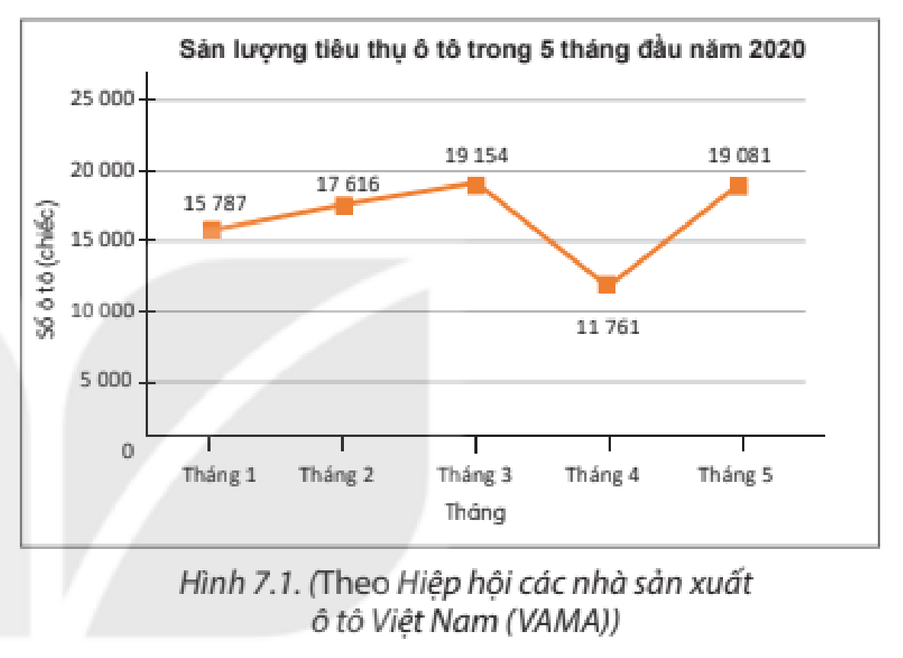
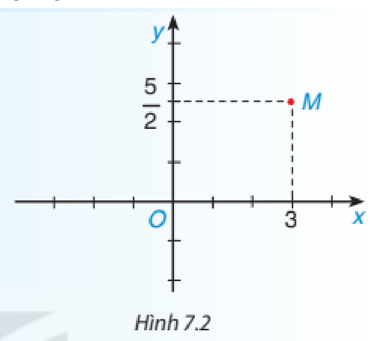
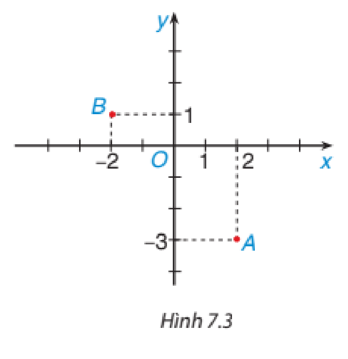
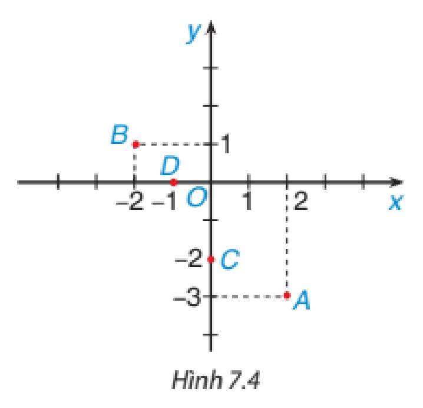
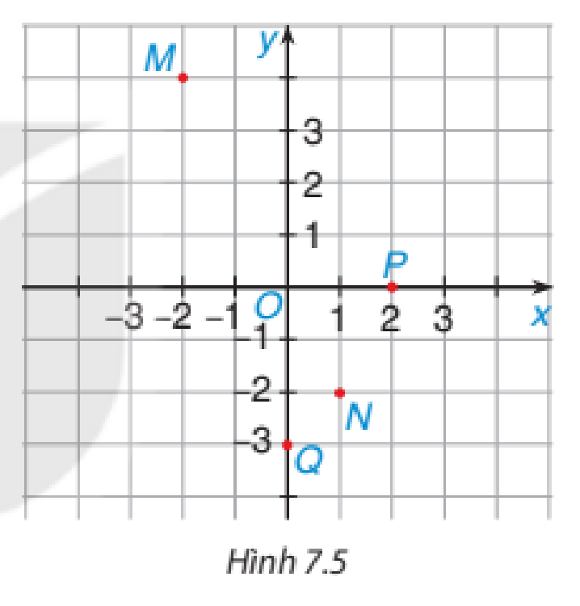
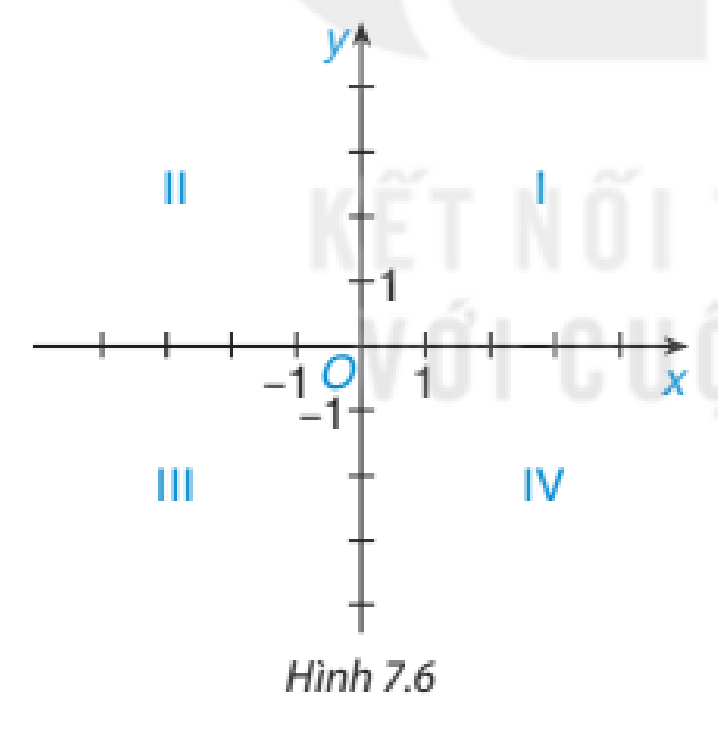
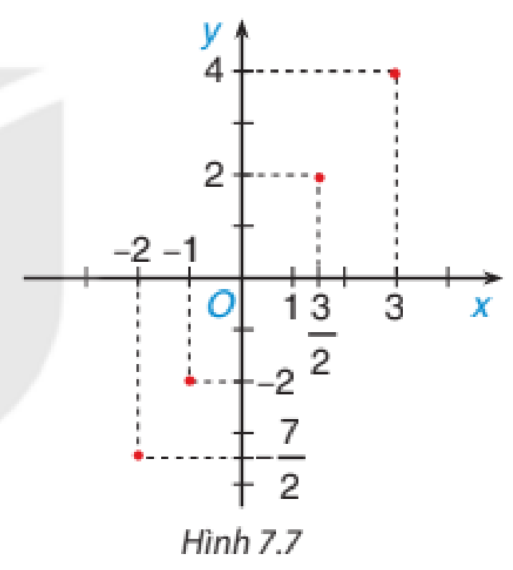
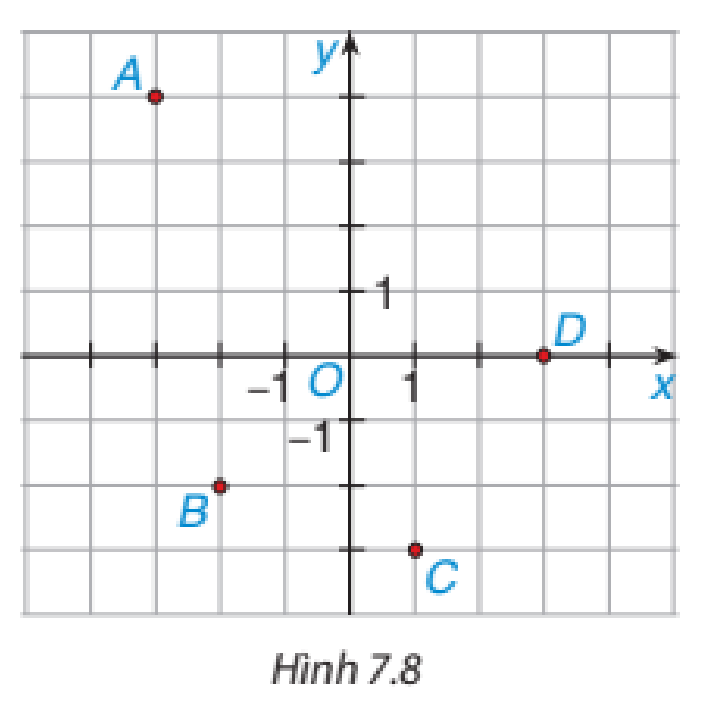
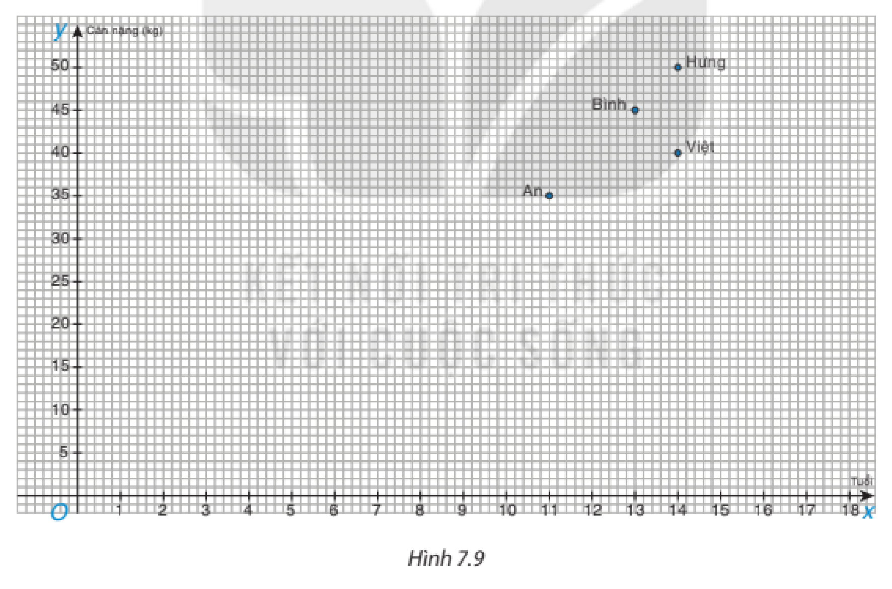
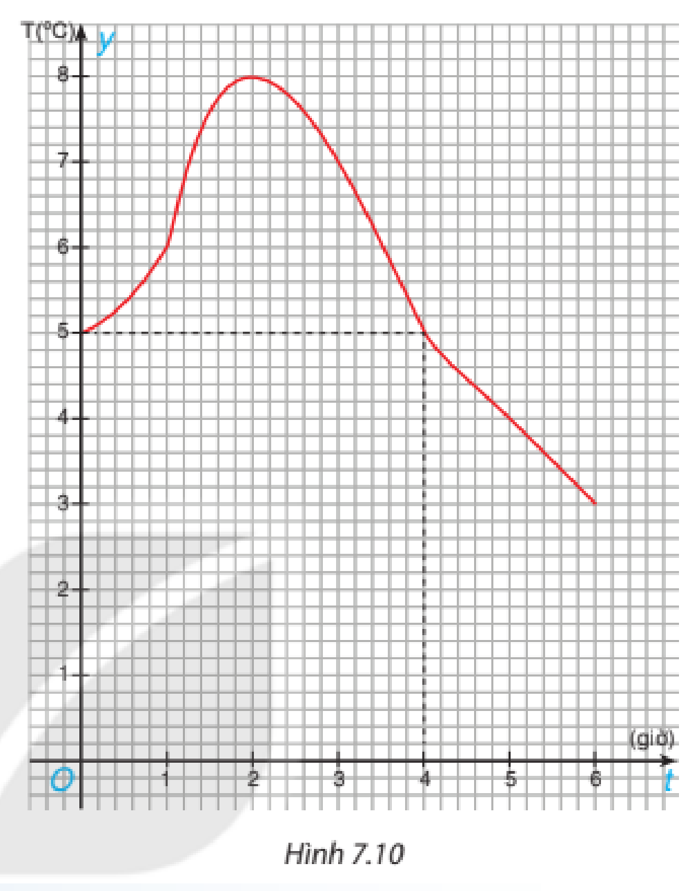

<!-- pdf:41 -->

# BÀI 27: KHÁI NIỆM HÀM SỐ VÀ ĐỒ THỊ CỦA HÀM SỐ

## 🔤 Khái niệm, thuật ngữ

- Hàm số
- Biến số
- Mặt phẳng toạ độ
- Toạ độ của điểm
- Đồ thị của hàm số

## 🎯 Kiến thức, kĩ năng

- Nhận biết những mô hình thực tế dẫn đến khái niệm hàm số.
- Tính giá trị của hàm số khi hàm số đó xác định bởi công thức.
- Xác định toạ độ của một điểm trên mặt phẳng toạ độ; xác định một điểm trên mặt phẳng toạ độ khi biết toạ độ của nó.
- Nhận biết đồ thị hàm số.

## 🔴 Mở đầu

Hình 7.1 là biểu đồ đoạn thẳng mô tả sản lượng tiêu thụ ô tô của thị trường Việt Nam trong $5$ tháng đầu năm $2020$. Em hãy cho biết trong tháng nào thì số lượng ô tô tiêu thụ là ít nhất.

*Hình 7.1. (Theo Hiệp hội các nhà sản xuất ô tô Việt Nam (VAMA))*

## 1. KHÁI NIỆM HÀM SỐ

**Nhận biết khái niệm hàm số**

**HĐ1:** Quãng đường đi được $S\text{ (km)}$ của một ô tô chuyển động với vận tốc $60\text{ km/h}$ được cho bởi công thức $S = 60t$, trong đó $t$ (giờ) là thời gian ô tô di chuyển.

a) Tính và lập bảng các giá trị tương ứng của $S$ khi $t$ nhận các giá trị lần lượt là $1; 2; 3; 4$ (giờ).

b) Với mỗi giá trị của $t$, ta xác định được bao nhiêu giá trị tương ứng của $S$?

**HĐ2:** Nhiệt độ $T\ (^\circ\text{C})$ tại các thời điểm $t$ (giờ) của Hà Nội vào một ngày được cho trong bảng sau:

| $t$ (giờ) | $0$ | $4$ | $8$ | $12$ | $16$ | $20$ |
| --- | :---: | :---: | :---: | :---: | :---: | :---: |
| $T\ (^\circ\text{C})$ | $24$ | $25$ | $27$ | $30$ | $28$ | $27$ |

a) Hãy cho biết nhiệt độ của Hà Nội vào thời điểm $12$ giờ trưa ngày hôm đó.

b) Với mỗi giá trị của $t$, ta xác định được bao nhiêu giá trị tương ứng của $T$?

> Nếu đại lượng $y$ phụ thuộc vào đại lượng thay đổi $x$ sao cho với mỗi giá trị của $x$ ta luôn xác định được chỉ một giá trị tương ứng của $y$ thì $y$ được gọi là **hàm số** của $x$ và $x$ gọi là **biến số**.

<!-- pdf:42 -->

<!-- term: Giá trị của hàm số -->
**Chú ý:** Khi $y$ là hàm số của $x$, ta thường viết $y = f(x)$, $y = g(x), \dots$ Chẳng hạn, với hàm số $y = 2x + 1$, ta còn viết $y = f(x) = 2x + 1$. Khi đó, thay cho câu “Khi $x$ bằng $1$ thì giá trị tương ứng của $y$ là $3$”, ta viết ngắn gọn là $f(1) = 3$.

<!-- term: Cách cho hàm số -->
> **Pi:** Hàm số có thể được cho bằng công thức (như ở HĐ1), bằng bảng (như ở HĐ2),...

**Ví dụ 1:** Cho hàm số $y = f(x) = 3x$. Lập bảng các giá trị tương ứng của $y$ khi $x$ nhận các giá trị lần lượt là $-2; -1; 0; 1; 2$.

**Giải**

Bảng các giá trị tương ứng của $y$:

| $x$ | $-2$ | $-1$ | $0$ | $1$ | $2$ |
| --- | :---: | :---: | :---: | :---: | :---: |
| $y = f(x) = 3x$ | $-6$ | $-3$ | $0$ | $3$ | $6$ |

**Ví dụ 2:** Các giá trị tương ứng của hai đại lượng $x$ và $y$ được cho bởi các bảng sau. Đại lượng $y$ có phải là một hàm số của đại lượng $x$ không?

a)

| $x$ | $-3$ | $-2$ | $2$ | $4$ | $6$ |
| --- | :---: | :---: | :---: | :---: | :---: |
| $y$ | $-4$ | $-6$ | $6$ | $3$ | $2$ |

b)

| $x$ | $-2$ | $-1$ | $0$ | $1$ | $-2$ |
| --- | :---: | :---: | :---: | :---: | :---: |
| $y$ | $-1$ | $0$ | $1$ | $2$ | $1$ |

**Giải**

a) Đại lượng $y$ là hàm số của $x$ vì với mỗi giá trị của $x$ ($x \in \{-3; -2; 2; 4; 6\}$), ta luôn xác định được chỉ một giá trị tương ứng của $y$.

b) Đại lượng $y$ không phải là một hàm số của $x$ vì với $x = -2$ ta xác định được hai giá trị tương ứng của $y$ ($y = -1$ và $y = 1$).

**Luyện tập 1:** Viết công thức tính thời gian di chuyển $t$ (giờ) của một ô tô chuyển động trên quãng đường dài $150\text{ km}$ với vận tốc không đổi $v\text{ (km/h)}$. Thời gian di chuyển $t$ có phải là một hàm số của vận tốc $v$ không? Tính giá trị của $t$ khi $v = 60\text{ (km/h)}$.

**Vận dụng:** Trở lại *tình huống mở đầu*, em hãy cho biết:
<!-- ocr-ok: đã đối chiếu ảnh trang PDF 42, OCR bỏ sót nhãn Vận dụng màu cam và đọc sai "tình huống" thành "tinh huồng" -->

a) Tháng nào thì số lượng ô tô tiêu thụ là ít nhất và số lượng ô tô tiêu thụ trong tháng đó là bao nhiêu?

b) Nếu gọi $y$ là số lượng ô tô tiêu thụ trong tháng $x$ ($x \in \{1; 2; 3; 4; 5\}$) thì $y$ có phải là một hàm số của $x$ không? Tính giá trị của $y$ khi $x = 5$.

> **Tròn:** Đây là một ví dụ về hàm số cho bằng biểu đồ: Số lượng ô tô tiêu thụ là hàm số của tháng.

<!-- pdf:43 -->

## 2. MẶT PHẲNG TOẠ ĐỘ

Ở lớp 7 các em đã biết mỗi điểm trên trục số biểu diễn một số thực nào đó và ngược lại, mỗi số thực sẽ được biểu diễn bởi một điểm trên trục số. Liệu chúng ta có thể xác định được vị trí của một điểm bất kì trên mặt phẳng bằng cách tương tự không nhỉ?

**Nhận biết toạ độ của một điểm trong mặt phẳng toạ độ**

Trên mặt phẳng, ta vẽ hai trục số $Ox, Oy$ vuông góc với nhau và cắt nhau tại gốc $O$ của mỗi trục số như Hình 7.2. Các trục $Ox$ và $Oy$ gọi là các **trục toạ độ**, $Ox$ thường vẽ nằm ngang và gọi là **trục hoành**, $Oy$ thường vẽ thẳng đứng và gọi là **trục tung**, giao điểm $O$ gọi là **gốc toạ độ**. Mặt phẳng có **hệ trục toạ độ $Oxy$** gọi là **mặt phẳng toạ độ**.

Lấy một điểm $M$ bất kì trong mặt phẳng toạ độ $Oxy$. Từ $M$ kẻ các đường thẳng vuông góc với các trục toạ độ. Giả sử các đường vuông góc này cắt trục hoành tại điểm $3$ và cắt trục tung tại điểm $\dfrac{5}{2}$. Khi đó cặp số $\left(3; \dfrac{5}{2}\right)$ gọi là *toạ độ* của điểm $M$ và kí hiệu là $M\left(3; \dfrac{5}{2}\right)$. Số $3$ gọi là *hoành độ* và số $\dfrac{5}{2}$ gọi là *tung độ* của điểm $M$.

*Hình 7.2*

> **Vuông:** Các đơn vị dài trên hai trục toạ độ được chọn bằng nhau (nếu không nói gì thêm).

> Trong mặt phẳng toạ độ, mỗi điểm $M$ xác định duy nhất một cặp số $(x_0; y_0)$ và mỗi cặp số $(x_0; y_0)$ xác định duy nhất một điểm $M$.
>
> Cặp số $(x_0; y_0)$ gọi là **toạ độ** của điểm $M$ và kí hiệu là $M(x_0; y_0)$, trong đó $x_0$ là **hoành độ** và $y_0$ là **tung độ** của điểm $M$.

> ❓ Hãy cho biết toạ độ của gốc toạ độ $O$.

**Ví dụ 3:**

a) Viết toạ độ của các điểm $A, B$ trong Hình 7.3.

b) Xác định các điểm $C(0; -2)$ và $D(-1; 0)$ trong Hình 7.3.

**Giải**

a) Ta có toạ độ của hai điểm $A, B$ là: $A(2; -3)$, $B(-2; 1)$.

*Hình 7.3*

<!-- pdf:44 -->

b) Các điểm $C(0; -2)$, $D(-1; 0)$ được xác định như Hình 7.4.

*Hình 7.4*

> **Pi:** Các điểm có hoành độ (tung độ) bằng $0$ nằm trên trục tung $Oy$ (trục hoành $Ox$).

**Luyện tập 2:**

a) Xác định toạ độ của các điểm $M, N, P, Q$ trong Hình 7.5.

b) Xác định các điểm $R(2; -2)$ và $S(-1; 2)$ trong Hình 7.5.

*Hình 7.5*

**Chú ý:** Hệ trục toạ độ $Oxy$ chia mặt phẳng toạ độ thành $4$ **góc phần tư** (góc phần tư thứ I, II, III, IV) như Hình 7.6.

*Hình 7.6*

**Tranh luận**

- **Pi:** Những điểm có cả hoành độ và tung độ đều âm nằm ở góc phần tư thứ mấy?
- **Vuông:** Em nghĩ là nằm ở góc phần tư thứ II.
- **Tròn:** Không đúng, em nghĩ là nằm ở góc phần tư thứ III.

Ý kiến của em như thế nào?

<!-- pdf:45 -->

## 3. ĐỒ THỊ CỦA HÀM SỐ

**Nhận biết khái niệm đồ thị của hàm số**

**HĐ3:** Hàm số $y = f(x)$ được cho bởi bảng sau:

| $x$ | $-2$ | $-1$ | $0$ | $1$ | $2$ |
| --- | :---: | :---: | :---: | :---: | :---: |
| $y = f(x)$ | $-1$ | $0$ | $1$ | $2$ | $3$ |

a) Viết tập hợp $\{(x; y)\}$ các cặp giá trị tương ứng của $x$ và $y$.

b) Vẽ hệ trục toạ độ $Oxy$ và biểu diễn các điểm có toạ độ là các cặp số trên. Tập hợp các điểm này gọi là *đồ thị* của hàm số $y = f(x)$ đã cho.

> **Đồ thị của hàm số** $y = f(x)$ là tập hợp tất cả các điểm biểu diễn các cặp giá trị tương ứng $(x; y)$ trên mặt phẳng toạ độ.

**Ví dụ 4:** Vẽ đồ thị của hàm số $y = f(x)$ cho bởi bảng sau:

| $x$ | $-2$ | $-1$ | $\dfrac{3}{2}$ | $3$ |
| --- | :---: | :---: | :---: | :---: |
| $y$ | $-\dfrac{7}{2}$ | $-2$ | $2$ | $4$ |

**Giải**

Đồ thị của hàm số $y = f(x)$ gồm bốn điểm như Hình 7.7.

*Hình 7.7*

**Luyện tập 3:** Vẽ đồ thị của hàm số $y = f(x)$ cho bởi bảng sau:

| $x$ | $-3$ | $-1$ | $1$ | $2,5$ |
| --- | :---: | :---: | :---: | :---: |
| $y$ | $4$ | $3,5$ | $1$ | $0$ |

## BÀI TẬP

7.18. Các giá trị tương ứng của hai đại lượng $x$ và $y$ cho bởi các bảng sau. Đại lượng $y$ có phải là một hàm số của $x$ không?

a)

| $x$ | $-3$ | $-1$ | $0$ | $2$ | $4$ |
| --- | :---: | :---: | :---: | :---: | :---: |
| $y$ | $1$ | $1$ | $1$ | $1$ | $1$ |

b)

| $x$ | $-2$ | $1$ | $0$ | $1$ | $2$ |
| --- | :---: | :---: | :---: | :---: | :---: |
| $y$ | $-2$ | $1$ | $0$ | $2$ | $2$ |

<!-- pdf:46 -->

7.19. Cho hàm số $y = f(x) = \dfrac{4}{x}$.

a) Tính $f(-4)$; $f(8)$.

b) Hoàn thành bảng sau vào vở:

| $x$ | $-2$ | $?$ | $2$ | $3$ | $?$ |
| --- | :---: | :---: | :---: | :---: | :---: |
| $y = f(x)$ | $?$ | $-4$ | $?$ | $?$ | $8$ |

7.20. a) Xác định toạ độ của các điểm $A; B; C; D$ trong Hình 7.8.

b) Xác định các điểm $E(0; -2)$ và $F(2; -1)$ trong Hình 7.8.

*Hình 7.8*

7.21. Hàm số $y = f(x)$ được cho bởi bảng sau:

| $x$ | $-2$ | $-1$ | $0$ | $1$ | $2$ |
| --- | :---: | :---: | :---: | :---: | :---: |
| $y = f(x)$ | $-5$ | $-2,5$ | $0$ | $2,5$ | $5$ |

Vẽ đồ thị của hàm số $y = f(x)$.

7.22. Cân nặng và tuổi của bốn bạn An, Bình, Hưng, Việt được biểu diễn trên mặt phẳng toạ độ như Hình 7.9.

*Hình 7.9*

(Do số liệu về tuổi và cân nặng rất chênh lệch nên trong Hình 7.9, ta đã lấy một đơn vị dài trên trục tung bằng $5$ lần đơn vị dài trên trục hoành).

Hãy cho biết:

a) Ai là người nặng nhất và nặng bao nhiêu?

b) Ai là người ít tuổi nhất và bao nhiêu tuổi?

c) Bình và Việt ai nặng hơn và ai nhiều tuổi hơn?

d) Thay dấu “$?$” bằng số thích hợp để hoàn thành bảng sau vào vở:

<!-- pdf:47 -->

| Tên | An | Bình | Hưng | Việt |
| --- | :---: | :---: | :---: | :---: |
| Tuổi | $?$ | $?$ | $?$ | $?$ |
| Cân nặng (kg) | $?$ | $?$ | $?$ | $?$ |

Theo bảng đã hoàn thành, cân nặng có phải là hàm số của tuổi không? Vì sao?

7.23. Hình 7.10 là đồ thị của hàm số mô tả nhiệt độ $T\ (^\circ\text{C})$ tại các thời điểm $t$ (giờ) của một thành phố ở châu Âu từ giữa trưa đến $6$ giờ tối.

a) Tìm $T(1)$, $T(2)$, $T(5)$ và giải thích ý nghĩa của các số này.

b) Trong hai giá trị $T(1)$ và $T(4)$, giá trị nào lớn hơn?

c) Tìm $t$ sao cho $T(t) = 5$.

d) Trong khoảng thời gian nào thì nhiệt độ cao hơn $5\ ^\circ\text{C}$?

*Hình 7.10*

## 💡 Em có biết?

**Nhà toán học René Descartes (1596 – 1650)**

René Descartes là nhà triết học, nhà khoa học, nhà toán học người Pháp. Ông sinh ngày $31$ tháng $3$ năm $1596$ ở La Haye en Touraine, ngày nay là vùng Descartes. Ông mất ngày $11$ tháng $2$ năm $1650$ tại Stockholm, Thuỵ Điển.

Đóng góp lớn nhất trong toán học của Descartes là đã giới thiệu khái niệm hệ toạ độ, ngày nay thường gọi là hệ toạ độ Descartes, cung cấp công cụ để có thể dùng đại số trong việc nghiên cứu hình học, giúp thống nhất đại số và hình học Euclid. Đóng góp này của ông có ảnh hưởng lớn đến sự phát triển của các lĩnh vực như hình học giải tích, phép tính vi tích phân và khoa học bản đồ.

*René Descartes (1596 – 1650)*

Descartes cũng có những đóng góp về lí thuyết các đẳng thức. Ông là người đầu tiên đề xuất việc sử dụng những chữ cái cuối cùng của bảng chữ cái Latinh để chỉ các ẩn số và dùng những chữ cái đầu tiên của bảng chữ cái để chỉ các giá trị đã biết. Ông cũng đã sáng tạo ra hệ thống kí hiệu để mô tả luỹ thừa của các số (chẳng hạn trong biểu thức $x^2$). Mặt khác, chính ông đã thiết lập ra phương pháp, gọi là phương pháp dấu hiệu Descartes, để tìm số nghiệm âm và số nghiệm dương của một đa thức bất kì.

## 📷 Danh sách hình trong bài

| Mã hình | Trang PDF | Vị trí trong bài | Chú thích gốc |
| --- | :---: | --- | --- |
| H8-toan-b27-01 | 41 | Mở đầu | Hình 7.1. (Theo Hiệp hội các nhà sản xuất ô tô Việt Nam (VAMA)) |
| H8-toan-b27-02 | 43 | Mục 2 | Hình 7.2 |
| H8-toan-b27-03 | 43 | Mục 2, Ví dụ 3 | Hình 7.3 |
| H8-toan-b27-04 | 44 | Mục 2, Ví dụ 3 | Hình 7.4 |
| H8-toan-b27-05 | 44 | Mục 2, Luyện tập 2 | Hình 7.5 |
| H8-toan-b27-06 | 44 | Mục 2, Chú ý | Hình 7.6 |
| H8-toan-b27-07 | 45 | Mục 3, Ví dụ 4 | Hình 7.7 |
| H8-toan-b27-08 | 46 | Bài tập 7.20 | Hình 7.8 |
| H8-toan-b27-09 | 46 | Bài tập 7.22 | Hình 7.9 |
| H8-toan-b27-10 | 47 | Bài tập 7.23 | Hình 7.10 |
| H8-toan-b27-11 | 47 | Em có biết? | René Descartes (1596 – 1650) |
