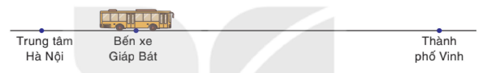
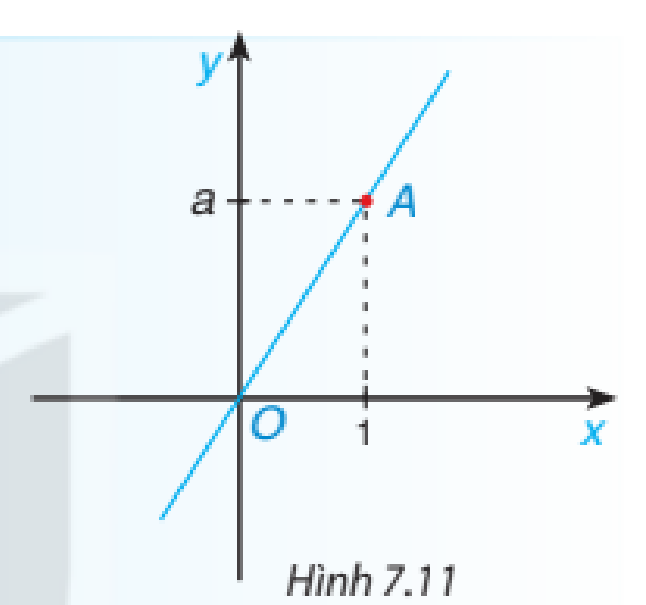
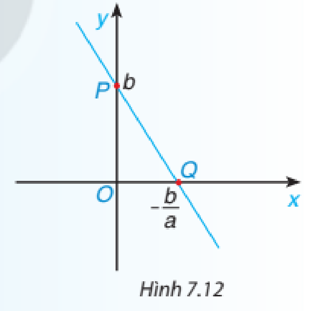
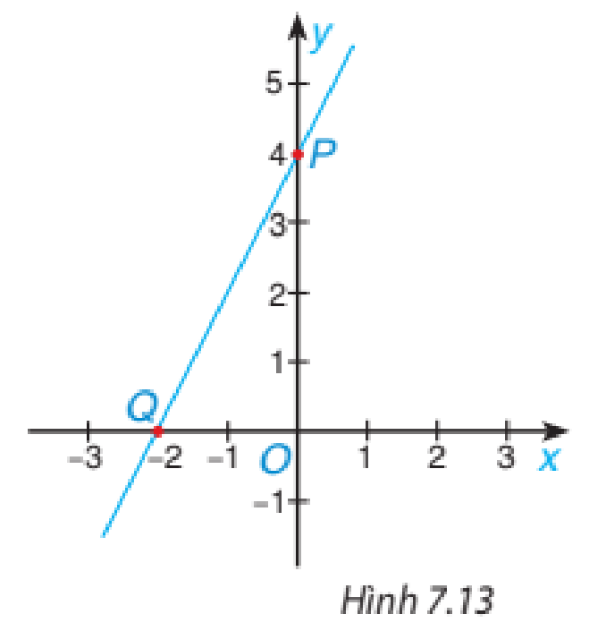

<!-- pdf:48 -->

# BÀI 28: HÀM SỐ BẬC NHẤT VÀ ĐỒ THỊ CỦA HÀM SỐ BẬC NHẤT

## 🔤 Khái niệm, thuật ngữ

- Hàm số bậc nhất
- Đồ thị của hàm số bậc nhất

## 🎯 Kiến thức, kĩ năng

- Thiết lập bảng giá trị của hàm số bậc nhất.
- Vẽ đồ thị của hàm số bậc nhất.
- Vận dụng hàm số bậc nhất và đồ thị của hàm số bậc nhất vào giải quyết một số bài toán thực tiễn.

## 🔴 Mở đầu

Một ô tô đi từ bến xe Giáp Bát (Hà Nội) đến thành phố Vinh (Nghệ An) với vận tốc trung bình là $60\text{ km/h}$. Hỏi sau $t$ giờ ô tô đó cách trung tâm Hà Nội bao nhiêu kilômét? Biết rằng bến xe Giáp Bát cách trung tâm Hà Nội $7\text{ km}$ và coi rằng trung tâm Hà Nội, bến xe Giáp Bát và thành phố Vinh nằm trên cùng một đường thẳng.

## 1. KHÁI NIỆM HÀM SỐ BẬC NHẤT

**Nhận biết hàm số bậc nhất**

Xét *bài toán mở đầu*.

**HĐ1:** Viết công thức tính quãng đường $S$ đi được của ô tô sau $t$ giờ. Quãng đường $S$ có phải là một hàm số của thời gian $t$ không?

**HĐ2:** Viết công thức tính khoảng cách $d$ từ vị trí của ô tô đến trung tâm Hà Nội sau $t$ giờ.

**HĐ3:** Từ kết quả của HĐ2, hãy hoàn thành bảng sau vào vở:

| $t$ (giờ) | $1$ | $2$ | $3$ | $4$ | $5$ |
| --- | :---: | :---: | :---: | :---: | :---: |
| $d\text{ (km)}$ | $?$ | $?$ | $?$ | $?$ | $?$ |

Khoảng cách $d$ có phải là một hàm số của thời gian $t$ không?

> **Hàm số bậc nhất** là hàm số cho bởi công thức $y = ax + b$, trong đó $a, b$ là các số cho trước và $a \ne 0$.

**Ví dụ 1:**

a) Nếu $y$ tỉ lệ thuận với $x$, tức là $y = kx$ thì $y$ là một hàm số bậc nhất của $x$ với $a = k$, $b = 0$.
<!-- ocr-ok: đã đối chiếu ảnh trang PDF 48, OCR đọc sai "tỉ lệ" thành "1Í lệ" -->

b) Hàm số $y = -2x + 3$ là một hàm số bậc nhất với $a = -2$; $b = 3$.

<!-- pdf:49 -->

> ❓ Trong các hàm số sau, những hàm số nào là hàm số bậc nhất?
>
> a) $y = 3x - 2$;
>
> b) $y = -2x$;
>
> c) $y = 2x^2 + 3$;
>
> d) $y = 3(x - 1)$;
>
> e) $y = 0x + 1$.

**Ví dụ 2:** Cho hàm số bậc nhất $y = -2x + 5$.
<!-- ocr-ok: đã đối chiếu ảnh trang PDF 49, OCR đọc sai nhãn Ví dụ 2 và mất số 5 -->

a) Hoàn thành bảng giá trị sau:

| $x$ | $-2$ | $-1$ | $0$ | $1$ | $2$ |
| --- | :---: | :---: | :---: | :---: | :---: |
| $y = -2x + 5$ | $?$ | $?$ | $?$ | $?$ | $?$ |

b) Tìm $x$ sao cho $y = 12$.

**Giải**

a) Ta có bảng giá trị sau:

| $x$ | $-2$ | $-1$ | $0$ | $1$ | $2$ |
| --- | :---: | :---: | :---: | :---: | :---: |
| $y = -2x + 5$ | $9$ | $7$ | $5$ | $3$ | $1$ |

b) Ta phải tìm $x$ sao cho $y = 12$, tức là $-2x + 5 = 12$ hay $-2x = 7$, suy ra $x = -\dfrac{7}{2}$.
<!-- ocr-ok: đã đối chiếu ảnh trang PDF 49, câu chứa nhiều biểu thức toán học trong LaTeX -->

**Vận dụng:** Trong hệ đo lường Anh – Mỹ, quãng đường thường được đo bằng dặm (mile) và $1$ dặm bằng khoảng $1,609\text{ km}$.

a) Viết công thức để chuyển đổi $x\text{ km}$ sang $y$ dặm. Công thức tính $y$ theo $x$ này có phải là một hàm số bậc nhất của $x$ không?

b) Một ô tô chạy với vận tốc $55\text{ dặm/giờ}$ trên một quãng đường có hạn chế tốc độ tối đa là $80\text{ km/h}$. Hỏi ô tô đó có vi phạm luật giao thông không?

**Tranh luận**

- **Pi:** Hàm số $y = \dfrac{x + 1}{2}$ có phải là một hàm số bậc nhất không?
- **Vuông:** Đây là hàm số bậc nhất.
- **Tròn:** Không đúng, tớ nghĩ đây không phải hàm số bậc nhất.

Theo em, Vuông và Tròn ai nói đúng? Vì sao?

## 2. ĐỒ THỊ CỦA HÀM SỐ BẬC NHẤT

**Nhận biết đồ thị của hàm số bậc nhất**

Cho hàm số bậc nhất $y = 2x - 1$.

**HĐ4:** Hoàn thành bảng giá trị sau vào vở:

| $x$ | $-2$ | $-1$ | $0$ | $1$ | $2$ |
| --- | :---: | :---: | :---: | :---: | :---: |
| $y = 2x - 1$ | $?$ | $?$ | $?$ | $?$ | $?$ |

<!-- pdf:50 -->

**HĐ5:** Gọi $A, B, C, D, E$ là các điểm trên đồ thị hàm số $y = 2x - 1$ có hoành độ $x$ lần lượt là $-2; -1; 0; 1; 2$. Từ kết quả của HĐ4, hãy xác định toạ độ các điểm $A, B, C, D, E$.

**HĐ6:** Trên mặt phẳng toạ độ $Oxy$, biểu diễn các điểm $A, B, C, D, E$ trong HĐ5. Dùng thước thẳng để kiểm nghiệm rằng các điểm này cùng nằm trên một đường thẳng.

Người ta cũng chỉ ra rằng một điểm bất kì trên đường thẳng $AB$ có toạ độ thoả mãn $y = 2x - 1$.

<!-- term: Đồ thị của hàm số bậc nhất -->
> Đồ thị của hàm số $y = ax + b$ ($a \ne 0$) là một đường thẳng.

**Chú ý:** Đồ thị của hàm số $y = ax + b$ ($a \ne 0$) còn được gọi là **đường thẳng $y = ax + b$**.

*Cách vẽ đồ thị của hàm số bậc nhất*

<!-- term: Cách vẽ đồ thị của hàm số bậc nhất -->
Ta đã biết đồ thị của hàm số bậc nhất $y = ax + b$ ($a \ne 0$) là một đường thẳng. Do đó, để vẽ đồ thị này, ta chỉ cần xác định được hai điểm phân biệt nào đó thuộc đồ thị rồi vẽ đường thẳng đi qua hai điểm đó.

Ta xét hai trường hợp:

<!-- term: Cách vẽ đồ thị của hàm số bậc nhất -->
- Khi $b = 0$ thì $y = ax$. Đồ thị của hàm số $y = ax$ là đường thẳng đi qua gốc toạ độ $O(0; 0)$ và điểm $A(1; a)$ như Hình 7.11.

*Hình 7.11*

<!-- term: Cách vẽ đồ thị của hàm số bậc nhất -->
- Khi $b \ne 0$ ta thường xác định hai điểm đặc biệt trên đồ thị là giao của đồ thị với hai trục toạ độ như sau:
  - Cho $x = 0$ thì $y = b$, ta được điểm $P(0; b)$ thuộc trục tung $Oy$.
  - Cho $y = 0$ thì $x = -\dfrac{b}{a}$, ta được điểm $Q\left(-\dfrac{b}{a}; 0\right)$ thuộc trục hoành $Ox$.
  - Vẽ đường thẳng đi qua hai điểm $P, Q$ ta được đồ thị của hàm số $y = ax + b$ như Hình 7.12.

*Hình 7.12*

**Ví dụ 3:** Vẽ đồ thị của hàm số bậc nhất $y = 2x + 4$.

**Giải:** (H.7.13)

Cho $x = 0$ thì $y = 4$, ta được giao điểm của đồ thị với trục $Oy$ là $P(0; 4)$.

Cho $y = 0$ thì $x = -2$, ta được giao điểm của đồ thị với trục $Ox$ là $Q(-2; 0)$.

Đồ thị hàm số $y = 2x + 4$ là đường thẳng $PQ$.

*Hình 7.13*

**Luyện tập:** Vẽ đồ thị của các hàm số bậc nhất $y = -2x + 3$ và $y = \dfrac{1}{2}x$.

<!-- pdf:51 -->

## BÀI TẬP

7.24. Trong các hàm số sau, những hàm số nào là hàm số bậc nhất? Hãy xác định các hệ số $a, b$ của chúng.

a) $y = 0 \cdot x - 5$;

b) $y = 1 - 3x$;

c) $y = -0,6x$;

d) $y = \sqrt{2}(x - 1) + 3$;

e) $y = 2x^2 + 1$.

7.25. Cho hàm số bậc nhất $y = ax + 3$.

a) Tìm hệ số $a$, biết rằng khi $x = 1$ thì $y = 5$.
<!-- ocr-ok: đã đối chiếu ảnh trang PDF 51, OCR dính chữ "khix= 1" -->

b) Với giá trị $a$ tìm được, hãy hoàn thành bảng giá trị sau vào vở:

| $x$ | $-2$ | $-1$ | $0$ | $1$ | $2$ |
| --- | :---: | :---: | :---: | :---: | :---: |
| $y$ | $?$ | $?$ | $?$ | $?$ | $?$ |

7.26. Vẽ đồ thị của các hàm số sau:

a) $y = 2x - 6$;

b) $y = -3x + 5$;

c) $y = \dfrac{3}{2}x$.

7.27. Đồng euro (EUR) là đơn vị tiền tệ chính thức ở một số quốc gia thành viên của Liên minh châu Âu. Vào một ngày, tỉ giá hối đoái giữa đồng euro và đồng đô la Mỹ (USD) là: $1\text{ EUR} = 1,1052\text{ USD}$.

a) Viết công thức để chuyển đổi $x$ euro sang $y$ đô la Mỹ. Công thức tính $y$ theo $x$ này có phải là một hàm số bậc nhất của $x$ không?

b) Vào ngày đó, $200$ euro có giá trị bằng bao nhiêu đô la Mỹ?

c) Vào ngày đó, $500$ đô la Mỹ có giá trị bằng bao nhiêu euro?

7.28. Giá cước điện thoại cố định của một hãng viễn thông bao gồm cước thuê bao là $22\,000\text{ đồng/tháng}$ và cước gọi là $800\text{ đồng/phút}$.

a) Lập công thức tính số tiền cước điện thoại $y$ (đồng) phải trả trong tháng khi gọi $x$ phút.

b) Tính số tiền cước điện thoại phải trả khi gọi $75$ phút.

c) Nếu số tiền cước điện thoại phải trả là $94\,000$ đồng thì trong tháng đó thuê bao đã gọi bao nhiêu phút?

7.29. Hàm chi phí đơn giản nhất là hàm chi phí bậc nhất $y = ax + b$, trong đó $b$ biểu thị chi phí cố định của hoạt động kinh doanh và hệ số $a$ biểu thị chi phí của mỗi mặt hàng được sản xuất. Giả sử rằng một xưởng sản xuất xe đạp có chi phí cố định hằng ngày là $36$ triệu đồng và mỗi chiếc xe đạp có chi phí sản xuất là $1,8$ triệu đồng.

a) Viết công thức của hàm số bậc nhất biểu thị chi phí $y$ (triệu đồng) để sản xuất $x$ (xe đạp) trong một ngày.

b) Vẽ đồ thị của hàm số thu được ở câu a.

c) Chi phí để sản xuất $15$ chiếc xe đạp trong một ngày là bao nhiêu?

d) Có thể sản xuất bao nhiêu chiếc xe đạp trong ngày, nếu chi phí trong ngày đó là $72$ triệu đồng?

## 📷 Danh sách hình trong bài

| Mã hình | Trang PDF | Vị trí trong bài | Chú thích gốc |
| --- | :---: | --- | --- |
| H8-toan-b28-01 | 48 | Mở đầu | (sách không đánh số, sơ đồ vị trí Trung tâm Hà Nội, Bến xe Giáp Bát và Thành phố Vinh) |
| H8-toan-b28-02 | 50 | Mục 2 | Hình 7.11 |
| H8-toan-b28-03 | 50 | Mục 2 | Hình 7.12 |
| H8-toan-b28-04 | 50 | Mục 2, Ví dụ 3 | Hình 7.13 |
