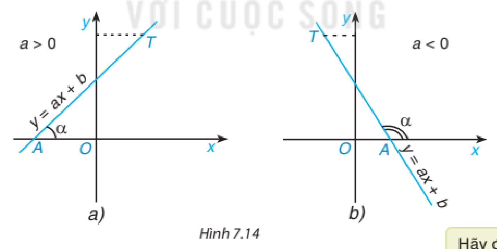
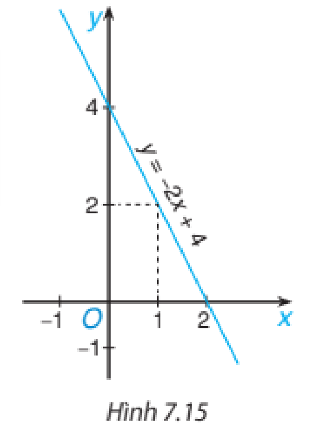
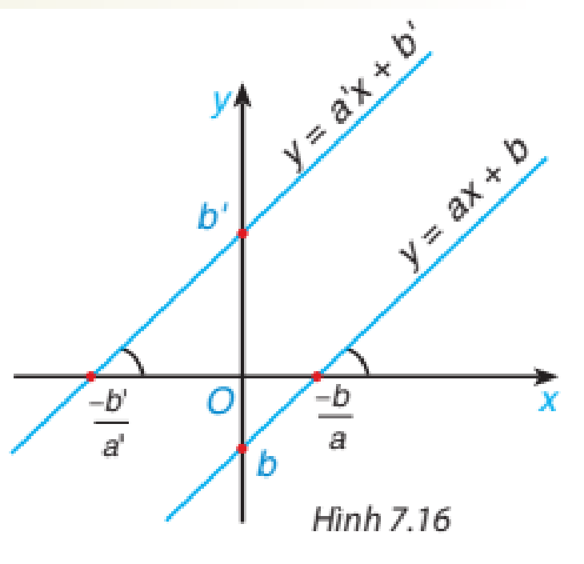

<!-- pdf:52 -->

# BÀI 29: HỆ SỐ GÓC CỦA ĐƯỜNG THẲNG

## 🔤 Khái niệm, thuật ngữ

- Hệ số góc của đường thẳng

## 🎯 Kiến thức, kĩ năng

- Nhận biết khái niệm hệ số góc của đường thẳng $y = ax + b$ ($a \ne 0$).
- Sử dụng hệ số góc của đường thẳng để nhận biết và giải thích sự cắt nhau hoặc song song của hai đường thẳng cho trước.

## 🔴 Mở đầu

- **Vuông:** Làm thế nào để biết hai đường thẳng $y = ax + b$ và $y = a'x + b'$ song song hay cắt nhau nhỉ?
- **Tròn:** Cứ vẽ hai đường thẳng này trong cùng mặt phẳng toạ độ $Oxy$ là biết ngay mà!
- **Pi:** Anh có một cách nhanh hơn nhiều mà không cần vẽ hình. Trong bài học này chúng ta sẽ cùng tìm hiểu nhé!

## 1. HỆ SỐ GÓC CỦA ĐƯỜNG THẲNG

*Góc tạo bởi đường thẳng $y = ax + b$ ($a \ne 0$) và trục $Ox$*

<!-- term: Góc tạo bởi đường thẳng $y = ax + b$ ($a \ne 0$) và trục $Ox$ -->
Trong mặt phẳng $Oxy$, góc $\alpha$ tạo bởi đường thẳng $y = ax + b$ ($a \ne 0$) và trục $Ox$ là góc tạo bởi tia $Ax$ và tia $AT$, trong đó $A$ là giao điểm của đường thẳng $y = ax + b$ với trục $Ox$, $T$ là một điểm nào đó thuộc đường thẳng $y = ax + b$ và có tung độ dương. Chú ý rằng $0^\circ < \alpha < 180^\circ$ (H.7.14).

*Hình 7.14*

**HĐ1:** Trên cùng một mặt phẳng toạ độ $Oxy$, vẽ hai đường thẳng sau:

$$(d): y = 2x + 1 \text{ và } (d'): y = -2x + 1.$$

a) So sánh góc tạo bởi đường thẳng $(d)$ và trục $Ox$ với $90^\circ$.

b) So sánh góc tạo bởi đường thẳng $(d')$ và trục $Ox$ với $90^\circ$.

> **Pi:** Hãy để ý: Dấu của hệ số $a$ và so sánh góc tương ứng với $90^\circ$.

<!-- pdf:53 -->

**HĐ2:** Từ kết quả của HĐ1, em có nhận xét gì về quan hệ giữa hệ số $a$ của đường thẳng $y = ax + b$ ($a \ne 0$) với góc tạo bởi đường thẳng này và trục $Ox$?

Vì có sự liên quan giữa hệ số $a$ với góc tạo bởi đường thẳng $y = ax + b$ và trục $Ox$ nên ta có định nghĩa sau:

> Ta gọi $a$ là **hệ số góc** của đường thẳng $y = ax + b$ ($a \ne 0$).

> ❓ Xác định hệ số góc của mỗi đường thẳng sau:
>
> $$y = 3x - 1; \qquad y = 2 - x; \qquad y = \dfrac{1}{2}(x - 1).$$

**Nhận xét**

- Khi hệ số góc $a$ dương, đường thẳng $y = ax + b$ đi lên từ trái sang phải. Góc tạo bởi đường thẳng này và trục $Ox$ là góc nhọn (H.7.14a).
- Khi hệ số góc $a$ âm, đường thẳng $y = ax + b$ đi xuống từ trái sang phải. Góc tạo bởi đường thẳng này và trục $Ox$ là góc tù (H.7.14b).

**Ví dụ 1:** Tìm hàm số bậc nhất có đồ thị là đường thẳng có hệ số góc $a = -2$ và đi qua điểm $(1; 2)$.

**Giải:** (H.7.15)

Hàm số bậc nhất cần tìm có dạng $y = -2x + b$.

Vì đường thẳng đi qua điểm $(1; 2)$ nên ta có:

$2 = -2 \cdot 1 + b$, suy ra $b = 4$.

Vậy hàm số cần tìm là $y = -2x + 4$.

*Hình 7.15*

**Luyện tập 1:** Tìm hàm số bậc nhất có đồ thị là đường thẳng có hệ số góc là $3$ và cắt trục tung tại điểm có tung độ bằng $-1$.

**Tranh luận**

Đường thẳng $y = \dfrac{2x + 1}{2}$ có hệ số góc bằng bao nhiêu?

- **Tròn:** Đường thẳng này có hệ số góc $a = 2$.
- **Vuông:** Không đúng, đường thẳng này có hệ số góc $a = 1$.

Theo em, bạn nào trả lời đúng, bạn nào trả lời sai? Vì sao?

<!-- pdf:54 -->

## 2. ĐƯỜNG THẲNG SONG SONG VÀ ĐƯỜNG THẲNG CẮT NHAU

**Nhận biết hai đường thẳng song song**

**HĐ3:** Trên cùng một mặt phẳng toạ độ $Oxy$, vẽ hai đường thẳng $y = 2x$ và $y = 2x + 1$. Có nhận xét gì về vị trí tương đối của hai đường thẳng này?

<!-- term: Hai đường thẳng song song, trùng nhau -->
> Hai đường thẳng $y = ax + b$ ($a \ne 0$) và $y = a'x + b'$ ($a' \ne 0$) song song với nhau khi $a = a'$, $b \ne b'$ và ngược lại; trùng nhau khi $a = a'$, $b = b'$ và ngược lại.

*Hình 7.16*

> ❓ Tìm các cặp đường thẳng song song với nhau trong các đường thẳng sau:
>
> a) $y = 2x + 1$; \qquad b) $y = -1 - 2x$; \qquad c) $y = 2 + 2x$; \qquad d) $y = -1 + 2x$.

**Ví dụ 2:** Tìm giá trị của $m$ để đường thẳng $y = (m + 1)x + 2$ ($m \ne -1$) song song với đường thẳng $y = -2x + 1$.

**Giải**

Hai đường thẳng đã cho song song với nhau khi $m + 1 = -2$, tức là $m = -3$.

Giá trị này thoả mãn điều kiện $m \ne -1$.

Vậy giá trị $m$ cần tìm là $m = -3$.

**Nhận biết hai đường thẳng cắt nhau**

**HĐ4:** Cho hai đường thẳng $y = 2x - 1$ và $y = x - 3$. Bằng cách so sánh hai hệ số góc, hãy cho biết hai đường thẳng này có song song hay trùng nhau không.

<!-- term: Hai đường thẳng cắt nhau -->
> Hai đường thẳng $y = ax + b$ ($a \ne 0$) và $y = a'x + b'$ ($a' \ne 0$) cắt nhau khi $a \ne a'$ và ngược lại.

> ❓ Tìm các cặp đường thẳng cắt nhau trong các đường thẳng sau:
>
> a) $y = 2x + 1$; \qquad b) $y = 2x$; \qquad c) $y = 2 + 2x$; \qquad d) $y = 1 - 2x$.

**Ví dụ 3:** Tìm các giá trị của $m$ để đường thẳng $y = mx - 2$ ($m \ne 0$) cắt đường thẳng $y = -2x + 1$.

**Giải**

Hai đường thẳng đã cho cắt nhau khi $m \ne -2$.

Kết hợp với điều kiện đã cho, ta được các giá trị $m$ cần tìm là: $m \ne 0$ và $m \ne -2$.

<!-- pdf:55 -->

**Luyện tập 2:** Cho hai hàm số bậc nhất $y = 2mx + 1$ và $y = (m - 1)x + 2$.
<!-- ocr-ok: đã đối chiếu ảnh trang PDF 55, OCR đọc sai nhãn Luyện tập 2 màu xanh thành "VU" -->

Tìm các giá trị của $m$ để đồ thị của hai hàm số đã cho là:

a) Hai đường thẳng song song với nhau.

b) Hai đường thẳng cắt nhau.

**Thử thách nhỏ**

Liệu hai đường thẳng phân biệt với cùng hệ số góc, có thể có:

a) Cùng giao điểm với trục $Ox$ không?

b) Cùng giao điểm với trục $Oy$ không?

**Vận dụng:** Em hãy trình bày cách làm của anh Pi để trả lời câu hỏi của bạn Vuông trong *tình huống mở đầu*.

## BÀI TẬP

7.30. Tìm hàm số bậc nhất có đồ thị là đường thẳng đi qua điểm $(1; -2)$ và có hệ số góc là $3$.

7.31. Tìm hàm số bậc nhất có đồ thị là đường thẳng có hệ số góc là $-2$ và cắt trục hoành tại điểm có hoành độ bằng $3$.

7.32. Hãy chỉ ra các cặp đường thẳng song song với nhau và các cặp đường thẳng cắt nhau trong các đường thẳng sau:

a) $y = -x + 1$; \qquad b) $y = -2x + 1$;

c) $y = -2x + 2$; \qquad d) $y = -x$.

7.33. Cho hai hàm số bậc nhất $y = mx - 5$ và $y = (2m + 1)x + 3$. Tìm các giá trị của $m$ để đồ thị của hai hàm số là:

a) Hai đường thẳng song song với nhau.

b) Hai đường thẳng cắt nhau.

7.34. Tìm hàm số bậc nhất có đồ thị là đường thẳng song song với đường thẳng $y = -3x + 1$ và đi qua điểm $(2; 6)$.

7.35. Trong mặt phẳng toạ độ $Oxy$, cho hai đường thẳng $y = x$ và $y = -x + 2$.

a) Vẽ hai đường thẳng đã cho trên cùng mặt phẳng toạ độ.

b) Tìm giao điểm $A$ của hai đường thẳng đã cho.

c) Gọi $B$ là giao điểm của đường thẳng $y = -x + 2$ và trục $Ox$. Chứng minh tam giác $OAB$ vuông tại $A$, tức là hai đường thẳng $y = x$ và $y = -x + 2$ vuông góc với nhau.

d) Có nhận xét gì về tích hai hệ số góc của hai đường thẳng đã cho?

## 📷 Danh sách hình trong bài

| Mã hình | Trang PDF | Vị trí trong bài | Chú thích gốc |
| --- | :---: | --- | --- |
| H8-toan-b29-01 | 52 | Mục 1 (góc dưới bên phải khung bao giao viền bóng thoại gợi ý của Pi đặt sát nhánh b) | Hình 7.14 |
| H8-toan-b29-02 | 53 | Mục 1, Ví dụ 1 | Hình 7.15 |
| H8-toan-b29-03 | 54 | Mục 2 | Hình 7.16 |
