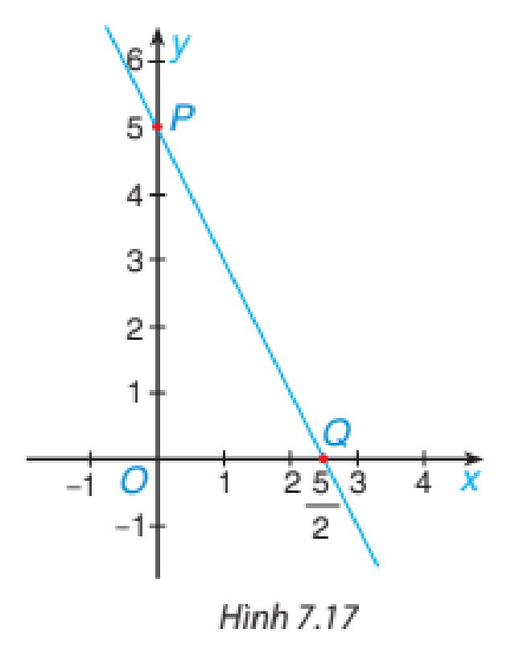
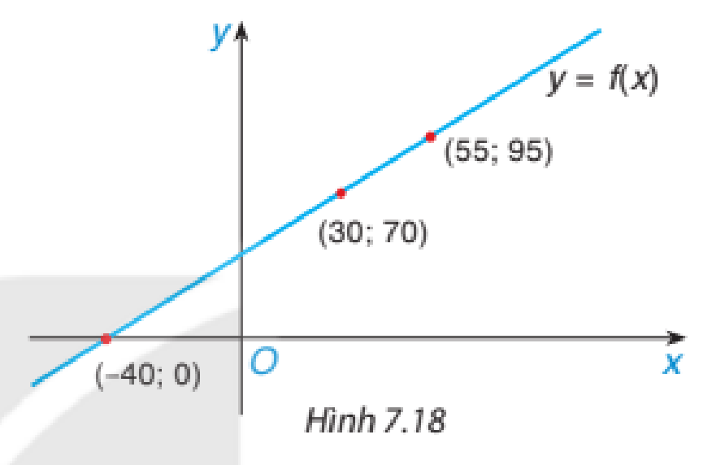

<!-- pdf:56 -->

# LUYỆN TẬP CHUNG (TRANG 55)

**Ví dụ 1:** Cho hàm số bậc nhất $y = ax + 5$.
<!-- ocr-ok: đã đối chiếu ảnh trang PDF 56, OCR bỏ sót nhãn Ví dụ 1 màu xanh -->

a) Xác định hệ số $a$, biết đồ thị hàm số đi qua điểm $A(1; 3)$.

b) Vẽ đồ thị hàm số đã cho với giá trị $a$ tìm được ở câu a.

**Giải**

a) Vì đồ thị hàm số đi qua điểm $A(1; 3)$ nên ta có:

$3 = a + 5 \text{ hay } a = -2.$

b) Với $a = -2$ ta có hàm số $y = -2x + 5$. Đồ thị của hàm số này là một đường thẳng.

*Hình 7.17*

Cho $x = 0$ thì $y = 5$, ta được giao điểm của đồ thị với trục tung là $P(0; 5)$.

Cho $y = 0$ thì $x = \dfrac{5}{2}$, ta được giao điểm của đồ thị với trục hoành là $Q\left(\dfrac{5}{2}; 0\right)$.

Đồ thị của hàm số $y = -2x + 5$ là đường thẳng $PQ$ (H.7.17).

**Ví dụ 2:** Số tiền điện phải trả trong tháng khi lượng điện sử dụng $x\text{ (kWh)}$ trong khoảng từ $51\text{ kWh}$ đến $100\text{ kWh}$ được cho bởi công thức sau:

$$T(x) = 1\,734x - 2\,800 \text{ (đồng)}.$$

a) Tính số tiền điện phải trả khi lượng điện tiêu thụ trong tháng là $90\text{ kWh}$.

b) Nếu số tiền điện phải trả trong tháng là $144\,590$ đồng thì gia đình đó đã sử dụng bao nhiêu $\text{kWh}$ điện?

**Giải**

a) Khi $x = 90$ ta có: $T(90) = 1\,734 \cdot 90 - 2\,800 = 153\,260$.

Vậy khi lượng điện tiêu thụ trong tháng là $90\text{ kWh}$ thì số tiền điện phải trả là $153\,260$ đồng.

b) Ta phải tìm $x$ sao cho $T(x) = 144\,590$, tức là

$1\,734x - 2\,800 = 144\,590$

$1\,734x = 147\,390$

$x = 85 \text{ (thoả mãn)}.$

Vậy gia đình này đã sử dụng $85\text{ kWh}$ trong tháng đó.

<!-- pdf:57 -->

## BÀI TẬP

7.36. Cho hai hàm số $y = 2x - 1$ và $y = -x + 2$.

a) Trong cùng mặt phẳng toạ độ $Oxy$, vẽ đồ thị của hai hàm số đã cho.

b) Tìm toạ độ giao điểm của hai đồ thị trên.

7.37. Cho hàm số bậc nhất $y = (3 - m)x + 2m + 1$.

Tìm các giá trị của $m$ để đồ thị của hàm số đã cho là:

a) Đường thẳng đi qua điểm $(1; 2)$.

b) Đường thẳng cắt đường thẳng $y = x + 1$ tại một điểm nằm trên trục tung.

7.38. Cho đồ thị của một hàm số bậc nhất $y = f(x)$ như Hình 7.18.

Hãy giải các phương trình sau:

a) $f(x) = 70$;

b) $f(x) = 95$;

c) $f(x) = 0$.

*Hình 7.18*

7.39. Giá cước taxi của một hãng xe taxi khi quãng đường di chuyển $x\text{ (km)}$ trong khoảng từ trên $1\text{ km}$ đến $30\text{ km}$ được cho bởi công thức sau:

$T(x) = 10\,000 + 13\,600 \cdot (x - 1) \text{ (đồng)}.$

a) Tính số tiền phải trả khi xe di chuyển $20\text{ km}$.

b) Nếu một hành khách phải trả $200\,400$ đồng thì hành khách đó đã di chuyển bao nhiêu kilômét?

7.40. Trong lí thuyết tài chính, *giá trị sổ sách* là giá trị của một tài sản mà công ty sử dụng để xây dựng bảng cân đối kế toán của mình. Một số công ty khấu hao tài sản của họ bằng cách sử dụng phương pháp khấu hao đường thẳng để giá trị của tài sản giảm một lượng cố định mỗi năm. Mức suy giảm phụ thuộc vào thời gian sử dụng hữu ích mà công ty đặt vào tài sản đó.

Giả sử một công ty vừa mua một chiếc máy photocopy mới với giá $18$ triệu đồng. Công ty lựa chọn cách tính khấu hao chiếc máy photocopy này theo phương pháp khấu hao đường thẳng trong thời gian $3$ năm, tức là mỗi năm giá trị của chiếc máy photocopy sẽ giảm $18 : 3 = 6$ triệu đồng.

a) Viết hàm số bậc nhất biểu thị giá trị sổ sách $V(x)$ của máy photocopy dưới dạng một hàm số theo thời gian sử dụng $x$ (năm) của nó.

b) Vẽ đồ thị của hàm số bậc nhất $y = V(x)$.

c) Giá trị sổ sách của máy photocopy sau $2$ năm sử dụng là bao nhiêu?

d) Sau thời gian sử dụng là bao lâu thì máy photocopy có giá trị sổ sách là $9$ triệu đồng?

## 📷 Danh sách hình trong bài

| Mã hình | Trang PDF | Vị trí trong bài | Chú thích gốc |
| --- | :---: | --- | --- |
| H8-toan-ltc-c07-02-01 | 56 | Ví dụ 1 | Hình 7.17 |
| H8-toan-ltc-c07-02-02 | 57 | Bài tập 7.38 | Hình 7.18 |
