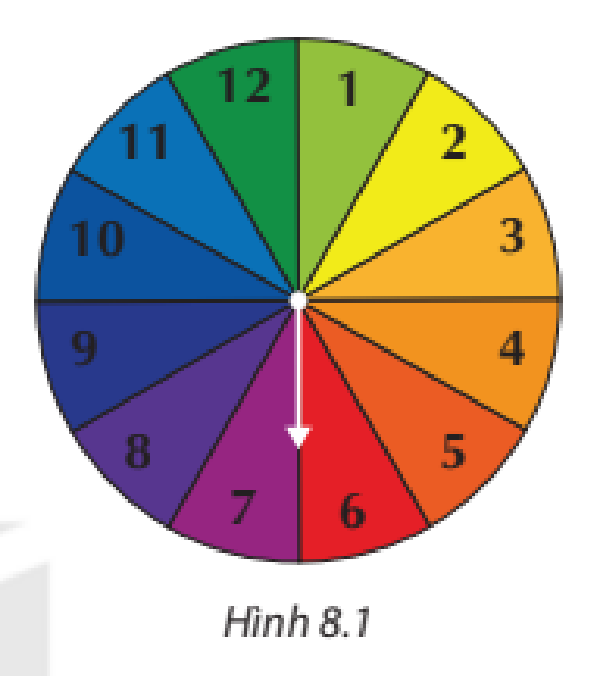
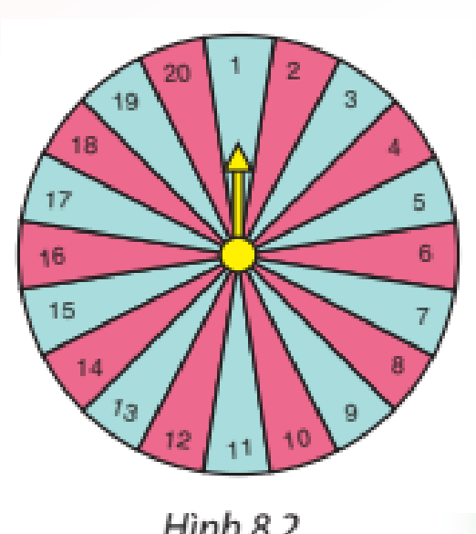
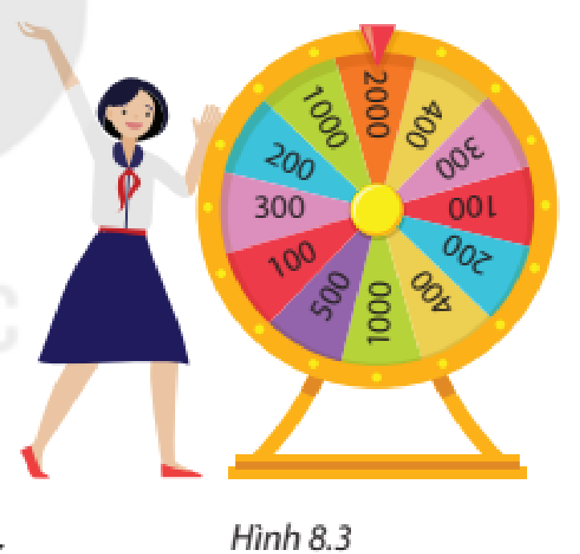

<!-- pdf:64 -->

# BÀI 31: CÁCH TÍNH XÁC SUẤT CỦA BIẾN CỐ BẰNG TỈ SỐ

## 🔤 Khái niệm, thuật ngữ

- Công thức tính xác suất

## 🎯 Kiến thức, kĩ năng

- Tính xác suất bằng tỉ số giữa số kết quả thuận lợi cho biến cố và số kết quả có thể trong trường hợp các kết quả có thể là đồng khả năng.

## 🔴 Mở đầu

Một túi đựng $20$ viên kẹo giống hệt nhau nhưng khác loại, trong đó có $7$ viên kẹo sữa, $4$ viên kẹo chanh, $6$ viên kẹo dừa và $3$ viên kẹo bạc hà. Bạn Lan lấy ngẫu nhiên một viên kẹo từ túi. Tính xác suất để Lan lấy được viên kẹo sữa.

- **Vuông:** Các viên kẹo giống hệt nhau, chỉ khác loại nên có $4$ kết quả có thể là lấy được viên kẹo sữa, viên kẹo chanh, viên kẹo dừa và viên kẹo bạc hà. Do đó, xác suất để Lan lấy được viên kẹo sữa là $\dfrac{1}{4}$.
- **Tròn:** Không đúng, chỉ có $4$ kết quả có thể nhưng chúng không đồng khả năng. Tớ thấy xác suất để Lan lấy được viên kẹo sữa là cao nhất vì trong túi có nhiều viên kẹo sữa nhất. Nhưng tớ không biết xác suất để Lan lấy được viên kẹo sữa chính xác là bao nhiêu?

Trong bài học này sẽ giúp các em trả lời được câu hỏi của bạn Tròn.

**Cách tính xác suất bằng tỉ số**

Muốn tính xác suất trong những tình huống tương tự như trên ta có công thức tính xác suất sau:

> Giả thiết rằng các kết quả có thể của một hành động hay thực nghiệm là **đồng khả năng**. Khi đó, **xác suất của biến cố** $E$, kí hiệu là $P(E)$, bằng tỉ số giữa số kết quả thuận lợi cho biến cố $E$ và tổng số kết quả có thể.
>
> $$P(E) = \dfrac{\text{Số kết quả thuận lợi cho } E}{\text{Tổng số kết quả có thể}}.$$

<!-- pdf:65 -->

<!-- term: Các bước tính xác suất của biến cố bằng tỉ số -->
**Nhận xét:** Việc tính xác suất của một biến cố $E$ trong một hành động hay thực nghiệm đồng khả năng sẽ gồm các bước sau:
- *Bước 1.* Đếm các kết quả có thể (thường bằng cách liệt kê);
- *Bước 2.* Chỉ ra các kết quả có thể là đồng khả năng;
- *Bước 3.* Đếm các kết quả thuận lợi cho biến cố $E$;
- *Bước 4.* Lập tỉ số giữa số kết quả thuận lợi cho biến cố $E$ và tổng số kết quả có thể.

**Ví dụ 1:** Một tấm bìa cứng hình tròn được chia thành $12$ hình quạt như nhau và đánh số $1; 2; 3; \dots; 12$ (H.8.1), được gắn vào trục quay có mũi tên cố định ở tâm. Quay tấm bìa xem mũi tên chỉ vào hình quạt nào khi tấm bìa dừng lại, tính xác suất của các biến cố sau:

a) $A$: “Mũi tên chỉ vào hình quạt ghi số nguyên tố”;

b) $B$: “Mũi tên chỉ vào hình quạt ghi số chính phương”.

*Hình 8.1*

**Giải**

Có $12$ kết quả có thể, đó là $1; 2; \dots; 12$. Do $12$ hình quạt như nhau nên $12$ kết quả có thể này là đồng khả năng.

a) Các kết quả thuận lợi cho biến cố $A$ là $2; 3; 5; 7; 11$. Có $5$ kết quả thuận lợi cho biến cố $A$. Do đó, xác suất của biến cố $A$ là $P(A) = \dfrac{5}{12}$.

b) Các kết quả thuận lợi cho biến cố $B$ là $1; 4; 9$. Có $3$ kết quả thuận lợi cho biến cố $B$. Do đó, xác suất của biến cố $B$ là $P(B) = \dfrac{3}{12} = \dfrac{1}{4}$.

**Luyện tập 1:** Trở lại *tình huống mở đầu*. Tính xác suất để Lan lấy được:

a) Viên kẹo sữa;

b) Viên kẹo chanh.

**Ví dụ 2:** Một hộp đựng $18$ viên bi cùng khối lượng và kích thước, với hai màu đỏ và vàng, trong đó số viên bi màu vàng gấp đôi số viên bi màu đỏ. Bình lấy ngẫu nhiên một viên bi từ trong hộp. Tính xác suất để Bình lấy được viên bi màu vàng.

<!-- pdf:66 -->

**Giải**

Gọi $x$ là số viên bi màu đỏ. Khi đó số viên bi màu vàng là $2x$.

Theo đề bài, ta có $x + 2x = 18$, hay $3x = 18$, tức là $x = 6$.
<!-- ocr-ok: đã đối chiếu ảnh trang PDF 66, OCR dính chữ "cóx+2x= 18,hay3x= 18, tứclàx=8" -->

Do đó, số viên bi màu vàng là $12$.

Do Bình lấy ngẫu nhiên một viên bi từ hộp có $18$ viên nên có $18$ kết quả có thể và các kết quả đó là đồng khả năng.

Vậy xác suất để Bình lấy được viên bi màu vàng là $\dfrac{12}{18} = \dfrac{2}{3}$.

**Luyện tập 2:** Trên giá sách của thư viện có $15$ cuốn sách, trong đó có một số cuốn tiểu thuyết. Người thủ thư đặt thêm $5$ cuốn tiểu thuyết thư viện mới mua vào giá sách. Bạn Nam đến mượn sách, chọn ngẫu nhiên một cuốn sách trên giá. Biết rằng xác suất để chọn được cuốn tiểu thuyết là $\dfrac{3}{4}$. Hỏi lúc đầu trên giá sách có bao nhiêu cuốn tiểu thuyết?

**Tranh luận**

Một túi đựng $17$ viên bi cùng khối lượng và kích thước, chỉ khác màu, trong đó có $8$ viên bi màu đỏ, $5$ viên bi màu xanh và $4$ viên bi màu vàng. Lấy ngẫu nhiên một viên bi từ trong túi. Tính xác suất của biến cố $E$: “Lấy được viên bi màu đỏ”.

- **Tròn:** Có $17$ viên bi nên có $17$ kết quả có thể. Có $8$ viên bi màu đỏ nên có $8$ kết quả thuận lợi cho biến cố $E$. Vậy $P(E) = \dfrac{8}{17}$.
- **Vuông:** Các viên bi cùng khối lượng và kích thước, chỉ khác màu, nên chỉ có $3$ kết quả có thể là viên bi màu đỏ, viên bi màu trắng và viên bi màu vàng. Do đó $P(E) = \dfrac{1}{3}$.

Vuông và Tròn ai nói đúng? Tại sao?

## BÀI TẬP

8.4. Một hình tròn được chia thành $20$ hình quạt như nhau, đánh số từ $1; 2; \dots; 20$ và được gắn vào trục quay có mũi tên cố định ở tâm (H.8.2). Quay tấm bìa và quan sát xem mũi tên chỉ vào hình quạt nào khi tấm bìa dừng lại.

*Hình 8.2*

<!-- pdf:67 -->

Tính xác suất để mũi tên:

a) Chỉ vào hình quạt ghi số chia hết cho $4$.

b) Chỉ vào hình quạt ghi số không phải là số nguyên tố.

8.5. Một túi đựng các viên kẹo giống hệt nhau, chỉ khác màu, trong đó có $5$ viên kẹo màu đen, $3$ viên kẹo màu đỏ, $7$ viên kẹo màu trắng. Lấy ngẫu nhiên một viên kẹo trong túi. Tính xác suất của các biến cố sau:

a) $E$: “Lấy được viên kẹo màu đen”;

b) $F$: “Lấy được viên kẹo màu đen hoặc màu đỏ”;

c) $G$: “Lấy được viên kẹo màu trắng”;

d) $H$: “Không lấy được viên kẹo màu đỏ”.

8.6. Trong một chiếc hộp có $15$ tấm thẻ giống nhau được đánh số $10; 11; \dots; 24$. Rút ngẫu nhiên một tấm thẻ từ trong hộp. Tính xác suất của các biến cố sau:

a) $A$: “Rút được tấm thẻ ghi số lẻ”;

b) $B$: “Rút được tấm thẻ ghi số nguyên tố”.

8.7. *Trò chơi vòng quay may mắn.*

Một bánh xe hình tròn được chia thành $12$ hình quạt như nhau, trong đó có $2$ hình quạt ghi $100$ điểm, $2$ hình quạt ghi $200$ điểm, $2$ hình quạt ghi $300$ điểm, $2$ hình quạt ghi $400$ điểm, $1$ hình quạt ghi $500$ điểm, $2$ hình quạt ghi $1\,000$ điểm, $1$ hình quạt ghi $2\,000$ điểm (H.8.3). Ở mỗi lượt, người chơi quay bánh xe. Mũi tên cố định gắn trên vành bánh xe dừng ở hình quạt nào thì người chơi nhận được số điểm ghi trên hình quạt đó.

*Hình 8.3*

Bạn Lan chơi trò chơi này. Tính xác suất của các biến cố sau:

a) $A$: “Trong một lượt quay, Lan được $400$ điểm”;

b) $B$: “Trong một lượt quay, Lan được ít nhất $500$ điểm”.

## 📷 Danh sách hình trong bài

| Mã hình | Trang PDF | Vị trí trong bài | Chú thích gốc |
| --- | :---: | --- | --- |
| H8-toan-b31-01 | 65 | Ví dụ 1 | Hình 8.1 |
| H8-toan-b31-02 | 66 | Bài tập 8.4 (góc dưới bên phải khung bao chạm nhẹ vào ô nền màu xanh của số trang 65 ở chân trang) | Hình 8.2 |
| H8-toan-b31-03 | 67 | Bài tập 8.7 (dòng văn bản cuối Bài 8.7 chạy sát ngay dưới chân nhân vật bên trái Hình 8.3) | Hình 8.3 |
