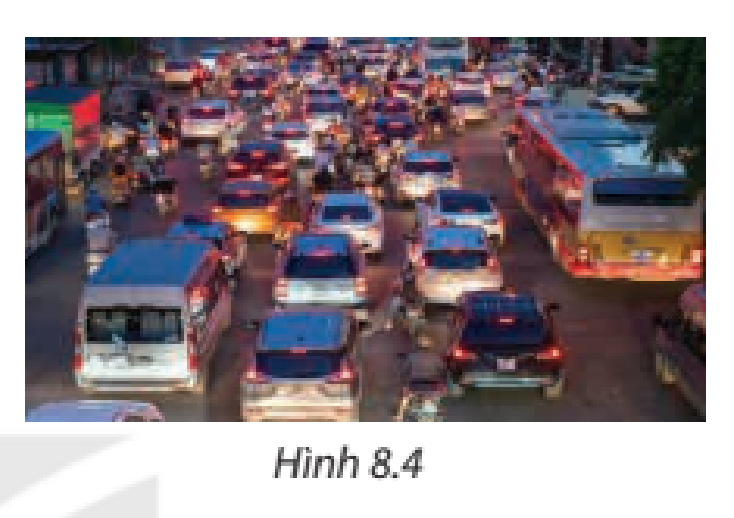

<!-- pdf:68 -->

# BÀI 32: MỐI LIÊN HỆ GIỮA XÁC SUẤT THỰC NGHIỆM VỚI XÁC SUẤT VÀ ỨNG DỤNG

## 🔤 Khái niệm, thuật ngữ

- Xác suất thực nghiệm

## 🎯 Kiến thức, kĩ năng

- Tính xác suất thực nghiệm trong một số ví dụ có tình huống thực tế.
- Ước lượng xác suất của một biến cố bằng xác suất thực nghiệm.
- Ứng dụng trong một số bài toán đơn giản.

## 🔴 Mở đầu

Hình 8.4 là cảnh tắc đường ở đường Nguyễn Trãi (Hà Nội) vào giờ cao điểm buổi sáng, từ khoảng $7$ giờ $30$ phút đến $8$ giờ. Liệu ta có thể tính được xác suất của biến cố “Tắc đường vào giờ cao điểm buổi sáng ở đường Nguyễn Trãi” hay không?

*Hình 8.4*

## 1. XÁC SUẤT THỰC NGHIỆM CỦA MỘT BIẾN CỐ

Ở lớp 6, chúng ta đã biết khái niệm xác suất thực nghiệm của một sự kiện trong một số trò chơi, thí nghiệm đơn giản. Trong phần này, chúng ta sẽ tìm hiểu khái niệm xác suất thực nghiệm của một biến cố trong những tình huống thực tế.

**HĐ1:** Ông An theo dõi và thống kê số cuộc gọi điện thoại đến cho ông trong một ngày. Sau $59$ ngày theo dõi, kết quả thu được như sau:

| Số cuộc điện thoại gọi đến trong một ngày | $0$ | $1$ | $2$ | $3$ | $4$ | $5$ | $6$ | $7$ | $8$ |
| --- | :---: | :---: | :---: | :---: | :---: | :---: | :---: | :---: | :---: |
| Số ngày | $5$ | $9$ | $15$ | $10$ | $5$ | $6$ | $4$ | $2$ | $3$ |

Gọi $A$ là biến cố “Trong một ngày ông An nhận được nhiều hơn $6$ cuộc gọi”. Hỏi trong $59$ ngày, có bao nhiêu ngày biến cố $A$ xuất hiện?

> Giả sử trong $n$ lần thực nghiệm hoặc $n$ lần theo dõi (quan sát) một hiện tượng ta thấy biến cố $E$ xảy ra $k$ lần. Khi đó **xác suất thực nghiệm** của biến cố $E$ bằng $\dfrac{k}{n}$, tức là bằng tỉ số giữa số lần xuất hiện biến cố $E$ và số lần thực hiện thực nghiệm hoặc theo dõi hiện tượng đó.

<!-- pdf:69 -->

**Ví dụ 1:** Trở lại tình huống trong HĐ1. Gọi $E$ là biến cố “Trong một ngày ông An nhận được ít nhất $5$ cuộc gọi điện thoại” và $F$ là biến cố “Trong một ngày ông An nhận được nhiều nhất $3$ cuộc điện thoại”. Tính xác suất thực nghiệm của biến cố $E$ và biến cố $F$.

**Giải**

- Trong $59$ ngày theo dõi có $6$ ngày có $5$ cuộc gọi, $4$ ngày có $6$ cuộc gọi, $2$ ngày có $7$ cuộc gọi và $3$ ngày có $8$ cuộc gọi.

Do đó, số ngày có ít nhất $5$ cuộc gọi là $6 + 4 + 2 + 3 = 15$ (ngày).

Như vậy trong $59$ ngày theo dõi, ông An thấy biến cố $E$ xảy ra $15$ lần.

Vậy xác suất thực nghiệm của biến cố $E$ là $\dfrac{15}{59}$.

- Trong $59$ ngày theo dõi có $5$ ngày không có cuộc gọi, $9$ ngày có $1$ cuộc gọi, $15$ ngày có $2$ cuộc gọi và $10$ ngày có $3$ cuộc gọi.

Do đó, số ngày có nhiều nhất $3$ cuộc gọi là $5 + 9 + 15 + 10 = 39$ (ngày).

Như vậy trong $59$ ngày theo dõi, ông An thấy biến cố $F$ xảy ra $39$ lần.

Vậy xác suất thực nghiệm của biến cố $F$ là $\dfrac{39}{59}$.

**Luyện tập 1:** Một cửa hàng thống kê số lượng các loại điện thoại bán được trong một năm vừa qua như sau:

| Loại điện thoại | A | B | C |
| --- | :---: | :---: | :---: |
| Số lượng bán được (chiếc) | $712$ | $1\,035$ | $1\,085$ |
<!-- ocr-ok: đã đối chiếu ảnh trang PDF 69, OCR đọc sai tiêu đề cột C thành "AB ÚC" -->

Tính xác suất thực nghiệm của biến cố $E$: “Chiếc điện thoại loại A được bán ra trong năm đó của cửa hàng”.

## 2. MỐI LIÊN HỆ GIỮA XÁC SUẤT THỰC NGHIỆM VỚI XÁC SUẤT

Ta đã biết khả năng xảy ra của một biến cố được đo lường bằng một số nhận giá trị từ $0$ đến $1$, gọi là *xác suất* của biến cố đó. Trong Bài 31, ta đã có công thức tính xác suất của một biến cố với giả thiết rằng các kết quả có thể của một hành động hay thực nghiệm là đồng khả năng.

Tuy nhiên trong nhiều tình huống, giả thiết trên không thoả mãn. Người ta thấy rằng có thể *ước lượng xác suất của một biến cố nhờ xác suất thực nghiệm*.

<!-- term: Ước lượng xác suất của một biến cố bằng xác suất thực nghiệm -->
> Xác suất của biến cố $E$ được ước lượng bằng xác suất thực nghiệm của $E$:
>
> $$P(E) \approx \dfrac{k}{n};$$
>
> trong đó $n$ là số lần thực nghiệm hay theo dõi một hiện tượng, $k$ là số lần biến cố $E$ xảy ra.

<!-- pdf:70 -->

**Ví dụ 2:** Kiểm tra ngẫu nhiên $500$ chiếc ti vi do nhà máy X sản xuất thì có $4$ chiếc không đạt chất lượng. Hãy ước lượng xác suất của biến cố $E$: “Một ti vi của nhà máy X sản xuất không đạt chất lượng”.

**Giải**

Trong $500$ lần quan sát ta thấy biến cố $E$ xảy ra $4$ lần.

Do đó, xác suất thực nghiệm của biến cố $E$ là $\dfrac{4}{500} = 0,008 = 0,8\%$.

Vậy xác suất của biến cố $E$ được ước lượng là $0,8\%$.

**Luyện tập 2:** Trở lại *tình huống mở đầu*. Giả sử camera quan sát đường Nguyễn Trãi trong $365$ ngày ghi nhận được $217$ ngày tắc đường vào giờ cao điểm buổi sáng. Từ số liệu thống kê đó, hãy ước lượng xác suất của biến cố $E$: “Tắc đường vào giờ cao điểm buổi sáng ở đường Nguyễn Trãi”.

**Ví dụ 3:** Thống kê tới ngày 26-12-2021, toàn thế giới có $279\,830\,788$ người nhiễm Covid-19, trong đó có $5\,413\,126$ người tử vong. (Theo *www.worldometers.info*).

Hãy ước lượng xác suất người nhiễm Covid-19 bị tử vong.

**Giải**

Theo dõi $279\,830\,788$ người nhiễm Covid-19 và thống kê có $5\,413\,126$ người tử vong.

Vậy xác suất thực nghiệm của biến cố “Người nhiễm Covid-19 bị tử vong” là

$\dfrac{5\,413\,126}{279\,830\,788} \approx 0,0193 = 1,93\%.$

Vậy xác suất người nhiễm Covid-19 bị tử vong được ước lượng là $1,93\%$.

**Luyện tập 3:** Trong $240\,000$ trẻ sơ sinh chào đời người ta thấy có $123\,120$ bé trai. Hãy ước lượng xác suất của biến cố “Trẻ sơ sinh là bé gái”.

## 3. ỨNG DỤNG

<!-- term: Ứng dụng của xác suất thực nghiệm -->
Xác suất thực nghiệm có thể sử dụng để đưa ra dự báo số lần xảy ra một sự kiện, hiện tượng trong tương lai.

<!-- pdf:71 -->

**Ví dụ 4:** Một nhà máy sản xuất linh kiện điện tử, kiểm tra chất lượng của $100$ sản phẩm. Kết quả được ghi trong bảng sau:

| Số lỗi | $0$ | $1$ | $> 1$ |
| --- | :---: | :---: | :---: |
| Số sản phẩm | $62$ | $35$ | $3$ |

a) Chọn ngẫu nhiên một sản phẩm của nhà máy. Hãy tính xác suất thực nghiệm của các biến cố sau:

$A$: “Sản phẩm không có lỗi”;

$B$: “Sản phẩm có đúng $1$ lỗi”;

$C$: “Sản phẩm có nhiều hơn $1$ lỗi”.

b) Nếu kiểm tra $120$ sản phẩm khác, hãy dự đoán:

- Có bao nhiêu sản phẩm không có lỗi?
- Có bao nhiêu sản phẩm có đúng $1$ lỗi?
- Có bao nhiêu sản phẩm nhiều hơn $1$ lỗi?

**Giải**

a) Xác suất thực nghiệm của các biến cố $A, B$ và $C$ tương ứng là

$\dfrac{62}{100} = 0,62; \quad \dfrac{35}{100} = 0,35 \text{ và } \dfrac{3}{100} = 0,03.$

Vậy ta có các ước lượng sau: $P(A) \approx 0,62$; $P(B) \approx 0,35$; $P(C) \approx 0,03$.

b) Khi kiểm tra $120$ sản phẩm khác.

- Gọi $k$ là số sản phẩm không có lỗi.

Ta có $P(A) \approx \dfrac{k}{120}$. Thay giá trị ước lượng của $P(A)$ ở trên, ta được

$\dfrac{k}{120} \approx 0,62.$ Suy ra $k \approx 120 \cdot 0,62 = 74,4$.

Vậy có khoảng $74$ sản phẩm không có lỗi.

- Gọi $h$ là số sản phẩm có đúng $1$ lỗi.

Ta có $P(B) \approx \dfrac{h}{120}$. Thay giá trị ước lượng của $P(B)$ ở trên, ta được

$\dfrac{h}{120} \approx 0,35.$ Suy ra $h \approx 120 \cdot 0,35 = 42$.

Vậy có khoảng $42$ sản phẩm có đúng $1$ lỗi.

- Gọi $m$ là số sản phẩm có nhiều hơn $1$ lỗi.

Ta có $P(C) \approx \dfrac{m}{120}$. Thay giá trị ước lượng của $P(C)$ ở trên, ta được

$\dfrac{m}{120} \approx 0,03.$ Suy ra $m \approx 120 \cdot 0,03 = 3,6$.

Vậy có khoảng $4$ sản phẩm có nhiều hơn $1$ lỗi.

<!-- pdf:72 -->

Như vậy, ta dự đoán kết quả khi kiểm tra $120$ sản phẩm khác như sau:

| Số lỗi | $0$ | $1$ | $> 1$ |
| --- | :---: | :---: | :---: |
| Số sản phẩm | $74$ | $42$ | $4$ |

**Luyện tập 4:** Thống kê điểm kiểm tra cuối năm môn Toán của một nhóm $100$ học sinh lớp $8$ được chọn ngẫu nhiên tại ba lớp của trường Trung học cơ sở X, thu được kết quả như bảng sau:

| Số điểm | $1$ | $2$ | $3$ | $4$ | $5$ | $6$ | $7$ | $8$ | $9$ | $10$ |
| --- | :---: | :---: | :---: | :---: | :---: | :---: | :---: | :---: | :---: | :---: |
| Số học sinh | $7$ | $9$ | $11$ | $11$ | $12$ | $12$ | $13$ | $9$ | $8$ | $8$ |
<!-- ocr-ok: đã đối chiếu ảnh trang PDF 72, OCR đọc sai nhãn "Số học sinh" thành "Sốngcsnh" -->

a) Chọn ngẫu nhiên một học sinh của trường X. Hãy tính xác suất thực nghiệm của các biến cố sau:

- $A$: “Học sinh đó có điểm nhỏ hơn hoặc bằng $5$”;
- $B$: “Học sinh đó có điểm từ $4$ đến $9$”.

b) Hãy dự đoán trong nhóm $80$ học sinh lớp $8$ chọn ngẫu nhiên từ ba lớp khác của trường X:

- Có bao nhiêu học sinh có số điểm không vượt quá $5$ điểm?
- Có bao nhiêu học sinh có số điểm từ $4$ đến $9$ điểm?

## BÀI TẬP

8.8. Tung một chiếc kẹp giấy $145$ lần xuống sàn nhà lát gạch đá hoa hình vuông. Quan sát thấy có $113$ lần chiếc kẹp nằm hoàn toàn bên trong hình vuông và $32$ lần chiếc kẹp nằm trên cạnh hình vuông. Tính xác suất thực nghiệm của các biến cố sau:

a) $E$: “Chiếc kẹp giấy nằm hoàn toàn trong hình vuông”;

b) $F$: “Chiếc kẹp giấy nằm trên cạnh của hình vuông”.

8.9. Một nhân viên kiểm tra chất lượng sản phẩm tại một nhà máy trong $20$ ngày rồi ghi lại số phế phẩm của nhà máy mỗi ngày và thu được kết quả như sau:

| Số phế phẩm | $0$ | $1$ | $2$ | $3$ | $\ge 4$ |
| --- | :---: | :---: | :---: | :---: | :---: |
| Số ngày | $14$ | $3$ | $1$ | $1$ | $1$ |

Tính xác suất thực nghiệm của các biến cố sau:

a) $M$: “Trong một ngày nhà máy đó không có phế phẩm”;

b) $N$: “Trong một ngày nhà máy đó chỉ có $1$ phế phẩm”;

c) $K$: “Trong một ngày nhà máy đó có ít nhất $2$ phế phẩm”.

<!-- pdf:73 -->

8.10. Thống kê thời gian của $78$ chương trình quảng cáo trên Đài truyền hình tỉnh X cho kết quả như sau:

| Thời gian quảng cáo trong khoảng | Số chương trình quảng cáo |
| --- | :---: |
| Từ $0$ đến $19$ giây | $17$ |
| Từ $20$ đến $39$ giây | $38$ |
| Từ $40$ đến $59$ giây | $19$ |
| Trên $60$ giây | $4$ |
<!-- ocr-ok: đã đối chiếu ảnh trang PDF 73, bảng số liệu có các số nằm trong LaTeX làm giảm bigram của bảng -->

Tính xác suất thực nghiệm của các biến cố sau:

a) $E$: “Chương trình quảng cáo của Đài truyền hình tỉnh X kéo dài từ $20$ đến $39$ giây”;

b) $F$: “Chương trình quảng cáo của Đài truyền hình tỉnh X kéo dài trên $1$ phút”;

c) $G$: “Chương trình quảng cáo của Đài truyền hình tỉnh X kéo dài trong khoảng từ $20$ đến $59$ giây”.

8.11. Thống kê về số ca nhiễm bệnh và số ca tử vong của bệnh SARS và bệnh EBOLA được kết quả như sau:

| Bệnh | Số người nhiễm | Số người tử vong |
| --- | :---: | :---: |
| SARS ($11$ – $2002$ đến $7$ – $2003$) | $8\,437$ | $813$ |
| EBOLA ($2014$ – $2016$) | $34\,453$ | $15\,158$ |

*(Theo www.worldometers.info)*

Căn cứ vào bảng thống kê trên, hãy ước lượng xác suất một người tử vong khi nhiễm bệnh SARS, bệnh EBOLA.

8.12. Một nhà máy sản xuất máy điều hoà tiến hành kiểm tra chất lượng của $600$ chiếc điều hoà được sản xuất và thấy có $5$ chiếc bị lỗi. Trong một lô hàng có $1\,500$ chiếc điều hoà. Hãy dự đoán xem có khoảng bao nhiêu chiếc điều hoà không bị lỗi.

8.13. Hai bạn Mai và Việt lần lượt thực hiện việc gieo đồng thời hai con xúc xắc và ở mỗi lần gieo sẽ nhận được số điểm bằng tổng số chấm xuất hiện trên hai con xúc xắc. Mai được gieo $100$ lần và Việt được gieo $120$ lần. Mai gieo trước và ghi lại kết quả của mình như sau:

| Số điểm | $2$ | $3$ | $4$ | $5$ | $6$ | $7$ | $8$ | $9$ | $10$ | $11$ | $12$ |
| --- | :---: | :---: | :---: | :---: | :---: | :---: | :---: | :---: | :---: | :---: | :---: |
| Số lần | $3$ | $5$ | $9$ | $10$ | $14$ | $16$ | $13$ | $11$ | $8$ | $7$ | $4$ |

Trước khi Việt gieo, hãy dự đoán xem có bao nhiêu lần số điểm của Việt nhận được là:

a) Một số chẵn;

b) Một số nguyên tố;

c) Một số lớn hơn $7$.

<!-- pdf:74 -->

## 💡 Em có biết?

**Tính gần đúng số $\pi$ bằng cách tung kim**

Tỉ số giữa chu vi và đường kính của một đường tròn tuỳ ý luôn không đổi và được kí hiệu là $\pi$. Số $\pi$ là một số thập phân vô hạn không tuần hoàn; $13$ chữ số đầu trong cách viết thập phân của $\pi$ là $3,141592653589\dots$

Trên mặt phẳng, kẻ các đường thẳng song song với nhau, cách đều nhau một khoảng bằng $d$. Lấy một chiếc kim có độ dài $h$ ném ngẫu nhiên lên mặt phẳng đó. Gọi $E$ là biến cố “Chiếc kim cắt một trong các đường thẳng đã vẽ”. Nhà toán học Pháp G.L. Buffon (1707 – 1788) đã chứng minh được rằng:

$P(E) = \dfrac{2h}{\pi d}.$

Giả sử ném chiếc kim $n$ lần, các đường thẳng song song cách đều nhau một khoảng $d$ và thấy có $k$ lần chiếc kim cắt đường thẳng. Khi đó xác suất thực nghiệm của $E$ là $\dfrac{k}{n}$. Vậy $P(E) \approx \dfrac{k}{n}$. Suy ra $\dfrac{2h}{\pi d} \approx \dfrac{k}{n}$. Từ đó $\pi \approx \dfrac{2hn}{kd}$.

Nếu chọn độ dài chiếc kim $h = \dfrac{d}{2}$ thì $\pi \approx \dfrac{n}{k}$.

Buffon đã thực hiện $2\,212$ lần ném chiếc kim có độ dài $1\text{ cm}$ lên mặt phẳng được kẻ bởi các đường thẳng song song với nhau, cách nhau một khoảng $2\text{ cm}$ và quan sát thấy có $704$ lần kim cắt một trong các đường thẳng đã vẽ.

Vậy $\pi \approx \dfrac{2\,212}{704} \approx 3,142045\dots$

Năm $1901$, nhà toán học Lazzerini đã tăng số lần ném kim lên và tìm được

$\pi \approx 3,1415929.$

Ngày nay trong Cung khoa học “Các phát minh” ở Pháp có đặt một dụng cụ cho phép khách tham quan tự tính gần đúng số $\pi$ bằng cách tung kim.

## 📷 Danh sách hình trong bài

| Mã hình | Trang PDF | Vị trí trong bài | Chú thích gốc |
| --- | :---: | --- | --- |
| H8-toan-b32-01 | 68 | Mở đầu | Hình 8.4 |
