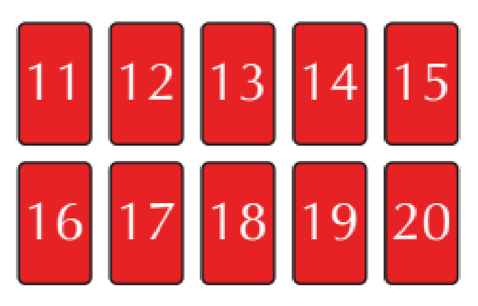

<!-- pdf:77 -->

# BÀI TẬP CUỐI CHƯƠNG VIII

## ✏️ A. TRẮC NGHIỆM

*Sử dụng dữ liệu sau để trả lời các Bài 8.18; 8.19.*

Lớp 8A gồm $38$ học sinh, trong đó có $18$ bạn nữ. Có $6$ bạn nữ tham gia câu lạc bộ thể thao và $8$ bạn nam không tham gia câu lạc bộ thể thao. Chọn ngẫu nhiên một học sinh trong lớp.

8.18. Xác suất để học sinh đó là một bạn nam có tham gia câu lạc bộ thể thao là

A. $\dfrac{7}{20}$.

B. $\dfrac{6}{19}$.

C. $\dfrac{8}{21}$.

D. $\dfrac{9}{23}$.

8.19. Xác suất để học sinh đó là một bạn **không** tham gia câu lạc bộ thể thao là

A. $\dfrac{11}{20}$.

B. $\dfrac{12}{19}$.

C. $\dfrac{13}{21}$.

D. $\dfrac{10}{19}$.

*Sử dụng dữ liệu sau để trả lời các Bài 8.20; 8.21.*

Một túi đựng các quả cầu giống hệt nhau, chỉ khác màu, trong đó có $26$ quả màu đỏ, $62$ quả màu tím, $8$ quả màu vàng, $9$ quả màu trắng và $12$ quả màu đen. Lấy ngẫu nhiên một quả cầu trong túi.

8.20. Xác suất để lấy được quả cầu màu tím là

A. $\dfrac{62}{117}$.

B. $\dfrac{60}{117}$.

C. $\dfrac{63}{118}$.

D. $\dfrac{65}{118}$.

8.21. Xác suất để lấy được quả cầu màu trắng là

A. $\dfrac{11}{117}$.

B. $\dfrac{9}{117}$.

C. $\dfrac{13}{118}$.

D. $\dfrac{15}{118}$.

## ✏️ B. TỰ LUẬN

8.22. Trong một hộp có $10$ tấm thẻ giống nhau được đánh số $11; 12; \dots; 20$. Rút ngẫu nhiên một tấm thẻ từ trong hộp.

a) Liệt kê các kết quả có thể của hành động trên.

b) Liệt kê các kết quả thuận lợi cho các biến cố sau:

$E$: “Rút được tấm thẻ ghi số là bội của $3$”;

$F$: “Rút được tấm thẻ ghi số nguyên tố”.

8.23. Một túi đựng các viên bi giống hệt nhau, chỉ khác màu, trong đó có $5$ viên bi màu xanh, $3$ viên bi màu đỏ và $7$ viên bi màu trắng. Bạn Việt lấy ngẫu nhiên một viên bi trong túi. Tính xác suất của các biến cố sau:

<!-- pdf:78 -->

a) $E$: “Việt lấy được viên bi màu xanh”;

b) $F$: “Việt lấy được viên bi màu đỏ”;

c) $G$: “Việt lấy được viên bi màu trắng”;

d) $H$: “Việt lấy được viên bi màu xanh hoặc màu đỏ”;

e) $K$: “Việt không lấy được viên bi màu đỏ”.

8.24. Chọn ngẫu nhiên một số có hai chữ số. Tính xác suất của các biến cố sau:

a) $A$: “Số được chọn nhỏ hơn $20$”;

b) $B$: “Số được chọn là số chính phương”.

8.25. Trong một phòng có $15$ học sinh lớp 8A gồm $9$ bạn nam, $6$ bạn nữ và $15$ học sinh lớp 8B gồm $12$ bạn nam, $3$ bạn nữ. Chọn ngẫu nhiên một học sinh trong phòng. Tính xác suất của các biến cố sau:

a) $E$: “Chọn được một học sinh nam”;

b) $F$: “Chọn được một học sinh nam lớp 8B”;

c) $G$: “Chọn được một học sinh nữ lớp 8A”.

8.26. Bảng sau đây thống kê kết quả khảo sát số người thích một bộ phim mới tại $5$ quận A, B, C, D, E của thành phố X.

| Quận | Số người khảo sát (Nam) | Số người khảo sát (Nữ) | Số người thích bộ phim mới (Nam) | Số người thích bộ phim mới (Nữ) |
| :---: | :---: | :---: | :---: | :---: |
| A | $45$ | $51$ | $10$ | $11$ |
| B | $36$ | $42$ | $9$ | $6$ |
| C | $52$ | $49$ | $13$ | $13$ |
| D | $28$ | $33$ | $9$ | $10$ |
| E | $40$ | $39$ | $7$ | $4$ |
| Tổng số | $201$ | $214$ | $48$ | $44$ |

a) Chọn ngẫu nhiên một người ở quận C. Ước lượng xác suất của biến cố:

$A$: “Người được chọn thích bộ phim đó”.

b) Chọn ngẫu nhiên một người ở quận E. Ước lượng xác suất của biến cố:

$B$: “Người được chọn không thích bộ phim đó”.

c) Chọn ngẫu nhiên $600$ người ở thành phố X. Ước lượng trong đó có bao nhiêu người thích bộ phim đó?

d) Chọn ngẫu nhiên $500$ người nữ ở thành phố X. Ước lượng trong đó có bao nhiêu người thích bộ phim đó?

## 📷 Danh sách hình trong bài

| Mã hình | Trang PDF | Vị trí trong bài | Chú thích gốc |
| --- | :---: | --- | --- |
| H8-toan-bt-c08-01 | 77 | Bài tập 8.22 | (sách không đánh số, minh hoạ $10$ tấm thẻ màu đỏ được đánh số từ $11$ đến $20$) |
