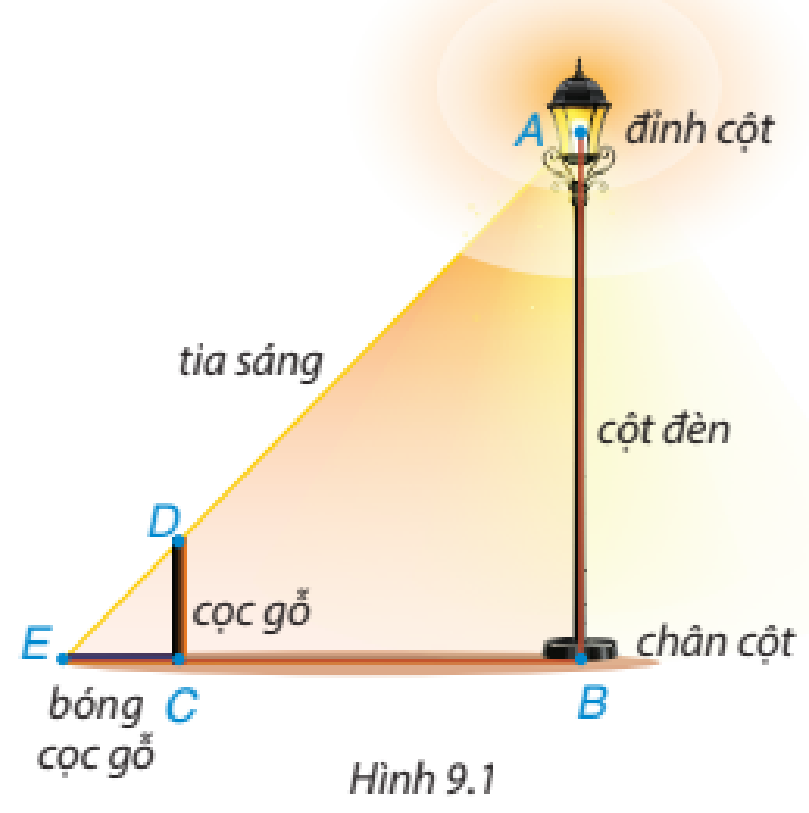
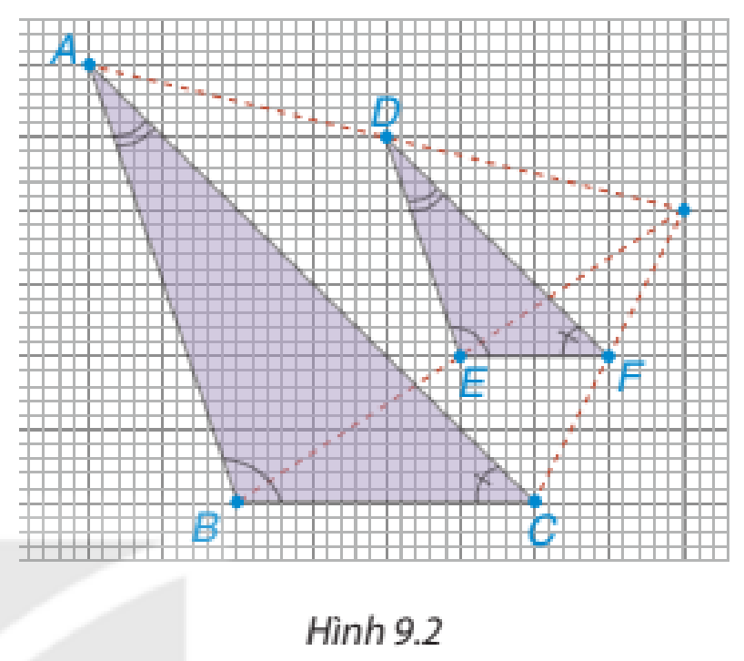
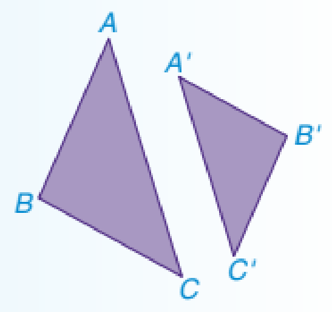
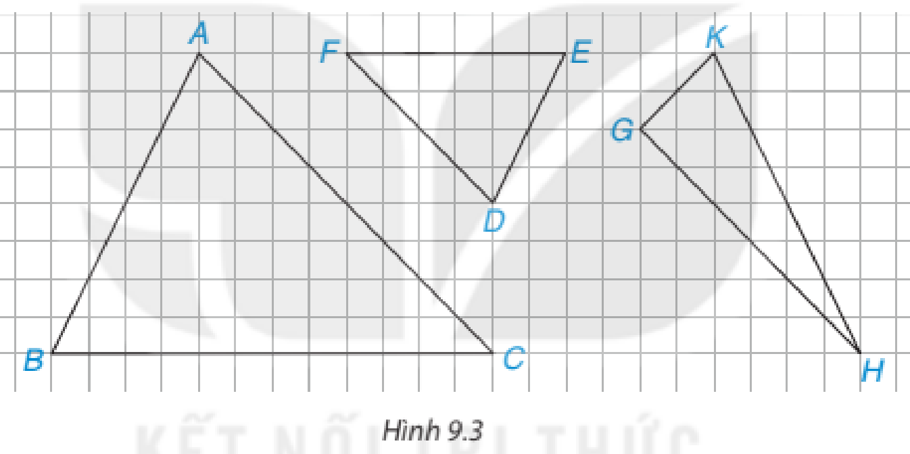
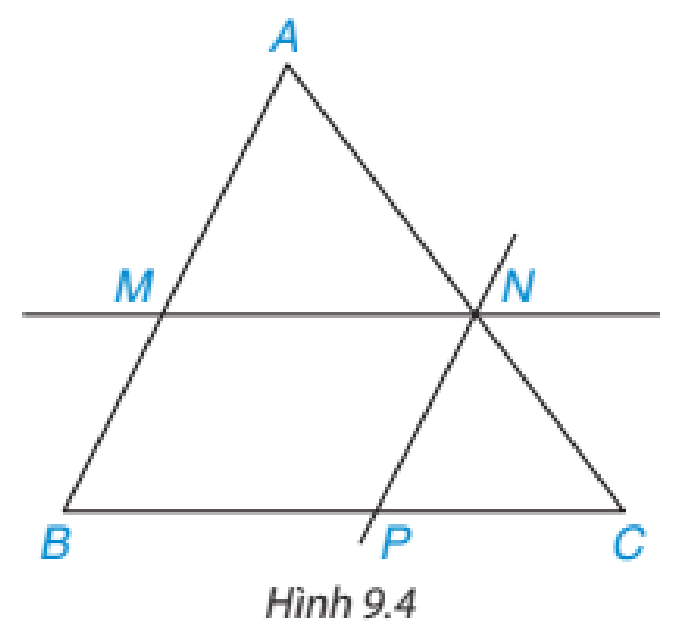
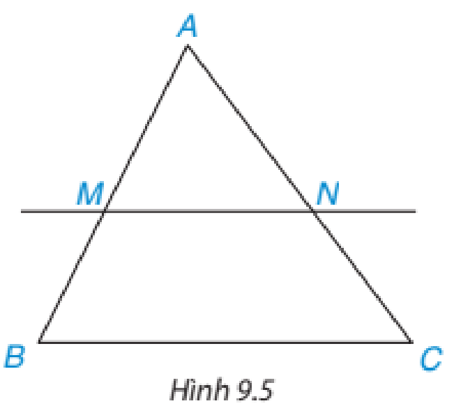
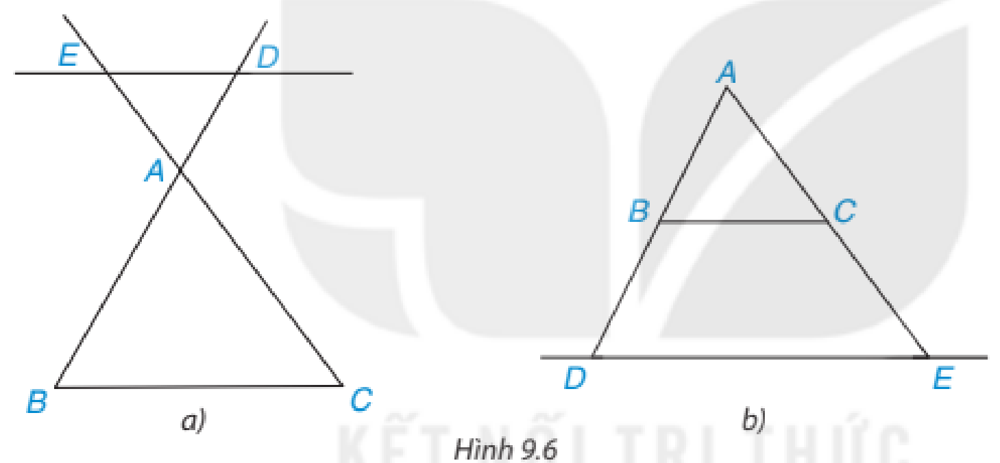
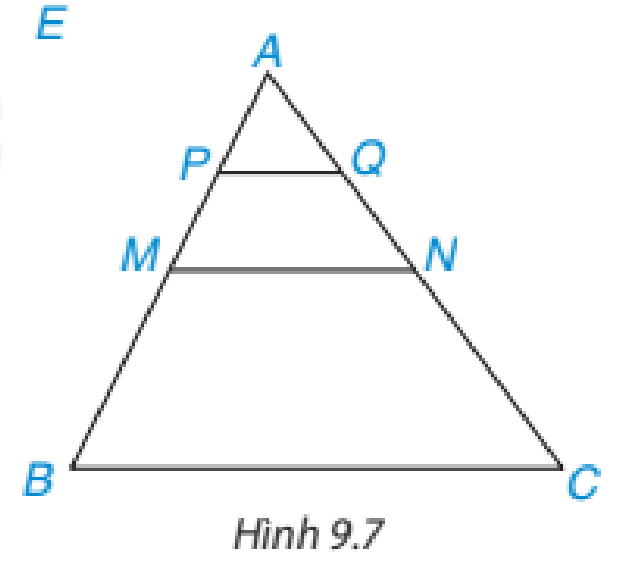
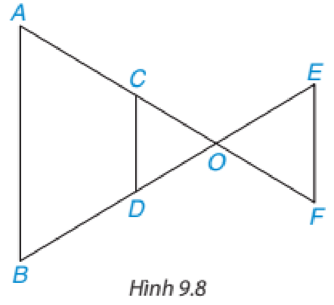
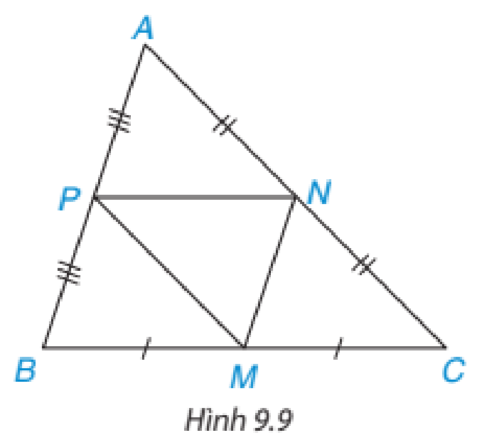

<!-- pdf:79 -->

# BÀI 33: HAI TAM GIÁC ĐỒNG DẠNG

> *Giới thiệu Chương IX — Tam giác đồng dạng (Hình học phẳng):*
>
> Các em gặp rất nhiều hình ảnh trong cuộc sống và thế giới tự nhiên được tạo nên bởi các hình giống nhau. Chẳng hạn, những toà nhà trong thành phố, những bông hoa trên cây,... Những hình như vậy trong mặt phẳng ta gọi là hình đồng dạng. Trong chương này các em sẽ được tìm hiểu về chúng, đặc biệt là các tam giác đồng dạng.

## 🔤 Khái niệm, thuật ngữ

- Hai tam giác đồng dạng
- Tỉ số đồng dạng

## 🎯 Kiến thức, kĩ năng

- Nhận biết hai tam giác đồng dạng và giải thích các tính chất của chúng.
- Giải thích định lí về trường hợp đồng dạng đặc biệt của hai tam giác.

## 🔴 Mở đầu

Có một chiếc bóng điện được mắc trên đỉnh (điểm $A$) của cột đèn thẳng đứng. Để tính chiều cao $AB$ của cột đèn, bác Dương cắm một chiếc cọc gỗ (đoạn $CD$) thẳng đứng trên mặt đất rồi đo chiều dài bóng của cọc gỗ do ánh đèn điện tạo ra và đo khoảng cách từ điểm $E$ đến chân cột đèn (điểm $B$) (H.9.1). Theo em, bác Dương đã tính như thế nào để ra được chiều cao cột đèn?

*Hình 9.1*

<!-- pdf:80 -->

## 1. ĐỊNH NGHĨA

Chúng ta đã biết hai tam giác bằng nhau sẽ có các góc tương ứng bằng nhau và hình dạng giống nhau. Trong bài này chúng ta sẽ tìm hiểu một trường hợp mà hai tam giác có thể không bằng nhau những vẫn có các góc bằng nhau và hình dạng giống nhau.

**Hai tam giác đồng dạng**

**HĐ1:** Trong Hình 9.2, $\Delta ABC$ và $\Delta DEF$ là hai tam giác có các cạnh tương ứng song song và các góc tương ứng bằng nhau, tức là $AB \parallel DE$, $AC \parallel DF$, $BC \parallel EF$ và $\widehat{A} = \widehat{D}$, $\widehat{B} = \widehat{E}$, $\widehat{C} = \widehat{F}$.

Nhìn hình vẽ, hãy cho biết giá trị của các tỉ số sau: $\dfrac{AB}{DE}; \dfrac{BC}{EF}; \dfrac{AC}{DF}$.

*Hình 9.2*

> Hai tam giác như Hình 9.2 được gọi là **hai tam giác đồng dạng**. Cụ thể, ta có định nghĩa về hai tam giác đồng dạng như sau :
> Tam giác $A'B'C'$ gọi là đồng dạng với tam giác $ABC$ nếu: $\dfrac{A'B'}{AB} = \dfrac{B'C'}{BC} = \dfrac{A'C'}{AC}$; $\widehat{A'} = \widehat{A}, \widehat{B'} = \widehat{B}, \widehat{C'} = \widehat{C}$.
> Tam giác $A'B'C'$ đồng dạng với tam giác $ABC$ được kí hiệu là $\Delta A'B'C' \backsim \Delta ABC$ (viết theo thứ tự cặp đỉnh tương ứng).
> Tỉ số $k = \dfrac{A'B'}{AB} = \dfrac{B'C'}{BC} = \dfrac{A'C'}{AC}$ được gọi là **tỉ số đồng dạng** của $\Delta A'B'C'$ với $\Delta ABC$.

**Nhận xét:**

- $\Delta A'B'C' \backsim \Delta ABC$ với tỉ số đồng dạng $k$ thì $\Delta ABC \backsim \Delta A'B'C'$ với tỉ số đồng dạng $\dfrac{1}{k}$. Do vậy khi $\Delta A'B'C' \backsim \Delta ABC$ thì ta nói hai tam giác $A'B'C'$ và $ABC$ đồng dạng với nhau.
- Hai tam giác bằng nhau thì đồng dạng với nhau theo tỉ số đồng dạng $k = 1$. Đặc biệt mọi tam giác đồng dạng với chính nó.
- Nếu $\Delta A''B''C'' \backsim \Delta A'B'C'$ với tỉ số đồng dạng $k$ và $\Delta A'B'C' \backsim \Delta ABC$ với tỉ số đồng dạng $m$ thì $\Delta A''B''C'' \backsim \Delta ABC$ với tỉ số đồng dạng $k \cdot m$.

<!-- pdf:81 -->

**Ví dụ 1:** Cho $ABC$ và $A'B'C'$ là hai tam giác đều có $AB = 4\text{ cm}$, $A'B' = 3\text{ cm}$. Chứng minh rằng $\Delta A'B'C' \backsim \Delta ABC$ và tìm tỉ số đồng dạng.
<!-- ocr-ok: đã đối chiếu ảnh trang PDF 81, các kí hiệu tam giác và độ dài viết bằng LaTeX -->

**Giải:**

Ta có: $BC = CA = AB = 4\text{ cm}$, $B'C' = C'A' = A'B' = 3\text{ cm}$, $\widehat{A} = \widehat{B} = \widehat{C} = 60^\circ$ và $\widehat{A'} = \widehat{B'} = \widehat{C'} = 60^\circ$.

Do vậy hai tam giác $ABC$ và $A'B'C'$ có: $\dfrac{A'B'}{AB} = \dfrac{B'C'}{BC} = \dfrac{A'C'}{AC} = \dfrac{3}{4}$ và $\widehat{A'} = \widehat{A}, \widehat{B'} = \widehat{B}, \widehat{C'} = \widehat{C}$.

Vậy $\Delta A'B'C' \backsim \Delta ABC$ với tỉ số đồng dạng $\dfrac{3}{4}$.

**Luyện tập 1:** Trong các tam giác được vẽ trên ô lưới vuông (H.9.3), có một cặp tam giác đồng dạng. Hãy chỉ ra cặp tam giác đó, viết đúng kí hiệu đồng dạng và tìm tỉ số đồng dạng của chúng.

*Hình 9.3*

**Thử thách nhỏ:**

Cho $\Delta ABC \backsim \Delta MNP$. Chứng minh rằng:

a) Nếu tam giác $ABC$ cân tại đỉnh $A$ thì tam giác $MNP$ cân tại đỉnh $M$.

b) Nếu tam giác $ABC$ đều thì tam giác $MNP$ đều.

c) Nếu $AB \ge AC \ge BC$ thì $MN \ge MP \ge NP$.

## 2. ĐỊNH LÍ

**Tìm hiểu định lí**

**HĐ2:** Cho tam giác $ABC$ và các điểm $M, N$ lần lượt nằm trên các cạnh $AB, AC$ sao cho $MN$ song song với $BC$ như Hình 9.4.

– Hãy viết các cặp góc bằng nhau của hai tam giác $ABC$ và $AMN$, giải thích vì sao chúng bằng nhau.

*Hình 9.4*

<!-- pdf:82 -->

– Kẻ đường thẳng đi qua $N$ song song với $AB$ và cắt $BC$ tại $P$. Hãy chứng tỏ $MN = BP$ và suy ra $\dfrac{MN}{BC} = \dfrac{AN}{AC} = \dfrac{AM}{AB}$.

– Tam giác $ABC$ và tam giác $AMN$ có đồng dạng không? Nếu có hãy viết đúng kí hiệu đồng dạng.

Tổng quát, ta có định lí sau:

<!-- term: Trường hợp đồng dạng đặc biệt của hai tam giác -->
> Nếu một đường thẳng cắt hai cạnh của một tam giác và song song với cạnh còn lại thì nó tạo thành một tam giác mới đồng dạng với tam giác đã cho.

| GT | $\Delta ABC$, $MN \parallel BC$ ($M \in AB; N \in AC$). |
| --- | --- |
| KL | $\Delta AMN \backsim \Delta ABC$. |

*Hình 9.5*

**Chú ý:** Định lí trên vẫn đúng nếu thay bằng đường thẳng cắt phần kéo dài của hai cạnh tam giác. Chẳng hạn, trong Hình 9.6 có $ED \parallel BC$. Khi đó, $\Delta ADE \backsim \Delta ABC$.

*Hình 9.6*

**Ví dụ 2:** Cho Hình 9.7, trong đó $M, N$ lần lượt là trung điểm của $AB, AC$; $P, Q$ lần lượt là trung điểm của $AM, AN$. Hãy liệt kê tất cả các cặp tam giác (phân biệt) đồng dạng.

*Hình 9.7*

**Giải:**

Tam giác $ABC$ có $M, N$ lần lượt là trung điểm của $AB, AC$ nên $MN$ là đường trung bình của tam giác $ABC$. Suy ra $MN \parallel BC$. (1)

Do đó $\Delta AMN \backsim \Delta ABC$ (theo định lí trên).

Tương tự, $PQ$ là đường trung bình của tam giác $AMN$ nên $PQ \parallel MN$. (2)

Do đó $\Delta APQ \backsim \Delta AMN$ (theo định lí trên).

Từ (1) và (2), suy ra $PQ \parallel BC$. Do đó $\Delta APQ \backsim \Delta ABC$ (theo định lí trên).

Vậy có tất cả ba cặp tam giác đồng dạng là: $\Delta AMN \backsim \Delta ABC$; $\Delta APQ \backsim \Delta AMN$ và $\Delta APQ \backsim \Delta ABC$.

<!-- pdf:83 -->

**Luyện tập 2:** Trong Hình 9.8, các đường thẳng $AB, CD, EF$ song song với nhau. Hãy liệt kê ba cặp tam giác (phân biệt) đồng dạng.

*Hình 9.8*

**Vận dụng:** Trở lại *tình huống mở đầu*, hãy giải thích bác Dương đã tính được chiều cao cột đèn như thế nào, biết cọc gỗ cao $1\text{ m}$, $EC = 80\text{ cm}$ và $EB = 4\text{ m}$.

## BÀI TẬP

9.1. Cho $\Delta ABC \backsim \Delta MNP$, khẳng định nào sau đây **không** đúng?

a) $\Delta MNP \backsim \Delta ABC$.

b) $\Delta BCA \backsim \Delta NPM$.

c) $\Delta CAB \backsim \Delta PMN$.

d) $\Delta ACB \backsim \Delta MNP$.

9.2. Khẳng định nào sau đây là đúng?

a) Hai tam giác bằng nhau thì đồng dạng với nhau.

b) Hai tam giác bất kì đồng dạng với nhau.

c) Hai tam giác đều bất kì đồng dạng với nhau.

d) Hai tam giác vuông bất kì đồng dạng với nhau.

e) Hai tam giác đồng dạng thì bằng nhau.

9.3. Trong Hình 9.9, $ABC$ là tam giác không cân; $M, N, P$ lần lượt là trung điểm của $BC, CA, AB$. Hãy tìm trong hình năm tam giác khác nhau mà chúng đôi một đồng dạng với nhau. Giải thích vì sao chúng đồng dạng.

*Hình 9.9*

9.4. Cho tam giác $ABC$ cân tại đỉnh $A$ và tam giác $MNP$ cân tại đỉnh $M$. Biết rằng $\widehat{BAC} = \widehat{PMN}$, $AB = 2MN$. Chứng minh $\Delta MNP \backsim \Delta ABC$ và tìm tỉ số đồng dạng.

## 📷 Danh sách hình trong bài

| Mã hình | Trang PDF | Vị trí trong bài | Chú thích gốc |
| --- | :---: | --- | --- |
| H8-toan-b33-01 | 79 | Mở đầu | Hình 9.1 |
| H8-toan-b33-02 | 80 | Mục 1, HĐ1 | Hình 9.2 |
| H8-toan-b33-03 | 80 | Mục 1, Khung định nghĩa hai tam giác đồng dạng | (sách không đánh số, hai tam giác đồng dạng $ABC$ và $A'B'C'$) |
| H8-toan-b33-04 | 81 | Mục 1, Luyện tập 1 | Hình 9.3 |
| H8-toan-b33-05 | 81 | Mục 2, HĐ2 | Hình 9.4 |
| H8-toan-b33-06 | 82 | Mục 2, Khung định lí | Hình 9.5 |
| H8-toan-b33-07 | 82 | Mục 2, Chú ý | Hình 9.6 |
| H8-toan-b33-08 | 82 | Mục 2, Ví dụ 2 | Hình 9.7 |
| H8-toan-b33-09 | 83 | Mục 2, Luyện tập 2 | Hình 9.8 |
| H8-toan-b33-10 | 83 | Bài 9.3 | Hình 9.9 |
