<!-- pdf:84 -->

# BÀI 34: BA TRƯỜNG HỢP ĐỒNG DẠNG CỦA HAI TAM GIÁC

## 🎯 Kiến thức, kĩ năng

- Ba trường hợp đồng dạng của hai tam giác.
- Áp dụng các trường hợp đồng dạng của hai tam giác vào các vấn đề thực tiễn.

## 🔴 Mở đầu

Trong môn bóng đá, độ khó của mỗi pha ghi bàn còn được tính bởi góc sút vào cầu môn là rộng hay hẹp. Nếu biết độ rộng của khung thành là $7,32\text{ m}$, trái bóng cách hai cột gôn lần lượt là $10,98\text{ m}$ và $14,64\text{ m}$ thì em có cách nào để đo được góc sút ở vị trí này bởi các dụng cụ học tập không?

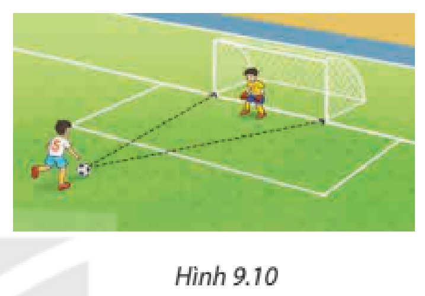
*Hình 9.10*

## 1. TRƯỜNG HỢP ĐỒNG DẠNG THỨ NHẤT CỦA TAM GIÁC

Để kiểm tra hai tam giác đồng dạng ta có nhất thiết phải kiểm tra tất cả các góc bằng nhau và độ dài tất cả các cạnh tỉ lệ với nhau không?

*Trường hợp đồng dạng cạnh – cạnh – cạnh*

**HĐ1:** Cho hai tam giác $ABC$ và $A'B'C'$ có $\dfrac{A'B'}{AB} = \dfrac{A'C'}{AC} = \dfrac{B'C'}{BC}$.
<!-- ocr-ok: đã đối chiếu ảnh trang PDF 84, các kí hiệu tam giác và tỉ số viết bằng LaTeX -->

a) Nếu $A'B' = AB$ thì hai tam giác có đồng dạng với nhau không? Vì sao?

b) Nếu $A'B' < AB$ như Hình 9.11. Trên đoạn thẳng $AB$ lấy điểm $M$ sao cho $AM = A'B'$. Kẻ đường thẳng qua $M$ song song với $BC$ và cắt $AC$ tại $N$.

– Hãy giải thích vì sao $\Delta AMN \backsim \Delta ABC$.

– Hãy chứng tỏ rằng $AN = A'C'$, $MN = B'C'$ để suy ra $\Delta AMN = \Delta A'B'C'$ (c.c.c).

– Hai tam giác $A'B'C'$ và $ABC$ có đồng dạng với nhau không? Nếu có, em hãy viết đúng kí hiệu đồng dạng giữa chúng.

c) Nếu $A'B' > AB$ thì tam giác $A'B'C'$ có đồng dạng với tam giác $ABC$ không? Vì sao?

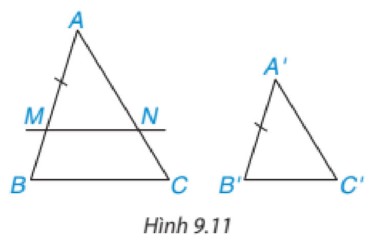
*Hình 9.11*

<!-- pdf:85 -->

Tổng quát, ta có định lí sau:

<!-- term: Trường hợp đồng dạng cạnh – cạnh – cạnh -->
> **Định lí (trường hợp đồng dạng cạnh – cạnh – cạnh)**
>
> Nếu ba cạnh của tam giác này tỉ lệ với ba cạnh của tam giác kia thì hai tam giác đó đồng dạng với nhau.

| GT | $\Delta ABC, \Delta A'B'C'$, $\dfrac{A'B'}{AB} = \dfrac{A'C'}{AC} = \dfrac{B'C'}{BC}$. |
| --- | --- |
| KL | $\Delta A'B'C' \backsim \Delta ABC$. |

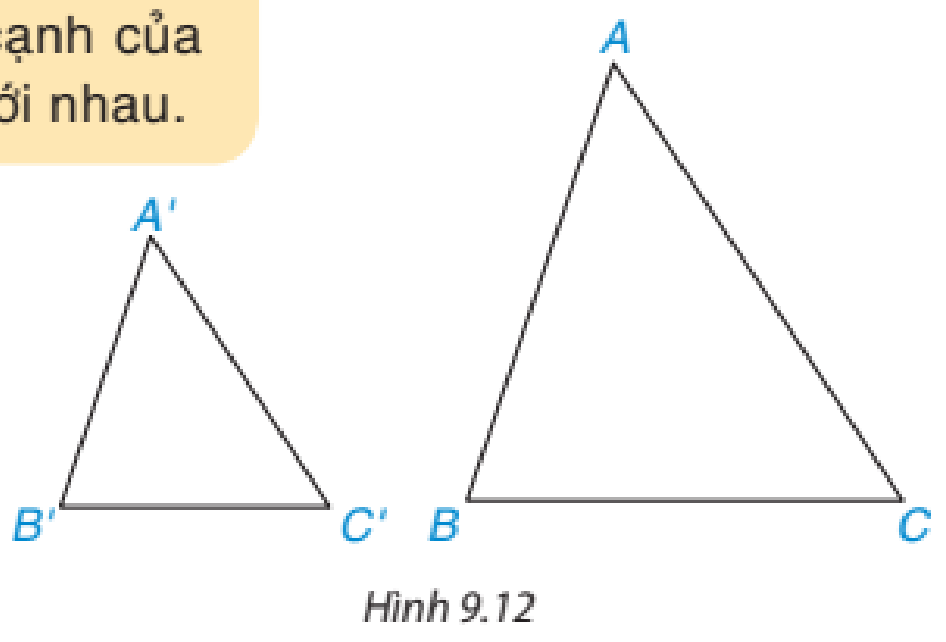
*Hình 9.12*

**?** Những cặp tam giác nào dưới đây (H.9.13) là đồng dạng? (Các kích thước được tính theo đơn vị centimét). Viết đúng kí hiệu đồng dạng.

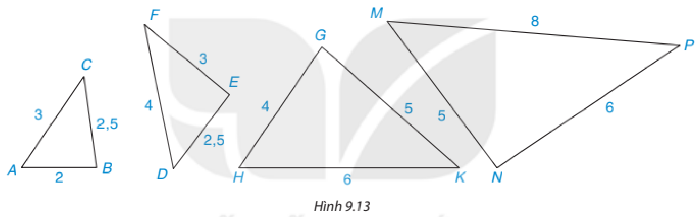
*Hình 9.13*

**Ví dụ 1:** Cho các tam giác $ABC$ và $MNP$ có $3AB = 4BC = 8CA$, $MN = 8\text{ cm}$, $NP = 6\text{ cm}$, $PM = 3\text{ cm}$. Chứng minh rằng $\Delta ABC \backsim \Delta MNP$.
<!-- ocr-ok: đã đối chiếu ảnh trang PDF 85, các kí hiệu hình học viết bằng LaTeX -->

**Giải.** (H.9.14)

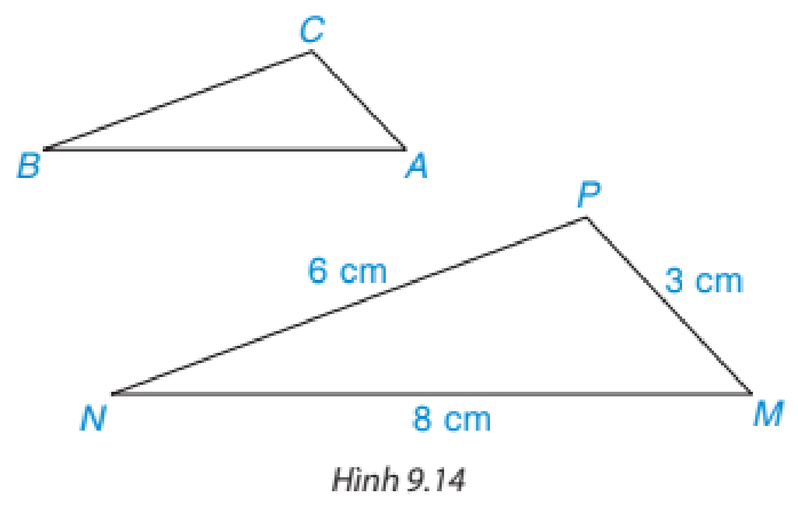
*Hình 9.14*

| GT | $\Delta ABC, \Delta MNP$, $3AB = 4BC = 8CA$, $MN = 8\text{ cm}$, $NP = 6\text{ cm}$, $PM = 3\text{ cm}$. |
| --- | --- |
| KL | $\Delta ABC \backsim \Delta MNP$. |

Từ giả thiết ta có: $3MN = 4NP = 8PM$ và $3AB = 4BC = 8CA$.

Vậy $\Delta ABC$ và $\Delta MNP$ có: $\dfrac{AB}{MN} = \dfrac{BC}{NP} = \dfrac{CA}{PM}$.

Do đó $\Delta ABC \backsim \Delta MNP$ (c.c.c).

<!-- pdf:86 -->

**Luyện tập 1:** Cho tam giác $ABC$ có chu vi bằng $18\text{ cm}$ và tam giác $DEF$ có chu vi bằng $27\text{ cm}$. Biết rằng $AB = 4\text{ cm}$, $BC = 6\text{ cm}$, $DE = 6\text{ cm}$, $FD = 12\text{ cm}$. Chứng minh $\Delta ABC \backsim \Delta DEF$.

> *Vuông:* Tớ sẽ đi tìm độ dài cạnh còn lại của hai tam giác.

**Vận dụng:** Trở lại *tình huống mở đầu*. Em hãy vẽ một tam giác có ba cạnh tỉ lệ với ba cạnh của tam giác tạo bởi ba đỉnh là trái bóng và hai chân cột gôn. Từ đó tính góc sút bằng góc tương ứng của tam giác vừa vẽ được.

> *Vuông:* Tớ sẽ tính tỉ lệ $(7,32 : 10,98 : 14,64)$ bằng $(1 : 1,5 : 2)$.
>
> *Tròn:* Tớ sẽ tính tỉ lệ $(7,32 : 10,98 : 14,64)$ bằng $(2 : 3 : 4)$.
<!-- ocr-ok: đã đối chiếu ảnh trang PDF 86, hai bóng thoại của Vuông và Tròn -->

## 2. TRƯỜNG HỢP ĐỒNG DẠNG THỨ HAI CỦA TAM GIÁC

Nếu không đo tất cả các cạnh của hai tam giác, ta có cách nào để kiểm tra hai tam giác đó đồng dạng hay không?

*Trường hợp đồng dạng cạnh – góc – cạnh*

**HĐ2:** Cho hai tam giác $ABC$ và $A'B'C'$ có độ dài các cạnh (theo đơn vị $\text{cm}$) như Hình 9.15. Biết rằng $\widehat{A} = \widehat{A'}$.

– So sánh các tỉ số $\dfrac{A'B'}{AB}, \dfrac{A'C'}{AC}$.

– Dùng thước có vạch chia đo độ dài $BC, B'C'$ và tính tỉ số $\dfrac{B'C'}{BC}$.

– Theo em, tam giác $A'B'C'$ có đồng dạng với tam giác $ABC$ không? Nếu có thì tỉ số đồng dạng là bao nhiêu?

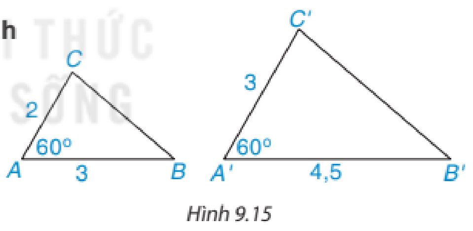
*Hình 9.15*

Tổng quát, ta có định lí sau:

<!-- term: Trường hợp đồng dạng cạnh – góc – cạnh -->
> **Định lí (trường hợp đồng dạng cạnh – góc – cạnh)**
>
> Nếu hai cạnh của tam giác này tỉ lệ với hai cạnh của tam giác kia và hai góc tạo bởi các cặp cạnh đó bằng nhau thì hai tam giác đó đồng dạng với nhau.

<!-- pdf:87 -->

**Chứng minh định lí** (H.9.16)

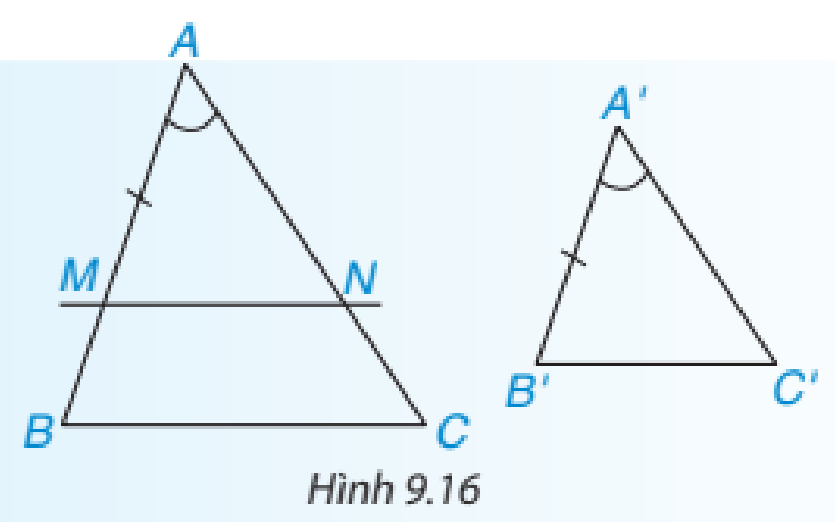
*Hình 9.16*

| GT | $\Delta ABC, \Delta A'B'C'$, $\dfrac{A'B'}{AB} = \dfrac{A'C'}{AC}, \widehat{A'} = \widehat{A}$. |
| --- | --- |
| KL | $\Delta A'B'C' \backsim \Delta ABC$. |

- Nếu $A'B' = AB$ thì $A'C' = AC$. Do đó $\Delta A'B'C' = \Delta ABC$ (c.g.c). Suy ra $\Delta A'B'C' \backsim \Delta ABC$.
- Nếu $A'B' \ne AB$ thì không mất tính tổng quát, ta giả sử $A'B' < AB$. Lấy điểm $M$ trên cạnh $AB$ sao cho $AM = A'B'$. Kẻ đường thẳng qua $M$ song song với $BC$, cắt $AC$ tại $N$.
<!-- ocr-ok: đã đối chiếu ảnh trang PDF 87, các kí hiệu hình học viết bằng LaTeX -->

Vì $MN \parallel BC$ nên $\Delta AMN \backsim \Delta ABC$ (theo định lí trang $81$). Do đó ta có $\dfrac{AM}{AB} = \dfrac{AN}{AC}$.

Kết hợp với $AM = A'B'$ và giả thiết $\dfrac{A'B'}{AB} = \dfrac{A'C'}{AC}$ ta suy ra: $AN = A'C'$.

Hai tam giác $AMN$ và $A'B'C'$ có:
<!-- ocr-ok: đã đối chiếu ảnh trang PDF 87, các kí hiệu tam giác viết bằng LaTeX -->

$AM = A'B'$ (theo cách dựng), $\widehat{A} = \widehat{A'}$ (theo giả thiết), $AN = A'C'$ (chứng minh trên).

Vậy $\Delta AMN = \Delta A'B'C'$ (c.g.c). Vì $\Delta AMN \backsim \Delta ABC$ nên $\Delta A'B'C' \backsim \Delta ABC$.
<!-- ocr-ok: đã đối chiếu ảnh trang PDF 87, các kí hiệu đồng dạng viết bằng LaTeX -->

**?** Những cặp tam giác nào trong Hình 9.17 là đồng dạng? (Các kích thước được tính theo đơn vị centimét). Viết đúng kí hiệu đồng dạng.

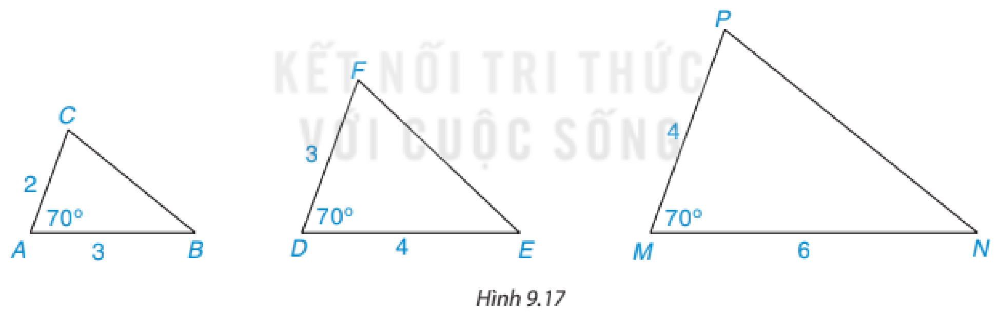
*Hình 9.17*

**Ví dụ 2:** Cho $\Delta A'B'C' \backsim \Delta ABC$ và $M, M'$ lần lượt là trung điểm của các cạnh $BC, B'C'$. Chứng minh rằng $\Delta A'B'M' \backsim \Delta ABM$.
<!-- ocr-ok: đã đối chiếu ảnh trang PDF 87, các kí hiệu hình học viết bằng LaTeX -->

**Giải.** (H.9.18)

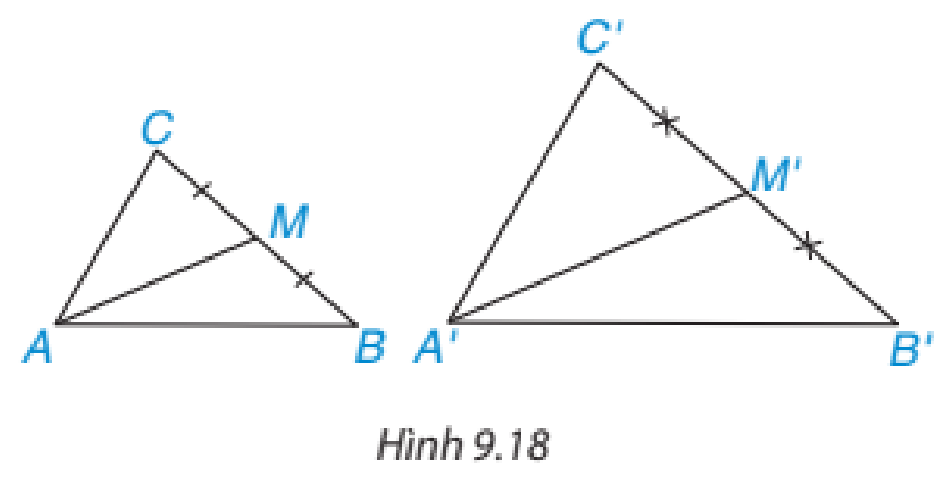
*Hình 9.18*

| GT | $\Delta A'B'C' \backsim \Delta ABC$, $M \in BC, M' \in B'C'$, $BM = MC, B'M' = M'C'$. |
| --- | --- |
| KL | $\Delta A'B'M' \backsim \Delta ABM$. |

<!-- pdf:88 -->

Vì $\Delta A'B'C' \backsim \Delta ABC$ nên $\widehat{B'} = \widehat{B}$ và $\dfrac{A'B'}{AB} = \dfrac{B'C'}{BC}$.

Do $M, M'$ lần lượt là trung điểm của $BC, B'C'$ nên $\dfrac{M'B'}{MB} = \dfrac{B'C'}{BC} = \dfrac{A'B'}{AB}$.

Hai tam giác $A'B'M'$ và $ABM$ có: $\dfrac{M'B'}{MB} = \dfrac{A'B'}{AB}$ và $\widehat{B'} = \widehat{B}$ (theo chứng minh trên).

Vậy $\Delta A'B'M' \backsim \Delta ABM$ (c.g.c).

**Nhận xét:** Nếu $\Delta A'B'C' \backsim \Delta ABC$ theo tỉ số $k$ và $AM, A'M'$ lần lượt là các đường trung tuyến của $\Delta ABC$ và $\Delta A'B'C'$ thì $\dfrac{A'M'}{AM} = k$.
<!-- ocr-ok: đã đối chiếu ảnh trang PDF 88, các kí hiệu hình học viết bằng LaTeX -->

**Luyện tập 2:** Cho $\Delta A'B'C' \backsim \Delta ABC$. Trên tia đối của các tia $CB, C'B'$ lần lượt lấy các điểm $M, M'$ sao cho $\dfrac{MC}{MB} = \dfrac{M'C'}{M'B'}$. Chứng minh rằng $\Delta A'B'M' \backsim \Delta ABM$.
<!-- ocr-ok: đã đối chiếu ảnh trang PDF 88, các kí hiệu hình học viết bằng LaTeX -->

**Tranh luận:**

1. Bạn Lan nhận xét rằng nếu tam giác $ABC$ và tam giác $A'B'C'$ có $\dfrac{A'B'}{AB} = \dfrac{A'C'}{AC}$ và $\widehat{B'} = \widehat{B}$ thì chúng đồng dạng. Theo em, bạn Lan nhận xét có đúng không? Vì sao?

*Gợi ý.* Khi góc $ACB$ tù, lấy điểm $M$ trên tia $BC$ sao cho $\Delta AMC$ cân (H.9.19) rồi xét xem trong hai tam giác $ABC$ và $ABM$, tam giác nào đồng dạng với tam giác $A'B'C'$.

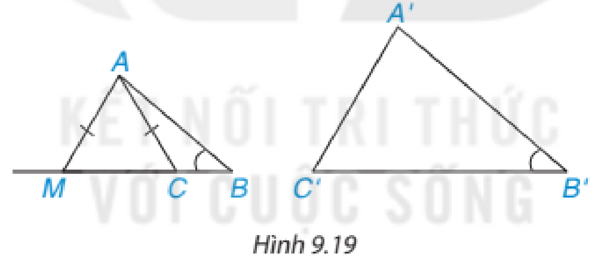
*Hình 9.19*

2. Nếu thêm giả thiết $\widehat{C}$ và $\widehat{C'}$ đều là góc nhọn thì hai tam giác $ABC$ và $A'B'C'$ có đồng dạng không?

## 3. TRƯỜNG HỢP ĐỒNG DẠNG THỨ BA CỦA TAM GIÁC

Nếu chỉ đo các góc của hai tam giác, ta có thể kiểm tra được hai tam giác đó có đồng dạng không?

*Trường hợp đồng dạng góc – góc*

Bạn Tròn đang đứng ở vị trí điểm $A$ bên bờ sông và nhờ anh Pi tính giúp khoảng cách từ chỗ mình đứng đến chân một cột cờ tại điểm $C$ bên kia sông (H.9.20a). Anh Pi lấy một vị trí $B$ sao cho $AB = 10\text{ m}$, $\widehat{ABC} = 70^\circ, \widehat{BAC} = 80^\circ$ và vẽ một tam giác $A'B'C'$ trên giấy với $A'B' = 2\text{ cm}$, $\widehat{A'B'C'} = 70^\circ, \widehat{B'A'C'} = 80^\circ$ (H.9.20b).

<!-- pdf:89 -->

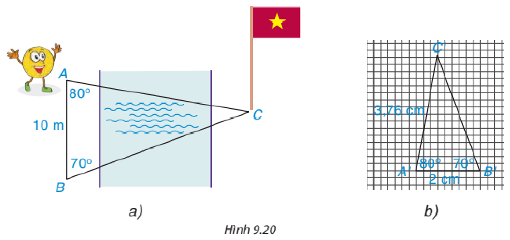
*Hình 9.20*

**HĐ3:** Em hãy dự đoán xem tam giác $A'B'C'$ có đồng dạng với tam giác $ABC$ không? Nếu có thì tỉ số đồng dạng là bao nhiêu?

**HĐ4:** Nếu $\Delta A'B'C' \backsim \Delta ABC$ và anh Pi đo được $A'C' = 3,76\text{ cm}$ thì khoảng cách từ bạn Tròn đến chân cột cờ là bao nhiêu mét?

Tổng quát, ta có định lí sau:

<!-- term: Trường hợp đồng dạng góc – góc -->
> **Định lí (trường hợp đồng dạng góc – góc)**
>
> Nếu hai góc của tam giác này lần lượt bằng hai góc của tam giác kia thì hai tam giác đó đồng dạng với nhau.

**Chứng minh định lí** (H.9.21)

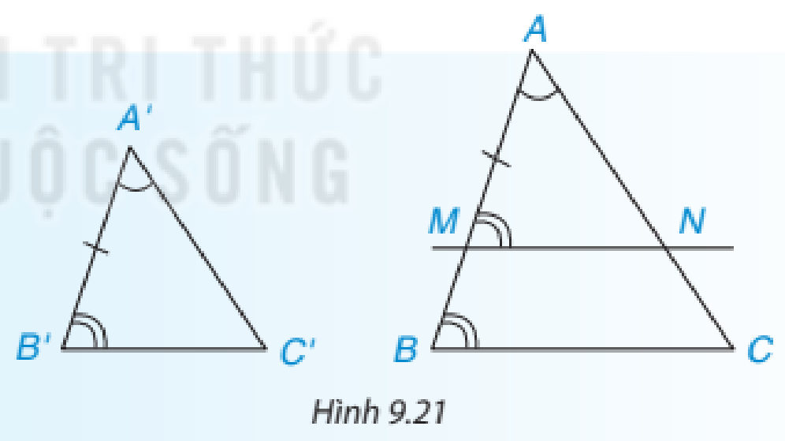
*Hình 9.21*

| GT | $\Delta ABC, \Delta A'B'C'$, $\widehat{A'} = \widehat{A}, \widehat{B'} = \widehat{B}$. |
| --- | --- |
| KL | $\Delta A'B'C' \backsim \Delta ABC$. |

- Nếu $A'B' = AB$ thì $\Delta A'B'C' = \Delta ABC$ (g.c.g). Suy ra $\Delta A'B'C' \backsim \Delta ABC$.
- Nếu $A'B' \ne AB$ thì không mất tính tổng quát, ta giả sử $A'B' < AB$. Lấy điểm $M$ trên cạnh $AB$ sao cho $AM = A'B'$. Kẻ đường thẳng qua $M$ song song với $BC$, cắt $AC$ tại $N$.
<!-- ocr-ok: đã đối chiếu ảnh trang PDF 89, các kí hiệu hình học viết bằng LaTeX -->

Vì $MN \parallel BC$ nên $\Delta AMN \backsim \Delta ABC$ (theo định lí trang $81$).
<!-- ocr-ok: đã đối chiếu ảnh trang PDF 89, các kí hiệu hình học viết bằng LaTeX -->

Do đó ta có $\widehat{AMN} = \widehat{ABC} = \widehat{A'B'C'}$.

Hai tam giác $AMN$ và $A'B'C'$ có:
<!-- ocr-ok: đã đối chiếu ảnh trang PDF 89, các kí hiệu tam giác viết bằng LaTeX -->

$\widehat{A} = \widehat{A'}$ (theo giả thiết), $AM = A'B'$ (theo cách dựng), $\widehat{AMN} = \widehat{A'B'C'}$ (chứng minh trên).

Vậy $\Delta AMN = \Delta A'B'C'$ (g.c.g). Vì $\Delta AMN \backsim \Delta ABC$ nên $\Delta A'B'C' \backsim \Delta ABC$.
<!-- ocr-ok: đã đối chiếu ảnh trang PDF 89, các kí hiệu đồng dạng viết bằng LaTeX -->

<!-- pdf:90 -->

**?** Những cặp tam giác nào trong Hình 9.22 là đồng dạng? Viết đúng kí hiệu đồng dạng.

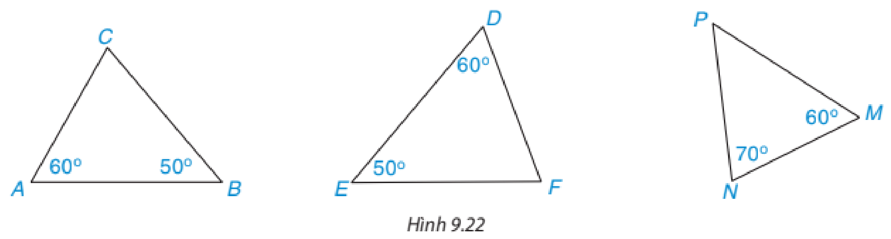
*Hình 9.22*

**Ví dụ 3:** Cho $\Delta A'B'C' \backsim \Delta ABC$ và $AM, A'M'$ lần lượt là các đường phân giác của tam giác $ABC$ và tam giác $A'B'C'$. Chứng minh rằng $\Delta A'B'M' \backsim \Delta ABM$.

**Giải.** (H.9.23)

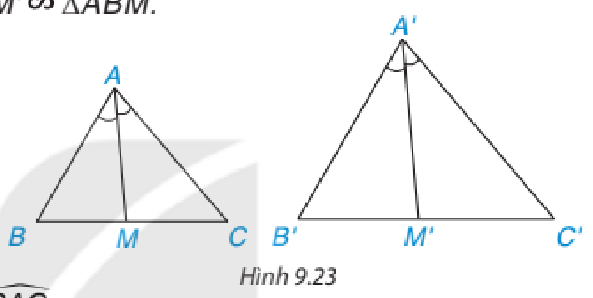
*Hình 9.23*

| GT | $\Delta A'B'C' \backsim \Delta ABC$, $M \in BC, M' \in B'C'$, $\widehat{BAM} = \widehat{MAC}, \widehat{B'A'M'} = \widehat{M'A'C'}$. |
| --- | --- |
| KL | $\Delta A'B'M' \backsim \Delta ABM$. |

Vì $\Delta A'B'C' \backsim \Delta ABC$ nên $\widehat{B'} = \widehat{B}$ và $\widehat{B'A'C'} = \widehat{BAC}$.

Vì $AM, A'M'$ lần lượt là các đường phân giác của $\widehat{BAC}$ và $\widehat{B'A'C'}$ nên $\widehat{B'A'M'} = \dfrac{\widehat{B'A'C'}}{2} = \dfrac{\widehat{BAC}}{2} = \widehat{BAM}$.

Hai tam giác $ABM$ và $A'B'M'$ có $\widehat{A'B'M'} = \widehat{ABM}$, $\widehat{B'A'M'} = \widehat{BAM}$ (theo chứng minh trên).

Vậy $\Delta A'B'M' \backsim \Delta ABM$ (g.g).

**Nhận xét:** Nếu $\Delta A'B'C' \backsim \Delta ABC$ theo tỉ số $k$ và $AM, A'M'$ lần lượt là các đường phân giác của $\Delta ABC$ và $\Delta A'B'C'$ thì $\dfrac{A'M'}{AM} = k$.

**Luyện tập 3:** Cho các điểm $A, B, C, D$ như Hình 9.24. Biết rằng $\widehat{ABC} = \widehat{ADB}$. Hãy chứng minh $\Delta ABC \backsim \Delta ADB$ và $AB^2 = AD \cdot AC$.

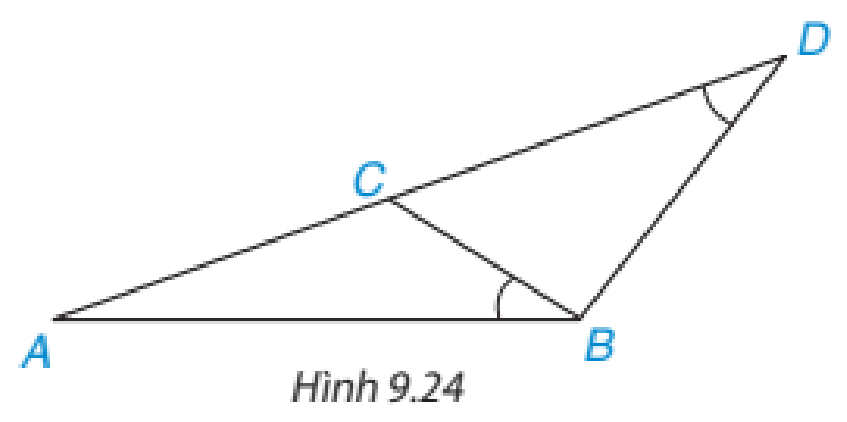
*Hình 9.24*

**Thử thách nhỏ:**

Biết rằng ba đường phân giác của tam giác $ABC$ đồng quy tại $I$, ba đường phân giác của tam giác $A'B'C'$ đồng quy tại $I'$. Hãy chứng tỏ rằng nếu $\widehat{A'I'B'} = \widehat{AIB}$ và $\widehat{A'I'C'} = \widehat{AIC}$ thì $\Delta A'B'C' \backsim \Delta ABC$.

<!-- pdf:91 -->

## BÀI TẬP

9.5. Khẳng định nào sau đây chứng tỏ rằng hai tam giác đồng dạng?

a) Ba cạnh của tam giác này tỉ lệ với ba cạnh tam giác kia.

b) Hai cạnh của tam giác này tỉ lệ với hai cạnh tam giác kia và có một cặp góc bằng nhau.

c) Hai góc của tam giác này bằng hai góc của tam giác kia.

d) Hai cạnh của tam giác này bằng hai cạnh của tam giác kia.

9.6. Cho hai tam giác đồng dạng. Tam giác thứ nhất có độ dài ba cạnh là $4\text{ cm}$, $8\text{ cm}$ và $10\text{ cm}$. Tam giác thứ hai có chu vi là $33\text{ cm}$. Độ dài ba cạnh của tam giác thứ hai là bộ ba nào sau đây?

a) $6\text{ cm}, 12\text{ cm}, 15\text{ cm}$.

b) $8\text{ cm}, 16\text{ cm}, 20\text{ cm}$.

c) $6\text{ cm}, 9\text{ cm}, 18\text{ cm}$.

d) $8\text{ cm}, 10\text{ cm}, 15\text{ cm}$.

9.7. Cho $AM, BN, CP$ là các đường trung tuyến của tam giác $ABC$. Cho $A'M', B'N', C'P'$ là các đường trung tuyến của tam giác $A'B'C'$. Biết rằng $\Delta A'B'C' \backsim \Delta ABC$.

Chứng minh rằng $\dfrac{A'M'}{AM} = \dfrac{B'N'}{BN} = \dfrac{C'P'}{CP}$.

9.8. Cho tam giác $ABC$ có $AB = 12\text{ cm}$, $AC = 15\text{ cm}$. Trên các tia $AB, AC$ lần lượt lấy các điểm $M, N$ sao cho $AM = 10\text{ cm}$, $AN = 8\text{ cm}$. Chứng minh rằng $\Delta ABC \backsim \Delta ANM$.

9.9. Cho góc $BAC$ và các điểm $M, N$ lần lượt trên các đoạn thẳng $AB, AC$ sao cho $\widehat{ABN} = \widehat{ACM}$.

a) Chứng minh rằng $\Delta ABN \backsim \Delta ACM$.

b) Gọi $I$ là giao điểm của $BN$ và $CM$. Chứng minh rằng $IB \cdot IN = IC \cdot IM$.

9.10. Có hai chiếc cột dựng thẳng đứng trên mặt đất với chiều cao lần lượt là $3\text{ m}$ và $2\text{ m}$. Người ta nối hai sợi dây từ đỉnh cột này đến chân cột kia và hai sợi dây cắt nhau tại một điểm (H.9.25), hãy tính độ cao $h$ của điểm đó so với mặt đất.

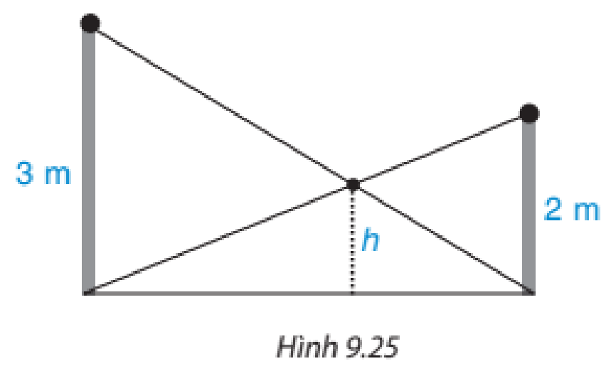
*Hình 9.25*

## 📷 Danh sách hình trong bài

| Mã hình | Trang PDF | Vị trí trong bài | Chú thích gốc |
| --- | :---: | --- | --- |
| H8-toan-b34-01 | 84 | Mở đầu | Hình 9.10 |
| H8-toan-b34-02 | 84 | Mục 1, HĐ1 | Hình 9.11 |
| H8-toan-b34-03 | 85 | Mục 1, Định lí (góc trên trái khung chữ nhật chạm mép phải khung Định lí màu cam) | Hình 9.12 |
| H8-toan-b34-04 | 85 | Mục 1, Câu hỏi | Hình 9.13 |
| H8-toan-b34-05 | 85 | Mục 1, Ví dụ 1 | Hình 9.14 |
| H8-toan-b34-06 | 86 | Mục 2, HĐ2 | Hình 9.15 |
| H8-toan-b34-07 | 87 | Mục 2, Chứng minh định lí | Hình 9.16 |
| H8-toan-b34-08 | 87 | Mục 2, Câu hỏi | Hình 9.17 |
| H8-toan-b34-09 | 87 | Mục 2, Ví dụ 2 | Hình 9.18 |
| H8-toan-b34-10 | 88 | Mục 2, Tranh luận | Hình 9.19 |
| H8-toan-b34-11 | 89 | Mục 3, Trường hợp đồng dạng góc – góc | Hình 9.20 |
| H8-toan-b34-12 | 89 | Mục 3, Chứng minh định lí | Hình 9.21 |
| H8-toan-b34-13 | 90 | Mục 3, Câu hỏi | Hình 9.22 |
| H8-toan-b34-14 | 90 | Mục 3, Ví dụ 3 (khung chữ nhật nằm sát dòng chữ đề bài phía trên và lời giải bên trái) | Hình 9.23 |
| H8-toan-b34-15 | 90 | Mục 3, Luyện tập 3 | Hình 9.24 |
| H8-toan-b34-16 | 91 | Bài 9.10 | Hình 9.25 |
