<!-- pdf:94 -->

# BÀI 35: ĐỊNH LÍ PYTHAGORE VÀ ỨNG DỤNG

## 🔤 Khái niệm, thuật ngữ

- Định lí Pythagore

## 🎯 Kiến thức, kĩ năng

- Giải thích định lí Pythagore.
- Tính độ dài cạnh trong tam giác vuông bằng cách sử dụng định lí Pythagore.
- Giải quyết một số vấn đề thực tiễn gắn với việc vận dụng định lí Pythagore.

## 🔴 Mở đầu

Bác thợ muốn xây một cầu thang bắc từ mặt sàn lên sân thượng. Biết rằng bức tường từ sàn lên sân thượng cao $4\text{ m}$, chân cầu thang cách bức tường $3\text{ m}$ (H.9.31). Hỏi chiều dài của cầu thang là bao nhiêu mét?

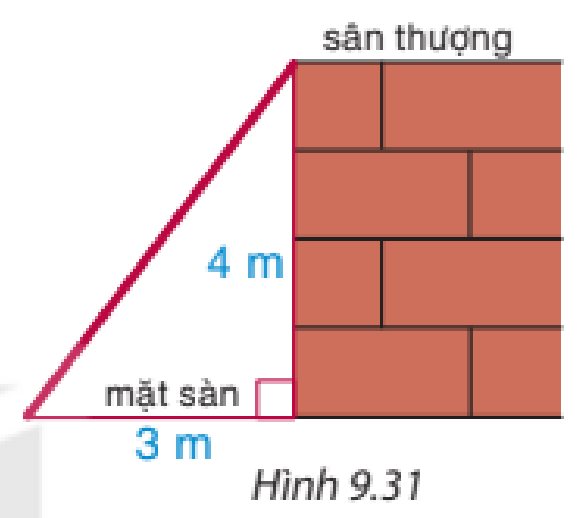
*Hình 9.31*

## 1. ĐỊNH LÍ PYTHAGORE

Độ dài ba cạnh trong một tam giác vuông có liên hệ gì với nhau không?

**Định lí Pythagore**

**HĐ1:** Cho tam giác vuông $ABC$ có hai cạnh góc vuông $AB = 3\text{ cm}$, $AC = 4\text{ cm}$ (H.9.32). Hãy đo độ dài cạnh $BC$ và so sánh hai đại lượng $AB^2 + AC^2$ với $BC^2$.

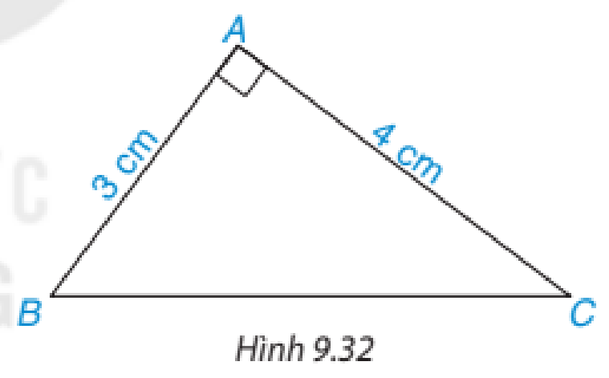
*Hình 9.32*

**HĐ2:** Lấy giấy trắng cắt bốn tam giác vuông bằng nhau. Gọi $a, b$ là độ dài hai cạnh góc vuông, $c$ là độ dài cạnh huyền của các tam giác vuông này. Cắt một hình vuông bằng tấm bìa có cạnh dài $a + b$. Dán bốn tam giác vuông lên tấm bìa như Hình 9.33.

– Dùng ê ke kiểm tra xem phần bìa không bị che lấp có phải là hình vuông cạnh bằng $c$ không. Từ đó tính diện tích phần bìa này theo $c$.

– Tổng diện tích bốn tam giác vuông có độ dài hai cạnh góc vuông $a, b$ là bao nhiêu?

– Diện tích cả tấm bìa hình vuông cạnh $a + b$ bằng bao nhiêu?

– So sánh $c^2 + 2ab$ với $(a + b)^2$ để rút ra nhận xét về mối quan hệ giữa hai đại lượng $c^2$ và $a^2 + b^2$.

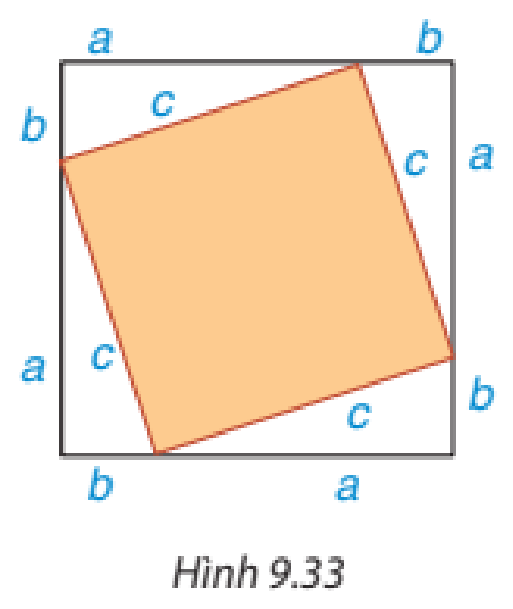
*Hình 9.33*

<!-- pdf:95 -->

Từ các hoạt động trên, ta có định lí sau:

> **Định lí Pythagore**
> Trong một tam giác vuông, bình phương của cạnh huyền bằng tổng các bình phương của hai cạnh góc vuông.

**Chứng minh định lí** (H.9.34)

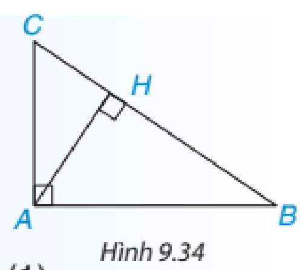
*Hình 9.34*

| GT | $\Delta ABC, \widehat{A} = 90^\circ$ |
| --- | --- |
| KL | $BC^2 = AB^2 + AC^2$. |

Kẻ đường cao $AH$ của tam giác $ABC$.

Hai tam giác $ABC$ và $HBA$ có: $\widehat{BAC} = 90^\circ = \widehat{BHA}$, $\widehat{B}$ chung.
<!-- ocr-ok: đã đối chiếu ảnh trang PDF 95, các kí hiệu tam giác và góc viết bằng LaTeX -->

Vậy $\Delta ABC \backsim \Delta HBA$ (g.g). Suy ra $\dfrac{AB}{HB} = \dfrac{BC}{AB}$ hay $AB^2 = HB \cdot BC$. (1)

Tương tự, $\Delta ABC \backsim \Delta HAC$. Suy ra $\dfrac{AC}{HC} = \dfrac{BC}{AC}$ hay $AC^2 = HC \cdot BC$. (2)
<!-- ocr-ok: đã đối chiếu ảnh trang PDF 95, các kí hiệu đồng dạng và tỉ số viết bằng LaTeX -->

Từ (1) và (2) suy ra $AB^2 + AC^2 = (HB + HC) \cdot BC = BC^2$.

> *Pi:* Bình phương của một đoạn thẳng là bình phương độ dài của đoạn thẳng đó.

**Chú ý:** Người ta cũng chứng minh được định lí sau đây (**định lí Pythagore đảo**):
Nếu tam giác có bình phương của một cạnh bằng tổng các bình phương của hai cạnh kia thì tam giác đó là tam giác vuông.

**?** Tìm độ dài $x$ và $y$ trong Hình 9.35.

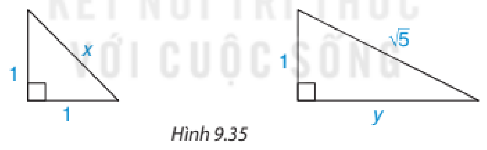
*Hình 9.35*

**Ví dụ 1:** Cho tam giác $ABC$ có $AB = 3\text{ cm}$, $AC = 4\text{ cm}$, $BC = x\text{ (cm)}$.

a) Tính $x$ trong trường hợp tam giác $ABC$ vuông tại $B$ (làm tròn kết quả đến chữ số thập phân thứ nhất).

b) Tìm $x$ để tam giác $ABC$ vuông tại $A$.

**Giải:**

a) Nếu tam giác $ABC$ vuông tại $B$ thì theo định lí Pythagore ta có:

$AB^2 + BC^2 = AC^2$, suy ra $3^2 + x^2 = 4^2$, hay $x = \sqrt{7}$.

Vậy $x \approx 2,6$.

b) Theo định lí Pythagore đảo thì tam giác $ABC$ vuông tại $A$ khi và chỉ khi $BC^2 = AB^2 + AC^2$. Vậy giá trị $x$ cần tìm thoả mãn $x^2 = 4^2 + 3^2$, hay $x = 5$.

<!-- pdf:96 -->

**Luyện tập 1:** Trên giấy kẻ ô vuông (cạnh ô vuông bằng $1\text{ cm}$), cho các điểm $A, B, C$ như Hình 9.36. Tính độ dài các cạnh của tam giác $ABC$.

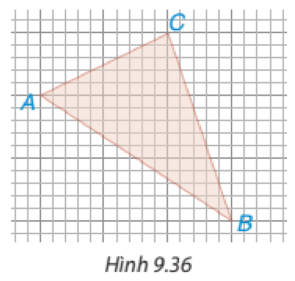
*Hình 9.36*

**Vận dụng 1:** Trở lại *tình huống mở đầu*. Xem thành cầu thang như cạnh huyền $BC$ của tam giác vuông $ABC$ (H.9.37). Từ đó, hãy tính độ dài cạnh $BC$ để suy ra chiều dài cầu thang cần xây.

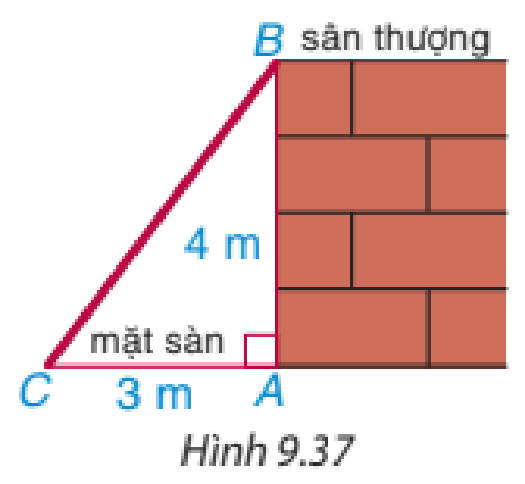
*Hình 9.37*

## 2. ỨNG DỤNG CỦA ĐỊNH LÍ PYTHAGORE

**Tính độ dài đoạn thẳng**

**Bài toán 1:** Cho tam giác $ABC$ vuông tại $A$ có $AB = 6\text{ cm}$, $AC = 8\text{ cm}$. Hãy tính độ dài cạnh $BC$, đường cao $AH$ và các đoạn thẳng $BH, CH$.

**Giải.** (H.9.38)

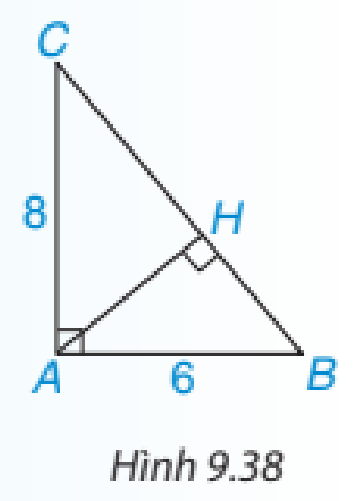
*Hình 9.38*

Áp dụng định lí Pythagore cho tam giác vuông $ABC$, ta được

$BC^2 = AB^2 + AC^2 = 6^2 + 8^2 = 100$, hay $BC = 10\text{ (cm)}$.

Vì diện tích của tam giác $ABC$ bằng $\dfrac{AB \cdot AC}{2}$ và cũng bằng $\dfrac{AH \cdot BC}{2}$ nên $\dfrac{AB \cdot AC}{2} = \dfrac{AH \cdot BC}{2}$, hay $AH = \dfrac{AB \cdot AC}{BC} = \dfrac{6 \cdot 8}{10} = 4,8\text{ (cm)}$.
<!-- ocr-ok: đã đối chiếu ảnh trang PDF 96, các công thức diện tích viết bằng LaTeX -->

Áp dụng định lí Pythagore cho tam giác vuông $AHB$, ta được:

$BH^2 = AB^2 - AH^2 = 6^2 - 4,8^2 = 12,96$ hay $BH = 3,6\text{ cm}$.

Suy ra $CH = BC - BH = 10 - 3,6 = 6,4\text{ (cm)}$.

**Nhận xét:** Nếu tam giác vuông $ABC$ tại $A$ có đường cao $AH = h$, các cạnh $BC = a$, $AC = b$, $AB = c$ thì $h \cdot a = b \cdot c$.

**Luyện tập 2:** Cho các tam giác vuông với kích thước như Hình 9.39. Hãy tính độ dài $x$ và cho biết những tam giác nào đồng dạng, viết đúng kí hiệu đồng dạng.

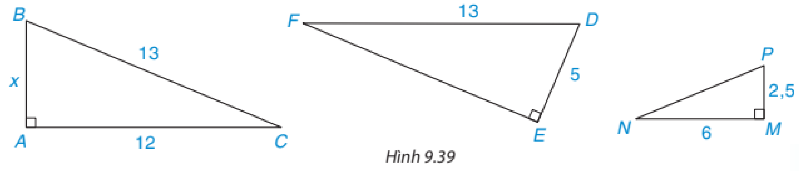
*Hình 9.39*

<!-- pdf:97 -->

**Vận dụng 2:** Để đón được một người khách, một xe taxi xuất phát từ vị trí điểm $A$, chạy dọc một con phố dài $3\text{ km}$ đến điểm $B$ thì rẽ vuông góc sang trái, chạy được $3\text{ km}$ đến điểm $C$ thì tài xế cho xe rẽ vuông góc sang phải, chạy $1\text{ km}$ nữa thì gặp người khách tại điểm $D$ (H.9.40). Hỏi lúc đầu, khoảng cách từ chỗ người lái xe đến người khách là bao nhiêu kilômét?

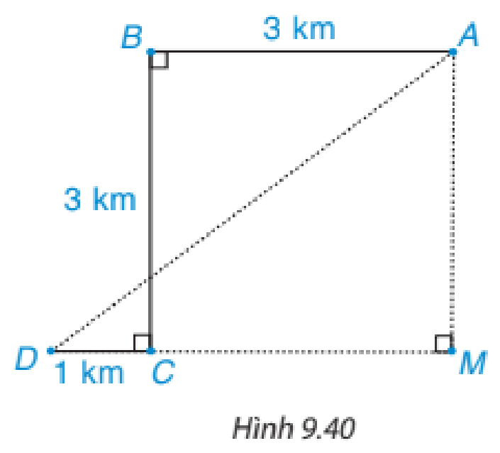
*Hình 9.40*

**Chứng minh tính chất hình học**

**Bài toán 2:** Một chiếc cột có chiều cao $h$ dựng thẳng đứng trên mặt đất tại điểm $M$, người ta kéo căng các sợi dây từ đỉnh cột (điểm $A$) lần lượt đến các điểm $C$ và $D$ trên mặt đất (H.9.41). Biết rằng $CM = c$, $DM = d$ và $c < d$. Hãy chứng minh rằng $a < b$.

**Giải.** (H.9.41)

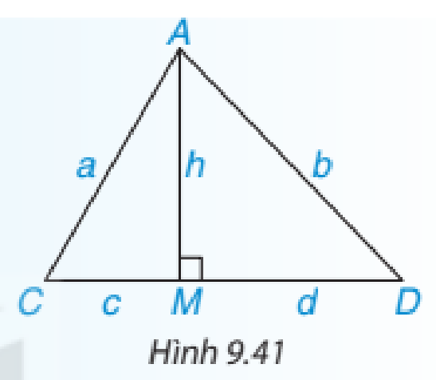
*Hình 9.41*

Áp dụng định lí Pythagore cho hai tam giác vuông $AMC$ và $AMD$, ta được:

$AC^2 = AM^2 + CM^2$, hay $a^2 = h^2 + c^2$ (1)

và $AD^2 = AM^2 + DM^2$, hay $b^2 = h^2 + d^2$ (2).

Vì $c < d$ nên từ (1) và (2) suy ra $a^2 < b^2$. Do đó $a < b$.

**Chú ý:** Trong Bài toán 2, nếu gọi $AM$ là đường cao, các đoạn thẳng $AC, AD$ là đường xiên thì đoạn thẳng $MC$ được gọi là **hình chiếu** của đường xiên $AC$ và đoạn thẳng $MD$ được gọi là hình chiếu của hình xiên $AD$.

> *Pi:* Với cùng một đường cao, hình chiếu càng lớn thì đường xiên càng lớn.

**Câu hỏi:** Cho Hình 9.42, trong các đoạn thẳng $AC, AD, AE$, đoạn nào có độ dài lớn nhất, đoạn nào có độ dài nhỏ nhất?

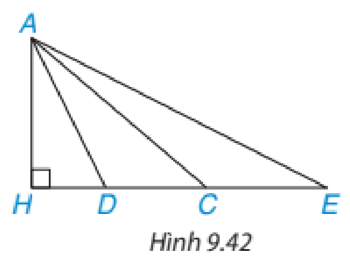
*Hình 9.42*

**Luyện tập 3:** Trước đây chúng ta thừa nhận định lí về trường hợp bằng nhau đặc biệt của hai tam giác vuông: “Nếu một cạnh góc vuông và cạnh huyền của tam giác vuông này bằng một cạnh góc vuông và cạnh huyền của tam giác vuông kia thì hai tam giác vuông đó bằng nhau”. Áp dụng định lí Pythagore, em hãy chứng minh định lí trên.

| GT | $\Delta ABC, \Delta A'B'C'$, $\widehat{A} = \widehat{A'} = 90^\circ$, $AB = A'B', BC = B'C'$. |
| --- | --- |
| KL | $\Delta ABC = \Delta A'B'C'$. |

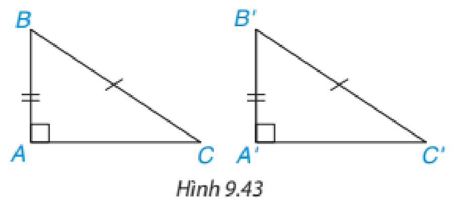
*Hình 9.43*

<!-- pdf:98 -->

**Thử thách nhỏ:**

Hãy tính chiều cao theo đơn vị centimét của một tam giác đều cạnh $2\text{ cm}$ (H.9.44) (làm tròn kết quả đến chữ số thập phân thứ hai).

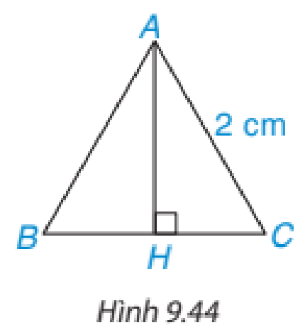
*Hình 9.44*

## BÀI TẬP

9.17. Cho tam giác $ABC$ vuông tại $A$. Trong các khẳng định sau đây, khẳng định nào đúng, khẳng định nào sai?

a) $AB^2 + BC^2 = AC^2$.

b) $BC^2 - AC^2 = AB^2$.

c) $AC^2 + BC^2 = AB^2$.

d) $BC^2 - AB^2 = AC^2$.

9.18. Những bộ ba số đo nào dưới đây là độ dài ba cạnh của một tam giác vuông?

a) $1\text{ cm}, 1\text{ cm}, 2\text{ cm}$.

b) $2\text{ cm}, 4\text{ cm}, 20\text{ cm}$.

c) $5\text{ cm}, 4\text{ cm}, 3\text{ cm}$.

d) $2\text{ cm}, 2\text{ cm}, 2\sqrt{2}\text{ cm}$.

9.19. Tính các độ dài $x, y, z, t$ trong Hình 9.45.

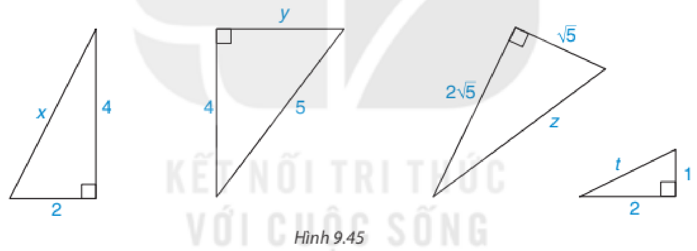
*Hình 9.45*

9.20. Cho tam giác $ABC$ cân tại đỉnh $A$, chiều cao $AH = 3\text{ cm}$ và cạnh đáy $BC = 10\text{ cm}$. Hãy tính độ dài các cạnh bên $AB, AC$.

9.21. Hãy tính diện tích của một hình chữ nhật có chiều rộng $8\text{ cm}$ và đường chéo dài $17\text{ cm}$.

9.22. Chú cún bị xích bởi một sợi dây dài $6\text{ m}$ để canh một mảnh vườn giới hạn bởi các điểm $A, B, E, F, D$ trong hình vuông $ABCD$ có cạnh $5\text{ m}$ như Hình 9.46. Đầu xích buộc cố định tại điểm $A$ của mảnh vườn. Hỏi chú cún có thể chạy đến tất cả các điểm của mảnh vườn mình phải canh không?

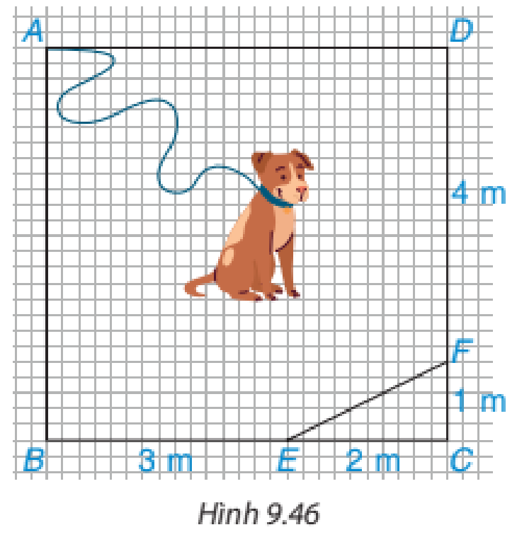
*Hình 9.46*

## 📷 Danh sách hình trong bài

| Mã hình | Trang PDF | Vị trí trong bài | Chú thích gốc |
| --- | :---: | --- | --- |
| H8-toan-b35-01 | 94 | Mở đầu | Hình 9.31 |
| H8-toan-b35-02 | 94 | Mục 1, HĐ1 | Hình 9.32 |
| H8-toan-b35-03 | 94 | Mục 1, HĐ2 | Hình 9.33 |
| H8-toan-b35-04 | 95 | Mục 1, Chứng minh định lí (cạnh dưới khung chạm kí hiệu (1) của phần chứng minh bên dưới) | Hình 9.34 |
| H8-toan-b35-05 | 95 | Mục 1, Câu hỏi | Hình 9.35 |
| H8-toan-b35-06 | 96 | Mục 1, Luyện tập 1 | Hình 9.36 |
| H8-toan-b35-07 | 96 | Mục 1, Vận dụng 1 | Hình 9.37 |
| H8-toan-b35-08 | 96 | Mục 2, Bài toán 1 | Hình 9.38 |
| H8-toan-b35-09 | 96 | Mục 2, Luyện tập 2 | Hình 9.39 |
| H8-toan-b35-10 | 97 | Mục 2, Vận dụng 2 | Hình 9.40 |
| H8-toan-b35-11 | 97 | Mục 2, Bài toán 2 | Hình 9.41 |
| H8-toan-b35-12 | 97 | Mục 2, Câu hỏi | Hình 9.42 |
| H8-toan-b35-13 | 97 | Mục 2, Luyện tập 3 | Hình 9.43 |
| H8-toan-b35-14 | 98 | Mục 2, Thử thách nhỏ | Hình 9.44 |
| H8-toan-b35-15 | 98 | Bài 9.19 | Hình 9.45 |
| H8-toan-b35-16 | 98 | Bài 9.22 | Hình 9.46 |
