<!-- pdf:99 -->

# BÀI 36: CÁC TRƯỜNG HỢP ĐỒNG DẠNG CỦA HAI TAM GIÁC VUÔNG

## 🎯 Kiến thức, kĩ năng

- Giải thích các trường hợp đồng dạng của tam giác vuông.
- Giải quyết một số vấn đề thực tiễn gắn với việc vận dụng các tam giác vuông đồng dạng.

## 🔴 Mở đầu

Nam và Việt muốn đo chiều cao của cột cờ ở sân trường mà hai bạn không trèo lên được. Vào buổi chiều, Nam đo thấy bóng của cột cờ dài $6\text{ m}$ và bóng của Việt dài $70\text{ cm}$. Nam hỏi Việt cao bao nhiêu, Việt trả lời là cao $1,4\text{ m}$. Nam liền reo lên: “Tớ biết cột cờ cao bao nhiêu rồi đấy!”. Vậy cột cờ cao bao nhiêu và làm sao bạn Nam biết được?

Qua bài này, các em sẽ có câu trả lời cho câu hỏi trên.

## 1. ÁP DỤNG CÁC TRƯỜNG HỢP ĐỒNG DẠNG CỦA TAM GIÁC VÀO TAM GIÁC VUÔNG

Từ các trường hợp đồng dạng góc – góc và cạnh – góc – cạnh của hai tam giác trong bài trước, ta suy ra hai định lí sau:

<!-- term: Các trường hợp đồng dạng của hai tam giác vuông -->
<!-- term: Trường hợp đồng dạng góc nhọn của hai tam giác vuông -->
> **Định lí 1.** Nếu một góc nhọn của tam giác vuông này bằng một góc nhọn của tam giác vuông kia thì hai tam giác vuông đó đồng dạng với nhau.

<!-- term: Các trường hợp đồng dạng của hai tam giác vuông -->
<!-- term: Trường hợp đồng dạng hai cạnh góc vuông của hai tam giác vuông -->
> **Định lí 2.** Nếu hai cạnh góc vuông của tam giác vuông này tỉ lệ với hai cạnh góc vuông của tam giác vuông kia thì hai tam giác vuông đó đồng dạng với nhau.

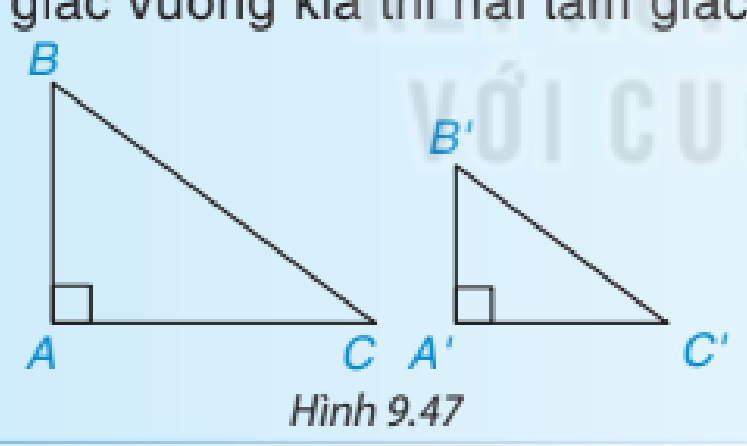
*Hình 9.47*

$\Delta ABC$ vuông tại $A$, $\Delta A'B'C'$ vuông tại $A'$.

- Nếu $\widehat{B'} = \widehat{B}$ thì $\Delta A'B'C' \backsim \Delta ABC$.
- Nếu $\dfrac{A'B'}{AB} = \dfrac{A'C'}{AC}$ thì $\Delta A'B'C' \backsim \Delta ABC$.

**?** Hãy chỉ ra hai cặp tam giác vuông đồng dạng trong Hình 9.48.

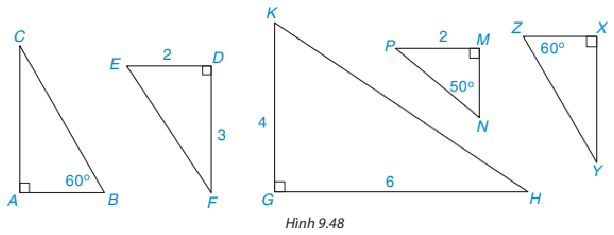
*Hình 9.48*

<!-- pdf:100 -->

**Ví dụ 1:** Cho tam giác $ABC$ có các đường cao $AD, BE, CF$ cắt nhau tại điểm $H$. Chứng minh rằng:
<!-- ocr-ok: đã đối chiếu ảnh trang PDF 100, các kí hiệu đường cao và điểm viết bằng LaTeX -->

a) $HA \cdot HD = HB \cdot HE = HC \cdot HF$;

b) $\Delta AEF \backsim \Delta ABC$.

**Giải.** (H.9.49)

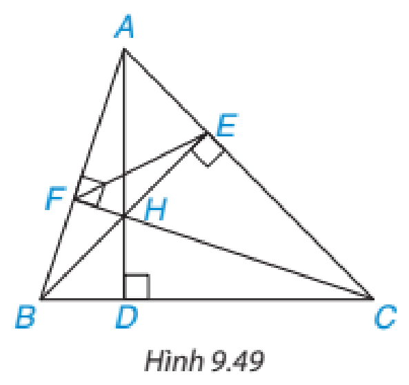
*Hình 9.49*

| GT | $\Delta ABC$, các đường cao $AD, BE, CF$ đồng quy tại $H$ |
| --- | --- |
| KL | a) $HA \cdot HD = HB \cdot HE = HC \cdot HF$; b) $\Delta AEF \backsim \Delta ABC$. |
<!-- ocr-ok: đã đối chiếu ảnh trang PDF 100, bảng GT/KL nhiều kí hiệu toán học -->

a) Hai tam giác vuông $AHF$ (vuông tại $F$) và $CHD$ (vuông tại $D$) có:
<!-- ocr-ok: đã đối chiếu ảnh trang PDF 100, các kí hiệu tam giác và đỉnh viết bằng LaTeX -->

$\widehat{AHF} = \widehat{CHD}$ (hai góc đối đỉnh).

Do đó $\Delta AHF \backsim \Delta CHD$. Suy ra $\dfrac{HA}{HC} = \dfrac{HF}{HD}$, hay $HA \cdot HD = HC \cdot HF$. (1)
<!-- ocr-ok: đã đối chiếu ảnh trang PDF 100, các kí hiệu đồng dạng và tỉ số viết bằng LaTeX -->

Tương tự, vì $\widehat{AHE} = \widehat{BHD}$ (hai góc đối đỉnh) nên hai tam giác vuông $AHE$ (vuông tại $E$) và $BHD$ (vuông tại $D$) đồng dạng với nhau.

Suy ra $\dfrac{HA}{HB} = \dfrac{HE}{HD}$ hay $HA \cdot HD = HB \cdot HE$. (2)

Từ (1) và (2) suy ra $HA \cdot HD = HB \cdot HE = HC \cdot HF$.

b) Hai tam giác vuông $ABE$ (vuông tại $E$) và $ACF$ (vuông tại $F$) có góc $\widehat{A}$ chung nên $\Delta ABE \backsim \Delta ACF$. Suy ra $\dfrac{AE}{AF} = \dfrac{AB}{AC}$, hay $\dfrac{AE}{AB} = \dfrac{AF}{AC}$.
<!-- ocr-ok: đã đối chiếu ảnh trang PDF 100, các kí hiệu tam giác và tỉ số viết bằng LaTeX -->

Hai tam giác $AEF$ và $ABC$ có: $\widehat{A}$ chung, $\dfrac{AE}{AB} = \dfrac{AF}{AC}$ (chứng minh trên).
<!-- ocr-ok: đã đối chiếu ảnh trang PDF 100, các kí hiệu tam giác và tỉ số viết bằng LaTeX -->

Vậy $\Delta AEF \backsim \Delta ABC$ (c.g.c).

**Luyện tập 1:** Trở lại *tình huống mở đầu*, ta thấy chiếc cột cùng với bóng của nó tạo thành hai cạnh góc vuông của tam giác $ABC$ vuông tại đỉnh $A$, bạn Việt và bóng của mình cũng được xem là hai cạnh góc vuông của tam giác $A'B'C'$ vuông tại đỉnh $A'$ (H.9.50). Vì các tia sáng Mặt Trời tạo với hai cái bóng các góc bằng nhau nên $\widehat{B} = \widehat{B'}$.

a) Hai tam giác vuông $ABC$ và $A'B'C'$ có đồng dạng với nhau không?

b) Bạn Nam đã tính chiều cao chiếc cột, tức là độ dài đoạn thẳng $AB$ như thế nào và kết quả là bao nhiêu?

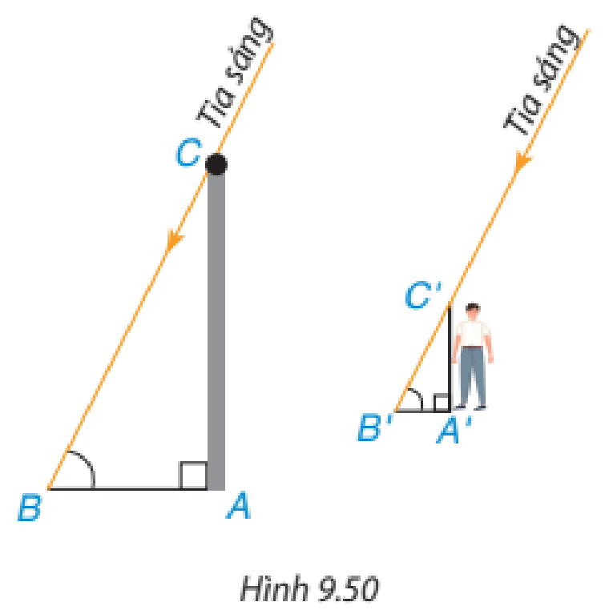
*Hình 9.50*

<!-- pdf:101 -->

**Thử thách nhỏ:**

Một người đo chiều cao của một cái cây bằng cách chôn một chiếc cọc xuống đất, cọc cao $2,4\text{ m}$ và cách vị trí gốc cây $19\text{ m}$. Người đó đứng cách xa chiếc cọc $1\text{ m}$ và nhìn thấy đỉnh cọc thẳng với đỉnh của cây. Hãy tính chiều cao của cây, biết rằng khoảng cách từ chân đến mắt người ấy là $1,6\text{ m}$ (H.9.51).

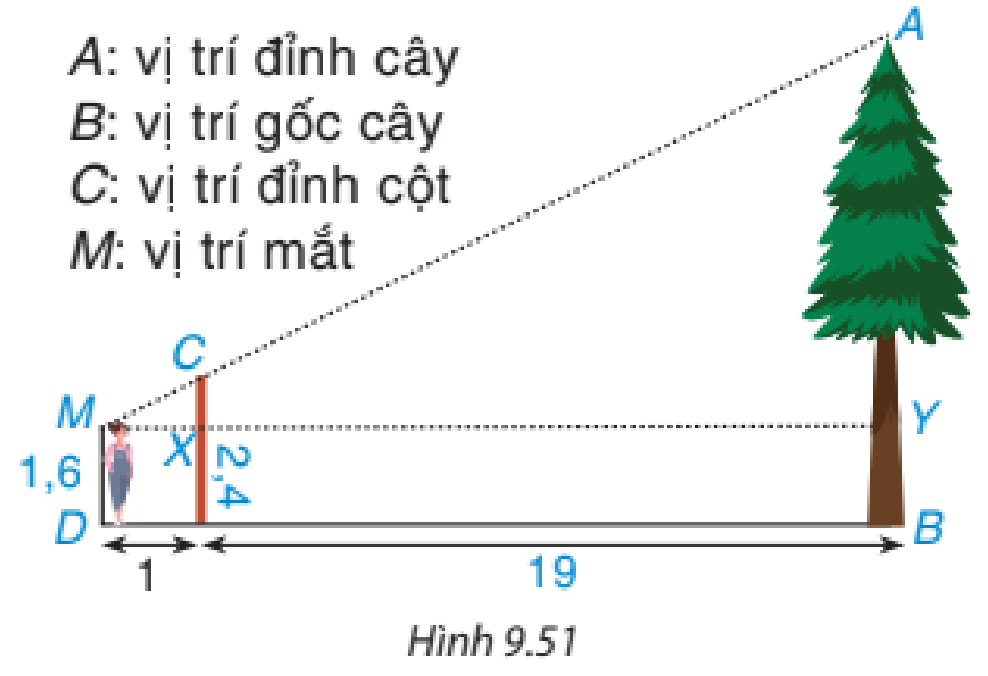
*Hình 9.51*

## 2. TRƯỜNG HỢP ĐỒNG DẠNG ĐẶC BIỆT CỦA HAI TAM GIÁC VUÔNG

**HĐ1:** Các tam giác vuông $AHB$ và $A'H'B'$ trong Hình 9.52 mô tả hai con dốc có chiều dài lần lượt là $AB = 13\text{ m}$, $A'B' = 7,5\text{ m}$ và độ cao lần lượt là $BH = 5\text{ m}$, $B'H' = 2,5\text{ m}$. Độ dốc của hai con dốc lần lượt được tính bởi số đo góc $HAB$ và $H'A'B'$.

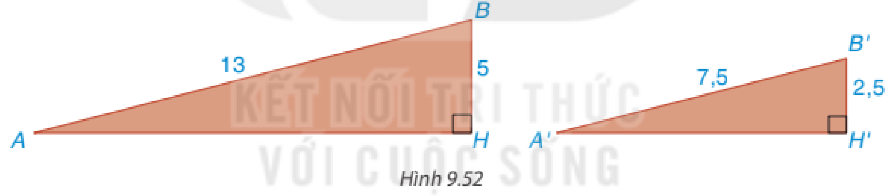
*Hình 9.52*

– Nhận xét về hai đại lượng $\dfrac{A'B'}{AB}$ và $\dfrac{B'H'}{BH}$.

– Dùng định lí Pythagore để tính $AH$ và $A'H'$.

– So sánh các đại lượng $\dfrac{A'H'}{AH}$ và $\dfrac{B'H'}{BH}$.

– Hai tam giác vuông $A'H'B'$ và $AHB$ có đồng dạng không? Từ đó rút ra kết luận gì về độ dốc của hai con dốc.

Tổng quát, ta có định lí sau:

<!-- term: Các trường hợp đồng dạng của hai tam giác vuông -->
<!-- term: Trường hợp đồng dạng đặc biệt của hai tam giác vuông -->
> **Định lí (trường hợp đồng dạng đặc biệt của hai tam giác vuông)**
>
> Nếu cạnh huyền và một cạnh góc vuông của tam giác vuông này tỉ lệ với cạnh huyền và một cạnh góc vuông của tam giác vuông kia thì hai tam giác vuông đó đồng dạng với nhau.

<!-- pdf:102 -->

**Chứng minh định lí** (H.9.53)

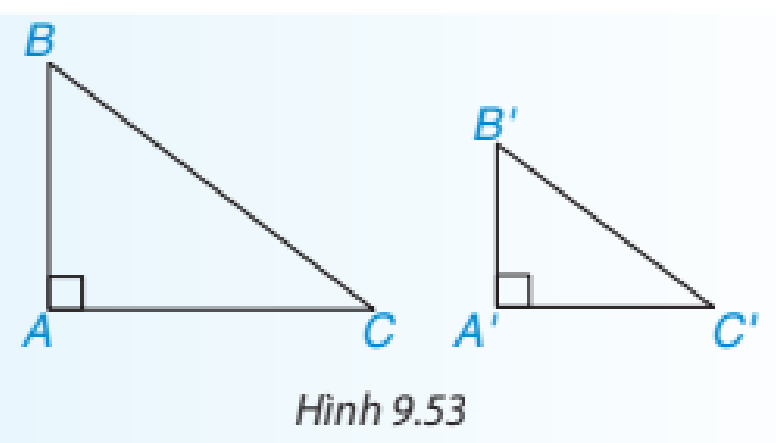
*Hình 9.53*

| GT | $\Delta ABC, \Delta A'B'C'$, $\widehat{A} = 90^\circ, \widehat{A'} = 90^\circ$, $\dfrac{B'C'}{BC} = \dfrac{A'B'}{AB}$. |
| --- | --- |
| KL | $\Delta A'B'C' \backsim \Delta ABC$. |

Áp dụng định lí Pythagore cho các tam giác vuông $A'B'C'$ và $ABC$, ta được:

$B'C'^2 = A'B'^2 + A'C'^2$; $BC^2 = AB^2 + AC^2$.

Suy ra $B'C'^2 - A'B'^2 = A'C'^2$ và $BC^2 - AB^2 = AC^2$. Vậy từ giả thiết $\dfrac{B'C'}{BC} = \dfrac{A'B'}{AB}$, ta có:
<!-- ocr-ok: đã đối chiếu ảnh trang PDF 102, OCR làm rớt cụm "Vậy từ giả thiết" -->

$\dfrac{B'C'^2}{BC^2} = \dfrac{A'B'^2}{AB^2} = \dfrac{B'C'^2 - A'B'^2}{BC^2 - AB^2} = \dfrac{A'C'^2}{AC^2}.$

Do đó $\dfrac{A'B'}{AB} = \dfrac{A'C'}{AC} = \dfrac{B'C'}{BC}$. Suy ra $\Delta A'B'C' \backsim \Delta ABC$ (c.c.c).

**?** Hãy chỉ ra các cặp tam giác vuông đồng dạng với nhau trong Hình 9.54, viết đúng kí hiệu đồng dạng.

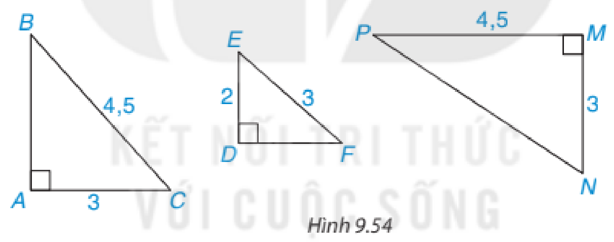
*Hình 9.54*

**Ví dụ 2:** Giả sử các chân đường cao $H, H'$ lần lượt hạ từ đỉnh $A$ và $A'$ của hai tam giác $ABC$ và $A'B'C'$ nằm trên các cạnh $BC, B'C'$ thoả mãn $\dfrac{A'B'}{AB} = \dfrac{A'H'}{AH} = \dfrac{A'C'}{AC}$. Chứng minh rằng $\Delta A'B'C' \backsim \Delta ABC$.
<!-- ocr-ok: đã đối chiếu ảnh trang PDF 102, các kí hiệu hình học viết bằng LaTeX -->

**Giải.** (H.9.55)

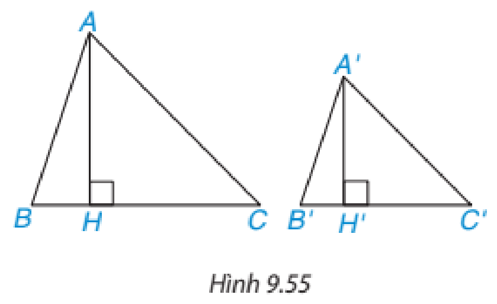
*Hình 9.55*

| GT | $\Delta A'B'C', \Delta ABC$, $H$ thuộc cạnh $BC$, $H'$ thuộc cạnh $B'C'$, $AH \perp BC$, $A'H' \perp B'C'$, $\dfrac{A'B'}{AB} = \dfrac{A'H'}{AH} = \dfrac{A'C'}{AC}$. |
| --- | --- |
| KL | $\Delta A'B'C' \backsim \Delta ABC$. |
<!-- ocr-ok: đã đối chiếu ảnh trang PDF 102, bảng GT/KL nhiều kí hiệu toán học -->

<!-- pdf:103 -->

Tam giác vuông $ABH$ (vuông tại $H$) và tam giác vuông $A'B'H'$ (vuông tại $H'$) có:
<!-- ocr-ok: đã đối chiếu ảnh trang PDF 103, các kí hiệu tam giác và đỉnh viết bằng LaTeX -->

$\dfrac{A'B'}{AB} = \dfrac{A'H'}{AH}$. Vậy $\Delta A'B'H' \backsim \Delta ABH$. Suy ra $\widehat{A'B'H'} = \widehat{ABH}$. (1)

Tam giác vuông $ACH$ (vuông tại $H$) và tam giác vuông $A'C'H'$ (vuông tại $H'$) có:
<!-- ocr-ok: đã đối chiếu ảnh trang PDF 103, các kí hiệu tam giác và đỉnh viết bằng LaTeX -->

$\dfrac{A'C'}{AC} = \dfrac{A'H'}{AH}$. Vậy $\Delta A'C'H' \backsim \Delta ACH$. Suy ra $\widehat{A'C'H'} = \widehat{ACH}$. (2)

Hai tam giác $ABC$ và $A'B'C'$ có:
<!-- ocr-ok: đã đối chiếu ảnh trang PDF 103, các kí hiệu tam giác viết bằng LaTeX -->

$\widehat{A'B'C'} = \widehat{ABC}$ (theo (1)), $\widehat{A'C'B'} = \widehat{ACB}$ (theo (2)).

Vậy $\Delta A'B'C' \backsim \Delta ABC$ (g.g).

**Nhận xét:** Ngược lại, nếu $\Delta A'B'C' \backsim \Delta ABC$ theo tỉ số $k$ và $AH, A'H'$ lần lượt là các đường cao của $\Delta ABC$ và $\Delta A'B'C'$ thì $\Delta A'B'H' \backsim \Delta ABH$ (do $\widehat{B} = \widehat{B'}$) theo tỉ số $k$ và $\dfrac{A'H'}{AH} = k$.
<!-- ocr-ok: đã đối chiếu ảnh trang PDF 103, các kí hiệu đồng dạng và tỉ số viết bằng LaTeX -->

**Luyện tập 2:** Một ngôi nhà với hai mái lệch $AB, CD$ được thiết kế như Hình 9.56 sao cho $CD = 6\text{ m}$, $AB = 4\text{ m}$, $HA = 2\text{ m}$, $AC = 1\text{ m}$. Chứng tỏ rằng $\widehat{ABD} = \widehat{CDB}$.

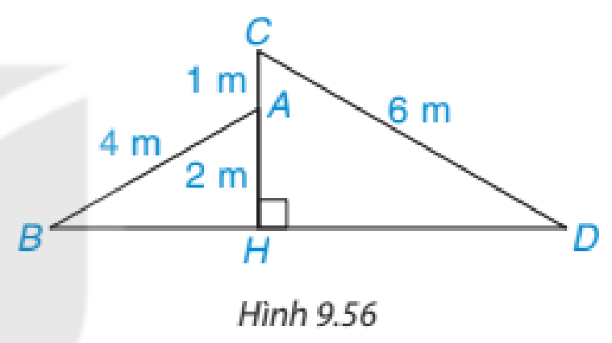
*Hình 9.56*

**Vận dụng:** Thường ngày đến công trường, bác Hoan dùng một chiếc thang lớn dựng lên một bức tường cao $6\text{ m}$. Khi đặt chân thang cách chân tường $1,5\text{ m}$ thì vừa dựng thang lên đúng mặt trên bức tường. Hôm nay, bác Hoan chỉ có một chiếc thang nhỏ dài bằng $\dfrac{2}{3}$ chiếc thang lớn. Để đảm bảo an toàn, bác đặt chân thang cách chân tường $1\text{ m}$ (H.9.57). Hỏi khi dựng chiếc thang nhỏ lên thì điểm cao nhất của thang cách mặt trên bức tường bao nhiêu mét?

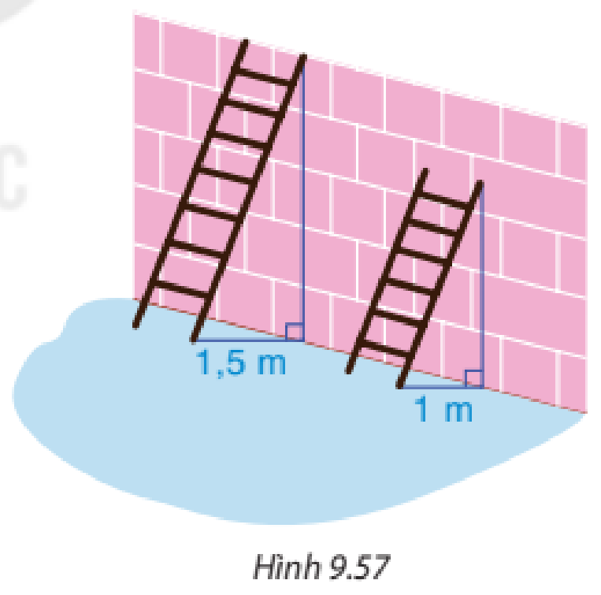
*Hình 9.57*

## BÀI TẬP

9.23. Điều kiện nào dưới đây chứng tỏ rằng hai tam giác vuông đồng dạng?

a) Một góc nhọn của tam giác này bằng một góc nhọn của tam giác kia.

b) Cạnh góc vuông và cạnh huyền của tam giác này tỉ lệ với cạnh góc vuông và cạnh huyền của tam giác kia.

c) Một cạnh góc vuông của tam giác này bằng một cạnh góc vuông của tam giác kia.

d) Hai cạnh góc vuông của tam giác này tỉ lệ với hai cạnh góc vuông của tam giác kia.

<!-- pdf:104 -->

9.24. Cặp tam giác vuông nào đồng dạng với nhau trong Hình 9.58?

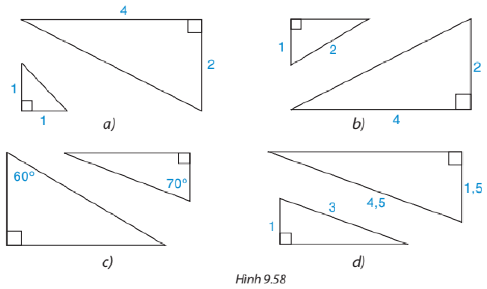
*Hình 9.58*

9.25. Cho góc nhọn $xOy$, các điểm $A, N$ nằm trên tia $Ox$, các điểm $B, M$ nằm trên tia $Oy$ sao cho $AM, BN$ lần lượt vuông góc với $Oy, Ox$. Chứng minh rằng tam giác $OAM$ đồng dạng với tam giác $OBN$.

9.26. Cho hai hình chữ nhật $ABCD$ và $A'B'C'D'$ thoả mãn $AC = 3AB$, $B'D' = 3A'B'$.

a) Chứng minh rằng tam giác $ABC$ đồng dạng với tam giác $A'B'C'$.

b) Nếu $A'B' = 2AB$ và diện tích hình chữ nhật $ABCD$ là $2\text{ m}^2$ thì diện tích hình chữ nhật $A'B'C'D'$ là bao nhiêu?

9.27. Cho tam giác $A'B'C'$ đồng dạng với tam giác $ABC$ theo tỉ số $k$. Gọi $A'H'$ và $AH$ lần lượt là các đường cao đỉnh $A'$ và $A$ của tam giác $A'B'C'$ và tam giác $ABC$. Chứng minh rằng:
<!-- ocr-ok: đã đối chiếu ảnh trang PDF 104, OCR đọc nhầm "Chứng" thành "Chúng" -->

a) $\dfrac{A'H'}{AH} = k$;

b) Diện tích tam giác $A'B'C'$ bằng $k^2$ lần diện tích tam giác $ABC$.

9.28. Một người ở vị trí điểm $A$ muốn đo khoảng cách đến điểm $B$ ở bên kia sông mà không thể qua sông được. Sử dụng giác kế, người đó xác định được một điểm $M$ trên bờ sông sao cho $AM = 2\text{ m}$, $AM$ vuông góc với $AB$ và đo được số đo góc $AMB$. Tiếp theo, người đó vẽ trên giấy tam giác $A'M'B'$ vuông tại $A'$, có $A'M' = 1\text{ cm}$, $\widehat{A'M'B'} = \widehat{AMB}$ và đo được $A'B' = 5\text{ cm}$ (H.9.59). Hỏi khoảng cách từ $A$ đến $B$ là bao nhiêu mét?

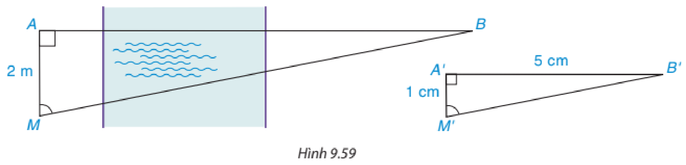
*Hình 9.59*

## 📷 Danh sách hình trong bài

| Mã hình | Trang PDF | Vị trí trong bài | Chú thích gốc |
| --- | :---: | --- | --- |
| H8-toan-b36-01 | 99 | Mục 1, Định lí 1 và Định lí 2 (đỉnh B của Hình 9.47 nằm sát ngay dưới dòng chữ trong khung Định lí 2) | Hình 9.47 |
| H8-toan-b36-02 | 99 | Mục 1, Câu hỏi | Hình 9.48 |
| H8-toan-b36-03 | 100 | Mục 1, Ví dụ 1 | Hình 9.49 |
| H8-toan-b36-04 | 100 | Mục 1, Luyện tập 1 | Hình 9.50 |
| H8-toan-b36-05 | 101 | Mục 1, Thử thách nhỏ | Hình 9.51 |
| H8-toan-b36-06 | 101 | Mục 2, HĐ1 | Hình 9.52 |
| H8-toan-b36-07 | 102 | Mục 2, Chứng minh định lí | Hình 9.53 |
| H8-toan-b36-08 | 102 | Mục 2, Câu hỏi | Hình 9.54 |
| H8-toan-b36-09 | 102 | Mục 2, Ví dụ 2 | Hình 9.55 |
| H8-toan-b36-10 | 103 | Mục 2, Luyện tập 2 | Hình 9.56 |
| H8-toan-b36-11 | 103 | Mục 2, Vận dụng | Hình 9.57 |
| H8-toan-b36-12 | 104 | Bài 9.24 | Hình 9.58 |
| H8-toan-b36-13 | 104 | Bài 9.28 | Hình 9.59 |
