<!-- pdf:105 -->

# BÀI 37: HÌNH ĐỒNG DẠNG

## 🔤 Khái niệm, thuật ngữ

- Hình đồng dạng
- Hình đồng dạng phối cảnh

## 🎯 Kiến thức, kĩ năng

- Nhận biết hai hình đồng dạng.
- Nhận biết hai hình đồng dạng phối cảnh.
- Nhận biết được vẻ đẹp trong tự nhiên, nghệ thuật, kiến trúc, công nghệ chế tạo,... biểu hiện qua hình đồng dạng.

## 🔴 Mở đầu

Ta thấy rằng hai hình phẳng bằng nhau, tức là hai hình có thể chồng khít lên nhau, thì sẽ có hình dạng và kích thước giống nhau. Ngoài ra, còn có những hình có kích thước khác nhau nhưng vẫn có hình dạng giống nhau (ví dụ hình chụp những chú cá trong Hình 9.60). Trong các hình đơn giản đã được học, có những hình nào có tính chất đó? Bài này chúng ta sẽ tìm hiểu về những hình như vậy.

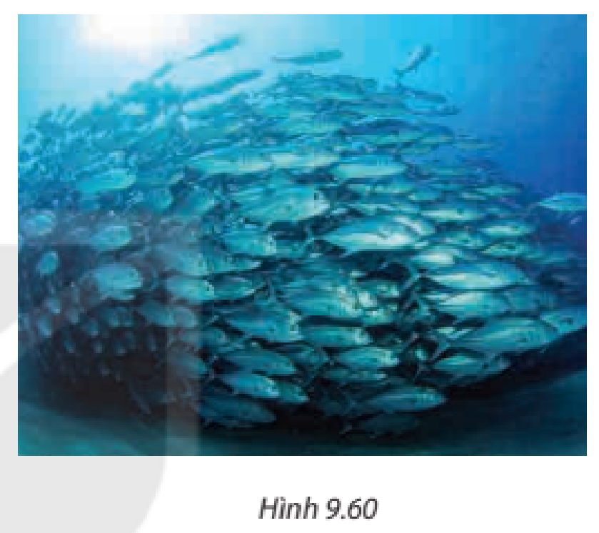
*Hình 9.60*

**Hình đồng dạng. Hình đồng dạng phối cảnh**

**HĐ1:** Lấy điểm $O$ và vẽ tam giác $A'B'C'$ như Hình 9.61. Trên các tia $OA', OB', OC'$, lấy các điểm $A, B, C$ sao cho $OA = 2OA'$, $OB = 2OB'$, $OC = 2OC'$.

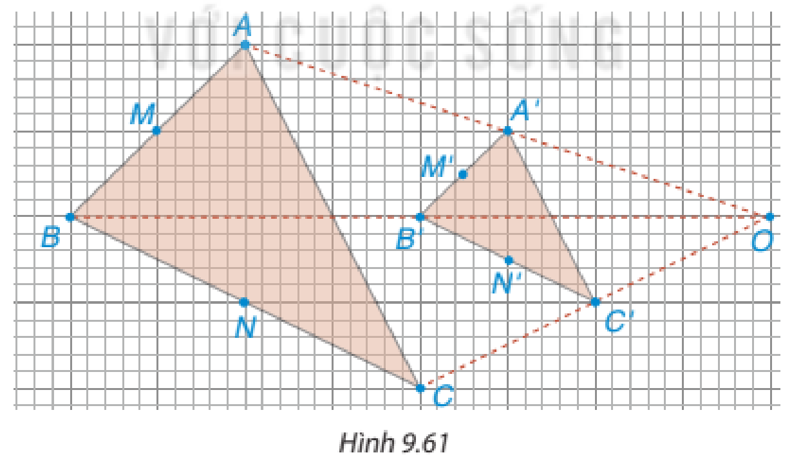
*Hình 9.61*

– Hãy giải thích vì sao $\Delta ABC \backsim \Delta A'B'C'$ với tỉ số đồng dạng bằng $2$.

– Dùng thước thẳng, em hãy kiểm tra xem đường thẳng $MM', NN'$ nối các trung điểm có đi qua $O$ không?

<!-- term: Cặp hình phóng to – thu nhỏ -->
Trong Hình 9.61, ta nói tam giác $ABC$ là hình phóng to ($2$ lần) của tam giác $A'B'C'$ và tam giác $A'B'C'$ là hình thu nhỏ ($2$ lần) của tam giác $ABC$.

<!-- pdf:106 -->

**HĐ2:** Hình 9.62 là hai bức hình chân dung của một cậu bé với kích thước $2 \times 3$ (hình $\mathcal{T}$) và $4 \times 6$ (hình $\mathcal{T}'$) được đặt cạnh nhau theo chiều thẳng đứng. Ta thấy các đường thẳng $AA', BB'$ nối các điểm tương ứng trên hai bức chân dung cùng đi qua một điểm $O$.

Dùng thước thẳng, em hãy kiểm tra xem một đường thẳng nối hai điểm tương ứng tuỳ ý trên hai hình (ví dụ $C$ và $C'$) có đi qua điểm $O$ không?

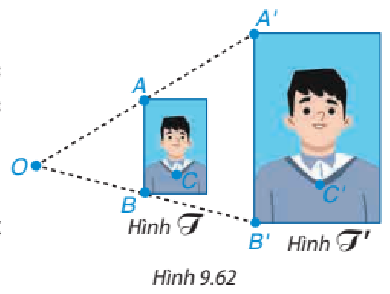
*Hình 9.62*

<!-- term: Cặp hình phóng to – thu nhỏ -->
Ta cũng nói hình $\mathcal{T}'$ là hình phóng to của hình $\mathcal{T}$ với tỉ số $6 : 3 = 2$, hình $\mathcal{T}$ là hình thu nhỏ của hình $\mathcal{T}'$ với tỉ số $3 : 6 = \dfrac{1}{2}$.

<!-- term: Tỉ số đồng dạng phối cảnh -->
> – Các cặp hình phóng to – thu nhỏ tương tự như trên được gọi là các **hình đồng dạng phối cảnh**. Điểm đồng quy $O$ trong mỗi hình được gọi là **tâm phối cảnh** của các cặp hình. Trong Hình 9.62, ta nói hình $\mathcal{T}'$ đồng dạng phối cảnh với hình $\mathcal{T}$ theo tỉ số đồng dạng $k = \dfrac{OA'}{OA} = 2$.

> – Trong cặp hình phóng to – thu nhỏ, nếu thay đổi vị trí của một hình đi thì chúng vẫn có hình dạng giống nhau (H.9.63). Khi đó chúng được gọi là **hình đồng dạng**. Cụ thể, *một hình $\mathcal{H}'$ được gọi là đồng dạng với hình $\mathcal{H}$ nếu nó bằng $\mathcal{H}$ hoặc bằng với một hình phóng to hay thu nhỏ của $\mathcal{H}$* (H.9.64).

> *Pi:* Hai hình đồng dạng có hình dạng giống nhau.

*Hình 9.63*

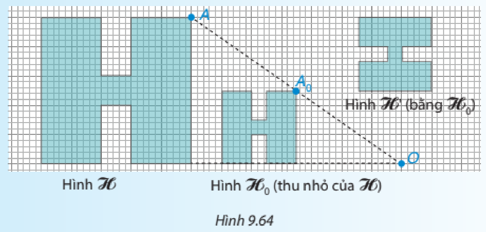
*Hình 9.64*

**Câu hỏi:** Theo em, hai hình tam giác bằng nhau có phải là hai hình đồng dạng phối cảnh không?

<!-- pdf:107 -->

**Ví dụ:**

- Trong các hình học đơn giản chúng ta đã học, những cặp hình dưới đây là cặp hình đồng dạng.

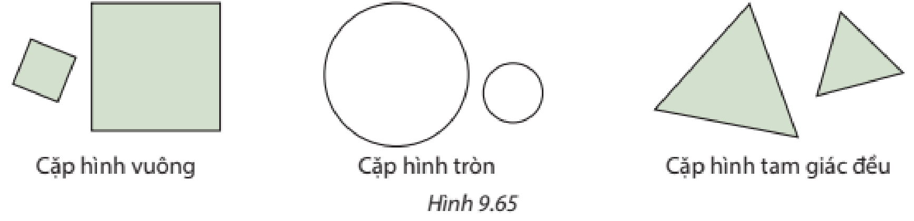
*Hình 9.65. Cặp hình vuông; Cặp hình tròn; Cặp hình tam giác đều*

- Những hình đồng dạng phối cảnh thường gặp:

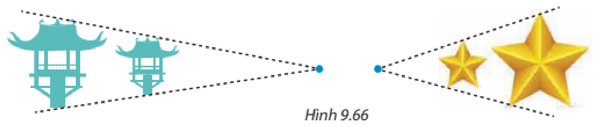
*Hình 9.66*

- Những hình đồng dạng trong thế giới tự nhiên:

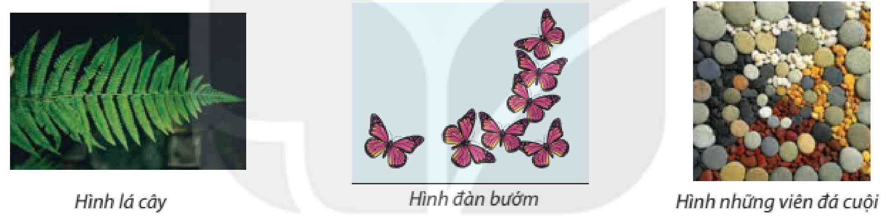
*Hình 9.67. Hình lá cây; Hình đàn bướm; Hình những viên đá cuội*

- Những hình đồng dạng sử dụng trong các công trình kiến trúc và trang trí:

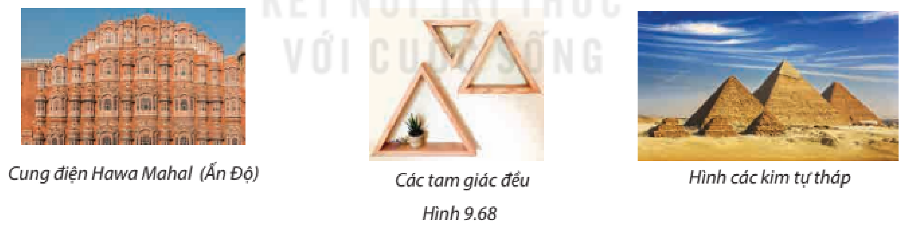
*Hình 9.68. Cung điện Hawa Mahal (Ấn Độ); Các tam giác đều; Hình các kim tự tháp*

- Những hình đồng dạng phối cảnh trong nghệ thuật và thiết kế:

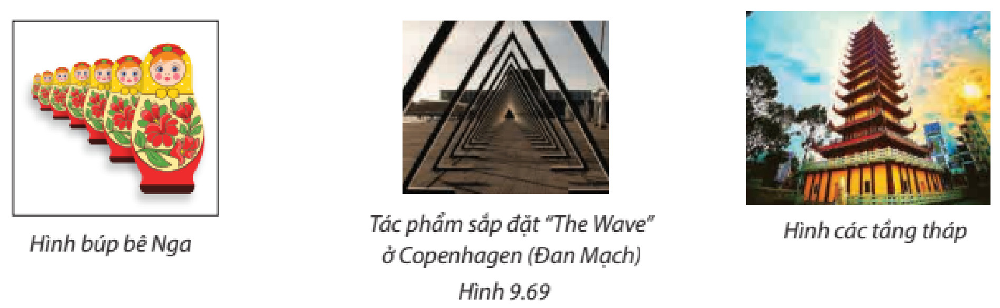
*Hình 9.69. Hình búp bê Nga; Tác phẩm sắp đặt “The Wave” ở Copenhagen (Đan Mạch); Hình các tầng tháp*

<!-- pdf:108 -->

**Luyện tập:** Trong những cặp hình dưới đây (H.9.70), cặp hình nào là hai hình đồng dạng? Hãy chỉ ra một cặp hình đồng dạng phối cảnh và vẽ cặp hình đó cùng tâm phối cảnh vào vở.

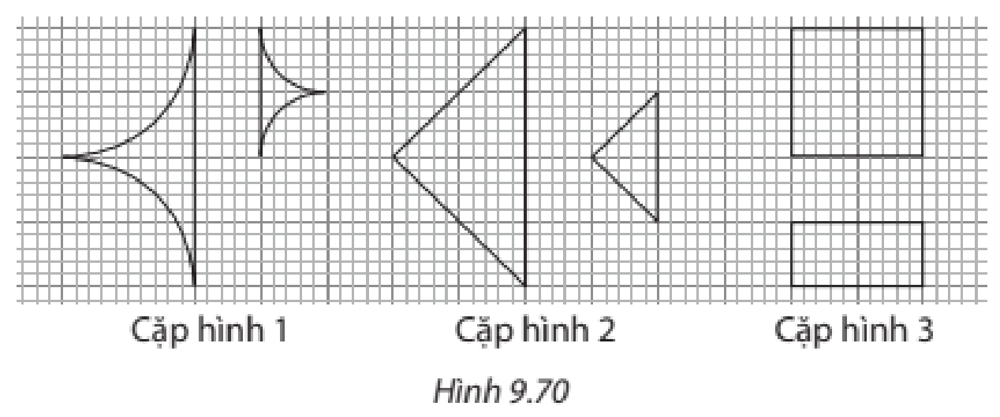
*Hình 9.70. Cặp hình 1; Cặp hình 2; Cặp hình 3*

**Tranh luận:**

> *Vuông:* Tớ nghĩ là hai hình vuông bất kì đều đồng dạng với nhau.
>
> *Tròn:* Tớ nghĩ hai hình tam giác đều bất kì đều đồng dạng phối cảnh với nhau.

Theo em, bạn nào đúng, bạn nào sai? Cho biết ý kiến của em.

## BÀI TẬP

9.29. Lấy một điểm $O$ nằm ngoài một đoạn thẳng $AB$. Hãy vẽ hình đồng dạng phối cảnh tâm $O$ của đoạn thẳng $AB$ theo tỉ số đồng dạng $\dfrac{1}{2}$.

9.30. Biết rằng mỗi hình dưới đây đồng dạng với một hình khác, hãy tìm các cặp hình đồng dạng đó.

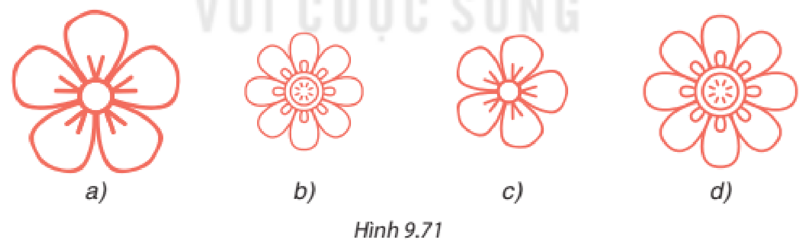
*Hình 9.71*

9.31. Trong các cặp hình đồng dạng dưới đây, cặp hình nào là đồng dạng phối cảnh?

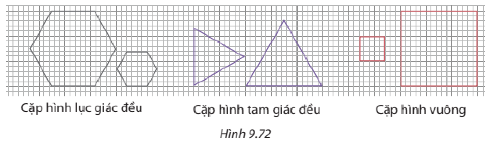
*Hình 9.72. Cặp hình lục giác đều; Cặp hình tam giác đều; Cặp hình vuông*

## 📷 Danh sách hình trong bài

| Mã hình | Trang PDF | Vị trí trong bài | Chú thích gốc |
| --- | :---: | --- | --- |
| H8-toan-b37-01 | 105 | Mở đầu | Hình 9.60 |
| H8-toan-b37-02 | 105 | HĐ1 | Hình 9.61 |
| H8-toan-b37-03 | 106 | HĐ2 | Hình 9.62 |
| H8-toan-b37-04 | 106 | Khung kiến thức hình đồng dạng | Hình 9.63 (Hai con bướm; Hai bông hoa) |
| H8-toan-b37-05 | 106 | Khung kiến thức hình đồng dạng | Hình 9.64 |
| H8-toan-b37-06 | 107 | Ví dụ | Hình 9.65 (Cặp hình vuông; Cặp hình tròn; Cặp hình tam giác đều) |
| H8-toan-b37-07 | 107 | Ví dụ | Hình 9.66 |
| H8-toan-b37-08 | 107 | Ví dụ | Hình 9.67 (Hình lá cây; Hình đàn bướm; Hình những viên đá cuội) |
| H8-toan-b37-09 | 107 | Ví dụ | Hình 9.68 (Cung điện Hawa Mahal (Ấn Độ); Các tam giác đều; Hình các kim tự tháp) |
| H8-toan-b37-10 | 107 | Ví dụ | Hình 9.69 (Hình búp bê Nga; Tác phẩm sắp đặt “The Wave” ở Copenhagen (Đan Mạch); Hình các tầng tháp) |
| H8-toan-b37-11 | 108 | Luyện tập | Hình 9.70 (Cặp hình 1; Cặp hình 2; Cặp hình 3) |
| H8-toan-b37-12 | 108 | Bài 9.30 | Hình 9.71 |
| H8-toan-b37-13 | 108 | Bài 9.31 | Hình 9.72 (Cặp hình lục giác đều; Cặp hình tam giác đều; Cặp hình vuông) |
