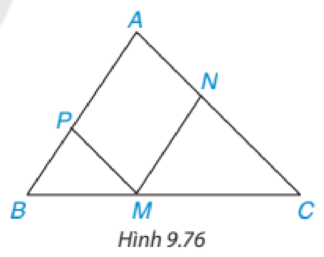
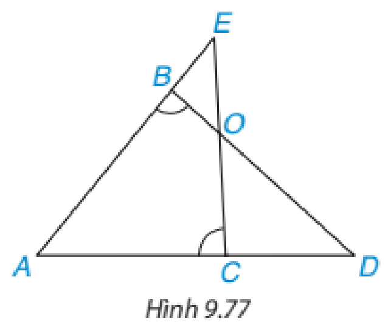
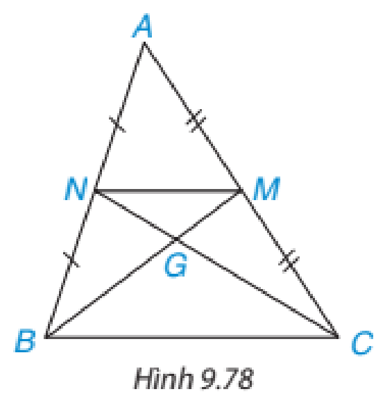
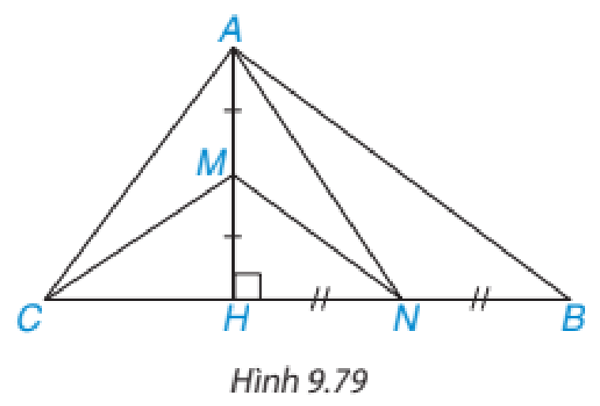
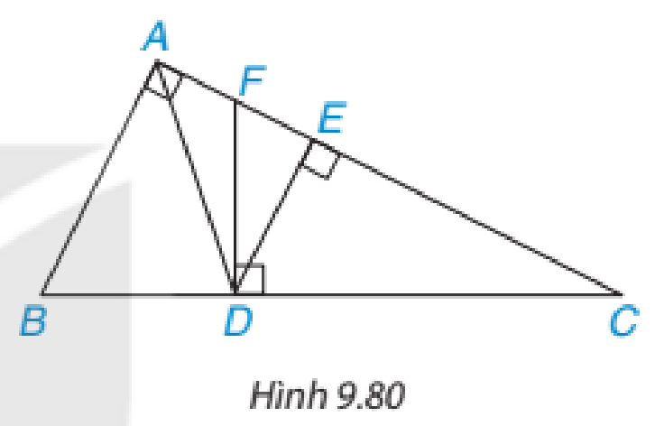

<!-- pdf:111 -->

# BÀI TẬP CUỐI CHƯƠNG IX

## ✏️ A. TRẮC NGHIỆM

9.37. Cho $ABC$ là tam giác không cân. Biết $\Delta A'B'C' \backsim \Delta ABC$. Khẳng định nào sau đây là đúng?

A. $\Delta A'C'B' \backsim \Delta ACB$.

B. $\Delta B'C'A' \backsim \Delta BAC$.

C. $\Delta B'A'C' \backsim \Delta BCA$.

D. $\Delta A'C'B' \backsim \Delta ABC$.

9.38. Cho $\Delta A'B'C' \backsim \Delta ABC$ với tỉ số đồng dạng bằng $2$. Khẳng định nào sau đây là đúng?

A. $\dfrac{AB}{A'B'} = 2$.

B. $\dfrac{AB}{A'C'} = 2$.

C. $\dfrac{A'B'}{AB} = 2$.

D. $\dfrac{A'B'}{AC} = 2$.

9.39. Trong các bộ ba số đo dưới đây, đâu là số đo ba cạnh của một tam giác vuông?

A. $3\text{ m}; 5\text{ m}; 6\text{ m}$.

B. $6\text{ m}; 8\text{ m}; 10\text{ m}$.

C. $1\text{ cm}; 0,5\text{ cm}; 1,25\text{ cm}$.

D. $9\text{ m}; 16\text{ m}; 25\text{ m}$.

9.40. Cho tam giác $ABC$ vuông tại $A$ ($AB \ne AC$) và tam giác $DEF$ vuông tại $D$ ($DE \ne DF$). Điều nào dưới đây **không** suy ra $\Delta ABC \backsim \Delta DEF$ ?

A. $\widehat{B} = \widehat{E}$.

B. $\widehat{C} = \widehat{F}$.

C. $\widehat{B} + \widehat{C} = \widehat{E} + \widehat{F}$.

D. $\widehat{B} - \widehat{C} = \widehat{E} - \widehat{F}$.

## ✏️ B. TỰ LUẬN

9.41. Cho Hình 9.76, biết rằng $MN \parallel AB$, $MP \parallel AC$. Hãy liệt kê ba cặp hai tam giác (khác nhau) đồng dạng có trong hình.

*Hình 9.76*

9.42. Cho Hình 9.77, biết rằng $\widehat{ABD} = \widehat{ACE}$. Chứng minh rằng $\Delta ABD \backsim \Delta ACE$ và $\Delta BOE \backsim \Delta COD$.

*Hình 9.77*

9.43. Hai đường trung tuyến $BM, CN$ của tam giác $ABC$ cắt nhau tại điểm $G$ (H.9.78). Chứng minh rằng tam giác $GMN$ đồng dạng với tam giác $GBC$ và tìm tỉ số đồng dạng.

*Hình 9.78*

<!-- pdf:112 -->

9.44. Cho tam giác $ABC$ vuông tại $A$ có $AB = 5\text{ cm}$, $AC = 4\text{ cm}$. Gọi $AH, HD$ lần lượt là các đường cao kẻ từ đỉnh $A$ của tam giác $ABC$ và đỉnh $H$ của tam giác $HAB$.

a) Chứng minh rằng $\Delta HDA \backsim \Delta AHC$.

b) Tính độ dài các đoạn thẳng $HA, HB, HC, HD$.

9.45. Cho tam giác $ABC$ có đường cao $AH$. Biết $AH = 12\text{ cm}$, $CH = 9\text{ cm}$, $BH = 16\text{ cm}$. Lấy $M, N$ lần lượt là trung điểm của $AH, BH$ (H.9.79).

a) Chứng minh rằng $ABC$ là tam giác vuông tại $A$.

b) Chứng minh rằng $MN \perp AC$ và $CM \perp AN$.

c) Tính diện tích tam giác $AMN$.

*Hình 9.79*

9.46. Cho tam giác $ABC$ vuông tại $A$ và các điểm $D, E, F$ như Hình 9.80 sao cho $AD$ là phân giác của góc $BAC$, $DE$ và $DF$ lần lượt vuông góc với $AC$ và $BC$. Chứng minh rằng:

a) $\dfrac{BD}{BC} = \dfrac{AB}{AB + AC}$, từ đó suy ra $AE = \dfrac{AB \cdot AC}{AB + AC}$;

b) $\Delta DFC \backsim \Delta ABC$;

c) $DF = DB$.

*Hình 9.80*

9.47. Để tính được chiều cao gần đúng của kim tự tháp Ai Cập, người ta cắm $1$ cây cọc cao $1\text{ m}$ vuông góc với mặt đất và đo được bóng cây cọc trên mặt đất là $1,5\text{ m}$. Khi đó chiều dài bóng của kim tự tháp trên mặt đất là $208,2\text{ m}$. Hỏi kim tự tháp cao bao nhiêu mét?

9.48. Một xe taxi xuất phát từ điểm $A$ để đón khách tại điểm $B$. Biết rằng đầu tiên người lái xe đi thẳng $3\text{ km}$, sau đó rẽ vuông góc sang bên phải và đi được một đoạn $3\text{ km}$ nữa thì rẽ vuông góc sang trái. Người lái xe đi thẳng tiếp $1\text{ km}$ nữa thì đến được điểm $B$. Hỏi khoảng cách giữa $A$ và $B$ bằng bao nhiêu?

9.49. Từ căn hộ chung cư nhà mình, bạn Lan đứng cách cửa sổ $1\text{ m}$ nhìn sang toà nhà đối diện thì vừa nhìn thấy đúng tất cả $6$ tầng của toà nhà đó. Biết rằng cửa sổ nhà Lan cao $80\text{ cm}$ và mỗi tầng của toà nhà đối diện cao $4\text{ m}$. Hỏi khoảng cách từ căn hộ nhà Lan đến toà nhà đối diện là bao nhiêu?

## 📷 Danh sách hình trong bài

| Mã hình | Trang PDF | Vị trí trong bài | Chú thích gốc |
| --- | :---: | --- | --- |
| H8-toan-bt-c09-01 | 111 | Bài 9.41 | Hình 9.76 |
| H8-toan-bt-c09-02 | 111 | Bài 9.42 | Hình 9.77 |
| H8-toan-bt-c09-03 | 111 | Bài 9.43 | Hình 9.78 |
| H8-toan-bt-c09-04 | 112 | Bài 9.45 | Hình 9.79 |
| H8-toan-bt-c09-05 | 112 | Bài 9.46 | Hình 9.80 |
