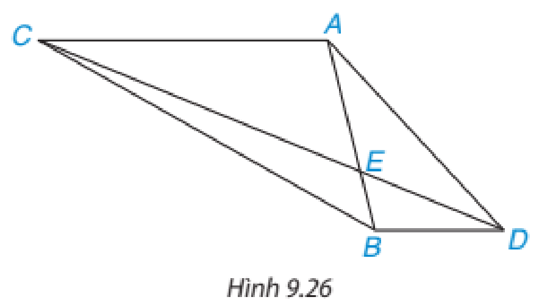
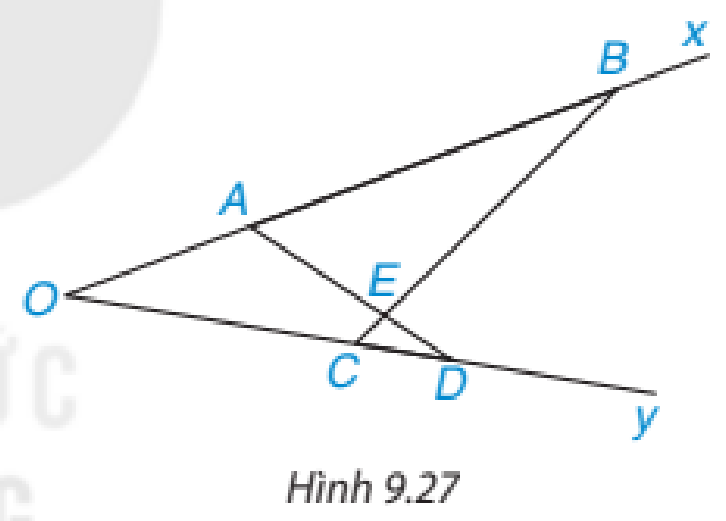
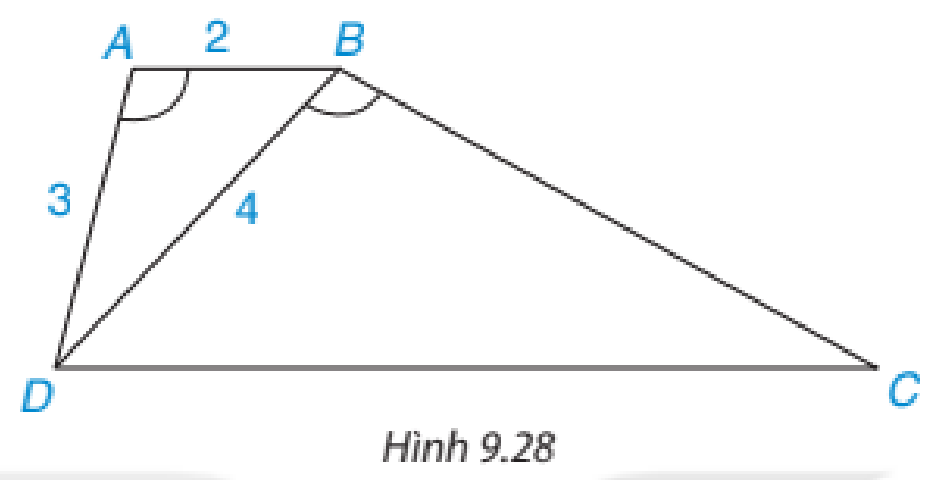
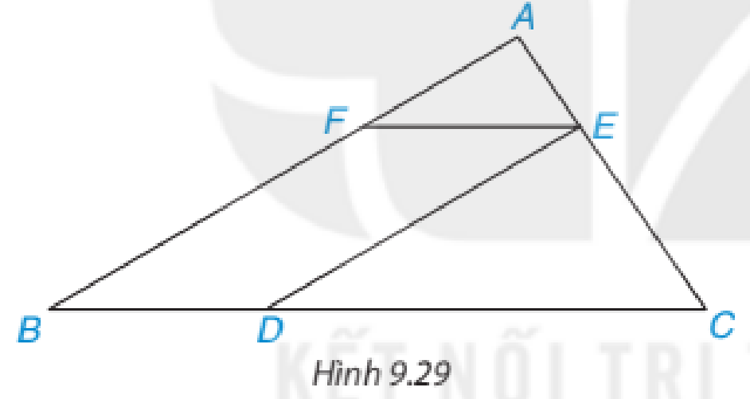
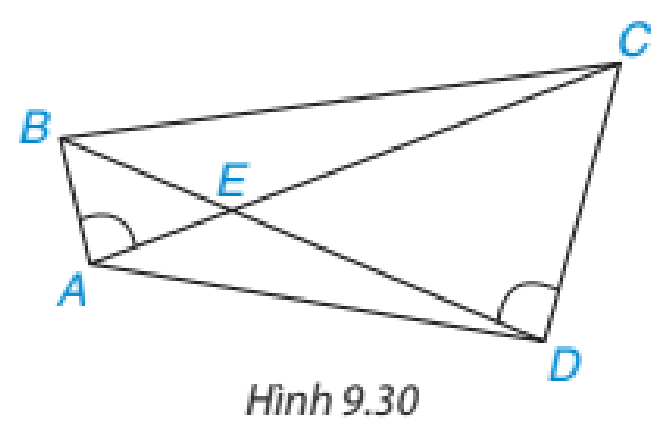

<!-- pdf:92 -->

# LUYỆN TẬP CHUNG (TRANG 91)

**Ví dụ 1:** Cho các điểm $A, B, C, D, E$ như Hình 9.26, biết rằng $AB = 6\text{ cm}$, $AC = 9\text{ cm}$, $AD = 8\text{ cm}$, $BC = 12\text{ cm}$, $BD = 4\text{ cm}$. Chứng minh rằng $\Delta ABC \backsim \Delta BDA$ và $\Delta BDE \backsim \Delta ACE$.
<!-- ocr-ok: đã đối chiếu ảnh trang PDF 92, các kí hiệu điểm và tam giác viết bằng LaTeX -->

*Hình 9.26*

**Giải:**

Hai tam giác $ABC$ và $BDA$ có: $\dfrac{AB}{BD} = \dfrac{AC}{BA} = \dfrac{BC}{DA} = \dfrac{3}{2}$.
<!-- ocr-ok: đã đối chiếu ảnh trang PDF 92, các kí hiệu tam giác và tỉ số viết bằng LaTeX -->

Vậy $\Delta ABC \backsim \Delta BDA$ (c.c.c). Từ đó suy ra $\widehat{CAB} = \widehat{ABD}$.

Do đó, $AC \parallel BD$ (có hai góc so le trong bằng nhau).

Vậy đường thẳng $AC$ song song với cạnh $BD$ của tam giác $BDE$ và cắt hai cạnh $BE, DE$ kéo dài lần lượt tại $A$ và $C$. Suy ra $\Delta BDE \backsim \Delta ACE$.

**Ví dụ 2:** Cho góc $xOy$, các điểm $A, B$ nằm trên tia $Ox$ và các điểm $C, D$ nằm trên tia $Oy$ như Hình 9.27, sao cho $OA = 2\text{ cm}$, $OB = 6\text{ cm}$, $OC = 3\text{ cm}$, $OD = 4\text{ cm}$. Biết $AD$ cắt $BC$ tại điểm $E$. Hãy tính tỉ số $\dfrac{BE}{DE}$.
<!-- ocr-ok: đã đối chiếu ảnh trang PDF 92, các kí hiệu góc, tia và đoạn thẳng viết bằng LaTeX -->

*Hình 9.27*

**Giải:**

| GT | Góc $xOy$; $A, B \in Ox$; $C, D \in Oy$; $OA = 2\text{ cm}$, $OB = 6\text{ cm}$, $OC = 3\text{ cm}$, $OD = 4\text{ cm}$; $AD$ cắt $BC$ tại $E$. |
| --- | --- |
| KL | Tính $\dfrac{BE}{DE}$. |
<!-- ocr-ok: đã đối chiếu ảnh trang PDF 92, bảng GT/KL nhiều kí hiệu toán học -->

Hai tam giác $OAD$ và $OCB$ có: $\widehat{O}$ chung, $\dfrac{OA}{OC} = \dfrac{OD}{OB} = \dfrac{2}{3}$.
<!-- ocr-ok: đã đối chiếu ảnh trang PDF 92, các kí hiệu tam giác và tỉ số viết bằng LaTeX -->

Vậy $\Delta OAD \backsim \Delta OCB$ (c.g.c). Suy ra $\widehat{ODA} = \widehat{OBC}$ (*).

Hai tam giác $AEB$ và $CED$ có:
<!-- ocr-ok: đã đối chiếu ảnh trang PDF 92, các kí hiệu tam giác viết bằng LaTeX -->

$\widehat{AEB} = \widehat{CED}$ (hai góc đối đỉnh), $\widehat{ABE} = \widehat{CDE}$ (theo (*)).

Vậy $\Delta AEB \backsim \Delta CED$ (g.g). Do đó $\dfrac{BE}{DE} = \dfrac{AB}{CD} = \dfrac{OB - OA}{OD - OC} = \dfrac{4}{1} = 4$.

<!-- pdf:93 -->

## BÀI TẬP

9.11. Cho $\Delta ABC \backsim \Delta DEF$. Biết $\widehat{A} = 60^\circ$, $\widehat{E} = 80^\circ$, hãy tính số đo các góc $\widehat{B}, \widehat{C}, \widehat{D}, \widehat{F}$.

9.12. Cho $\Delta ABC \backsim \Delta A'B'C'$. Biết $AB = 3\text{ cm}$, $A'B' = 6\text{ cm}$ và tam giác $ABC$ có chu vi bằng $10\text{ cm}$. Hãy tính chu vi tam giác $A'B'C'$.

9.13. Cho hình thang $ABCD$ ($AB \parallel CD$) có $\widehat{DAB} = \widehat{DBC}$ (H.9.28).

a) Chứng minh rằng $\Delta ABD \backsim \Delta BDC$.

b) Giả sử $AB = 2\text{ cm}$, $AD = 3\text{ cm}$, $BD = 4\text{ cm}$. Tính độ dài các cạnh $BC$ và $DC$.

*Hình 9.28*

9.14. Cho các điểm $A, B, C, D, E, F$ như Hình 9.29. Biết rằng $DE \parallel AB$, $EF \parallel BC$, $DE = 4\text{ cm}$, $AB = 6\text{ cm}$. Chứng minh rằng $\Delta AEF \backsim \Delta ECD$ và tính tỉ số đồng dạng.

*Hình 9.29*

9.15. Cho các điểm $A, B, C, D, E$ như Hình 9.30. Biết rằng $\widehat{BAC} = \widehat{CDB}$. Chứng minh rằng $\Delta AED \backsim \Delta BEC$.

*Hình 9.30*

9.16. Cho hình thang $ABCD$ ($AB \parallel CD$) và các điểm $M, N$ lần lượt trên cạnh $AD$ và $BC$ sao cho $2AM = MD$, $2BN = NC$. Biết $AB = 5\text{ cm}$, $CD = 6\text{ cm}$. Hãy tính độ dài đoạn thẳng $MN$.

## 📷 Danh sách hình trong bài

| Mã hình | Trang PDF | Vị trí trong bài | Chú thích gốc |
| --- | :---: | --- | --- |
| H8-toan-ltc-c09-01-01 | 92 | Ví dụ 1 | Hình 9.26 |
| H8-toan-ltc-c09-01-02 | 92 | Ví dụ 2 | Hình 9.27 |
| H8-toan-ltc-c09-01-03 | 93 | Bài 9.13 | Hình 9.28 |
| H8-toan-ltc-c09-01-04 | 93 | Bài 9.14 | Hình 9.29 |
| H8-toan-ltc-c09-01-05 | 93 | Bài 9.15 | Hình 9.30 |
