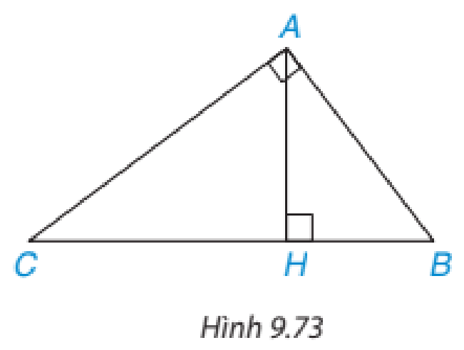
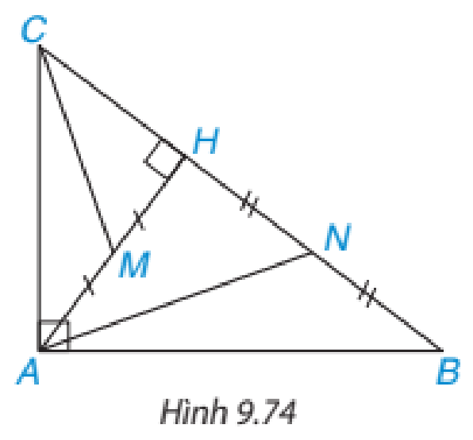
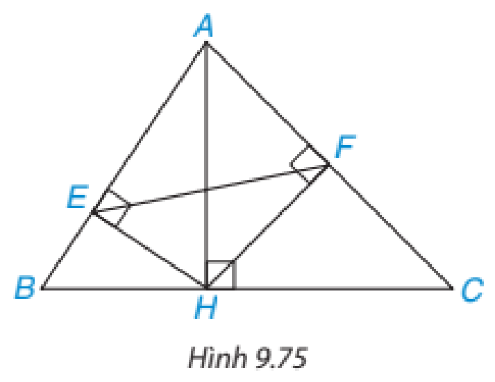

<!-- pdf:109 -->

# LUYỆN TẬP CHUNG (TRANG 108)

**Ví dụ 1:** Cho tam giác $ABC$ vuông tại $A$, đường cao $AH$, biết $AB = 5\text{ cm}$, $AH = 4\text{ cm}$.
<!-- ocr-ok: đã đối chiếu ảnh trang PDF 109, các kí hiệu hình học viết bằng LaTeX -->

a) Chứng minh $\Delta AHB \backsim \Delta CHA$.

b) Tính độ dài các đoạn thẳng $BH, CH, AC$.

**Giải.** (H.9.73)

*Hình 9.73*

| GT | $\Delta ABC$, $\widehat{A} = 90^\circ$, $AH$ vuông góc với $BC$ tại $H$, $AB = 5\text{ cm}$, $AH = 4\text{ cm}$. |
| --- | --- |
| KL | a) $\Delta AHB \backsim \Delta CHA$; b) Tính $BH, CH, AC$. |
<!-- ocr-ok: đã đối chiếu ảnh trang PDF 109, bảng GT/KL nhiều kí hiệu toán học -->

a) Xét tam giác $AHB$ vuông tại $H$ và tam giác $CHA$ vuông tại $H$, ta có:

$\widehat{ABH} = 90^\circ - \widehat{HAB} = \widehat{CAB} - \widehat{HAB} = \widehat{CAH}.$

Vậy $\Delta AHB \backsim \Delta CHA$ (cặp góc nhọn bằng nhau).

b) Áp dụng định lí Pythagore cho tam giác vuông $AHB$, ta có:

$BH^2 = AB^2 - AH^2 = 5^2 - 4^2 = 3^2.$

Suy ra $BH = 3\text{ cm}$.

Mặt khác, vì $\Delta AHB \backsim \Delta CHA$ nên $\dfrac{AH}{CH} = \dfrac{HB}{HA}$. Suy ra $CH = \dfrac{AH^2}{BH} = \dfrac{16}{3}\text{ (cm)}$.
<!-- ocr-ok: đã đối chiếu ảnh trang PDF 109, các kí hiệu đồng dạng và tỉ số viết bằng LaTeX -->

Đồng thời $\dfrac{AB}{AC} = \dfrac{AH}{CH}$. Do đó $AC = \dfrac{AB \cdot CH}{AH} = \dfrac{20}{3}\text{ (cm)}$.

**Ví dụ 2:** Cho tam giác $ABC$ có $AB = 4\text{ cm}$, $AC = 3\text{ cm}$, $BC = 5\text{ cm}$. Cho $AH$ là đường cao của tam giác $ABC$. Chứng minh rằng:

a) $AB^2 = BH \cdot BC$; $AC^2 = CH \cdot BC$;

b) $AH^2 = BH \cdot CH$;

c) Gọi $M, N$ lần lượt là trung điểm của $AH, BH$. Chứng minh rằng $\Delta ANB \backsim \Delta CMA$.

**Giải.** (H.9.74)

*Hình 9.74*

Từ giả thiết, ta thấy $BC^2 = AC^2 + AB^2 = 25$.

Theo định lí Pythagore đảo thì $ABC$ là tam giác vuông tại $A$.

a) Tam giác $AHB$ vuông tại $H$ và tam giác $CAB$ vuông tại $A$ có: góc $\widehat{B}$ chung nên $\Delta AHB \backsim \Delta CAB$ (một góc nhọn bằng nhau).

<!-- pdf:110 -->

Do đó $\dfrac{AB}{BC} = \dfrac{BH}{AB}$, hay $AB^2 = BH \cdot BC$. Tương tự $AC^2 = CH \cdot BC$.
<!-- ocr-ok: đã đối chiếu ảnh trang PDF 110, các tỉ số và hệ thức viết bằng LaTeX -->

b) Tam giác $AHB$ vuông tại $H$ và tam giác $CHA$ vuông tại $H$ có:
<!-- ocr-ok: đã đối chiếu ảnh trang PDF 110, các kí hiệu tam giác và đỉnh viết bằng LaTeX -->

$\widehat{ABH} = \widehat{ABC} = 90^\circ - \widehat{ACB} = 90^\circ - \widehat{ACH} = \widehat{CAH}.$

Vậy $\Delta AHB \backsim \Delta CHA$ (một góc nhọn bằng nhau). Do đó $\dfrac{AH}{CH} = \dfrac{HB}{HA}$, hay $AH^2 = BH \cdot CH$.

c) Vì $\Delta AHB \backsim \Delta CHA$ nên $\dfrac{HB}{AB} = \dfrac{HA}{CA}$ và $\widehat{HBA} = \widehat{HAC}$.

Hai tam giác $ANB$ và $CMA$ có: $\dfrac{NB}{AB} = \dfrac{HB}{2AB} = \dfrac{HA}{2CA} = \dfrac{AM}{CA}$, $\widehat{NBA} = \widehat{HBA} = \widehat{HAC} = \widehat{MAC}$.

Vậy $\Delta ANB \backsim \Delta CMA$ (c.g.c).

**Nhận xét:** Cho $\Delta ABC$ vuông tại $A$ có đường cao $AH$ với $BC = a$, $AC = b$, $AB = c$, $BH = b'$, $CH = c'$, $AH = h$. Theo chứng minh câu a và câu b của Ví dụ 2 ta suy ra $b^2 = ab'$; $c^2 = ac'$; $h^2 = b'c'$.

## BÀI TẬP

9.32. Cho tam giác $ABC$ vuông tại $A$ và có đường cao $AH$. Biết rằng $BH = 16\text{ cm}$, $CH = 9\text{ cm}$.

a) Tính độ dài đoạn thẳng $AH$.

b) Tính độ dài các đoạn thẳng $AB$ và $AC$.

9.33. Cho tam giác $ABC$ có $AB = 6\text{ cm}$, $AC = 8\text{ cm}$, $BC = 10\text{ cm}$. Cho điểm $M$ nằm trên cạnh $BC$ sao cho $BM = 4\text{ cm}$. Vẽ đường thẳng $MN$ vuông góc với $AC$ tại $N$ và đường thẳng $MP$ vuông góc với $AB$ tại $P$.
<!-- ocr-ok: đã đối chiếu ảnh trang PDF 110, các kí hiệu điểm và đoạn thẳng viết bằng LaTeX -->

a) Chứng minh rằng $\Delta BMP \backsim \Delta MCN$.

b) Tính độ dài đoạn thẳng $AM$.

9.34. Trong Hình 9.75, cho $AH, HE, HF$ lần lượt là các đường cao của các tam giác $ABC, AHB, AHC$. Chứng minh rằng:

a) $\Delta AEH \backsim \Delta AHB$;

b) $\Delta AFH \backsim \Delta AHC$;

c) $\Delta AFE \backsim \Delta ABC$.

*Hình 9.75*

9.35. Cho tam giác $ABC$ vuông tại $A$ có đường cao $AH$. Cho $M$ và $N$ lần lượt là trung điểm của $AB$ và $AC$. Chứng minh $\Delta HBM \backsim \Delta HAN$.

9.36. Vào gần buổi trưa, khi bóng bạn An dài $60\text{ cm}$ thì bóng cột cờ dài $3\text{ m}$.

a) Biết rằng bạn An cao $1,4\text{ m}$. Hỏi cột cờ cao bao nhiêu mét?

b) Vào buổi chiều khi bóng bạn An dài $3\text{ m}$, hỏi bóng cột cờ dài bao nhiêu mét?

## 📷 Danh sách hình trong bài

| Mã hình | Trang PDF | Vị trí trong bài | Chú thích gốc |
| --- | :---: | --- | --- |
| H8-toan-ltc-c09-02-01 | 109 | Ví dụ 1 | Hình 9.73 |
| H8-toan-ltc-c09-02-02 | 109 | Ví dụ 2 | Hình 9.74 |
| H8-toan-ltc-c09-02-03 | 110 | Bài 9.34 | Hình 9.75 |
