<!-- pdf:113 -->

# BÀI 38: HÌNH CHÓP TAM GIÁC ĐỀU

> *Giới thiệu Chương X — Một số hình khối trong thực tiễn (Hình học trực quan):*
>
> Những kim tự tháp tại Ai Cập, công trình kiến trúc tại bảo tàng Louvre (Pháp) hay những chiếc rubik,... có dạng hình chóp tứ giác đều, hình chóp tam giác đều,... Đây là những hình khối đẹp, có nhiều ứng dụng trong thực tế đời sống. Chương này chúng ta sẽ tìm hiểu một số vấn đề cơ bản về chúng và những bài toán liên quan.

## 🔤 Khái niệm, thuật ngữ

- Hình chóp tam giác đều

## 🎯 Kiến thức, kĩ năng

- Mô tả đỉnh, cạnh bên, mặt bên, mặt đáy của hình chóp tam giác đều.
- Tạo lập hình chóp tam giác đều.
- Tính diện tích xung quanh và thể tích của hình chóp tam giác đều.
- Giải quyết một số vấn đề thực tiễn gắn với việc tính thể tích, diện tích xung quanh của hình chóp tam giác đều.

## 🔴 Mở đầu

Đỉnh FANSIPAN (Lào Cai) cao $3\,143\text{ m}$, là đỉnh núi cao nhất Đông Dương. Trên đỉnh núi, người ta đặt một chóp làm bằng inox có dạng hình chóp tam giác đều cạnh đáy dài $60\text{ cm}$, chiều cao $90\text{ cm}$ (H.10.1). Hỏi tổng diện tích các mặt bên của hình chóp bằng bao nhiêu?

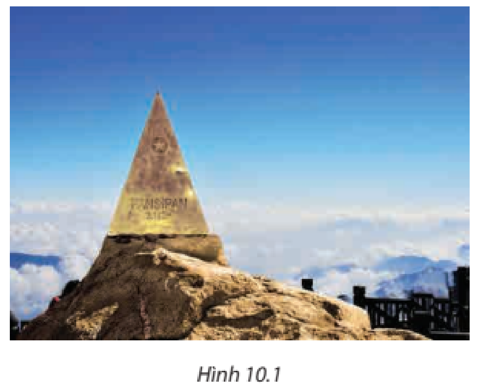
*Hình 10.1*

<!-- pdf:114 -->

## 1. HÌNH CHÓP TAM GIÁC ĐỀU

**Hình chóp tam giác đều**

<!-- term: Mặt đáy của hình chóp tam giác đều -->
<!-- term: Mặt bên của hình chóp tam giác đều -->
> - **Hình chóp tam giác đều** có đáy là một tam giác đều, các mặt bên là các tam giác cân bằng nhau chung một đỉnh. Đỉnh chung này được gọi là **đỉnh của hình chóp tam giác đều**.
> Trong Hình 10.2, $S.ABC$ là hình chóp tam giác đều.
> - Đoạn thẳng nối đỉnh của hình chóp và trọng tâm của tam giác đáy gọi là **đường cao của hình chóp tam giác đều**.
> - Đường cao vẽ từ đỉnh của mỗi mặt bên gọi là **trung đoạn của hình chóp tam giác đều**.

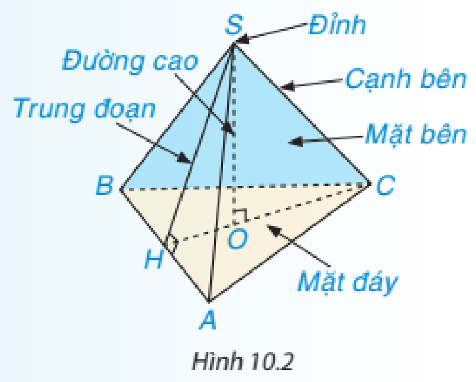
*Hình 10.2*

**?** Hãy gọi tên đỉnh, cạnh bên, mặt bên, mặt đáy, đường cao, trung đoạn của hình chóp tam giác đều $S.ABC$ trong Hình 10.2.

<!-- term: Mặt đáy của hình chóp tam giác đều -->
<!-- term: Mặt bên của hình chóp tam giác đều -->
**Nhận xét:** Hình chóp tam giác đều có:
– Đáy là tam giác đều;
– Mặt bên là các tam giác cân bằng nhau có chung đỉnh;
– Chân đường cao kẻ từ đỉnh tới mặt đáy là điểm cách đều các đỉnh của tam giác đáy.

**Thực hành:**

Sử dụng bìa cứng, cắt và gấp hình chóp tam giác đều với kích thước như Hình 10.3 theo hướng dẫn sau:

*Bước 1.* Vẽ hình khai triển của hình chóp tam giác đều theo kích thước đã cho như Hình 10.4.

*Bước 2.* Cắt theo viền.

*Bước 3.* Gấp theo các đường màu cam để được hình chóp tam giác đều (H.10.5).

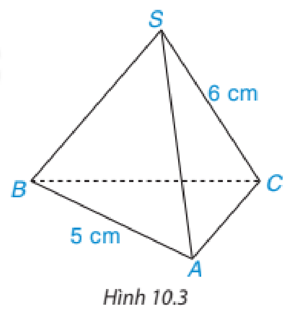
*Hình 10.3*

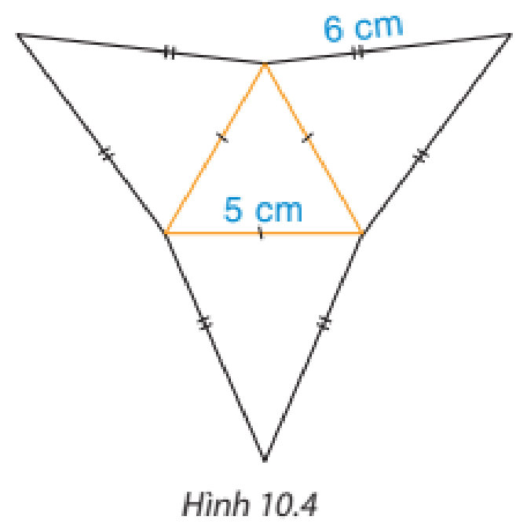
*Hình 10.4*

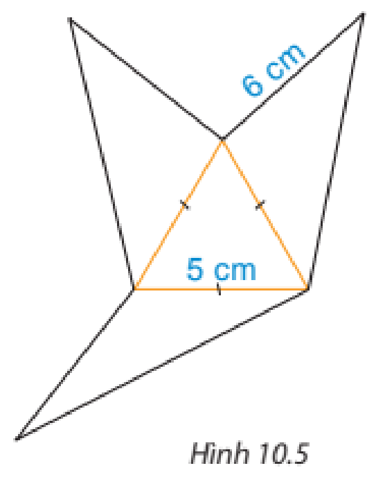
*Hình 10.5*

<!-- pdf:115 -->

## 2. DIỆN TÍCH XUNG QUANH VÀ THỂ TÍCH CỦA HÌNH CHÓP TAM GIÁC ĐỀU

**Diện tích xung quanh của hình chóp tam giác đều**

**HĐ1:** Quan sát hình chóp tam giác đều và hình khai triển của nó (H.10.6). Hãy tính tổng diện tích các mặt bên của hình chóp.

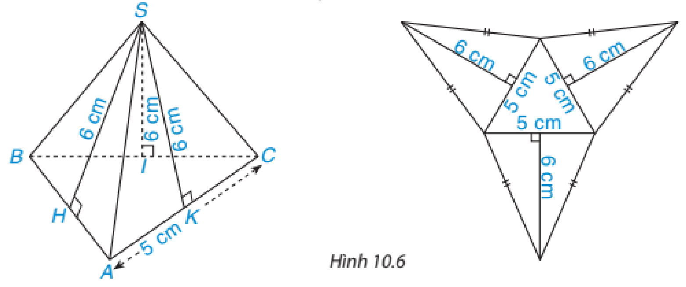
*Hình 10.6*

**HĐ2:** Hãy tính tích của nửa chu vi mặt đáy với trung đoạn của hình chóp tam giác đều. So sánh kết quả vừa tính với tổng diện tích các mặt bên của hình chóp.

<!-- term: Diện tích xung quanh và thể tích của hình chóp tam giác đều -->
> **Diện tích xung quanh của hình chóp tam giác đều** bằng tích của nửa chu vi đáy với trung đoạn.
> $S_{xq} = p \cdot d$, trong đó $p$: nửa chu vi đáy, $d$: trung đoạn.

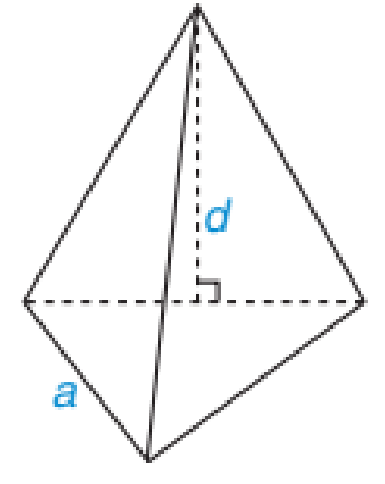

**Ví dụ 1:** Tính diện tích xung quanh của hình chóp tam giác đều $S.ABC$ trong Hình 10.7.

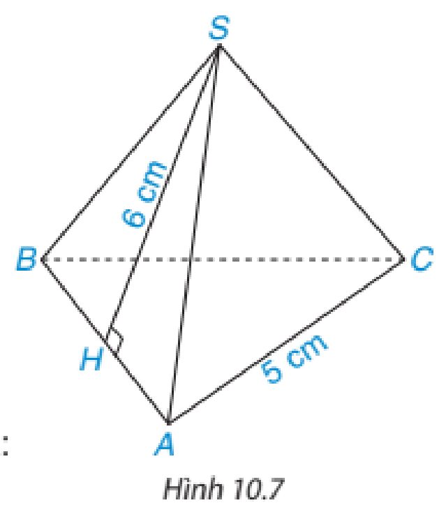
*Hình 10.7*

**Giải:**

Nửa chu vi đáy của hình chóp tam giác đều là:

$p = \dfrac{1}{2}(5 + 5 + 5) = \dfrac{15}{2}\text{ (cm)}$.

Trung đoạn của hình chóp tam giác đều là $d = SH = 6\text{ cm}$.

Diện tích xung quanh của hình chóp tam giác đều $S.ABC$ là:

$S_{xq} = \dfrac{15}{2} \cdot 6 = 45\text{ (cm}^2\text{)}$.

**Luyện tập:** Tính diện tích xung quanh của hình chóp tam giác đều $S.MNP$ trong Hình 10.8, biết $IP = 3\text{ cm}$ và cạnh bên $SP = 5\text{ cm}$.

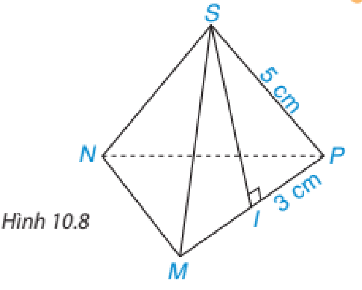
*Hình 10.8*

<!-- pdf:116 -->

**Thể tích của hình chóp tam giác đều**

Hai dụng cụ đựng nước có dạng hình lăng trụ đứng đáy là tam giác đều và hình chóp tam giác đều có thể đặt “chồng khít” lên nhau. Chiều cao của hình chóp tam giác đều bằng chiều cao của hình lăng trụ.

Nếu ta lấy dụng cụ hình chóp tam giác đều múc đầy nước và đổ hết vào dụng cụ hình lăng trụ đứng thì thấy chiều cao của cột nước chỉ bằng $\dfrac{1}{3}$ chiều cao của hình lăng trụ (H.10.9).

Như vậy: $V_{\text{chóp}} = \dfrac{1}{3}V_{\text{lăng trụ}} = \dfrac{1}{3}S \cdot h$.

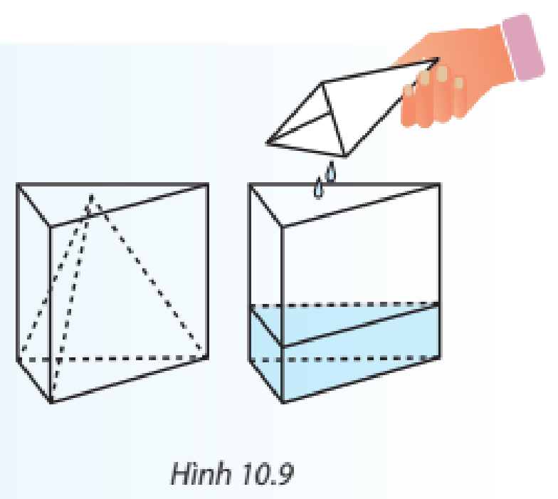
*Hình 10.9*

<!-- term: Diện tích xung quanh và thể tích của hình chóp tam giác đều -->
> **Thể tích hình chóp tam giác đều** bằng $\dfrac{1}{3}$ tích của diện tích mặt đáy với chiều cao của nó.
> $V = \dfrac{1}{3}S \cdot h$, trong đó $S$: diện tích đáy, $h$: chiều cao của hình chóp.

**Ví dụ 2:** Tính thể tích hình chóp tam giác đều $S.ABC$ trong Hình 10.10, biết cạnh đáy bằng $6\text{ cm}$, chiều cao của hình chóp $SO = 10\text{ cm}$. Cho biết $\sqrt{27} \approx 5,2$. (Làm tròn kết quả đến hàng phần mười).

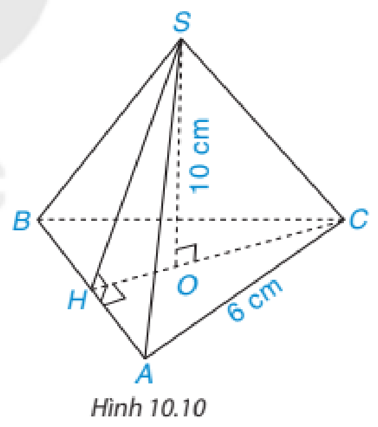
*Hình 10.10*

**Giải:**

Trong tam giác đều $ABC$ có $CH \perp AB$ nên $CH$ là trung tuyến của $\Delta ABC$.

Suy ra $BH = HA = \dfrac{1}{2}AB = 3\text{ (cm)}$.

Tam giác $AHC$ vuông tại $H$ nên $HA^2 + HC^2 = AC^2$ (định lí Pythagore).
<!-- ocr-ok: đã đối chiếu ảnh trang PDF 116, OCR đọc nhầm "AHC" thành "AHG" -->

Suy ra $3^2 + HC^2 = 6^2$

$HC^2 = 36 - 9$

$HC^2 = 27$

$HC = \sqrt{27} \approx 5,2$.

Diện tích tam giác $ABC$ là: $S = \dfrac{1}{2}AB \cdot CH \approx \dfrac{1}{2} \cdot 6 \cdot 5,2 = 15,6\text{ (cm}^2\text{)}$.

Thể tích của hình chóp tam giác đều $S.ABC$ là: $V = \dfrac{1}{3}S \cdot h \approx \dfrac{1}{3} \cdot 15,6 \cdot 10 = 52\text{ (cm}^3\text{)}$.

<!-- pdf:117 -->

**Vận dụng:** Hình 10.11 mô tả hình chóp trong *tình huống mở đầu*. Dựa vào đó, em hãy trả lời câu hỏi của bài toán.

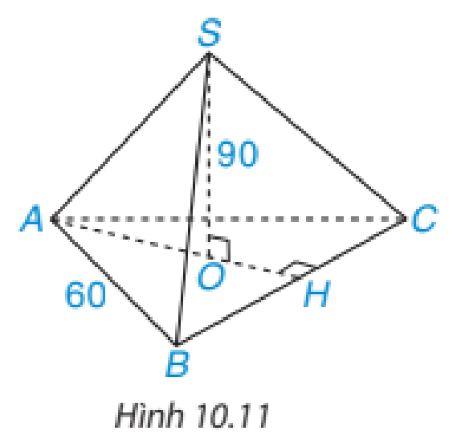
*Hình 10.11*

## BÀI TẬP

10.1. Gọi tên đỉnh, cạnh bên, mặt bên, mặt đáy, đường cao và một trung đoạn của hình chóp tam giác đều trong Hình 10.12.

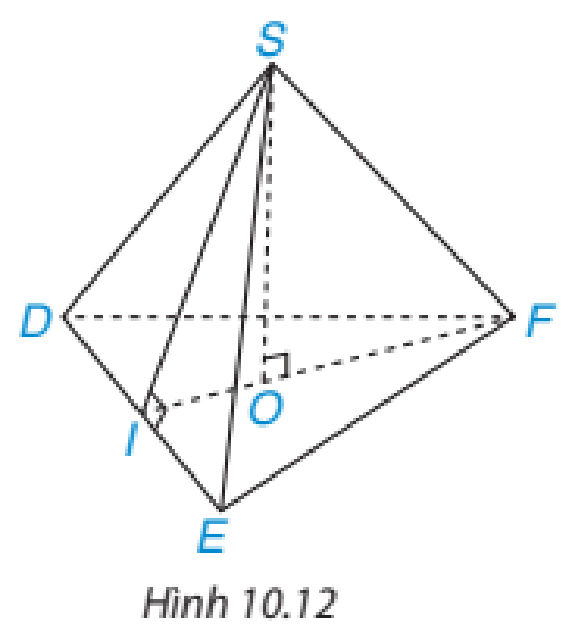
*Hình 10.12*

10.2. Vẽ và cắt một tam giác đều có cạnh $10\text{ cm}$ (H.10.13) rồi gấp theo đường màu cam để được hình chóp tam giác đều (H.10.14).

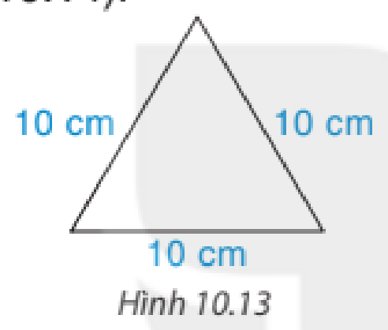
*Hình 10.13*

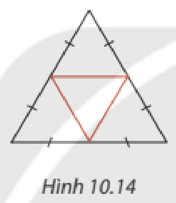
*Hình 10.14*

*Trong các bài tập 10.3, 10.4, hãy làm tròn kết quả đến hàng phần mười.*

10.3. Cho hình chóp tam giác đều $S.MNP$ như Hình 10.15.

a) Tính diện tích tam giác $MNP$.

b) Tính thể tích hình chóp $S.MNP$, biết $\sqrt{27} \approx 5,19$.

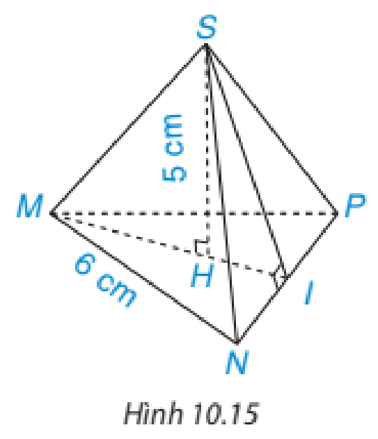
*Hình 10.15*

10.4. Nhà bạn Thu có một đèn trang trí có dạng hình chóp tam giác đều như Hình 10.16. Các cạnh của hình chóp đều bằng nhau và bằng $20\text{ cm}$. Bạn Thu dự định sẽ dán các mặt bên của đèn bằng những tấm giấy màu. Tính diện tích giấy bạn Thu sử dụng (coi như mép dán không đáng kể). Cho biết $\sqrt{300} \approx 17,32$.

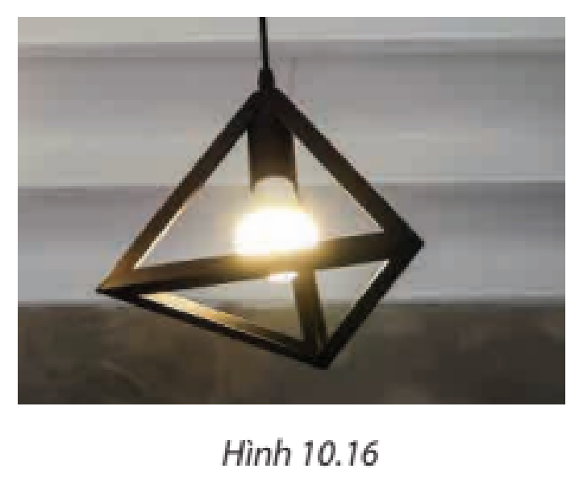
*Hình 10.16*

## 📷 Danh sách hình trong bài

| Mã hình | Trang PDF | Vị trí trong bài | Chú thích gốc |
| --- | :---: | --- | --- |
| H8-toan-b38-01 | 113 | Mở đầu | Hình 10.1 |
| H8-toan-b38-02 | 114 | Mục 1, Khung kiến thức hình chóp tam giác đều | Hình 10.2 |
| H8-toan-b38-03 | 114 | Mục 1, Thực hành | Hình 10.3 |
| H8-toan-b38-04 | 114 | Mục 1, Thực hành | Hình 10.4 |
| H8-toan-b38-05 | 114 | Mục 1, Thực hành | Hình 10.5 |
| H8-toan-b38-06 | 115 | Mục 2, HĐ1 | Hình 10.6 |
| H8-toan-b38-07 | 115 | Mục 2, Khung công thức diện tích xung quanh | (sách không đánh số, hình chóp tam giác đều cạnh đáy $a$, trung đoạn $d$) |
| H8-toan-b38-08 | 115 | Mục 2, Ví dụ 1 | Hình 10.7 |
| H8-toan-b38-09 | 115 | Mục 2, Luyện tập (đỉnh S nằm sát đường viền chấm cam của Ví dụ 1 phía trên) | Hình 10.8 |
| H8-toan-b38-10 | 116 | Mục 2, Thể tích của hình chóp tam giác đều | Hình 10.9 |
| H8-toan-b38-11 | 116 | Mục 2, Ví dụ 2 | Hình 10.10 |
| H8-toan-b38-12 | 117 | Mục 2, Vận dụng | Hình 10.11 |
| H8-toan-b38-13 | 117 | Bài 10.1 | Hình 10.12 |
| H8-toan-b38-14 | 117 | Bài 10.2 (góc trên trái khung nằm sát chữ '(H.10.14).' của đề bài 10.2) | Hình 10.13 |
| H8-toan-b38-15 | 117 | Bài 10.2 | Hình 10.14 |
| H8-toan-b38-16 | 117 | Bài 10.3 | Hình 10.15 |
| H8-toan-b38-17 | 117 | Bài 10.4 | Hình 10.16 |
