<!-- pdf:118 -->

# BÀI 39: HÌNH CHÓP TỨ GIÁC ĐỀU

## 🔤 Khái niệm, thuật ngữ

- Hình chóp tứ giác đều

## 🎯 Kiến thức, kĩ năng

- Mô tả đỉnh, mặt đáy, mặt bên, cạnh bên của hình chóp tứ giác đều.
- Tạo lập hình chóp tứ giác đều.
- Tính diện tích xung quanh và thể tích của hình chóp tứ giác đều.
- Giải quyết một số vấn đề thực tiễn gắn với việc tính thể tích, diện tích xung quanh của hình chóp tứ giác đều.

## 🔴 Mở đầu

Kim tự tháp Kheops ở Ai Cập được xây dựng vào khoảng $2\,500$ năm trước Công nguyên là một trong những công trình cổ nhất và duy nhất còn tồn tại trong số bảy kì quan thế giới cổ đại. Kim tự tháp này có dạng hình chóp tứ giác đều cao $147\text{ m}$, cạnh đáy dài $230\text{ m}$ (H.10.17). Kim tự tháp Kheops có thể tích bằng bao nhiêu?

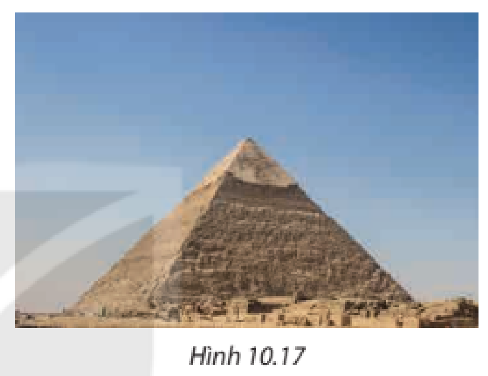
*Hình 10.17*

## 1. HÌNH CHÓP TỨ GIÁC ĐỀU

**Hình chóp tứ giác đều**

Hình chóp $S.ABCD$ trong Hình 10.18 có đáy $ABCD$ là hình vuông, các mặt bên là những tam giác cân bằng nhau, có chung đỉnh. Ta gọi $S.ABCD$ là **hình chóp tứ giác đều**.

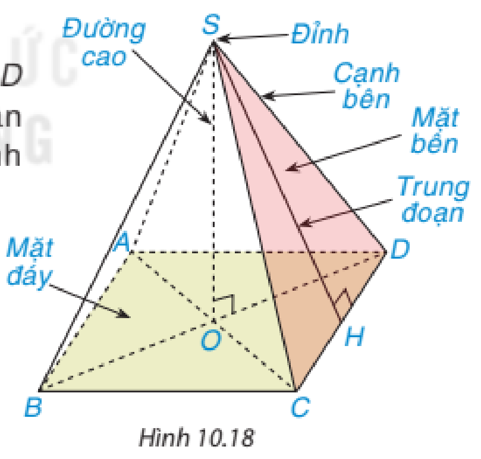
*Hình 10.18*

**HĐ1:** Gọi tên đỉnh, các cạnh bên của hình chóp.

**HĐ2:** Gọi tên đường cao, trung đoạn của hình chóp.

**HĐ3:** Gọi tên các mặt bên và mặt đáy của hình chóp.

<!-- term: Mặt đáy của hình chóp tứ giác đều -->
<!-- term: Mặt bên của hình chóp tứ giác đều -->
**Nhận xét:** Hình chóp tứ giác đều có:
– Mặt đáy là hình vuông, các mặt bên là các tam giác cân bằng nhau có chung đỉnh.
– Chân đường cao kẻ từ đỉnh tới mặt đáy là điểm cách đều các đỉnh của mặt đáy (giao điểm hai đường chéo).

**Ví dụ 1:** Hãy cho biết đỉnh, cạnh bên, mặt bên, mặt đáy, đường cao và một trung đoạn của hình chóp tứ giác đều $S.MNPQ$ trong Hình 10.19.

<!-- pdf:119 -->

**Giải:**

Đỉnh: $S$.

Các cạnh bên: $SM, SN, SP, SQ$.

Các mặt bên là các tam giác cân bằng nhau $SMN, SNP, SPQ, SQM$.

Mặt đáy là hình vuông $MNPQ$.

Đường cao: $SH$.

Trung đoạn: $SI$.

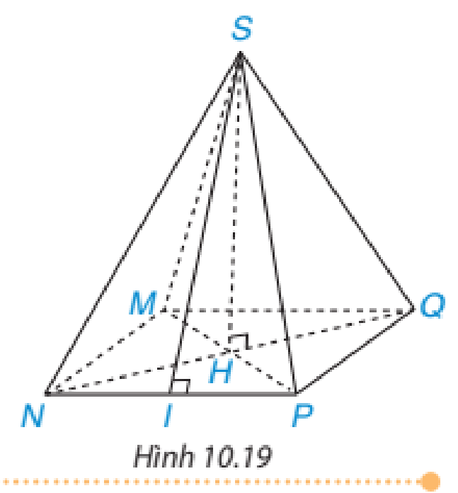
*Hình 10.19*

**Thực hành:**

Cắt và gấp một miếng bìa thành hình chóp tứ giác đều theo hướng dẫn sau:

*Bước 1.* Vẽ hình khai triển theo mẫu và cắt theo viền (H.10.20).

*Bước 2.* Gấp theo các đường màu cam, ta được hình chóp tứ giác đều (H.10.21).

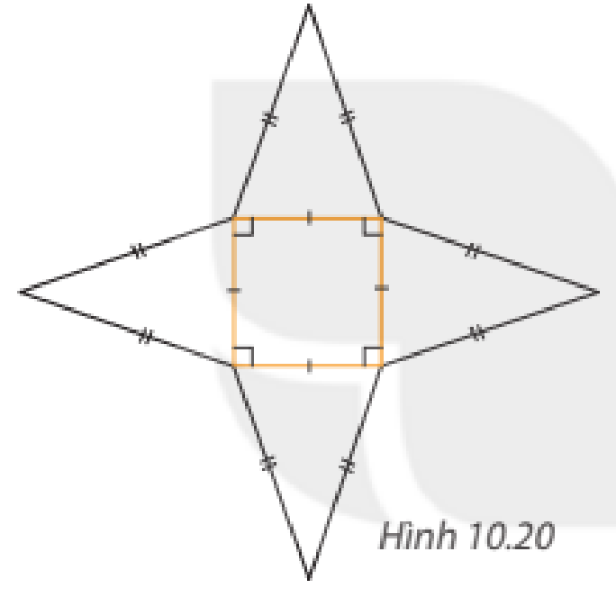
*Hình 10.20*

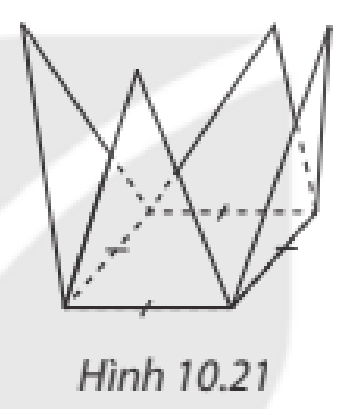
*Hình 10.21*

## 2. DIỆN TÍCH XUNG QUANH VÀ THỂ TÍCH CỦA HÌNH CHÓP TỨ GIÁC ĐỀU

*Diện tích xung quanh và thể tích của hình chóp tứ giác đều*

Tương tự hình chóp tam giác đều, diện tích xung quanh và thể tích của hình chóp tứ giác đều được tính như sau:

<!-- term: Diện tích xung quanh và thể tích của hình chóp tứ giác đều -->
> - **Diện tích xung quanh của hình chóp tứ giác đều** bằng tích của nửa chu vi đáy với trung đoạn.
> $S_{xq} = p \cdot d$, trong đó $p$: nửa chu vi đáy, $d$: trung đoạn.

<!-- term: Diện tích xung quanh và thể tích của hình chóp tứ giác đều -->
> - **Thể tích của hình chóp tứ giác đều** bằng $\dfrac{1}{3}$ tích của diện tích mặt đáy với chiều cao của nó.
> $V = \dfrac{1}{3}S \cdot h$, trong đó $S$: diện tích đáy, $h$: chiều cao của hình chóp.

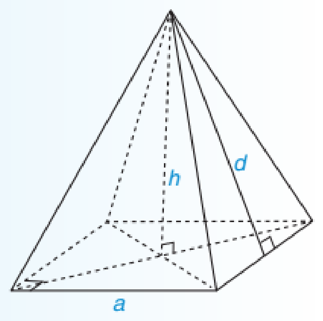

<!-- pdf:120 -->

**Ví dụ 2:** Tính diện tích xung quanh và thể tích của hình chóp tứ giác đều $S.ABCD$, biết độ dài cạnh đáy bằng $6\text{ cm}$, chiều cao bằng $4\text{ cm}$ và trung đoạn bằng $5\text{ cm}$.

**Giải.** (H.10.22)

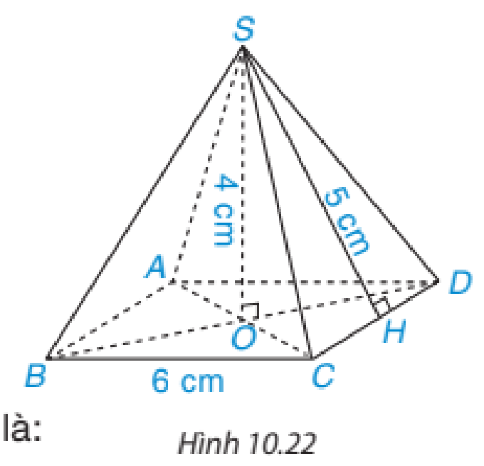
*Hình 10.22*

Nửa chu vi của đáy $ABCD$ là: $(4 \cdot 6) : 2 = 12\text{ (cm)}$.

Diện tích xung quanh của hình chóp tứ giác đều $S.ABCD$ là:

$S_{xq} = p \cdot d = 12 \cdot 5 = 60\text{ (cm}^2\text{)}$.

Diện tích đáy $ABCD$ là: $S = 6^2 = 36\text{ (cm}^2\text{)}$.

Thể tích của hình chóp tứ giác đều $S.ABCD$ là:

$V = \dfrac{1}{3}S \cdot h = \dfrac{1}{3} \cdot 36 \cdot 4 = 48\text{ (cm}^3\text{)}$.

**Luyện tập 1:** Bác Khôi làm một chiếc hộp gỗ có dạng hình chóp tứ giác đều với độ dài cạnh đáy của hình chóp là $2\text{ m}$, trung đoạn của hình chóp là $3\text{ m}$. Bác Khôi muốn sơn bốn mặt xung quanh của hộp gỗ. Cứ mỗi mét vuông sơn cần trả $30\,000$ đồng (tiền sơn và tiền công). Hỏi bác Khôi phải trả chi phí là bao nhiêu?

**Luyện tập 2:** Một chiếc lều có dạng hình chóp tứ giác đều, cạnh đáy bằng $2\text{ m}$, chiều cao bằng $2\text{ m}$ (H.10.23).

a) Thể tích không khí trong lều là bao nhiêu?

b) Biết lều phủ vải bốn phía và cả mặt tiếp đất. Tính diện tích vải bạt cần dùng (coi mép nối không đáng kể). Biết $\sqrt{5} \approx 2,24$ (làm tròn kết quả tới hàng phần mười).

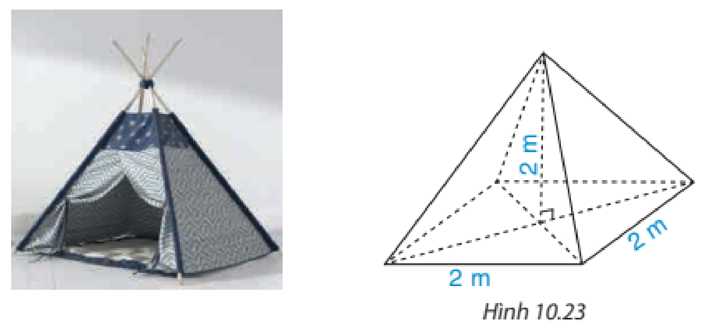
*Hình 10.23*

**Vận dụng:** Em hãy giải *bài toán mở đầu*.

<!-- pdf:121 -->

## BÀI TẬP

10.5. Hãy cho biết đỉnh, cạnh bên, mặt bên, mặt đáy, đường cao và một trung đoạn của hình chóp tứ giác đều $S.EFGH$ trong Hình 10.24.

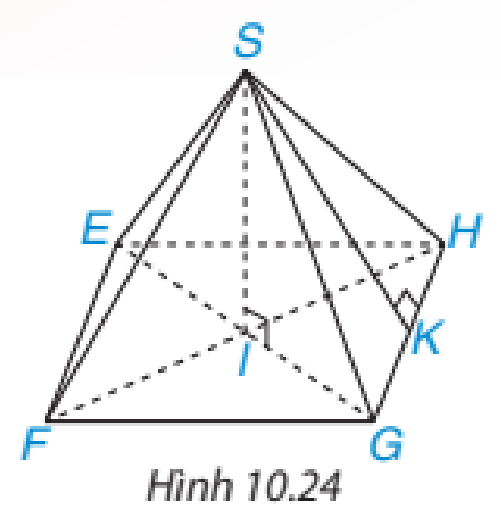
*Hình 10.24*

10.6. Trong các miếng bìa ở Hình 10.25, hình nào gấp lại cho ta một hình chóp tứ giác đều?

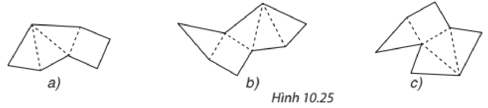
*Hình 10.25*

10.7. Từ tờ giấy cắt ra một hình vuông rồi thực hiện các thao tác như Hình 10.26 để có thể ghép được các mặt bên của hình chóp tứ giác đều.

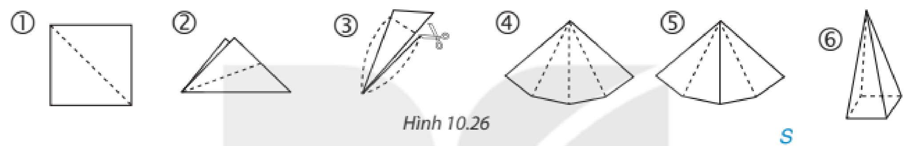
*Hình 10.26*

10.8. Cho hình chóp tứ giác đều $S.ABCD$ như Hình 10.27.

a) Tính diện tích xung quanh của hình chóp.

b) Tính diện tích toàn phần của hình chóp.

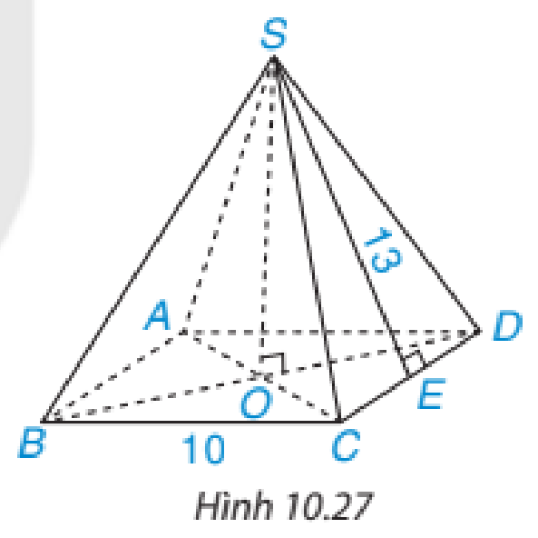
*Hình 10.27*

10.9. Bánh ít trong Hình 10.28 có dạng hình chóp tứ giác đều, cạnh đáy $3\text{ cm}$, cao $3\text{ cm}$. Tính thể tích một chiếc bánh ít.

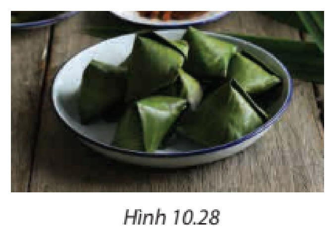
*Hình 10.28*

10.10. Một khối bê tông có dạng như Hình 10.29. Phần dưới của khối bê tông có dạng hình hộp chữ nhật, đáy là hình vuông có cạnh $40\text{ cm}$, chiều cao $25\text{ cm}$. Phần trên của khối bê tông có dạng hình chóp tứ giác đều, chiều cao $100\text{ cm}$. Tính thể tích của khối bê tông đó.

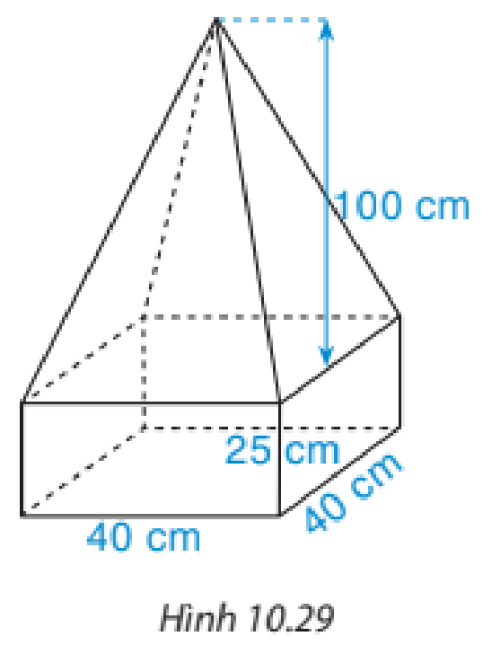
*Hình 10.29*

## 📷 Danh sách hình trong bài

| Mã hình | Trang PDF | Vị trí trong bài | Chú thích gốc |
| --- | :---: | --- | --- |
| H8-toan-b39-01 | 118 | Mở đầu | Hình 10.17 |
| H8-toan-b39-02 | 118 | Mục 1, Hình chóp tứ giác đều (nhãn 'Mặt đáy' bên trái nằm sát chữ của HĐ1, HĐ2, HĐ3) | Hình 10.18 |
| H8-toan-b39-03 | 119 | Mục 1, Ví dụ 1 | Hình 10.19 |
| H8-toan-b39-04 | 119 | Mục 1, Thực hành | Hình 10.20 |
| H8-toan-b39-05 | 119 | Mục 1, Thực hành | Hình 10.21 |
| H8-toan-b39-06 | 119 | Mục 2, Khung công thức diện tích xung quanh và thể tích | (sách không đánh số, hình chóp tứ giác đều cạnh đáy $a$, chiều cao $h$, trung đoạn $d$) |
| H8-toan-b39-07 | 120 | Mục 2, Ví dụ 2 | Hình 10.22 |
| H8-toan-b39-08 | 120 | Mục 2, Luyện tập 2 | Hình 10.23 |
| H8-toan-b39-09 | 121 | Bài 10.5 | Hình 10.24 |
| H8-toan-b39-10 | 121 | Bài 10.6 | Hình 10.25 |
| H8-toan-b39-11 | 121 | Bài 10.7 | Hình 10.26 |
| H8-toan-b39-12 | 121 | Bài 10.8 | Hình 10.27 |
| H8-toan-b39-13 | 121 | Bài 10.9 | Hình 10.28 |
| H8-toan-b39-14 | 121 | Bài 10.10 | Hình 10.29 |
