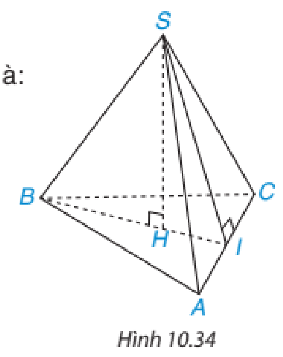
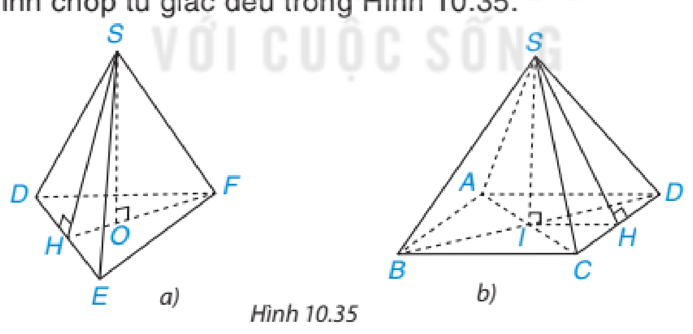
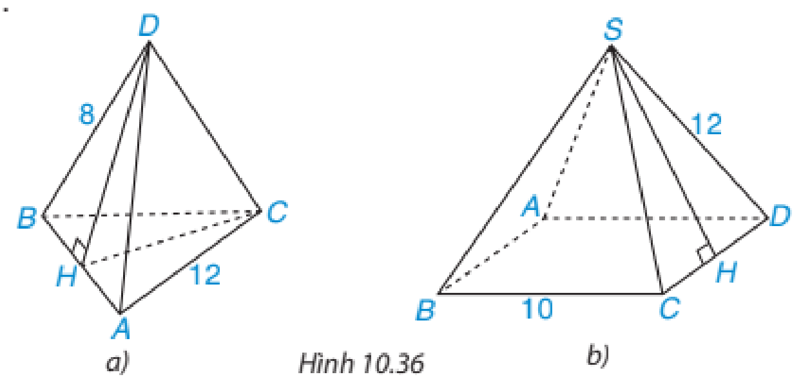
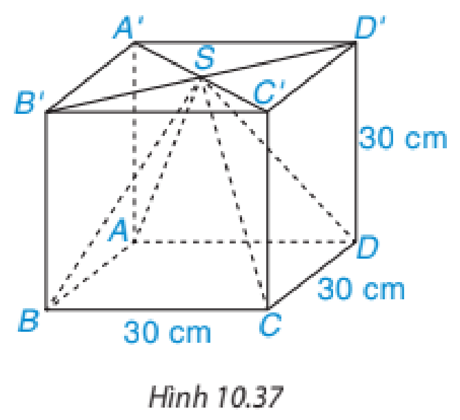
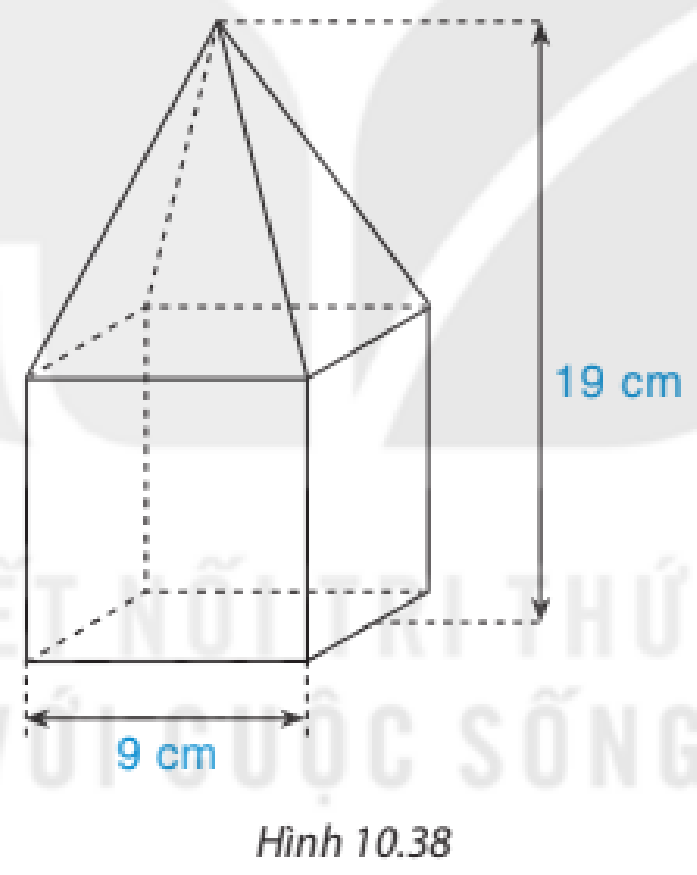
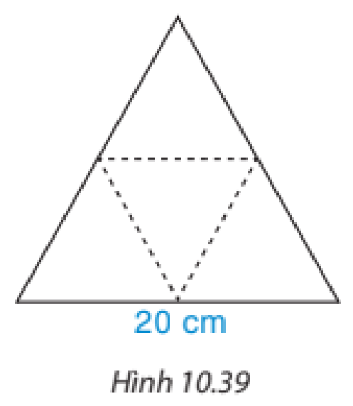

<!-- pdf:124 -->

# BÀI TẬP CUỐI CHƯƠNG X

## ✏️ A. TRẮC NGHIỆM

10.15. Trung đoạn của hình chóp tam giác đều trong Hình 10.34 là:

A. $SB$.

B. $SH$.

C. $SI$.

D. $HI$.

*Hình 10.34*

10.16. Đáy của hình chóp tứ giác đều là:

A. Hình vuông.

B. Hình bình hành.

C. Hình thoi.

D. Hình chữ nhật.

10.17. Diện tích xung quanh của hình chóp tam giác đều bằng:

A. Tích của nửa chu vi đáy và chiều cao của hình chóp.

B. Tích của nửa chu vi đáy và trung đoạn.

C. Tích của chu vi đáy và trung đoạn.

D. Tổng của chu vi đáy và trung đoạn.

10.18. Một hình chóp tam giác đều có chiều cao $h$, thể tích $V$. Diện tích đáy $S$ là:

A. $S = \dfrac{h}{V}$.

B. $S = \dfrac{V}{h}$.

C. $S = \dfrac{3V}{h}$.

D. $S = \dfrac{3h}{V}$.

## ✏️ B. TỰ LUẬN

10.19. Gọi tên đỉnh, cạnh bên, cạnh đáy, đường cao và một trung đoạn của hình chóp tam giác đều, hình chóp tứ giác đều trong Hình 10.35.

*Hình 10.35*

10.20. Tính diện tích xung quanh của hình chóp tam giác đều, hình chóp tứ giác đều trong Hình 10.36.

*Hình 10.36*

<!-- pdf:125 -->

10.21. Tính thể tích của hình chóp tứ giác đều, biết chiều cao bằng $9\text{ cm}$ và chu vi đáy bằng $12\text{ cm}$.

10.22. Từ một khúc gỗ hình lập phương cạnh $30\text{ cm}$ (H.10.37), người ta cắt đi một phần gỗ để được phần còn lại là một hình chóp tứ giác đều có đáy là hình vuông cạnh $30\text{ cm}$ và chiều cao của hình chóp cũng bằng $30\text{ cm}$. Tính thể tích của phần gỗ bị cắt đi.

*Hình 10.37*

10.23. Một khối gỗ gồm đế là hình lập phương cạnh $9\text{ cm}$ và một hình chóp tứ giác đều (H.10.38). Tính thể tích khối gỗ.

*Hình 10.38*

10.24. Bạn Trang cắt miếng bìa hình tam giác đều cạnh dài $20\text{ cm}$ (H.10.39) và gấp lại theo các dòng kẻ (nét đứt) để được hình chóp tam giác đều. Tính diện tích xung quanh của hình chóp tam giác đều tạo thành. Cho biết $\sqrt{75} \approx 8,66$.

*Hình 10.39*

## 📷 Danh sách hình trong bài

| Mã hình | Trang PDF | Vị trí trong bài | Chú thích gốc |
| --- | :---: | --- | --- |
| H8-toan-bt-c10-01 | 124 | Bài 10.15 | Hình 10.34 |
| H8-toan-bt-c10-02 | 124 | Bài 10.19 (đỉnh S của Hình 10.35a nằm sát ngay dưới dòng đề bài 10.19) | Hình 10.35 |
| H8-toan-bt-c10-03 | 124 | Bài 10.20 | Hình 10.36 |
| H8-toan-bt-c10-04 | 125 | Bài 10.22 | Hình 10.37 |
| H8-toan-bt-c10-05 | 125 | Bài 10.23 | Hình 10.38 |
| H8-toan-bt-c10-06 | 125 | Bài 10.24 | Hình 10.39 |
