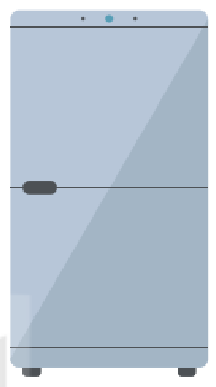

<!-- pdf:126 -->
<!-- Trang mở đầu phần Hoạt động thực hành trải nghiệm cuối Tập hai (PDF 126): HOẠT ĐỘNG THỰC HÀNH TRẢI NGHIỆM -->

# MỘT VÀI ỨNG DỤNG CỦA HÀM SỐ BẬC NHẤT TRONG TÀI CHÍNH

## 🎯 Mục tiêu

- Giới thiệu một vài ứng dụng đơn giản của hàm số bậc nhất trong tài chính.

Hàm số bậc nhất được sử dụng trong nhiều vấn đề của cuộc sống. Trong những tình huống đơn giản, hàm chi phí trong sản xuất hoặc tiêu dùng một loại hàng hoá, hàm cung và hàm cầu của một mặt hàng là những hàm số bậc nhất. Trong bài này, chúng ta sẽ tìm hiểu một vài mô hình đơn giản trong tài chính liên quan đến hàm số bậc nhất.

**Chuẩn bị:**

– Thu thập số liệu về giá cước của một số gói dịch vụ truyền hình, gói internet phổ biến.

– Thu thập số liệu về giá tiền và công suất tiêu thụ điện của một số loại ti vi, tủ lạnh phổ biến dành cho gia đình.

– Máy tính cầm tay.

**Các bước thực hiện:**

Chia lớp thành bốn nhóm và thực hiện lần lượt các bước sau:

<!-- pdf:127 -->

*Bước 1.* Các nhóm thực hiện HĐ1 và HĐ2 dưới đây để tìm hiểu về cách xây dựng công thức của hàm chi phí và phương pháp khấu hao đường thẳng.

**HĐ1: Xây dựng công thức của hàm chi phí**

Chi phí sử dụng truyền hình cáp của hai công ty dịch vụ truyền hình $A$ và $B$ như sau:

| | Công ty $A$ | Công ty $B$ |
| --- | --- | --- |
| Chi phí lắp đặt ban đầu | $150\,000$ đồng | Miễn phí |
| Cước hằng tháng | $110\,000$ đồng | $120\,000$ đồng |
<!-- ocr-ok: đã đối chiếu ảnh trang PDF 127, bảng chi phí truyền hình cáp của hai công ty A và B -->

a) Viết công thức tính chi phí sử dụng truyền hình cáp $y$ (nghìn đồng) của mỗi công ty $A$ và $B$ theo số tháng sử dụng là $x$ (tháng).

b) Tính chi phí sử dụng truyền hình cáp trong $18$ tháng của mỗi công ty $A$ và $B$.

c) Với bao nhiêu tháng sử dụng thì chi phí sử dụng truyền hình cáp của hai công ty này là như nhau?

d) Vẽ đồ thị của hai hàm số nhận được ở câu a trên cùng một hệ trục toạ độ. Từ đó hãy cho biết nếu một gia đình dự định dùng dịch vụ truyền hình cáp trong $3$ năm thì nên chọn dịch vụ của công ty $A$ hay công ty $B$ để tiết kiệm chi phí hơn (Giả sử chất lượng dịch vụ truyền hình cáp của hai công ty này là như nhau).

**HĐ2: Tính giá trị sổ sách của tài sản bằng phương pháp khấu hao đường thẳng**

<!-- term: Khấu hao đường thẳng -->
> Trong lí thuyết tài chính, **giá trị sổ sách** là giá trị của một tài sản mà công ty sử dụng để tạo ra bảng cân đối kế toán của mình. Một số công ty khấu hao tài sản của họ bằng cách sử dụng khấu hao đường thẳng để giá trị của tài sản giảm một lượng cố định mỗi năm. Mức suy giảm phụ thuộc vào thời gian sử dụng hữu ích mà công ty đặt vào tài sản.

Giả sử rằng một hãng taxi vừa mua một số ô tô để chạy dịch vụ với chi phí là $480$ triệu đồng một chiếc. Công ty chọn khấu hao từng chiếc xe theo phương pháp khấu hao đường thẳng trong vòng $8$ năm. Điều này có nghĩa là mỗi chiếc xe sẽ giảm giá $480 : 8 = 60$ triệu đồng mỗi năm.

a) Tính giá trị sổ sách $y$ (triệu đồng) của mỗi chiếc ô tô dưới dạng một hàm số bậc nhất của thời gian sử dụng $x$ (năm) của nó.

b) Vẽ đồ thị của hàm số bậc nhất này.

c) Giá trị sổ sách của mỗi chiếc ô tô sau $3$ năm sử dụng là bao nhiêu?

d) Sau bao lâu thì giá trị sổ sách của mỗi chiếc ô tô còn lại là $150$ triệu đồng?

<!-- pdf:128 -->

*Bước 2.* Sử dụng các thông tin ở phần Chuẩn bị, mỗi nhóm lựa chọn một tình huống thực tế liên quan đến việc lựa chọn sản phẩm hoặc dịch vụ. Sau đó sử dụng kiến thức đã tiếp thu ở Bước 1 để ước tính chi phí khi sử dụng, từ đó có phương án lựa chọn hợp lí. Cuối cùng, các nhóm trình bày kết quả trước lớp. Khi xây dựng tình huống vận dụng thực tiễn, các nhóm có thể tham khảo các yêu cầu trong Vận dụng sau:

**Vận dụng:**

Bác An dự định mua một chiếc tủ lạnh loại $150\text{ lít}$ của hãng $A$, có công suất $1\text{ kWh/ngày}$ với giá $5\,000\,000$ đồng và dự định sẽ sử dụng nó trong vòng $10$ năm.

a) Giả sử trung bình một tháng có $30$ ngày và giá điện là $2\,000\text{ đồng/1 kWh}$. Hãy tính số tiền điện phải trả hằng tháng cho chiếc tủ lạnh này.

b) Giả sử trong quá trình sử dụng, tủ lạnh không bị hỏng hóc gì cần sửa chữa. Khi đó chi phí sử dụng tủ lạnh bao gồm chi phí mua ban đầu và chi phí trả tiền điện hằng tháng. Lập công thức tính chi phí sử dụng chiếc tủ lạnh này sau $x$ (tháng).

c) Sử dụng công thức đã lập ở câu b, hãy tính chi phí sử dụng chiếc tủ lạnh này sau $5$ năm.

d) Bác An dùng phương pháp khấu hao đường thẳng để tính giá trị còn lại của chiếc tủ lạnh sau mỗi năm sử dụng. Hỏi sau $7$ năm giá trị còn lại của chiếc tủ lạnh này là bao nhiêu?

e) Hãng $B$ cũng có một loại tủ lạnh $150\text{ lít}$, công suất $1,25\text{ kWh/ngày}$ với giá bán là $4\,460\,000$ đồng.

– Lập công thức tính chi phí sử dụng chiếc tủ lạnh của hãng $B$ sau $x$ (tháng).

– Sau bao nhiêu tháng sử dụng thì chi phí sử dụng của hai loại tủ lạnh này là bằng nhau?

– Vẽ đồ thị của hai hàm số chi phí sử dụng của hai loại tủ lạnh trên cùng một hệ trục toạ độ. Từ đồ thị đã vẽ, theo em bác An nên mua tủ lạnh của hãng $A$ hay hãng $B$ để tiết kiệm chi phí sử dụng hơn? (Giả sử bác An sẽ sử dụng trong vòng $10$ năm và chất lượng của hai loại tủ lạnh là tương đương).

## 📷 Danh sách hình trong bài

| Mã hình | Trang PDF | Vị trí trong bài | Chú thích gốc |
| --- | :---: | --- | --- |
| H8-toan-hd-thtn-05-01 | 127 | Bước 1, HĐ1 | (sách không đánh số, minh hoạ dịch vụ truyền hình cáp) |
| H8-toan-hd-thtn-05-02 | 127 | Bước 1, HĐ2 | GIÁ TRỊ SỔ SÁCH / BOOK VALUE |
| H8-toan-hd-thtn-05-03 | 128 | Bước 2, Vận dụng | (sách không đánh số, minh hoạ chiếc tủ lạnh) |
