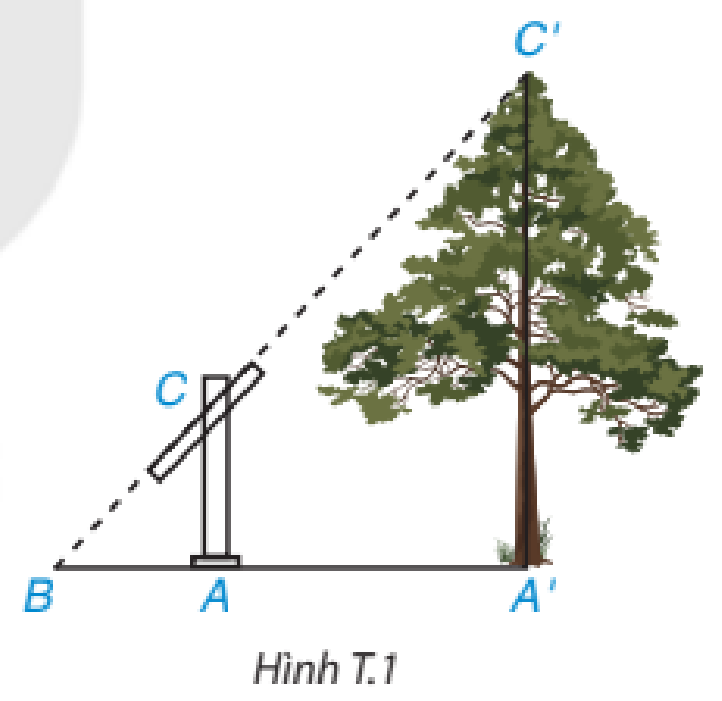
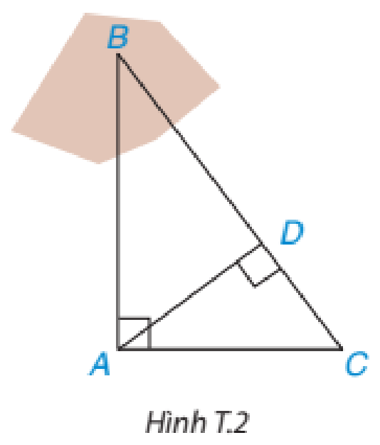
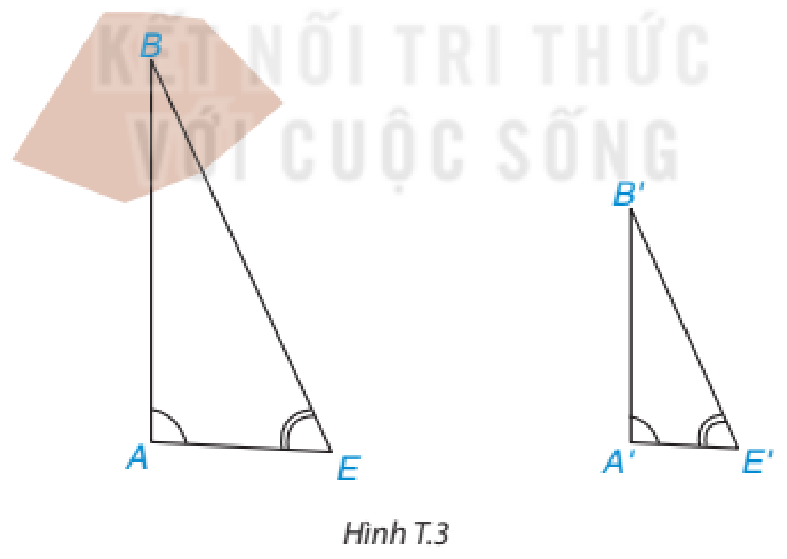

<!-- pdf:129 -->

# ỨNG DỤNG ĐỊNH LÍ THALÈS, ĐỊNH LÍ PYTHAGORE VÀ TAM GIÁC ĐỒNG DẠNG ĐỂ ĐO CHIỀU CAO, KHOẢNG CÁCH

## 🎯 Mục tiêu

- Ứng dụng định lí Thalès để đo chiều cao của ngọn cây (toà nhà, toà tháp).
- Ứng dụng định lí Pythagore và tam giác đồng dạng để đo khoảng cách những điểm không tới được.

**HĐ1: Dùng định lí Thalès để đo chiều cao của ngọn cây (toà nhà, toà tháp)**

*Chuẩn bị:*

– Cọc thẳng cắm được trên mặt đất hoặc dựng đứng được, thước ngắm thẳng gắn ở trên cọc có thể quay được, thước dây, thước kẻ.

– Giấy, bút, máy tính cầm tay.

– Địa điểm thực hiện: sân trường, nơi dã ngoại.

– Chia lớp thành các nhóm, mỗi nhóm từ $6$ đến $8$ học sinh.

*Hướng dẫn* (H.T.1):

– Dựng cọc $AC$ thẳng đứng trên mặt đất, chỉnh cho thước ngắm đi qua đỉnh $C'$ của ngọn cây.

– Xác định giao điểm $B$ của đường thẳng đi qua $CC'$ (chứa thước ngắm) với mặt đất.

– Gọi $A'$ là gốc cây thì $AC \parallel A'C'$. Theo định lí Thalès ta có: $\dfrac{AC}{A'C'} = \dfrac{BA}{BA'}$.

– Đo các khoảng cách $AC, BA', BA$ và tính chiều cao $A'C'$ của cây theo công thức: $A'C' = \dfrac{AC \cdot BA'}{BA}$.

– Các nhóm cùng đo chiều cao của một cây nhưng ở các vị trí khác nhau và so sánh kết quả với nhau.

*Hình T.1*

**HĐ2: Dùng định lí Pythagore và tam giác đồng dạng để đo khoảng cách những điểm không tới được**

*Chuẩn bị:*

– Giác kế ngang (dụng cụ đo góc trên mặt đất), thước dây.

– Giấy, bút, máy tính cầm tay.

– Địa điểm thực hiện: sân trường, dã ngoại.

– Chia lớp thành các nhóm, mỗi nhóm từ $6$ đến $8$ học sinh.

Hướng dẫn đo khoảng cách từ vị trí đang đứng (điểm $A$) đến vị trí khó đi đến được (điểm $B$) theo một trong hai phương pháp sau:

<!-- pdf:130 -->

*Phương pháp 1* (H.T.2):

– Dùng giác kế chọn một điểm $C$ sao cho $AC$ vuông góc $AB$, chọn điểm $D$ trên đường thẳng $BC$ sao cho $AD$ vuông góc $BC$.

– Diện tích tam giác $ABC$ bằng $\dfrac{AB \cdot AC}{2} = \dfrac{AD \cdot BC}{2}$.

Do đó $AD^2 = \dfrac{AB^2 \cdot AC^2}{BC^2} = \dfrac{AB^2 \cdot AC^2}{AB^2 + AC^2}$.

Suy ra $AB^2 = \dfrac{AC^2 \cdot AD^2}{AC^2 - AD^2}$.

– Đo độ dài các đoạn thẳng $AC, AD$ và tính ra kết quả độ dài đoạn thẳng $AB$.

*Hình T.2*

*Phương pháp 2* (H.T.3):

– Lấy một điểm $E$ tuỳ ý khác điểm $A$ và không nằm trên đường thẳng $AB$.

– Sử dụng giác kế xác định số đo các góc $\widehat{BAE}$ và $\widehat{BEA}$.

– Vẽ lên giấy tam giác $A'B'E'$ có các góc $A'$ và $E'$ tương ứng bằng các góc $A$ và $E$ của tam giác $ABE$.

Như vậy tam giác $A'B'E'$ đồng dạng với tam giác $ABE$. Suy ra $\dfrac{A'B'}{AB} = \dfrac{A'E'}{AE}$.

– Đo độ dài đoạn thẳng $AE$ bằng thước dây và đo độ dài các đoạn thẳng $A'B', A'E'$ bằng thước kẻ.

– Tính độ dài đoạn thẳng $AB$ theo công thức $AB = \dfrac{A'B' \cdot AE}{A'E'}$.

*Hình T.3*

Các nhóm khác nhau có thể xác định vị trí các điểm $C, D, E$ khác nhau và so sánh kết quả cuối cùng với nhau.

**Luyện tập:**

Trong Phương pháp 1 của HĐ2, chúng ta đã dùng định lí Pythagore để tính độ dài đoạn thẳng $AB$. Em hãy tính độ dài đoạn thẳng $AB$ bằng một cách khác thông qua độ dài các đoạn thẳng $AC, AD, CD$.

## 📷 Danh sách hình trong bài

| Mã hình | Trang PDF | Vị trí trong bài | Chú thích gốc |
| --- | :---: | --- | --- |
| H8-toan-hd-thtn-06-01 | 129 | HĐ1, Hướng dẫn | Hình T.1 |
| H8-toan-hd-thtn-06-02 | 130 | HĐ2, Phương pháp 1 | Hình T.2 |
| H8-toan-hd-thtn-06-03 | 130 | HĐ2, Phương pháp 2 | Hình T.3 |
