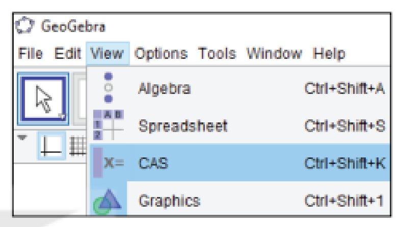
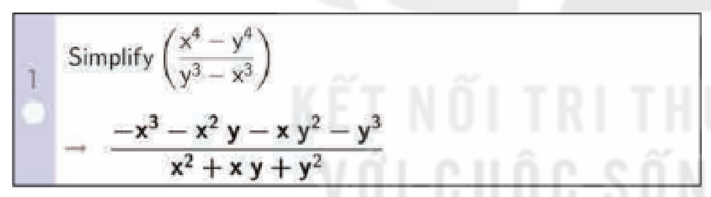
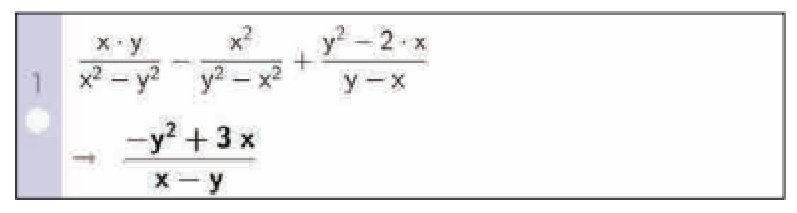
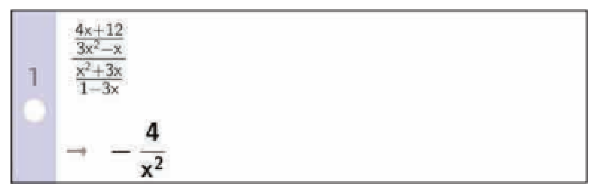
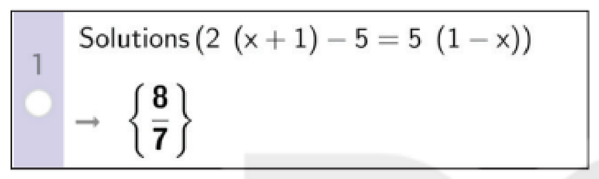
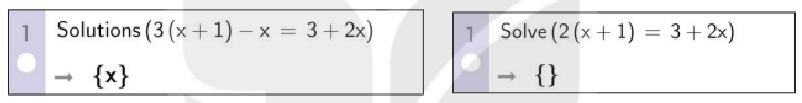
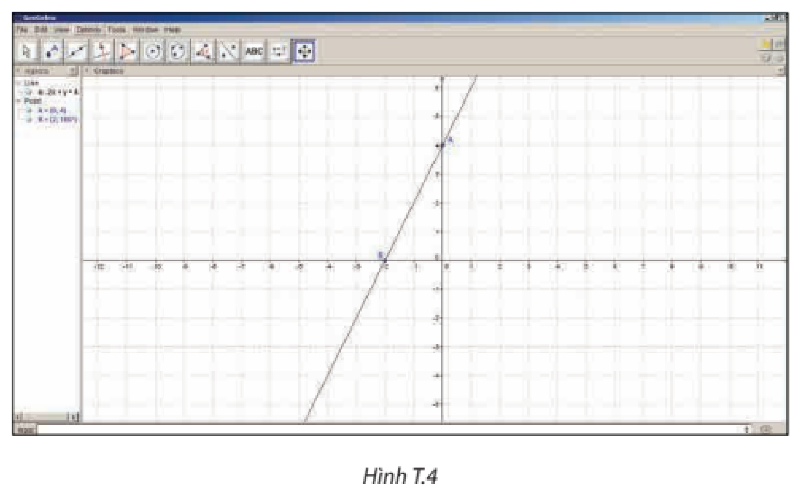
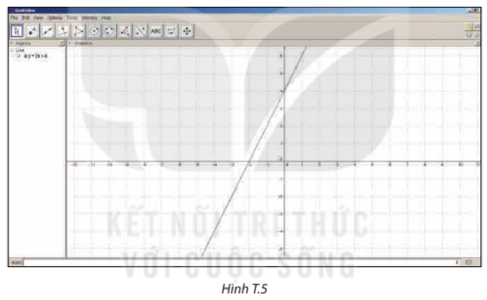

<!-- pdf:131 -->

# THỰC HÀNH TÍNH TOÁN TRÊN PHÂN THỨC ĐẠI SỐ VÀ VẼ ĐỒ THỊ HÀM SỐ VỚI PHẦN MỀM GEOGEBRA

## 🎯 Mục tiêu

- Sử dụng phần mềm GeoGebra để tính toán các phép tính trên phân thức đại số, giải phương trình bậc nhất một ẩn và vẽ đồ thị của hàm số bậc nhất.

Khởi động phần mềm GeoGebra, chọn View $\to$ Complex Adaptive System (CAS) để thực hiện tính toán các phép tính trên phân thức đại số, giải phương trình bậc nhất một ẩn; chọn Graphics để vẽ đồ thị của hàm số bậc nhất.

## 1. CÁC PHÉP TÍNH TRÊN PHÂN THỨC ĐẠI SỐ

- Để rút gọn một phân thức, ta dùng lệnh `Simplify(<phân thức>)`, khi đó kết quả sẽ hiển thị ngay bên dưới.

> Để nhập một phân thức, ta gõ tử số trong dấu (), sau đó dùng dấu /, và nhập mẫu.

- Để cộng, trừ, nhân các phân thức, tương tự như đối với đa thức, ta cũng nhập các phân thức và các phép toán vào ô lệnh trên cửa sổ CAS. Khi đó máy sẽ thực hiện phép tính và tự động rút gọn kết quả.

- Để thực hiện phép chia hai phân thức, ta nhập phân thức thứ nhất, dấu /, rồi nhập phân thức thứ hai. Khi đó máy sẽ thực hiện phép tính và tự động rút gọn kết quả.

<!-- pdf:132 -->

> Khi nhập phép chia hai phân thức, máy sẽ hiểu là ta tính một phân thức hữu tỉ có tử và mẫu là các phân thức.

## 2. GIẢI PHƯƠNG TRÌNH BẬC NHẤT MỘT ẨN

Để giải phương trình nói chung, phương trình bậc nhất một ẩn nói riêng, ta dùng lệnh `Solve(<phương trình>)` hoặc `Solutions(<phương trình>)` trên ô lệnh của cửa sổ CAS, kết quả sẽ được hiển thị ngay bên dưới.

> Phương trình nghiệm đúng với mọi $x$ thì kết quả hiển thị là $\{x\}$.
>
> Phương trình vô nghiệm thì kết quả hiển thị là $\{\}$.

## 3. VẼ ĐỒ THỊ CỦA HÀM SỐ BẬC NHẤT

Khởi động GeoGebra và chọn View $\to$ Graphics để vẽ đồ thị của hàm số bậc nhất. Khi đó màn hình hiển thị sẵn hệ trục toạ độ dạng lưới ô vuông.

Có hai cách vẽ đồ thị hàm số bậc nhất:

*Cách 1.* Xác định hai điểm thuộc đồ thị hàm số rồi vẽ đường thẳng đi qua hai điểm đó.

*Cách 2.* Nhập hàm số vào ô lệnh, màn hình sẽ hiển thị đồ thị của hàm số cần vẽ.

**Ví dụ.** Vẽ đồ thị hàm số $y = 2x + 4$.

*Cách 1* (H.T.4).

*Bước 1.* Lấy điểm $A(0; 4)$ và điểm $B(-2; 0)$ thuộc đồ thị hàm số $y = 2x + 4$ bằng cách lần lượt nhập $(0, 4)$ và $(-2, 0)$ vào ô lệnh, màn hình sẽ hiển thị hai điểm $A$ và $B$ trên hệ trục toạ độ.

*Bước 2.* Trên thanh công cụ, chọn đường thẳng đi qua hai điểm để vẽ đồ thị hàm số đã cho đi qua hai điểm $A$ và $B$.

<!-- pdf:133 -->

*Hình T.4*

*Cách 2.* Nhập $y = 2x + 4$ trên ô lệnh, màn hình sẽ hiển thị đồ thị của hàm số (H.T.5).

*Hình T.5*

**Thực hành:**

*Sử dụng phần mềm GeoGebra, hãy thực hiện các yêu cầu sau đây.*

1. Tính:

$\dfrac{x^4 - xy^3}{2xy + y^2} : \dfrac{x^3 + x^2y + xy^2}{2x + y} + \dfrac{y + x}{x}.$

2. Giải các phương trình sau:

a) $4,8 - 2,5(x + 3) = x + 0,5(2 - 6x)$;

b) $2\left(x + \dfrac{4}{5}\right) = 3 - \left(\dfrac{7}{5} - 2x\right)$.

3. Vẽ đồ thị của các hàm số bậc nhất sau:

a) $y = -3x + 3$;

b) $y = \dfrac{1}{2}x - 4$.

## 📷 Danh sách hình trong bài

| Mã hình | Trang PDF | Vị trí trong bài | Chú thích gốc |
| --- | :---: | --- | --- |
| H8-toan-hd-thtn-07-01 | 131 | Mở đầu | (sách không đánh số, menu View của GeoGebra chọn CAS và Graphics) |
| H8-toan-hd-thtn-07-02 | 131 | Mục 1 | (sách không đánh số, lệnh Simplify rút gọn phân thức trên cửa sổ CAS) |
| H8-toan-hd-thtn-07-03 | 131 | Mục 1 | (sách không đánh số, phép cộng và trừ phân thức trên cửa sổ CAS) |
| H8-toan-hd-thtn-07-04 | 132 | Mục 1 | (sách không đánh số, phép chia hai phân thức trên cửa sổ CAS) |
| H8-toan-hd-thtn-07-05 | 132 | Mục 2 | (sách không đánh số, lệnh Solutions giải phương trình trên cửa sổ CAS) |
| H8-toan-hd-thtn-07-06 | 132 | Mục 2 | (sách không đánh số, kết quả {x} và {} khi giải phương trình trên cửa sổ CAS) |
| H8-toan-hd-thtn-07-07 | 133 | Mục 3, Ví dụ, Cách 1 | Hình T.4 |
| H8-toan-hd-thtn-07-08 | 133 | Mục 3, Ví dụ, Cách 2 | Hình T.5 |
