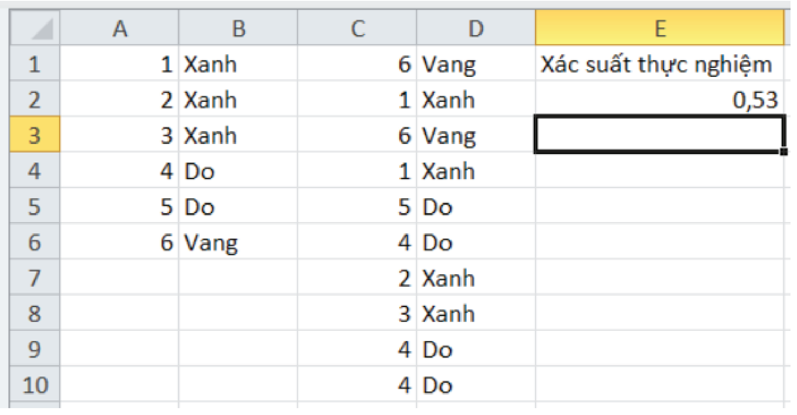

<!-- pdf:134 -->

# MÔ TẢ THÍ NGHIỆM NGẪU NHIÊN VỚI PHẦN MỀM EXCEL

## 🎯 Mục tiêu

- Mô tả thí nghiệm ngẫu nhiên với phần mềm bảng tính Excel, sử dụng một số hàm cơ bản và tính xác suất thực nghiệm của biến cố để thấy rằng khi số lần thực hiện thí nghiệm càng lớn thì xác suất thực nghiệm càng xấp xỉ tốt cho xác suất.

> *Chuẩn bị:*
> - Máy tính có cài đặt phần mềm bảng tính Excel.
> - Tìm hiểu về cú pháp của hai hàm RANDBETWEEN, VLOOKUP, COUNTIF.
>
> *Bài toán:* Một túi kín đựng $6$ quả bóng có cùng kích thước, trong đó có $3$ quả bóng xanh, $2$ quả bóng đỏ và $1$ quả bóng vàng. Lấy ngẫu nhiên một quả bóng trong túi $100$ lần (có hoàn lại). Tính xác suất thực nghiệm của biến cố “Lấy được quả bóng màu xanh”.

**Các bước thực hiện**

*Bước 1 (Chuẩn bị dữ liệu):*

- Mở phần mềm bảng tính Excel, nhập các giá trị $1; 2; 3; 4; 5; 6$ vào các ô A1; A2; A3; A4; A5; A6.
- Nhập ba từ “Xanh”, hai từ “Đỏ”, một từ “Vàng” tương ứng vào các ô B1; B2; B3; B4; B5; B6.

*Bước 2 (Thực hiện lấy bóng):*

- Trong ô C1 gõ hàm “`=RANDBETWEEN(1;6)`”.
- Trong ô D1 gõ hàm “`=VLOOKUP(C1; $A$1:$B$6; 2)`”.
- Copy công thức của $2$ ô C1, D1 bằng cách kéo từ dòng $1$ đến dòng $100$.
- Kết quả lấy bóng $100$ lần được cho trong cột D từ dòng $1$ đến dòng $100$.

*Bước 3 (Tính xác suất thực nghiệm):*

- Trong ô E1 ghi “Xác suất thực nghiệm”.
- Trong ô E2 nhập hàm “`=COUNTIF(D1:D100,“Xanh”)/100`”.

*Bước 4 (Giải thích kết quả):*

Chẳng hạn ta thu được bảng sau:

<!-- pdf:135 -->

| | A | B | C | D | E |
| :---: | :---: | --- | :---: | --- | --- |
| 1 | 1 | Xanh | 6 | Vang | Xác suất thực nghiệm |
| 2 | 2 | Xanh | 1 | Xanh | 0,53 |
| 3 | 3 | Xanh | 6 | Vang | |
| 4 | 4 | Do | 1 | Xanh | |
| 5 | 5 | Do | 5 | Do | |
| 6 | 6 | Vang | 4 | Do | |
| 7 | | | 2 | Xanh | |
| 8 | | | 3 | Xanh | |
| 9 | | | 4 | Do | |
| 10 | | | 4 | Do | |

Vậy ở lần $1$ ta lấy được quả bóng màu vàng, lần $2$ lấy được quả bóng màu xanh,... Kết quả của các lần lấy bóng được cho trong cột D. Sau $100$ lần, xác suất thực nghiệm của sự kiện “Lấy được quả bóng màu xanh” là $0,53$.

*Bước 5.* Tăng số lần thực hiện thí nghiệm lên $200; 300;...; 500$ và nhận xét về kết quả tính xác suất thực nghiệm so với xác suất.

**Vận dụng:**

Em hãy luyện tập tương tự với thí nghiệm sau:

Một túi kín đựng $8$ quả bóng có cùng kích thước, trong đó có $1$ quả màu xanh, $2$ quả màu vàng, $2$ quả màu đỏ và $3$ quả màu đen. Lấy ngẫu nhiên một quả bóng trong túi $200$ lần (có hoàn lại). Tính xác suất thực nghiệm của biến cố “Lấy được quả bóng không phải màu đen”.

## 📷 Danh sách hình trong bài

| Mã hình | Trang PDF | Vị trí trong bài | Chú thích gốc |
| --- | :---: | --- | --- |
| H8-toan-hd-thtn-08-01 | 134 | Chuẩn bị | (sách không đánh số, túi kín đựng 6 quả bóng màu) |
| H8-toan-hd-thtn-08-02 | 135 | Bước 4 | (sách không đánh số, bảng tính Excel kết quả mô phỏng 100 lần lấy bóng) |
