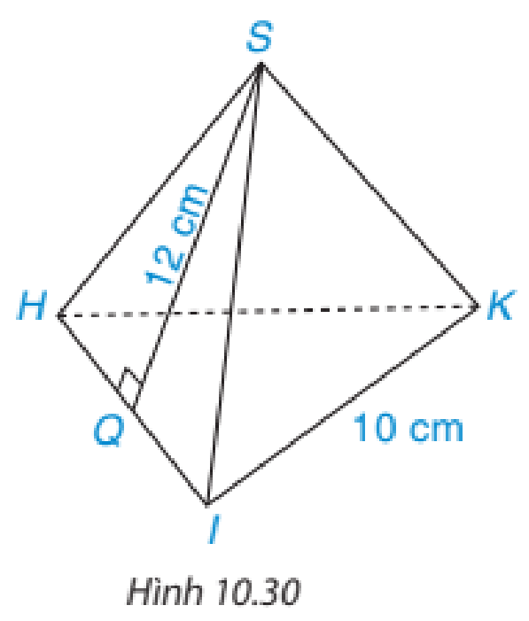
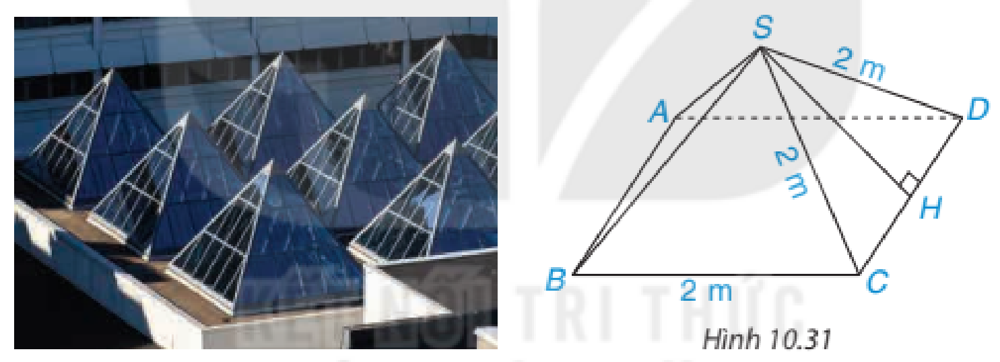
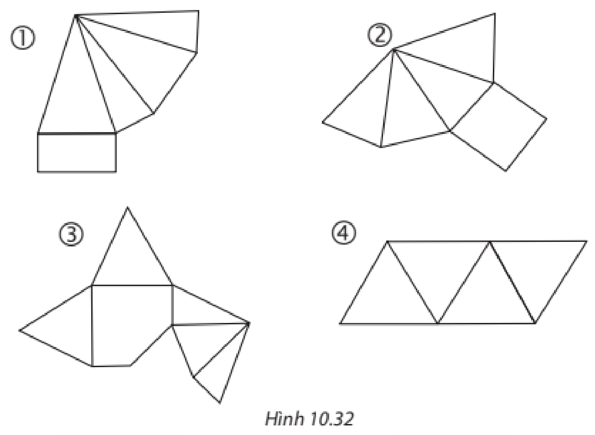
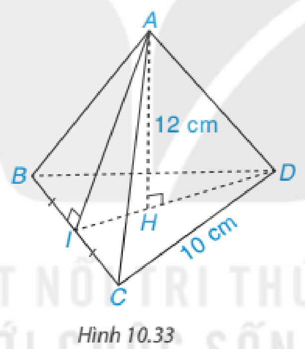
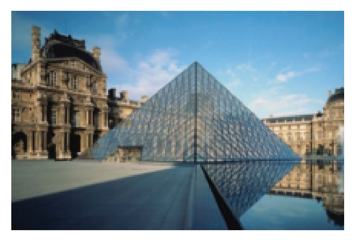

<!-- pdf:122 -->

# LUYỆN TẬP CHUNG (TRANG 121)

**Ví dụ 1:** Tính diện tích xung quanh của hình chóp tam giác đều $S.HIK$ trong Hình 10.30.

*Hình 10.30*

**Giải:**

Diện tích xung quanh của hình chóp tam giác đều $S.HIK$ là:

$S_{xq} = p \cdot d = \dfrac{1}{2} \cdot (10 + 10 + 10) \cdot 12 = 180\text{ (cm}^2\text{)}$.

**Ví dụ 2:** Một mái che giếng trời của một ngôi nhà có dạng hình chóp tứ giác đều, bốn mặt bên làm bằng kính. Diện tích kính làm bốn mặt bên của mái che bằng bao nhiêu? Biết các mặt bên là các tam giác đều có cạnh dài $2\text{ m}$ và viền không đáng kể (H.10.31). Cho biết $\sqrt{3} \approx 1,73$.

*Hình 10.31*

**Giải:**

Ta có $HD = \dfrac{1}{2}CD = 1\text{ (m)}$.

Áp dụng định lí Pythagore cho tam giác vuông $SHD$, ta có:

$SH^2 + HD^2 = SD^2$, suy ra $SH^2 = SD^2 - HD^2 = 2^2 - 1^2 = 3$, hay $SH = \sqrt{3}$.

Vậy $SH \approx 1,73\text{ m}$.

Diện tích kính làm bốn mặt mái che là:

$S_{xq} = p \cdot d \approx \dfrac{1}{2} \cdot (4 \cdot 2) \cdot 1,73 = 6,92\text{ (m}^2\text{)}$.

## BÀI TẬP

10.11. Tính thể tích của hình chóp tam giác đều $S.ABC$, biết diện tích đáy của nó bằng $15,6\text{ cm}^2$, chiều cao bằng $10\text{ cm}$.

<!-- pdf:123 -->

10.12. Trong các miếng bìa ở Hình 10.32, miếng bìa nào khi gấp và dán lại thì được một hình chóp tam giác đều, miếng nào được hình chóp tứ giác đều?

*Hình 10.32*

10.13. Tính thể tích hình chóp tam giác đều $A.BCD$ trong Hình 10.33, biết $\sqrt{75} \approx 8,66$.

*Hình 10.33*

10.14. Người ta làm mô hình một kim tự tháp ở cổng vào của bảo tàng Louvre. Mô hình có dạng hình chóp tứ giác đều, chiều cao $21\text{ m}$, độ dài cạnh đáy là $34\text{ m}$.

a) Tính thể tích hình chóp.

b) Tính tổng diện tích các tấm kính để phủ kín bốn mặt bên hình chóp này.

## 📷 Danh sách hình trong bài

| Mã hình | Trang PDF | Vị trí trong bài | Chú thích gốc |
| --- | :---: | --- | --- |
| H8-toan-ltc-c10-01 | 122 | Ví dụ 1 | Hình 10.30 |
| H8-toan-ltc-c10-02 | 122 | Ví dụ 2 | Hình 10.31 |
| H8-toan-ltc-c10-03 | 123 | Bài 10.12 | Hình 10.32 |
| H8-toan-ltc-c10-04 | 123 | Bài 10.13 | Hình 10.33 |
| H8-toan-ltc-c10-05 | 123 | Bài 10.14 | (sách không đánh số, kim tự tháp ở cổng vào của bảo tàng Louvre) |
