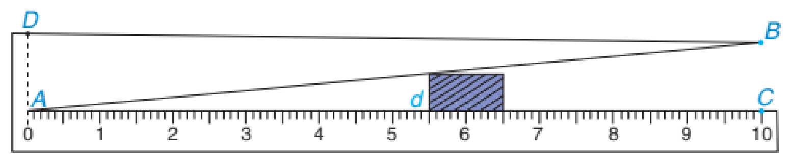

<!-- pdf:136 -->

# BÀI TẬP ÔN TẬP CUỐI NĂM

## ✏️ SỐ HỌC VÀ ĐẠI SỐ

1. Rút gọn các biểu thức sau:

a) $(2x + y)^2 + (5x - y)^2 + 2(2x + y)(5x - y)$;

b) $(2x - y^3)(2x + y^3) - (2x - y^2)(4x^2 + 2xy^2 + y^4)$.

2. Cho đa thức $P = x^2 - y^2 + 6x + 9$.

a) Phân tích đa thức $P$ thành nhân tử.

b) Sử dụng kết quả của câu a để tìm thương của phép chia đa thức $P$ cho $x + y + 3$.

3. Cho đa thức $f(x) = x^2 - 15x + 56$.

a) Phân tích đa thức $f(x)$ thành nhân tử.

b) Tìm $x$ sao cho $f(x) = 0$.

4. Cho phân thức $P = \dfrac{2x^3 + 6x^2}{2x^3 - 18x}$.

a) Viết điều kiện xác định và rút gọn phân thức $P$.

b) Có thể tính giá trị của $P$ tại $x = -3$ được không? Vì sao?

c) Tính giá trị của phân thức $P$ tại $x = 4$.

d) Với các giá trị nguyên nào của $x$ thì $P$ nhận giá trị nguyên?

5. Cho biểu thức $P = \left(\dfrac{x + y}{1 - xy} + \dfrac{x - y}{1 + xy}\right) : \left(1 + \dfrac{x^2 + y^2 + 2x^2y^2}{1 - x^2y^2}\right)$, trong đó $x$ và $y$ là hai biến thoả mãn điều kiện $x^2y^2 - 1 \ne 0$.
<!-- ocr-ok: đã đối chiếu ảnh trang PDF 136, biểu thức phân thức đại số viết bằng LaTeX -->

a) Tính mỗi tổng $A = \dfrac{x + y}{1 - xy} + \dfrac{x - y}{1 + xy}$ và $B = 1 + \dfrac{x^2 + y^2 + 2x^2y^2}{1 - x^2y^2}$.

b) Từ kết quả câu a, hãy thu gọn $P$ và giải thích tại sao giá trị của $P$ không phụ thuộc vào giá trị của biến $y$.

c) Chứng minh đẳng thức $P = 1 - \dfrac{(1 - x)^2}{1 + x^2}$.

d) Sử dụng câu c, hãy tìm các giá trị của $x$ và $y$ sao cho $P = 1$.

6. Bảng giá cước của một hãng taxi như sau:

| Giá mở cửa (từ $0$ đến $1\text{ km}$) | Giá cước các kilômét tiếp theo (từ trên $1\text{ km}$ đến $30\text{ km}$) | Giá cước từ kilômét thứ $31$ |
| :---: | :---: | :---: |
| $10\,000$ đồng | $13\,600$ đồng | $11\,000$ đồng |
<!-- ocr-ok: đã đối chiếu ảnh trang PDF 136, bảng giá cước taxi 3 cột -->

<!-- pdf:137 -->

a) Tính số tiền taxi phải trả khi di chuyển $35\text{ km}$.

b) Lập công thức tính số tiền taxi $y$ (đồng) phải trả khi di chuyển $x$ kilômét, với $1 < x \le 30$. Từ đó tính số tiền taxi phải trả khi di chuyển $30\text{ km}$.

c) Nếu một người phải trả số tiền taxi là $268\,400$ đồng, hãy tính quãng đường người đó đã di chuyển bằng taxi.

7. Với giá trị nào của $m$, đường thẳng $y = mx + 1$ ($m \ne 0$):

a) song song với đường thẳng $y = 3x$?

b) cắt trục hoành tại điểm có hoành độ bằng $-2$?

c) đồng quy với các đường thẳng $y = 5x - 2$ và $y = -x + 4$ (tức là ba đường thẳng này cắt nhau tại một điểm)? Với giá trị $m$ tìm được, hãy vẽ ba đường thẳng này trên cùng một hệ trục toạ độ để kiểm nghiệm lại kết quả.

## HÌNH HỌC VÀ ĐO LƯỜNG

8. Cho hình bình hành $ABCD$, $O$ là giao điểm của hai đường chéo $AC$ và $BD$. Gọi $H$ là trung điểm của $OB$, $K$ là trung điểm của $OD$.

a) Hỏi tứ giác $AHCK$ là hình gì?

b) Hình bình hành $ABCD$ phải thoả mãn điều kiện gì để tứ giác $AHCK$ là:

- một hình thoi?
- một hình chữ nhật?
- một hình vuông?

9. Cho tam giác $ABC$. Các đường trung tuyến $AF, BE$ và $CD$ cắt nhau tại $G$. Gọi $I, K$ theo thứ tự là trung điểm của $BG$ và $CG$.

a) Chứng minh rằng tứ giác $DEKI$ là hình bình hành.

b) Biết $AF = 6\text{ cm}$. Tính độ dài các đoạn thẳng $DI$ và $EK$.

10. Hình sau mô tả một dụng cụ đo bề dày (nhỏ hơn $1\text{ cm}$) của số sản phẩm. Dụng cụ này gồm một thước $AC = 10\text{ cm}$, có vạch chia đến $1\text{ mm}$, gắn với một bản kim loại có cạnh thẳng $AB$ sao cho khoảng cách $BC = 1\text{ cm}$.

Muốn đo bề dày của vật, ta kẹp vật vào giữa bản kim loại và thước (đáy của vật áp vào bề mặt của thước $AC$). Khi đó trên thước ta đọc được “bề dày” $d$ của vật (trên hình vẽ ta có $d = 5,5\text{ mm}$). Hãy giải thích tại sao với dụng cụ đó, ta có thể đo được bề dày $d$ của các vật (với $d < 10\text{ mm}$).

<!-- pdf:138 -->

11. Cho tam giác $ABC$ cân tại đỉnh $A$. Hai đường phân giác $BE$ và $CF$ của tam giác $ABC$ cắt nhau tại điểm $I$. Chứng minh rằng:

a) $\Delta BIC \backsim \Delta EIF$;

b) $FB^2 = FI \cdot FC$;

c) Cho biết $AB = 6\text{ cm}$, $BC = 3\text{ cm}$. Tính $EF$.

12. Cho tam giác $ABC$ không phải là tam giác vuông, có các đường cao $BE, CF$ cắt nhau tại điểm $H$.

a) Giả sử $ABC$ là tam giác nhọn. Chứng minh rằng $\Delta ABE \backsim \Delta ACF$; từ đó suy ra $\Delta AEF \backsim \Delta ABC$. Kết quả đó còn đúng không, nếu $ABC$ là tam giác tù (chỉ cần xét $2$ trường hợp: góc $A$ tù và góc $B$ tù)?

b) Cho biết $AB = 10\text{ cm}$, $BC = 15\text{ cm}$ và $BE = 8\text{ cm}$. Tính $EF$.
<!-- ocr-ok: đã đối chiếu ảnh trang PDF 138, các kí hiệu độ dài đoạn thẳng viết bằng LaTeX -->

## ✏️ THỐNG KÊ VÀ XÁC SUẤT

13. Cho bảng thống kê sau:

| Xếp loại | Tốt | Khá | Đạt | Không đạt |
| --- | :---: | :---: | :---: | :---: |
| Lớp Vuông | $7$ | $10$ | $15$ | $10$ |
| Lớp Tròn | $10$ | $15$ | $8$ | $9$ |
<!-- ocr-ok: đã đối chiếu ảnh trang PDF 138, bảng thống kê xếp loại học sinh -->

Để so sánh số lượng học sinh ở mỗi mức xếp loại của hai lớp ta nên dùng biểu đồ nào? Hãy vẽ biểu đồ đó.

14. Một túi đựng $24$ viên bi giống hệt nhau chỉ khác màu, trong đó có $9$ viên bi màu đỏ, $6$ viên bi màu xanh, $4$ viên bi màu vàng và $5$ viên bi màu đen. Bạn An lấy ngẫu nhiên một viên bi từ trong túi.

a) Có bao nhiêu kết quả có thể? Các kết quả có thể này có đồng khả năng không? Tại sao?

b) Tính khả năng để xảy ra mỗi kết quả có thể đó.

c) Tính xác suất để An lấy được:

- Viên bi màu đỏ hoặc màu vàng.
- Viên bi màu đen hoặc màu xanh.
- Viên bi không có màu đen.

## 📷 Danh sách hình trong bài

| Mã hình | Trang PDF | Vị trí trong bài | Chú thích gốc |
| --- | :---: | --- | --- |
| H8-toan-on-tap-cuoi-nam-01 | 137 | Hình học và Đo lường, Bài 10 | (sách không đánh số, dụng cụ đo bề dày sản phẩm gồm thước $AC = 10\text{ cm}$ và bản kim loại $AB$) |
